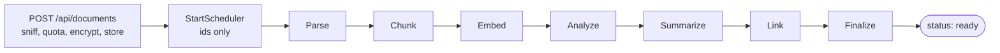
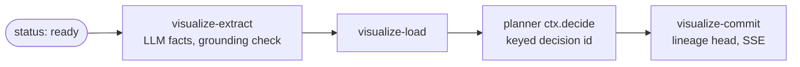
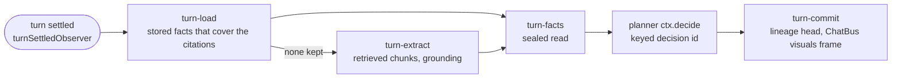
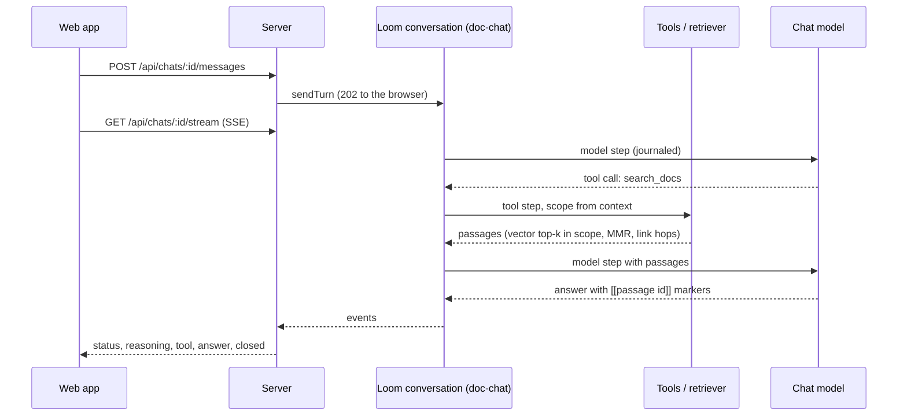
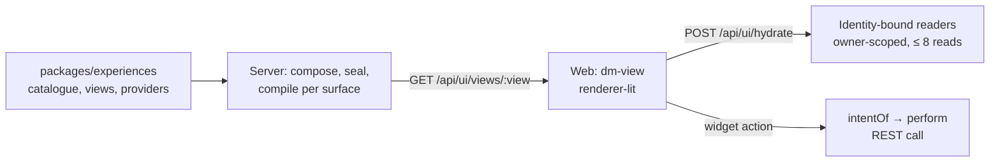

# DocMind architecture

Last updated 2026-10-23. This document describes how DocMind is built and why. For where to start reading the code, see [codebase-guide.md](codebase-guide.md). The binding design is the spec, [docs/specs/2026-10-18-docmind-design.md](specs/2026-10-18-docmind-design.md); where this summary and the spec disagree, the spec wins.

## 1. What DocMind is

DocMind is a multi-user, local-first document assistant built on the Loom framework:

- A user uploads documents. DocMind parses, chunks, embeds, analyzes, summarizes and links them.
- The user then asks questions in a chat. An agent answers only from the user's own documents, cites the passages it used, and streams the answer.

Four constraints shape every part of the design:

| Constraint | Consequence |
| --- | --- |
| Many users share one deployment | Every row is tenant-scoped and enforced by Postgres row-level security, not by application checks alone |
| Erasure must be final | Each user's data is encrypted under that user's own key; erasing an account destroys the key |
| Long, failure-prone work (parsing, model calls) | All of it runs as durable Loom flows that survive a crash and resume from their log |
| One UI definition for several surfaces | Screens are loom-ui experiences, compiled per surface (web today, terminal tested) |

## 2. System context

- The browser talks only to the server, on one origin. In development Vite proxies `/api`. In production the server also serves the built web app (`DOCMIND_WEB_DIR`) under a strict CSP.
- Postgres holds everything durable except the original files: Loom's event log, the relational tables, the vectors, the keys (wrapped) and the folded read models.
- Model calls go to Ollama by default. Gemini and Claude can be configured per role (chat, title, summary, vision, scanned PDF); see `docs/operations/llm-providers.md`.

## 3. Runtime and process model

DocMind runs as **one server process per database**. Three things live only in that process:
- the flow engine's in-memory state
- the live chat hub and stream partials
- the per-process view keys

Running two servers against one database is not supported.

Boot order (`apps/server/app/main.ts` → `setup.ts` → `bootIngest.ts`):

1. **Validate configuration.** Every environment variable is read and checked before any connection opens. A bad value fails with a `StartupConfigError` that names the variable, never its value.
2. **Open pools and verify the schema.** Applied migration checksums must match the files, and the vector column must fit the configured embedder.
3. **Compose.** `compose.ts` `buildServer()` wires every seam: auth, storage, flows, chat, UI routes.
4. **Boot the read models.** These are the `ingest-status` and `chat-activity` folded models. Loom's subject index is rebuilt from the execution ids.
5. **Bind the port.** A failed bind stops here, before any recovery work is spent.
6. **Start background work.**
    - Recovery: resume flow executions the last process left running.
    - Erasure: resume pending erasures.
    - Sweeps: the hourly session sweep, and the upload sweeper that restarts stuck ingestion and cleans orphaned status rows.

Shutdown drains the HTTP server, stops background work and aborts in-flight model calls, so their steps are left un-completed for the next recovery. A forced exit fires after a deadline.

## 4. Components

### 4.1 Server modules (`apps/server/app`)

| Module | Responsibility |
| --- | --- |
| `server.ts`, `http/` | Raw Node HTTP server; connection and body limits; 60 s request timer (streams exempt); origin guard; `requireAuth`; multipart parsing; static files with CSP |
| `auth/` | Sign-up, login, logout, sessions (HTTP-only cookie, only a hash stored), login throttling |
| `documents/` | Document API, content sniffing, quotas, starting ingestion, progress SSE, sweeps |
| `flows/ingest-document/` | The ingestion flow and its seven steps |
| `flows/visualize-document/` | Extracts facts from a ready document, plans visuals from them and commits the plan to the visuals lineage |
| `flows/chat-title/` | Names a chat from its first question |
| `chats/` | Chat sessions, the `doc-chat` conversation and agent, five tools, linked retrieval, citations, SSE stream, reasoning |
| `ui/` | Compiled experiences (`GET /api/ui/views/:view`) and their data (`POST /api/ui/hydrate`) |
| `erasure/` | `DELETE /api/me` and the background `Eraser` |
| `keys/`, `crypto/`, `sensitive.ts` | Master keys and rotation, field crypto, the registry of sensitive event paths |
| `llm/` | One provider per model role |
| `db/` | Migrations runner, `withTenant` |

### 4.2 Packages and the seams they own

Packages never import from apps. Each seam has one shared conformance suite that every implementation must pass. Only the composition root chooses the implementation.

| Seam | Package | v1 implementation |
| --- | --- | --- |
| `Authenticator` | `packages/auth` | Email and password (argon2id), session cookie |
| `DocumentParser` | `packages/parsers` | One parser per format, run in a resource-limited child process |
| `EmbeddingProvider` (Loom) | `packages/embeddings` | Ollama, `nomic-embed-text` by default |
| `ChunkVectorStore` | `packages/vector-pg` | pgvector columns on `chunks`, HNSW cosine index; an in-memory twin for tests |
| `ContentStore` (Loom) | `packages/blob-store` | Encrypted filesystem, per-user envelopes |
| `KeyStore` (Loom) | `packages/keystore-pg` | Per-user data keys in Postgres, wrapped by a master key |
| `LlmProvider` (Loom) | `packages/llm-anthropic`, Loom's providers | Ollama (OpenAI-compatible), Gemini, Claude |
| API shapes and intents | `packages/contracts` | zod schemas shared by server and web; `intentOf` |
| Screens | `packages/experiences` | Six loom-ui experiences, catalogue, providers, reshapers |

### 4.3 What comes from Loom and loom-ui

From Loom DocMind takes:
- durable flows and steps (`@loom/core`)
- the agent loop and conversations (`@loom/agent`, `@loom/conversation`)
- LLM effects and the untrusted-input guard (`@loom/llm`)
- grounding and citation checks (`@loom/knowledge`)
- the Postgres event store (`@loom/plugin-postgres`)
- encrypting stores and `shredSubject` (`@loom/plugin-crypto`)
- the content seam (`@loom/plugin-content`)
- SSE framing (`@loom/plugin-conversation-sse`)

From loom-ui it takes:
- the experience model, compiler and hydration
- the Lit renderer for the web
- the terminal renderer, used in tests

Both are sibling repositories linked with `link:`. CI checks them out at the pinned `LOOM_REF` and `LOOM_UI_REF`.

## 5. Data architecture

### 5.1 Where data lives

| Data | Store | Protection |
| --- | --- | --- |
| Original files | Blob directory, `<tenant>/<user>/<content address>` | Envelope-encrypted per user |
| Chat messages, flow history, ingest progress | Loom event log in Postgres | Sealed per user (`EncryptingEventStore`); sensitive paths registered in `sensitive.ts` |
| Documents, chunks, entities, links, chats, turn items, reasoning texts | Postgres tables | RLS by tenant; content columns (`*_enc`) sealed with the user's key |
| Embeddings | `chunks.embedding` (pgvector) | Plaintext: pgvector compares raw vectors |
| Link graph and entity keys | `chunk_links`, `chunk_entities`, `entities.name_key` | Plaintext metadata (existence, weight, HMAC); entity names sealed |
| Document status, chat activity | Loom folded read models | Scoped per user |
| Data keys | `data_keys` | Wrapped by the master key (`DOCMIND_KEK`) |

Tables, by migration: `tenants`, `users`, `auth_sessions`, `auth_throttle`, `data_keys`, `documents`, `parsed_documents`, `chunks`, `entities`, `chunk_entities`, `chunk_links`, `chat_sessions`, `chat_turn_items`, `chat_reasoning_texts`, `erasure_requests`. The SQL is in `infra/migrations` (0001–0025).

Document status is not a column. It is the `ingest-status` model's fold of the flow's events: `uploaded`, `parsing`, `embedding`, `ready` or `failed`.

### 5.2 Database roles

| Role | Used by | Rights |
| --- | --- | --- |
| Owner (`DOCMIND_MIGRATE_URL`) | Migrations, key rotation | Owns the schema |
| `docmind_app` (`DATABASE_URL`) | The server's requests | Owns nothing, no `BYPASSRLS`; RLS always applies |
| `docmind_loom` (`LOOM_DATABASE_URL`) | Loom's event store and read-model writer | Event log; folds rows of every tenant |

Lookups before a tenant is known (login by email, session by token hash, the sweeps, erasure bookkeeping) go through narrow `SECURITY DEFINER` functions owned by the migration role. Spec §4.3 lists them by name.

## 6. Security architecture

- **Identity.** The `Authenticator` yields `{tenantId, userId}` from the session cookie on every request. No route accepts a tenant or user id from the client.
- **Tenancy.** `withTenant(pool, tenantId, fn)` opens a transaction and sets `app.tenant_id`. RLS policies compare every row against it. The cross-tenant paths are few and named: recovery, the read-model writer, the sweeps and erasure.
- **Crypto-shredding.** Each user has a data key wrapped by the master key. The event log, snapshots, Loom's archive of trimmed chat inbox messages, sealed columns and blobs are encrypted under it. Loom also seals each inbox message's sender under a separate per-sender key, which erasure destroys too. Destroying the key (with a tombstone, so it can never be re-created) makes all of it unreadable.
- **Snapshot pruning.** A chat parks after every turn and Loom snapshots its whole state each time; a sweep, hourly by default (`DOCMIND_SNAPSHOT_PRUNE_INTERVAL_MS`; one replica at a time) keeps each conversation's latest snapshot and deletes the rest. It runs on the raw stores, so it never needs a user's key. Compaction stays off for chats and ingest (`compactionExempt`).
- **Untrusted files.** Types are decided by magic bytes. Parsers run in a child process with CPU, memory, size and decompression limits. Quotas apply per file and per tenant.
- **Untrusted model input.** Document text is tagged as untrusted, and the chat tools are read-only. Their scope comes from the execution context, never from the model's arguments. Loom's capability ring grants the agent only those tools. Citations are validated against the passages actually retrieved. A prompt injection can skew an answer but cannot read another user's data or act.
- **Untrusted UI actions.** Browser actions become typed intents only by looking ids up in what the page itself published (`intentOf`). The REST routes re-check ownership anyway.
- **HTTP.** An origin guard sits on state-changing routes. Production uses a strict CSP: no inline script or style, no remote assets. Limits cover connections, body sizes, concurrent uploads, open streams and slow readers.
- **Logs.** Errors and logs carry class names, routes and variable names, never ids, emails, values or content. Loom's warnings are redacted before logging.

## 7. Ingestion

- **The flow.** `ingest-document`, version 3.0.0. Each step is a Loom `step$` with its own retry policy and time bound, and every step is bound to the document's `ingest_generation`.
- **Restartable steps.** Embed works from "which chunks lack a vector", in batches of 64. Link replaces its link set as a whole. A re-run therefore finishes the work rather than duplicating it.
- **Optional models.** Summarize and vision are skipped when their model role is off. A document with no text is still `ready`, with zero chunks.
- **Recovery.** `recovery.ts` re-drives executions whose process died, and Loom replays completed steps from the log. An execution that makes no progress across repeated re-drives is given up. The upload sweeper restarts uploads whose flow never started.
- **Retry and delete.** A retry increments the generation and starts a new execution. A delete cancels every generation first, then removes the row (chunks cascade) and the blob.

### 7.1 Visuals

- **The trigger.** `IngestStatus.onReady` starts the `visualize-document` flow once per ingest generation, and a boot sweep starts it for ready documents that have none. Both need the `visuals` role on and `DOCMIND_PLANNER_DECISION_KEY` set; with the role off no execution is recorded.
- **Extract.** The `visuals` model reads the chunks in windows as fenced, untrusted data. A fact survives only if every number it states appears in the chunks it cites. Survivors are sealed per user in `visual_facts` (RLS, cascade with the document).
- **Plan.** A loom-ui planner decides the nodes through `ctx.decide`, so a resumed execution replays the recorded plan. The decision id is keyed by the deployment secret, because it is logged in plaintext.
- **Commit.** The plan becomes the head of the document's lineage line, which replaces the previous head and is idempotent. Its events go through the sealing event store and its artifacts through a per-user sealed Postgres content store (`lineage_content`). The step then publishes `{status: ready, step: finalize, visuals: ready}` so an open detail page reloads.
- **Outcomes.** `done`, `empty` (no facts or an empty plan), `skipped`, `failed`. A failure never changes the document's ingest status.
- **Serving.** `GET /api/ui/documents/:id/detail` is owner-checked (404 otherwise) and adds the Visuals panel. Its `fact-<n>` handles are classified and hydrate only under the owner's clearance, through the `visual.facts` read.
- **Delete and erasure.** Deleting a document cancels its visualize executions with its ingest ones, and the facts cascade. Erasing a user destroys the key that seals their lineage, so the line reads `line-erased` and nothing in the log or `lineage_content` is readable.

### 7.2 Chat visuals

- **The trigger.** Loom's `turnSettledObserver` (one per chat flow, composed into the runtime's single `onDurableEvent`) calls a listener that only enqueues. The queued check starts `visualize-turn-<chatId>-<ord>` for a `complete` answer of a live chat that cites a document the user still owns, while the `visuals` role is on and fewer than 20 visuals executions wait on the shared gate. `ExecutionAlreadyExistsError` is swallowed. No backfill: a turn whose hook call was missed is recovered by the on-demand action.
- **Facts are layered.** Stored `visual_facts` of the cited documents are kept when they cite a chunk the answer cited (at most 12, in citation order). Only when none survive does the turn extract from its own retrieved chunks (at most 16, same prompt and grounding), sealed in `turn_visual_facts` (RLS, cascade with the chat).
- **Plan and commit.** Capabilities are `docmind:visual.facts@1#<documentId>/fact-<n>` for a stored fact and `docmind:turn.facts@1#fact-<n>` for an extracted one. The plan replaces the head of `turnvisuals-<userId>-<chatId>-<ord>` (sealed, idempotent) and the step publishes `{kind: "visuals", ord, outcome}` on the `ChatBus`. A run that ends `nothing` (an invalid or empty plan, no grounded fact, a turn that stopped being cited) writes no head but publishes the same frame with `outcome: "nothing"`, so an on-demand click resolves.
- **On demand.** `POST /api/chats/:id/turns/:ord/visualize` answers 202, 409 `not_visualizable`, 409 `visualize_running` or 429 (10 per user per minute); re-runs are `-r<n>`.
- **Serving.** `GET /api/ui/chats/:id/turns/:ord/visuals` and `POST /api/ui/hydrate {turn}` are owner-checked under the owner's `sensitive` clearance; a deleted cited document's widgets drop out. `ChatMessageDto.hasVisuals` comes from one batched head lookup per history page.
- **Privacy.** Step outputs carry references only; facts, ops and the summary are sealed; ids are plaintext like every execution id. Erasure destroys the key that seals the turn lines.
- **Re-runs.** A re-run that ends `nothing` keeps the earlier head (ruling C1): earlier visuals stay. The frame's `outcome` (`visualized` or `nothing`) tells the web which happened. No new settings: it uses `DOCMIND_VISUALS_PROVIDER` and `DOCMIND_PLANNER_DECISION_KEY` of 7.1.

## 8. Chat and retrieval

- **A chat.** A chat is a Loom conversation with the id `u_<user>.c-<chat>`. Its `chat_sessions` row holds the sealed title and the `scope`: `"all"` or a list of document ids. Reopening a chat continues the same conversation, and long chats rotate their token window.
- **Rolling summary.** A chat's prompt holds the newest turns that fit `DOCMIND_CHAT_CONTEXT_TOKENS`; turns that no longer fit are folded into a rolling summary (Loom's conversation budget, at most 1,024 tokens, written by the chat model through the `chat-summarize` effect, which is never streamed to the live view) that the prompt keeps. The summary is sealed under the owner's key wherever it lands; its `summary-fit` decision goes through `SummaryChoiceEventStore` (`chats/summaryChoice.ts`), which stores the bare string Loom records as `choice.text` in a sealed form. A summarizer error yields no summary rather than ending the conversation (`tolerantSummarizer`, `chats/summarizer.ts`): after two in-memory retries of a retryable error, the turn completes with the turns evicted, as before (that span is then missing from the summary for good). The summarizer uses its own thinking-free provider (`createChatLlm().summaryProvider`). New chats start on flow 1.1.0; chats started before the summary existed run on 1.0.0 until their next rotation (every 50 turns), whose successor starts on 1.1.0. 1.0.0 can be removed once no 1.0.0 execution is live (census query in the spec); do not roll back past this release, and expect a one-time read-model rebuild at its first boot.
- **Tools.**
    - `search_docs` embeds the query, takes the pgvector top-k within the scope and re-ranks with MMR. It then follows links (`DOCMIND_RETRIEVAL_HOPS`, default 1; see `docs/design/linked-retrieval.md`).
    - `related`, `read_section`, `get_summary` and `list_documents` give deliberate hops and context.
    - Tools time out after 30 s.
- **Grounding.** The system prompt requires `[[passage id]]` citations and "not found in your documents" when retrieval is weak. Labelled general knowledge is an opt-in flow, `doc-chat-gk`. The stored reply is the raw text. On read, `citeReply` keeps only markers that point at passages the turn retrieved, and they become numbered source cards.
- **Streaming.** DocMind serves its own SSE (`chats/stream.ts`) with backpressure limits; a slow client reconnects with `Last-Event-ID`. A message sent mid-turn interrupts the turn (barge-in). `POST /stop` stops it.
- **Reasoning.** When the model exposes reasoning, Loom captures it (ADR 0133). It streams live, and its durable form is sealed per user.
- **Titles.** The `chat-title` flow names a chat once, from its first question. A user rename always wins.

## 9. UI architecture

- **The experiences.** There are six: library, empty library, document detail, sessions, chat and sources. They are defined once and know no surface.
- **Serving them.** The server compiles each experience per surface and serves it without user data. Data arrives through hydrate requests that the server binds to the caller's identity. A request may start at most 8 distinct reads, 4 at a time.
- **The web app.** It is a thin host: the shell, auth forms, dialogs, the upload zone, and the pages that host a view (`dm-*` elements). Chat state is a loom-ui `ChatFeed` folded from the SSE stream, with DocMind's tool steps and citations laid on top.
- **Other surfaces.** The same experiences render with the terminal renderer in tests. A terminal surface is planned as a second thin host over the same package and routes.

## 10. Account erasure

`DELETE /api/me` (password required) runs in two parts.

In one transaction it:
- records a durable request
- logs the user out everywhere
- frees the email

It then answers 202 with a receipt.

The background `Eraser` then runs these steps in order:

1. **`stop`.** Stop the user's flows, chats and streams.
2. **`shred`.** Loom appends tombstones and destroys the key. From here on, everything sealed is unreadable.
3. **`readModels`.** Tombstone the user's rows in the read models.
4. **`rows`.** Delete the user row; the foreign keys cascade.
5. **`blobs`.** Delete the user's blob directory.
6. **`key`.** Destroy the key again and check that it's gone.
7. **`done`.**

The user's visuals lineage needs no step of its own: it is sealed under the same key, so the `shred` step makes it unreadable, and the user's visualize executions are stopped in `stop`.

Each step is idempotent and recorded, and SQL enforces the order. A crash resumes at the first unrecorded step, and pending erasures resume at boot. An advisory lock keeps one runner per user across processes. `GET /api/erasure/:receipt` reports `pending` or `done`.

## 11. Configuration and deployment

Configuration is environment variables only, loaded from `.env` at the repo root by the root scripts. They fall into six groups:

| Group | Variables (examples) |
| --- | --- |
| Server | `HOST`, `PORT`, `DOCMIND_WEB_DIR`, `DOCMIND_PUBLIC_ORIGIN`, `DOCMIND_TRUST_PROXY`, `DOCMIND_TRUST_PROXY_HOPS`, `DOCMIND_COOKIE_SECURE`, `DOCMIND_DEPLOYMENT`, `DOCMIND_KEEP_ALIVE_TIMEOUT_MS`, `DOCMIND_HEADERS_TIMEOUT_MS`, `DOCMIND_SHUTDOWN_DEADLINE_MS` |
| Database | `DATABASE_URL`, `LOOM_DATABASE_URL`, `DOCMIND_MIGRATE_URL`, `DOCMIND_APP_DB_PASSWORD`, `DOCMIND_LOOM_DB_PASSWORD`, `DOCMIND_APP_POOL_MAX`, `DOCMIND_LOOM_POOL_MAX` |
| Keys | `DOCMIND_KEK`, `DOCMIND_KEK_ID`, `DOCMIND_CHAT_ENVELOPE_KEY` |
| Storage and limits | `DOCMIND_BLOB_DIR`, `DOCMIND_MAX_UPLOAD_BYTES`, `DOCMIND_TENANT_MAX_BYTES`, `DOCMIND_TENANT_MAX_DOCUMENTS`, `DOCMIND_MAX_CONCURRENT_UPLOADS` |
| Models | `DOCMIND_OLLAMA_URL`, `DOCMIND_EMBED_MODEL`, `DOCMIND_EMBED_DIMENSIONS`, `DOCMIND_LLM_PROVIDER` and per-role `DOCMIND_*_PROVIDER` / `_MODEL`, `GEMINI_API_KEY`, `ANTHROPIC_API_KEY` |
| Tests | `DOCMIND_TEST_PG_URL` |

Details of the newer server variables:
- **`DOCMIND_DEPLOYMENT`** is `development` (the default) or `production`. Production refuses to boot unless `DOCMIND_CHAT_ENVELOPE_KEY` is set, `DOCMIND_PUBLIC_ORIGIN` is set and is an `https://` origin, and `DOCMIND_COOKIE_SECURE=true`. It also logs a warning when `DOCMIND_TRUST_PROXY` is not `true`, because behind a load balancer every client then shares one login and sign-up throttle key. Development keeps its per-process envelope key, with a warning.
- **`_FILE` secrets.** `DATABASE_URL`, `LOOM_DATABASE_URL`, `DOCMIND_CHAT_ENVELOPE_KEY` (and `_PREVIOUS`), `ANTHROPIC_API_KEY` and `GEMINI_API_KEY` each accept `<NAME>_FILE`, the path of a file holding the value (a mounted secret). The rules are those of `DOCMIND_KEK_FILE`: the file wins if both are set, its content is trimmed, and an empty, unreadable, non-regular (a FIFO, a device) or oversize (over 64 KiB) file fails the boot, naming the variable and never the path. The migration job (`db/migrate.ts`) and the KEK rotation script resolve `DOCMIND_MIGRATE_URL`, `DOCMIND_APP_DB_PASSWORD` and `DOCMIND_LOOM_DB_PASSWORD` the same way.
- **`DOCMIND_TRUST_PROXY_HOPS`** (default 1, at most 32) is the number of your proxies between the client and the server. The client address is the `X-Forwarded-For` entry that many places from the right. A shorter header falls back to the socket address. Setting it without `DOCMIND_TRUST_PROXY=true` fails the boot. **The origin must accept traffic only from the outermost trusted proxy** (a security group or network policy): a request that reaches the server directly can send its own `X-Forwarded-For` and so choose its own throttle key.
- **`DOCMIND_KEEP_ALIVE_TIMEOUT_MS`** (default 5000) and **`DOCMIND_HEADERS_TIMEOUT_MS`** (default 20000). Behind a load balancer, set keep-alive above its idle timeout (65000 for an ALB). The headers timeout must be greater than it, or the boot fails.
- **`DOCMIND_SHUTDOWN_DEADLINE_MS`** (default 70000) is the forced-exit deadline after SIGTERM; match it to the platform's termination grace. The close steps need up to 62 s in the worst case, plus a 5 s forced-exit margin, so a value below 67000 logs a boot warning.
- **`DOCMIND_SHUTDOWN_DELAY_MS`** (default 0) is how long the server keeps serving normally after SIGTERM, with `/readyz` answering 503, before it closes the listener and drains. Set it to at least the balancer's probe interval times its failure threshold, so the balancer stops routing before connections are refused. It counts inside the deadline and must be less than the deadline minus 62000, or the boot fails; with the default deadline, 7999 is the most. A SIGTERM during startup exits at once (nothing durable has started); during the last boot steps it is honoured as soon as the server is up.
- **`DOCMIND_APP_POOL_MAX`** and **`DOCMIND_LOOM_POOL_MAX`** (default 10 each, at most 200) size the two Postgres pools.
- **Probes.** `GET` and `HEAD /healthz` are liveness (static). `GET` and `HEAD /readyz` are readiness: 200 only while a `SELECT 1` succeeds and shutdown has not begun, else 503 with `{"status":"unavailable","reason":"db_unavailable"|"shutting_down"}`. The ping uses a connection of its own, so a saturated request pool cannot fail readiness. `/readyz` flips at the start of shutdown and, with `DOCMIND_SHUTDOWN_DELAY_MS`, stays reachable for the delay before the drain. Use a failure threshold of 3 or more.

Local development:
- **Postgres.** Either `docker compose up -d`, or a local cluster driven by `pnpm db:start` (`infra/local-db.sh`, data in `~/.docmind/pgdata`, port 55432). Keep the cluster out of `/tmp`.
- **Run.** `pnpm serve` starts the database, builds, migrates and starts the server.
- **Web.** `pnpm --filter @docmind/web dev` runs Vite with hot reload on port 5173.

Production:
- Run `pnpm build`, run migrations as the owner role, then start one server process with `DOCMIND_WEB_DIR=apps/web/dist`.
- Behind a reverse proxy, forward `Host` unchanged.
- For a container on a cloud platform (image, migration job, environment, blob volume, platform notes) follow [operations/cloud-deploy.md](operations/cloud-deploy.md).
- Keep database backups for at most 30 days (see below).

## 12. Key decisions and trade-offs

| Decision | Why | Cost accepted |
| --- | --- | --- |
| Loom-native modular monolith | Durability and replay where failures are most common; one deployable | Splitting later means using the existing seams (for example a separate ingestion worker) |
| Postgres for everything | One store to back up, secure with RLS and query transactionally | Vector search scale bounded by pgvector |
| Encrypt content under per-user keys | Erasure is final by destroying one key | No full-text index (chunk text is sealed), so search is vector-only; dedup only within a user |
| Plaintext embeddings and link metadata | pgvector and link walks need raw values | Embeddings survive in backups until they expire, hence bounded backup retention |
| Flow inputs carry ids only | No content in the event log outside sealed paths | Steps re-read from tables |
| Experiences instead of hand-built views | One UI definition across surfaces; server-side data scoping | The web app follows loom-ui's widget set; gaps are fixed upstream in loom-ui |
| One process per database | The flow engine, live chat state and view keys are in memory | No horizontal scaling of the server today |

## 13. Known limits

These are from the spec's open risks (§10):
- A crash in the middle of a chat turn re-runs the turn, and the stream sends `reset`.
- Sign-up has no email verification, so it reveals whether an address has an account.
- Copies held by an external LLM provider are outside DocMind's control.
- A lost `DOCMIND_CHAT_ENVELOPE_KEY` makes queued messages unreadable.
- GitHub Actions currently can't run on the repository: account billing blocks it.

## 14. References

- Spec: `docs/specs/2026-10-18-docmind-design.md` (sections 4 data, 5 ingestion, 6 chat, 7 web UI, 8 testing)
- Design notes: `docs/design/linked-retrieval.md`, `docs/design/m6-loom-ui-native.md`, `docs/design/cloud-scaling.md` (cloud deployment, scaling, load-test baseline)
- Feature specs: `docs/specs/2026-10-22-multi-document-chat-scope-design.md`
- Runbooks: `docs/operations/llm-providers.md`, `rotate-kek.md`, `backfill.md`, `cloud-deploy.md` (container image and cloud deployment)
- Reading order: [codebase-guide.md](codebase-guide.md)
