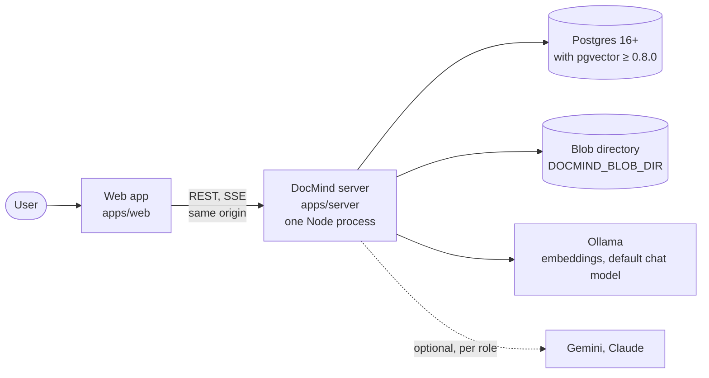
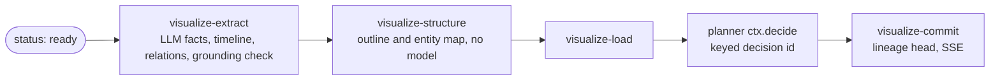
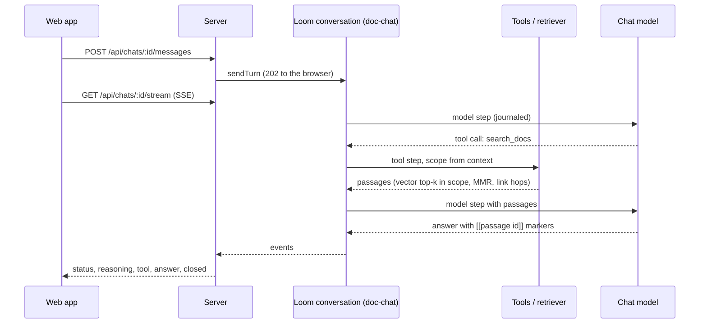
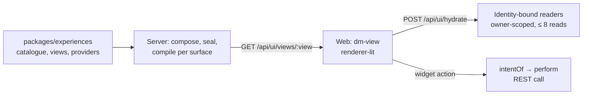

# DocMind architecture

Last updated 2026-11-10. This document describes how DocMind is built and why. For where to start reading the code, see [codebase-guide.md](codebase-guide.md). The binding design is the spec, [docs/specs/2026-10-18-docmind-design.md](specs/2026-10-18-docmind-design.md); where this summary and the spec disagree, the spec wins.

## 1. What DocMind is

DocMind is a multi-user, local-first document assistant built on the Loom framework:

- A user uploads documents. DocMind parses, chunks, embeds, analyzes, summarizes and links them.
- The user then asks questions in a chat. An agent answers only from the user's own documents, cites the passages it used, and streams the answer.

Four constraints shape every part of the design:

| Constraint | Consequence |
| --- | --- |
| Many users share one deployment | Every row is tenant-scoped and enforced by Postgres row-level security, not by application checks alone |
| Erasure must be final | Each user's data is encrypted under that user's own key; erasing an account destroys the key |
| Long, failure-prone work (parsing, model calls) | All of it runs as durable Loom flows that survive a crash and resume from their log |
| One UI definition for several surfaces | Screens are loom-ui experiences, compiled per surface (web today, terminal tested) |

## 2. System context

- The browser talks only to the server, on one origin. In development Vite proxies `/api`. In production the server also serves the built web app (`DOCMIND_WEB_DIR`) under a strict CSP.
- Postgres holds everything durable except the original files: Loom's event log, the relational tables, the vectors, the keys (wrapped) and the folded read models.
- Model calls go to Ollama by default. Gemini and Claude can be configured per role (chat, title, summary, vision, scanned PDF); see `docs/operations/llm-providers.md`.

## 3. Runtime and process model

DocMind runs as **one server process per database**. Three things live only in that process:
- the flow engine's in-memory state
- the live chat hub and stream partials
- the per-process view keys

Running two servers against one database is not supported.

Boot order (`apps/server/app/main.ts` → `setup.ts` → `bootIngest.ts`):

1. **Validate configuration.** Every environment variable is read and checked before any connection opens. A bad value fails with a `StartupConfigError` that names the variable, never its value.
2. **Open pools and verify the schema.** Applied migration checksums must match the files, and the vector column must fit the configured embedder.
3. **Compose.** `compose.ts` `buildServer()` wires every seam: auth, storage, flows, chat, UI routes.
4. **Warm the id keys, boot the read models.** The per-user id key cache is warmed first (every user with an `id_handle`, before anything reads an id). Then the `ingest-status` folded model catches up, the stored execution ids are repaired (10.1), and the `chat-activity` model boots. Loom's subject index is rebuilt from the execution ids of both formats (`u_` and `h_`), which need no key.
5. **Bind the port.** A failed bind stops here, before any recovery work is spent.
6. **Start background work.**
    - Recovery: resume flow executions the last process left running.
    - Erasure: resume pending erasures.
    - Sweeps: the hourly session sweep, and the upload sweeper that restarts stuck ingestion and cleans orphaned status rows.

Shutdown drains the HTTP server, stops background work and aborts in-flight model calls, so their steps are left un-completed for the next recovery. A forced exit fires after a deadline.

## 4. Components

### 4.1 Server modules (`apps/server/app`)

| Module | Responsibility |
| --- | --- |
| `server.ts`, `http/` | Raw Node HTTP server; connection and body limits; 60 s request timer (streams exempt); origin guard; `requireAuth`; multipart parsing; static files with CSP |
| `auth/` | Sign-up, login, logout, sessions (HTTP-only cookie, only a hash stored), login throttling |
| `documents/` | Document API, content sniffing, quotas, starting ingestion, progress SSE, sweeps |
| `flows/ingest-document/` | The ingestion flow and its seven steps |
| `flows/visualize-document/` | Extracts facts from a ready document, plans visuals from them and commits the plan to the visuals lineage |
| `flows/chat-title/` | Names a chat from its first question |
| `flows/suggest-tags/` | Suggests tags for one document from its stored summary, on demand (one step, one model call) |
| `tags/` | The tag service (sealed names, keyed lookup hash, links, suggestions), the tag and suggestion routes, the suggestion normaliser |
| `chats/` | Chat sessions, the `doc-chat` conversation and agent, five tools, linked retrieval, citations, SSE stream, reasoning |
| `ui/` | Compiled experiences (`GET /api/ui/views/:view`) and their data (`POST /api/ui/hydrate`) |
| `erasure/` | `DELETE /api/me` and the background `Eraser` |
| `keys/`, `crypto/`, `sensitive.ts` | Master keys and rotation, field crypto, the registry of sensitive event paths |
| `llm/` | One provider per model role |
| `db/` | Migrations runner, `withTenant` |

### 4.2 Packages and the seams they own

Packages never import from apps. Each seam has one shared conformance suite that every implementation must pass. Only the composition root chooses the implementation.

| Seam | Package | v1 implementation |
| --- | --- | --- |
| `Authenticator` | `packages/auth` | Email and password (argon2id), session cookie |
| `DocumentParser` | `packages/parsers` | One parser per format, run in a resource-limited child process |
| `EmbeddingProvider` (Loom) | `packages/embeddings` | Ollama, `nomic-embed-text` by default |
| `ChunkVectorStore` | `packages/vector-pg` | pgvector columns on `chunks`, HNSW cosine index; an in-memory twin for tests |
| `ContentStore` (Loom) | `packages/blob-store` | Encrypted filesystem, per-user envelopes |
| `KeyStore` (Loom) | `packages/keystore-pg` | Per-user data keys in Postgres, wrapped by a master key |
| `LlmProvider` (Loom) | `packages/llm-anthropic`, Loom's providers | Ollama (OpenAI-compatible), Gemini, Claude |
| API shapes and intents | `packages/contracts` | zod schemas shared by server and web; `intentOf` |
| Screens | `packages/experiences` | Six loom-ui experiences, catalogue, providers, reshapers |

### 4.3 What comes from Loom and loom-ui

From Loom DocMind takes:
- durable flows and steps (`@loom/core`)
- the agent loop and conversations (`@loom/agent`, `@loom/conversation`)
- LLM effects and the untrusted-input guard (`@loom/llm`)
- grounding and citation checks (`@loom/knowledge`)
- the Postgres event store (`@loom/plugin-postgres`)
- encrypting stores and `shredSubject` (`@loom/plugin-crypto`)
- the content seam (`@loom/plugin-content`)
- SSE framing (`@loom/plugin-conversation-sse`)

From loom-ui it takes:
- the experience model, compiler and hydration
- the Lit renderer for the web
- the terminal renderer, used in tests

Both are sibling repositories linked with `link:`. CI checks them out at the pinned `LOOM_REF` and `LOOM_UI_REF`.

## 5. Data architecture

### 5.1 Where data lives

| Data | Store | Protection |
| --- | --- | --- |
| Original files | Blob directory, `<tenant>/<user>/<content address>` | Envelope-encrypted per user |
| Chat messages, flow history, ingest progress | Loom event log in Postgres | Sealed per user (`EncryptingEventStore`); sensitive paths registered in `sensitive.ts` |
| Documents, chunks, entities, links, chats, turn items, reasoning texts | Postgres tables | RLS by tenant; content columns (`*_enc`) sealed with the user's key |
| Embeddings | `chunks.embedding` (pgvector) | Plaintext: pgvector compares raw vectors |
| Link graph and entity keys | `chunk_links`, `chunk_entities`, `entities.name_key` | Plaintext metadata (existence, weight, HMAC); entity names sealed |
| Tags, tag links, tag suggestions | `tags`, `document_tags`, `document_tag_suggestions` | RLS by tenant; names sealed with the user's key; uniqueness on `tags.name_bind`, an HMAC of the normalised name under a key derived from the user's data key (plaintext never compared) |
| Document status, chat activity | Loom folded read models | Scoped per user |
| Data keys | `data_keys` | Wrapped by the master key (`DOCMIND_KEK`) |

Tables, by migration: `tenants`, `users`, `auth_sessions`, `auth_throttle`, `data_keys`, `documents`, `parsed_documents`, `chunks`, `entities`, `chunk_entities`, `chunk_links`, `chat_sessions`, `chat_turn_items`, `chat_reasoning_texts`, `erasure_requests`, `tags`, `document_tags`, `document_tag_suggestions`. The SQL is in `infra/migrations` (0001–0037).

Document status is not a column. It is the `ingest-status` model's fold of the flow's events: `uploaded`, `parsing`, `embedding`, `ready` or `failed`.

### 5.2 Database roles

| Role | Used by | Rights |
| --- | --- | --- |
| Owner (`DOCMIND_MIGRATE_URL`) | Migrations, key rotation | Owns the schema |
| `docmind_app` (`DATABASE_URL`) | The server's requests | Owns nothing, no `BYPASSRLS`; RLS always applies |
| `docmind_loom` (`LOOM_DATABASE_URL`) | Loom's event store and read-model writer | Event log; folds rows of every tenant |

Lookups before a tenant is known (login by email, session by token hash, the sweeps, erasure bookkeeping) go through narrow `SECURITY DEFINER` functions owned by the migration role. Spec §4.3 lists them by name.

## 6. Security architecture

- **Identity.** The `Authenticator` yields `{tenantId, userId}` from the session cookie on every request. No route accepts a tenant or user id from the client.
- **Tenancy.** `withTenant(pool, tenantId, fn)` opens a transaction and sets `app.tenant_id`. RLS policies compare every row against it. The cross-tenant paths are few and named: recovery, the read-model writer, the sweeps and erasure.
- **Crypto-shredding.** Each user has a data key wrapped by the master key. The event log, snapshots, Loom's archive of trimmed chat inbox messages, sealed columns and blobs are encrypted under it. Loom also seals each inbox message's sender under a separate per-sender key, which erasure destroys too. Destroying the key (with a tombstone, so it can never be re-created) makes all of it unreadable.
- **Snapshot pruning.** A chat parks after every turn and Loom snapshots its whole state each time; a sweep, hourly by default (`DOCMIND_SNAPSHOT_PRUNE_INTERVAL_MS`; one replica at a time) keeps each conversation's latest snapshot and deletes the rest. It runs on the raw stores, so it never needs a user's key. Compaction stays off for chats and ingest (`compactionExempt`).
- **Untrusted files.** Types are decided by magic bytes. Parsers run in a child process with CPU, memory, size and decompression limits. Quotas apply per file and per tenant.
- **Untrusted model input.** Document text is tagged as untrusted, and the chat tools are read-only. Their scope comes from the execution context, never from the model's arguments. Loom's capability ring grants the agent only those tools. Citations are validated against the passages actually retrieved. A prompt injection can skew an answer but cannot read another user's data or act.
- **Untrusted UI actions.** Browser actions become typed intents only by looking ids up in what the page itself published (`intentOf`). The REST routes re-check ownership anyway.
- **HTTP.** An origin guard sits on state-changing routes. Production uses a strict CSP: no inline script or style, no remote assets. Limits cover connections, body sizes, concurrent uploads, open streams and slow readers.
- **Logs.** Errors and logs carry class names, routes and variable names, never ids, emails, values or content. Loom's warnings are redacted before logging.

## 7. Ingestion

- **The flow.** `ingest-document`, version 3.0.0. Each step is a Loom `step$` with its own retry policy and time bound, and every step is bound to the document's `ingest_generation`.
- **Restartable steps.** Embed works from "which chunks lack a vector", in batches of 64. Link replaces its link set as a whole. A re-run therefore finishes the work rather than duplicating it.
- **Optional models.** Summarize and vision are skipped when their model role is off. A document with no text is still `ready`, with zero chunks.
- **Recovery.** `recovery.ts` re-drives executions whose process died, and Loom replays completed steps from the log. An execution that makes no progress across repeated re-drives is given up. The upload sweeper restarts uploads whose flow never started.
- **Retry and delete.** A retry increments the generation and starts a new execution. A delete cancels every generation first, then removes the row (chunks cascade) and the blob.

### 7.1 Visuals

- **The trigger.** `IngestStatus.onReady` starts the `visualize-document` flow once per ingest generation, and a boot sweep starts it for ready documents that have none, and re-runs once those whose last run ended `visuals-model-unavailable`. Both need the `visuals` role on and `DOCMIND_PLANNER_DECISION_KEY` set; with the role off no execution is recorded.
- **Extract.** The `visuals` model reads the chunks in windows as fenced, untrusted data. A fact survives only if every number it states appears in the chunks it cites. Survivors are sealed per user in `visual_facts` (RLS, cascade with the document).
- **Structure.** The `visualize-structure` step (no model call, `STEP_RETRY`) runs after extract, and on a re-plan that skips extraction too. It reads only this document under the owner's key and derives two sealed facts stored in `visual_facts` on reserved ordinals: the **outline** (ordinal 16; the passages' heading paths as a tree, at most 120 nodes, labels clipped to 80 characters, deepest levels pruned first with their passage counts folded into the parent, none for fewer than 3 headings) and the **entity map** (ordinal 17; the 20 most-mentioned entities, an edge for each pair sharing at least 2 passages, the 40 strongest edges, entities left with no edge dropped, none for fewer than 3 linked). Extraction keeps its 16 facts (ordinals 0..15), and `PgVisualFacts.replace` and `replaceStructure` each own their own ordinal range, so neither wipes the other. Migration 0035 relaxes the table's `kind` and `ordinal` CHECKs for them (the `kind` column carries `outline` / `cooccurrence`; the sealed fact's own `kind` is authoritative) and adds a third, `visual_facts_kind_ordinal_check`, that ties each kind to its ordinal band in the database (`outline` and `cooccurrence` only at 16 and up, `series`, `figure` and `factTable` only below 16), so a manual repair that writes a structure kind below 16, or an extracted kind at 16 or 17, is refused. `list` returns extracted facts only (chat, including a chat turn's stored-document widget, which asks the `visual.facts` reader for `extractedOnly` so the structure facts are never opened or cited for it, and the extraction re-plan check); `listAll` returns everything (load, the document page's reader). Each fact's citations are cut to its first 16 distinct passages before they are resolved, since a widget shows 16. A heading or entity name that does not open skips that one fact; a key-store outage fails the step. The step list is part of the flow identity, so `visualize-document` moves to version 1.1.0 and the `legacy` 1.0.0 definition (extract, load, commit; its runner never calls the structure step) stays registered before it, so a run in flight at deploy resumes on 1.0.0 and finishes without structure facts while every new run starts on 1.1.0. The legacy runner notes its execution ids, and the run recorder does not stamp the current fact format on such a run (the row keeps its older or empty stamp), so the next boot's stale-format pass re-plans that document once and derives its structure. 1.0.0 can be dropped once no such execution is live; the rollback rule is in `docs/operations/cloud-deploy.md`. The entity query (`pgStructure.ts`) is owner-scoped and walks out from this document (`chunks_document_ordinal_key`, then the `chunk_entities` primary key), opening names only for the ranked few.
- **Timeline and relations.** The document extraction call (`askForExtraction`; chat keeps `askForFacts` and its own prompt, so a chat request is unchanged) also returns two optional top-level fields next to `facts`: `timeline` (at most 40 events: the date as written, the date as `YYYY`, `YYYY-Qn`, `YYYY-MM` or `YYYY-MM-DD`, a label, the cited passages) and `relations` (at most 30 links: from, a short relation phrase, to, the cited passages). They are validated item by item on the server (`dates.ts`, `timeline.ts`, `relations.ts`): a date must be real at its precision (year 1000 to 9999), relative or undated phrases are dropped, text is stripped of control and invisible characters and clipped (label 80, relation 40, party 80, written date 40), every citation must be a passage of this document, events are deduped by date, precision and label and sorted by date then by the first cited passage, links are deduped by (from, relation, to) with self-links dropped, parties are deduped by normalised name, and fewer than 3 events or 3 links is none. A bad item never fails the run or costs another fact. The survivors are two sealed facts in `visual_facts`: the **timeline** at ordinal 18 and the **relations** at ordinal 19. Ordinal ownership: `PgVisualFacts.replace` (extraction) owns 0..15 and 18..19 together, so a new extraction with no timeline removes the old one, `replaceStructure` owns 16..17, and a re-plan that skips extraction never writes, so 18..19 survive it. Migration 0037 widens the `visual_facts` ordinal CHECK to 0..19 and pins every kind to its own ordinal (`visual_facts_kind_ordinal_check`: extracted kinds below 16, `outline` 16, `cooccurrence` 17, `timeline` 18, `relations` 19). `list` (chat, the extraction re-plan check) still returns ordinals below 16 only; `aggregateCount` counts the rows without opening them. Each window is asked only for its share of the caps (`ceil(40 / windows)` events and `ceil(30 / windows)` links, at least 3; the server's caps are unchanged), so a long document's answers stay small. The answer is longer, so a document extraction has its own provider on the `visuals` role (`llm.visualsExtract`: a 16 000-token answer cap and `DOCMIND_VISUALS_EXTRACT_TIMEOUT_MS`, default 180 s); the planner and chat keep `VISUALS_MAX_TOKENS` (8192) and `DOCMIND_LLM_TIMEOUT_MS`. The extract step's prompt and output are not part of Loom's flow hash (which covers the flow id, version, steps, retry and timeout), so `visualize-document` stays 1.1.0 with an unchanged hash (`flowHash.test.ts` pins it). The reshapers (`structureShapes.ts`) turn the timeline into a loom-ui `Diagram` with the `timeline` layout (a node per event, `at` the ISO first day, the label prefixed with the written date unless the event is dated to the day, `timeFormat` date-only) and the relations into a `network` (a node per party, a directed edge per link labelled with the relation); both pass `diagramProblems`, and `refs` carry at most 16 cited passages. Rollout is on demand: a new upload or re-ingest gets them from its own extraction, and `factFormatFingerprint()` is unchanged, so the boot stale pass re-plans nothing. An existing document gets them when the user presses re-run, once: the route's re-run (never a boot pass) notes its execution id, and the extract step then extracts again only when the document's `documents.visual_extract_format` (added by migration 0037, set by the extraction write in its own transaction, NULL for a document extracted before c2) is missing or is not `docmind.extract@2`; the extraction stamps it, so every later re-run is a re-plan. Chat's turn extraction never writes or reads the stamp.
- **Plan.** A loom-ui planner decides the nodes through `ctx.decide`, so a resumed execution replays the recorded plan. The decision id is keyed by the deployment secret, because it is logged in plaintext. The planner is offered the structure facts as capabilities whose description is counts only and whose sample is counts plus neutral placeholder nodes and edges (never a heading or a name), and `VISUALS_INTENT` says to show an outline for long, sectioned documents and an entity map when several parties interact. The timeline and relations are offered the same way (counts only; the sample holds placeholder nodes and edges, with a neutral date for the timeline), and `VISUALS_INTENT` says to show a timeline when the document narrates dated events and a relationships diagram when it states how parties relate, and to leave them out for a few scattered dates or links.
- **Commit.** The plan becomes the head of the document's lineage line, which replaces the previous head and is idempotent. Its events go through the sealing event store and its artifacts through a per-user sealed Postgres content store (`lineage_content`). The step then publishes `{status: ready, step: finalize, visuals: ready}` so an open detail page reloads.
- **Outcomes.** `done`, `empty` (an empty plan; having no facts alone is not `empty`, since the connections-only plan is still made, and the run is `empty` only when that plan emits nothing or is invalid), `skipped`, `failed`. A failure never changes the document's ingest status. A `failed` run carries a fixed code: `visuals-plan-invalid` (the planner's plan did not validate) or `visuals-model-unavailable` (the `visuals` model stayed unreachable, an `LlmUnavailableError`: a timeout, a 5xx or a rate limit, through all 6 `LLM_RETRY` attempts of the extract step or the planner's attempts; the extract step's own 600 s clock running out is the same code on the first occurrence, never retried, since it is deterministic for the document's length). A permanent model error (bad key, rejected request) still fails the execution; a refusal is `empty`.
- **Fact-format re-plan.** A `done` run is stamped in `visual_runs.format` with `factFormatFingerprint()` (the pins of the `visual.facts`, `turn.facts` and `doc.connections` tools, and the structure format (`docmind.structure@1`); written by the event-feed sink only). The boot sweep re-runs, once per boot and through the same re-run lock, every ready document whose last run is `done` with a format that differs from the current one, or none (it re-plans over the stored facts and restamps; since migration 0032 a NULL format counts as stale, so the first boot after the connections release re-plans every visualized document once: one planner call each, at most 2 at a time, no extraction; a document whose end event is lost stays NULL and is re-planned again at the next boot until a live end event stamps it). A further pass, once per boot, covers documents visualized before migration 0030 created `visual_runs`, which have no row at all: `docmind_visual_unrecorded_documents` (migration 0033; ids only, keyset-paged, 500 cap, not for users being erased) lists ready current-generation documents with a visualize execution for that generation and no row (0034), the starter keeps those whose visuals lineage has a head, and re-plans each over its stored facts without extracting (noted as after-done); the run records a row, so it is not listed again, and a document with no head gets its run-0 outcome recorded from Loom's state, so it is not listed again). This replaces re-running on `schemaDrift`: served providers are rebuilt with the current pin on every hydrate, so a pin mismatch cannot occur from stored data. Chat turns are not stamped; the Visualize action remakes them. The structure release re-plans every visualized document once (one planner call each, at most 2 at a time, no extraction): the step derives the structure facts first. The timeline and relations release changes neither the fingerprint nor the flow hash, so it re-plans nothing at boot (`rollout.pg.test.ts` pins the fingerprint and that the stale pass lists no document stamped with it, while a boot sweep re-plans only a document stamped with an older format).
- **Connections.** The Visuals tab can show how a document relates to the rest of the owner's library, as live data rather than stored facts. The planner is always offered a `connections` capability (tool `doc.connections`, pin `docmind:doc.connections@1`, sensitive) beside the fact capabilities, and may bind `RelatedDocuments` (a Table with an "Open" row action) and `ConnectionMap` (a Diagram, network layout, at most 21 nodes). `detailWithVisuals` serves them from providers it generates (`connections-table`, `connections-map`) whose only argument is the server's own document id and which nothing can override; hydration is under the owner's `sensitive` clearance. One owner-scoped query (`ui/connections.ts`, `readConnections`) reads `chunk_links`, `chunk_entities`, `entities`, `chunks` and `documents` for ready, live documents of the owner (readiness from the status read model): up to 8 related documents (links grouped per document, by strength, link count, id) and up to 12 shared entities (rarest first, counting every other document of the owner that shares the entity, ready or not; up to 5 documents each; the entities are first ranked by chunk mention count and only the rarest 36 go through the readiness join, so a hub entity never makes the query library-sized); titles and entity names are opened with the owner's key, an entity whose name does not open is dropped, and nothing is logged. A new upload or a deletion changes what the next hydrate returns and needs no re-plan. An empty library shows the empty states (a table with one "No connected documents yet" row, a map of a single node). Chat turns never offer connections. A document with no extracted facts is still planned, over the connections capability alone (one planner call, no extraction); if the planner emits nothing the run ends `empty`. `Open` is answered by `intentOf("detail")` as `document.open` for a row key the served table holds, and the web navigates to `/documents/<id>`. The web registers loom-ui's opt-in `@loom-ui/renderer-lit/diagram` entry (`createViewRegistry`), against the loom-ui pin 3b4d046. Catalogue ids: the chat catalogue keeps `docmind.visuals.v1` (byte-identical, sha256-guarded; chat never offers a structure widget); the document catalogue, which adds the two connections types, `DocumentOutline`, `EntityMap`, `DocumentTimeline` (the `timeline` layout) and `Relationships` (the `network` layout), all loom-ui `Diagram`, is `docmind.visuals.v4`; its first eight entries are byte for byte v3's (a stored plan carries no catalogue id, so a v3 plan still hydrates under v4, and the catalogue id is not part of the fingerprint).
- **Retry.** `POST /api/documents/:id/visuals/retry` re-runs a ready document's visuals as `<visualize id>-r<n>` (the next free number, as chat's on-demand run): 202 `{started: true}`, 404 (not the caller's, unknown, deleted, malformed), 409 `not_visualizable` (not ready, or the role is off), 409 `visualize_running` (a run is in flight), 429 (10 per user per minute, a limiter of its own: a chat click and a document retry are different resources). The boot sweep's retry pass lists only failures at least an hour old (a crash-looping process does not hammer a down model). A re-run re-plans over the stored `visual_facts` and extracts only when the document has none, except a re-run the user asked for (the route, not a boot pass), which also extracts when the document's `visual_extract_format` is missing or not `docmind.extract@2` (once: the extraction stamps it); a re-run also skips extraction when the previous run of the generation ended `done` (a zero-fact document is re-planned, not re-extracted). The last run of each (document, ingest generation) is recorded in `visual_runs` (migration 0030: run number, state, a fixed code; written by an event-feed sink when a visualize execution ends, and as `running` when ANY run starts, the first automatic run (run 0) included), which is what the detail page and the boot sweep read. A recorded end can be lost (the feed is live only), so a `running` row this process is not tracking is checked against Loom's state for that execution whenever it is read (a retry, the detail) and for every such row at boot, and repaired from the output (ids and enums only). Re-run requests are serialised per document and generation, and the in-flight tracking, `-r<n>` probe and lock are shared with chat turns (`flows/rerunTracker.ts`). `GET /api/ui/documents/:id/detail` adds `visuals: { state: "none" | "ready" | "failed" | "running" }` (owner-only like the rest of it): `ready` whenever the lineage has a head, even while a run is in flight over it (the boot's stale-format re-plan), so `running` means a run with no visuals to show yet. A run that ends failed publishes `{visuals: "failed"}` on the progress stream; the web shows "Visuals couldn't be made." with a Retry button, and an always-present "Refresh visuals" button on the Visuals tab (not shown while a run this page did not start is in flight, so a first run shows only "Making visuals…"; the one-time re-extract of a pre-c2 document is reached from it) uses the same call, then "Retrying…" ("Refreshing…" on the Refresh button; only when this page started the run) until a `visuals` event or 60 seconds. A server `running` with no visuals yet (a new upload's first run) shows a neutral "Making visuals…"; over existing visuals there is no banner, only the Refresh row. A refresh costs one planner call, plus one extraction call when the document predates c2. The relations ask names relationships between people, organisations, projects, products and places (subject, short verb phrase, object); a top-level `relationships` alias and bare `links`/`events` arrays are read leniently, and each extraction logs `received/kept` counts only for events and links, never a name or label. The "previous run was `done`" signal is an in-process note consumed when the extract step reads it, so a step Loom retries in the same process (or recovers after a crash) may extract once (accepted).
- **Trend axis.** A `FigureTrend` value carries `timeFormat: { granularity }` (the coarsest granularity among its labels, no `timeZone`), so loom-ui draws "Q1 2026" as a quarter, not as a month tick.
- **Source markers.** Each widget value (`Kpi`, `BarChart`, `TimeSeries`, `Table`) carries loom-ui `refs: [{ id, label }]` built from its fact's `chunkIds` (a chunk id is the passage id the page opens): in the fact's order, one per passage, at most 16, none when nothing resolves. The ref id is `<documentId>:<passageId>` (both uuids, inside loom-ui's id rule) and the label is "<document title>, <place>" in the Sources panel's words (`Page 2`, `Characters 10-20`), clipped to 200; never a passage's text. The reshapers stay pure: the `visualFacts` / `turnFacts` readers (`ui/readers.ts`, `ui/factCites.ts`) resolve the chunks in one owner-scoped query and attach `cites` to each fact, so a deleted document's passages (cascaded) are dropped. Stored-document facts cite their own document and a turn's extracted facts the retrieved chunks' documents, through the same lookup. `REF_OPEN` is answered by `intentOf` as the chat's `source.open` (`<documentId>:<passageId>` parsed, both uuids, anything else refused) and the web navigates to `/documents/<id>?passage=<passageId>`, from the document's Visuals tab and from the chat strip (`dm-turn-visuals`). The ref names a passage the server resolved for this owner, and opening it goes through the owner-scoped document route like any link, so the action is not checked against a held list.
- **Serving.** `GET /api/ui/documents/:id/detail` is owner-checked (404 otherwise) and adds the Visuals panel. Its `fact-<n>` handles are classified and hydrate only under the owner's clearance, through the `visual.facts` read.
- **Delete and erasure.** Deleting a document cancels its visualize executions with its ingest ones, and the facts cascade. Erasing a user destroys the key that seals their lineage, so the line reads `line-erased` and nothing in the log or `lineage_content` is readable.
- **Reclaiming `lineage_content`.** Erasure destroys keys and leaves the ciphertext rows, and a crashed commit leaves a blob no line names. A collector (`storage/lineageGc.ts`, due daily by default, `DOCMIND_LINEAGE_GC_INTERVAL_MS`, `0` off; it wakes hourly and, under an advisory lock so one replica runs, starts only while the visuals role is on, and collects only when the last COMPLETED run in `maintenance_runs` (migration 0031, database clock) is at least an interval old, so a service redeployed daily still collects; a refusal or failure does not count and retries next tick; an empty lineage (`no-roots`) is logged at info once per process, not hourly) erases them with Loom's `sweepUnpinnedContent` (orphan pass, `{ completeScan: true }`, conditional on the blob's touch time, so a commit or fork that touched a blob during the run keeps it). Its roots are `Lineage.pins` over every line of every user (document `visuals-*` and chat-turn `turnvisuals-*`, every version kept), read to the end BEFORE Loom's sweep starts. It FAILS CLOSED: a line that fails to read or fold (anything but a confirmed erasure), an empty root set, a lost lock, or a store without `touch`/`touchClock` erases nothing. Only blobs untouched for a day are eligible. It scans no Loom event store, because the visuals `Lineage` is the only user of the store (no claim-check or content plugin, no `SeenLog`); `storage/contentUsers.test.ts` fails when that stops being true. Logs carry counts and error classes only.

### 7.2 Chat visuals

- **The trigger.** Loom's `turnSettledObserver` (one per chat flow, composed into the runtime's single `onDurableEvent`) calls a listener that only enqueues. The queued check starts `visualize-turn-<chatId>-<ord>` for a `complete` answer of a live chat that cites a document the user still owns (the chat's tenant comes from `docmind_chat_tenant(chat_id, user_id)`, a narrow SECURITY DEFINER lookup that also binds the user the conversation id carries, so a chat id with another user's id reveals no tenant), while the `visuals` role is on and fewer than 20 visuals executions wait on the shared gate. `ExecutionAlreadyExistsError` is swallowed. No backfill: a turn whose hook call was missed is recovered by the on-demand action.
- **Facts are layered.** Stored `visual_facts` of at most 8 cited documents are kept when they cite a chunk the answer cited (at most 12 facts, in citation order). Only when none survive does the turn extract from its own retrieved chunks (at most 16, same prompt and grounding), sealed in `turn_visual_facts` (RLS, cascade with the chat). A turn that already has `turn_visual_facts` rows is never extracted again (a re-run re-plans over them), so an earlier head's `fact-<n>` handles keep pointing at the same rows.
- **Model calls.** Planner calls of both visuals flows (`visualize-document` and `visualize-turn`) share one process-wide limit of 2 in flight (`plannerModelOf`), on top of the step gate; a chat reply never waits behind them.
- **Plan and commit.** Capabilities are `docmind:visual.facts@1#<documentId>/fact-<n>` for a stored fact and `docmind:turn.facts@1#fact-<n>` for an extracted one. The plan replaces the head of `turnvisuals-<userId>-<chatId>-<ord>` (sealed, idempotent) and the step publishes `{kind: "visuals", ord, outcome}` on the `ChatBus`. A run that ends `nothing` (an invalid or empty plan, no grounded fact, a turn that stopped being cited) writes no head but publishes the same frame with `outcome: "nothing"`, so an on-demand click resolves.
- **On demand.** `POST /api/chats/:id/turns/:ord/visualize` answers 202, 409 `not_visualizable`, 409 `visualize_running` or 429 (10 per user per minute); re-runs are `-r<n>`. **Lookback:** the turn is found by scanning the conversation backward from the tail, at most 5000 records (the reader pages by position cursors that an `ord` does not map to, so there is no seek). A turn further back answers 409 `not_visualizable` with its own message ("too far back in the chat"); the automatic pass finds a new turn on the first page. A failed click (404, 5xx, network) shows "Could not start. Try again." for 8 seconds in the web.
- **Serving.** `GET /api/ui/chats/:id/turns/:ord/visuals` and `POST /api/ui/hydrate {turn}` are owner-checked under the owner's `sensitive` clearance; a deleted cited document's widgets drop out. `ChatMessageDto.hasVisuals` comes from one batched head lookup per history page, and `visualizable` (role on, complete, cited) tells the web whether to offer "Visualize".
- **Live frames.** The `visuals` frame is live only (the `ChatBus`, never replayed). When the chat stream reopens after a drop, the web reads the newest history page again and takes `hasVisuals` and `visualizable` for the replies it holds, so a strip that became ready in the gap appears and a "Visualizing…" wait on it ends; a frame lost beyond the newest page shows after the next reload. The re-read runs only when a held reply is `visualizable` without visuals or a click is waiting, and never twice at once. Known limit: a Re-visualize whose frame was lost on a reply that already shows a strip is not recovered (it has `hasVisuals` and the DTO carries no head version), so the new head shows after a reload; versioning was not built. `hasVisuals` marks a reply when its turn line resolves (the same `resolveLatest` test the serving route starts with). A frame for an automatic run that ends `nothing` changes nothing on screen; "Nothing to visualize" answers an on-demand click only.
- **Stored-fact widgets follow the document.** A widget bound to a stored document fact reads the document's current `visual_facts`; if a later visualize-document run replaces them (only a failed document runs again), old chat visuals re-point to the new facts.
- **Preview.** The collapsed strip is a fixed-height clip of the widgets (a chart may be cut mid-way), not a separate thumbnail rendering. A strip whose widgets cannot load hides itself.
- **Privacy.** Step outputs carry references only; facts, ops and the summary are sealed; ids are plaintext like every execution id. Erasure destroys the key that seals the turn lines. A chat that is soft-deleted, whose owner is being erased, or whose turn line was erased ends a step as `document_gone` (the shared outcome word of every step output and the status model; the turn flow throws `TurnGoneError`, a `DocumentGoneError`).
- **Old turns.** `readTurn` finds a reply by scanning backward from the tail (at most 5000 records; the reader has no seek by `ord`). An old-but-found turn is scanned by the route, `turn-load` and `turn-extract`, up to three times per click, bounded by the 10 per minute limiter; the found position is not passed along because the reader exposes no cursor by `ord`.
- **Re-runs.** A re-run that ends `nothing` keeps the earlier head (ruling C1): earlier visuals stay. The frame's `outcome` (`visualized` or `nothing`) tells the web which happened. No new settings: it uses `DOCMIND_VISUALS_PROVIDER` and `DOCMIND_PLANNER_DECISION_KEY` of 7.1.

### 7.3 Tags

A user groups documents with their own tags (no hierarchy, no colours) and filters the library by them.

- **Storage.** `tags` holds a sealed name (`tag:<id>:name`) and `name_bind`, an HMAC-SHA256 of the normalised name (NFKC, trim, one inner space, case-fold) under a key derived from the owner's data key with its own HKDF info (`crypto/tagKeys.ts`, the `EntityKeys` pattern), unique per owner. `document_tags` links a document and a tag through composite foreign keys on `(tenant_id, owner_id, id)`, so both always share the owner; `document_tag_suggestions` holds one sealed list of up to 5 names per document. All three cascade with the document, the tag and the user (migration 0036; the same tenant-isolation policy as `documents`, and the owner is named in every query), so erasure needs no step of its own and crypto-shredding also covers the names. Limits: 20 tags per document, 200 per user, 10 per filter.
- **Suggestions (never applied automatically).** The ingest `summarize` step reads the owner's tag names (decrypted in memory, at most 200, most used first), puts them in the reduce prompt as a quoted JSON list with one line asking for `suggestedTags` (up to 5, reusing existing names, at most 3 new), parses the field leniently (missing or malformed is `[]`), runs `normaliseSuggestions` (clip to 40 characters, map onto an existing tag by normalised form, dedupe, drop tags the document already has) and stores the result before the summary. A suggestion problem never fails ingest; a key-store outage still fails the step. An existing document gets the on-demand `suggest-tags` flow (`flows/suggest-tags/`, one step, `h_<handle>:suggest-tags-<token>-r<n>` (the execution id is opaque: see 10.1), one run at a time per document through `rerunTracker`, at most 10 presses per user per minute): it reads only the stored summary and the tag names, makes one model call with the same answer and normalisation, replaces the row and emits a `tags` document event. It is recovery-owned: boot recovery re-drives an interrupted run (the step replaces the suggestions row, so a re-run is safe), and erasure cancels a user's runs from Loom's durable state. The page's busy state still ends after 60 seconds if no event arrives.
- **The ingest flow identity is unchanged.** Loom's flow hash covers the step list, ids, tool ids, timeouts, retry policies, the deadline and the version, and nothing inside a step, so a prompt change in `summarize` leaves `ingest-document` at 3.0.0 with the same hash (`flowHash.test.ts` pins it); no legacy definition is needed.
- **Listing.** `GET /api/documents?tags=<id>,<id>&match=any|all` filters in SQL before the cursor cut, with explicit owner and tenant predicates (`any` an `EXISTS`, `all` the documents holding every id), and the cursor carries a fingerprint of the filter, so a cursor reused under another filter answers 400. The library page is a hydrated view: its `documents` provider takes the same `tags` and `match` as parameters, and each row's Tags cell is a loom-ui token cell, so a chip in a row filters the list to that tag alone (row chips need loom-ui at the pin `fc34435` or later).
- **Privacy.** Names and suggestions are sealed and never appear in logs, the event log, lineage or error messages. The user's tag names reach their configured model provider inside the summary and suggestion prompts, the same boundary as the document text.

## 8. Chat and retrieval

- **A chat.** A chat is a Loom conversation with the id `u_<user>.c-<chat>`. Its `chat_sessions` row holds the sealed title and the `scope`: `"all"` or a list of document ids. Reopening a chat continues the same conversation, and long chats rotate their token window.
- **Rolling summary.** A chat's prompt holds the newest turns that fit `DOCMIND_CHAT_CONTEXT_TOKENS`; turns that no longer fit are folded into a rolling summary (Loom's conversation budget, at most 1,024 tokens, written by the chat model through the `chat-summarize` effect, which is never streamed to the live view) that the prompt keeps. The summary is sealed under the owner's key wherever it lands; its `summary-fit` decision goes through `SummaryChoiceEventStore` (`chats/summaryChoice.ts`), which stores the bare string Loom records as `choice.text` in a sealed form. A summarizer error yields no summary rather than ending the conversation (`tolerantSummarizer`, `chats/summarizer.ts`): after two in-memory retries of a retryable error, the turn completes with the turns evicted, as before (that span is then missing from the summary for good). The summarizer uses its own thinking-free provider (`createChatLlm().summaryProvider`). New chats start on flow 1.1.0; chats started before the summary existed run on 1.0.0 until their next rotation (every 50 turns), whose successor starts on 1.1.0. 1.0.0 can be removed once no 1.0.0 execution is live (census query in the spec); do not roll back past this release, and expect a one-time read-model rebuild at its first boot.
- **Tools.**
    - `search_docs` embeds the query, takes the pgvector top-k within the scope and re-ranks with MMR. It then follows links (`DOCMIND_RETRIEVAL_HOPS`, default 1; see `docs/design/linked-retrieval.md`).
    - `related`, `read_section`, `get_summary` and `list_documents` give deliberate hops and context.
    - Tools time out after 30 s.
- **Grounding.** The system prompt requires `[[passage id]]` citations and "not found in your documents" when retrieval is weak. Labelled general knowledge is an opt-in flow, `doc-chat-gk`. The stored reply is the raw text. On read, `citeReply` keeps only markers that point at passages the turn retrieved, and they become numbered source cards.
- **Streaming.** DocMind serves its own SSE (`chats/stream.ts`) with backpressure limits; a slow client reconnects with `Last-Event-ID`. A message sent mid-turn interrupts the turn (barge-in). `POST /stop` stops it.
- **Reasoning.** When the model exposes reasoning, Loom captures it (ADR 0133). It streams live, and its durable form is sealed per user.
- **Titles.** The `chat-title` flow names a chat once, from its first question. A user rename always wins.

## 9. UI architecture

- **The experiences.** There are six: library, empty library, document detail, sessions, chat and sources. They are defined once and know no surface.
- **Serving them.** The server compiles each experience per surface and serves it without user data. Data arrives through hydrate requests that the server binds to the caller's identity. A request may start at most 8 distinct reads, 4 at a time.
- **The web app.** It is a thin host: the shell, auth forms, dialogs, the upload zone, and the pages that host a view (`dm-*` elements). Chat state is a loom-ui `ChatFeed` folded from the SSE stream, with DocMind's tool steps and citations laid on top.
- **Other surfaces.** The same experiences render with the terminal renderer in tests. A terminal surface is planned as a second thin host over the same package and routes.

## 10. Account erasure

`DELETE /api/me` (password required) runs in two parts.

In one transaction it:
- records a durable request
- logs the user out everywhere
- frees the email

It then answers 202 with a receipt.

The background `Eraser` then runs these steps in order:

1. **`stop`.** Stop the user's flows, chats and streams.
2. **`shred`.** Loom appends tombstones and destroys the key. From here on, everything sealed is unreadable.
3. **`readModels`.** Tombstone the user's rows in the read models.
4. **`rows`.** Delete the user row; the foreign keys cascade.
5. **`blobs`.** Delete the user's blob directory.
6. **`key`.** Destroy the key again and check that it's gone.
7. **`done`.**

The user's visuals lineage needs no step of its own: it is sealed under the same key, so the `shred` step makes it unreadable, and the user's visualize executions are stopped in `stop`.

Tags, their links and the sealed suggestions need no step of their own either: the foreign keys cascade from the user row in `rows`, and the names are sealed under the key `shred` destroys. Erasure settles and cancels a user's on-demand `suggest-tags` starts like the other flows' starts (`erasure/wire.ts`), and a run that still got through would find no document and no sealing key.

Each step is idempotent and recorded, and SQL enforces the order. A crash resumes at the first unrecorded step, and pending erasures resume at boot. An advisory lock keeps one runner per user across processes. `GET /api/erasure/:receipt` reports `pending` or `done`.

### 10.1 Opaque execution and lineage ids

Loom stores execution ids and lineage ids in plaintext and they outlive an erasure, so an id that holds a user, document or chat UUID would link an erased user's records for good. Every execution the document flows start (ingest, visualize-document, suggest-tags) and the document's visuals lineage line is therefore named with keyed, reversible pseudonyms from `apps/server/app/opaqueIds/`. The design is `docs/specs/2026-11-10-opaque-ids-design.md`.

- **Handle.** `h_<H>` replaces `u_<userId>`. `H` is `base32(HMAC-SHA256(idKey, "user"))` cut to 128 bits (26 characters), stored in `users.id_handle` (migration 0038) when the user's first new-format run starts.
- **Tokens.** A document or chat id becomes a 52-character token, `base32(IV || AES-256-CTR(uuid))`, where the IV is `HMAC-SHA256(mac key, family || 0 || uuid)` cut to 128 bits: deterministic, authenticated (a token of one family does not open as another) and reversible only with the user's id key. Node's `crypto` has no AES-SIV, so this is the standard HMAC-plus-CTR composition from its primitives. The id key is derived with HKDF from the user's data key under `docmind-id-v1` (the `TagKeys` and `EntityKeys` mechanism, its own label). The generation, run number and turn ordinal stay in the clear.
- **Shapes.** Phase 1 builds `h_<H>:ingest-<D>[.g]`, `h_<H>:visualize-<D>[.g][-rN]`, `h_<H>:suggest-tags-<D>-rN` and the lineage line `visuals-<H>-<D>`. The chat shapes are parsed already but built only from phase 2, so chats and their turn visuals lineage (`turnvisuals-<user>-<chat>-<ord>`) keep the old `u_<userId>...` ids. Runs from before the deploy keep their old ids and are read through the same module (dual-format parsing); nothing is renamed.
- **One module.** `opaqueIds` builds and parses every id family in both formats; `executionIds.test.ts` fails any other file that names an id's shape. The erasure subject of an execution is read from the id alone: the user UUID for an old-format id, `h_<H>` for a new one. Loom therefore holds two subject keys per user. Erasure shreds both subjects, destroys the user's data key and the handle's key, deletes `users.id_handle` with the user row and evicts the cached id key. The destroyed state of the handle's key is durable, so a late write cannot recreate it.
- **Key cache.** The synchronous parser reads an in-memory map from handle to user and id key. Boot warms it before the status model; a starter awaits `ensureUser`; a reader awaits `load` (it never mints a key); a live event of a cold user passes the per-handle `status/ensureGate.ts`, which keeps log order and folds only after the cache is filled. Classification, the ingest generation, recovery ownership and the subject need no key.
- **Flow inputs are sealed.** The user, tenant and document ids in a new-format flow's input are sealed in the log, so no plain UUID appears in an `h_` execution.
- **SQL does not build ids.** `documents.ingest_execution_id` and `visualize_execution_id` hold the current generation's ids (recorded by the application before it starts an execution, cleared with a generation bump, backfilled by the migration). The five sweep functions and the connections reader compare them with the status rows. At boot `repairStoredExecutionIds` fills a NULL column from an old-format status row, bounded to documents updated in the last 7 days.
- **Residuals.** Old-format ids stay readable after an erasure; run counts and timing remain as records. A new-format read-model tombstone keeps only the `h_<H>` execution id: the `rows` step sets `scope` and `app_key` to NULL before the handle is deleted, so no row links the handle to a plain id (an old-format tombstone keeps them, its id names the user already). The `data_keys` tombstone of `h_<H>` carries a fixed `created_at` and `destroyed_at` (the epoch), so it cannot be paired with the user's by time. A parked erasure leaves `ERASURE_PENDING` in Loom's plaintext `__loom_erasure__` stream for each subject that parks; the handle and the user UUID appear there as a pair only when both subjects park. A second replica that cached the user's key keeps parsing that user's `h_` ids until its next boot or `load` miss, so while it folds an event of an erased user's execution it can write `scope` and `app_key` beside the handle again and issue a cancel that Loom denies with the actor's id in the clear. One replica is covered by the eviction in `forgetSubject`; several need the cross-process forget of docs/design/cloud-scaling.md §4 (S9). A read-model rebuild after an erasure refolds an erased handle's executions to neutral rows that hold only the `h_<H>` id.

## 11. Configuration and deployment

Configuration is environment variables only, loaded from `.env` at the repo root by the root scripts. They fall into six groups:

| Group | Variables (examples) |
| --- | --- |
| Server | `HOST`, `PORT`, `DOCMIND_WEB_DIR`, `DOCMIND_PUBLIC_ORIGIN`, `DOCMIND_TRUST_PROXY`, `DOCMIND_TRUST_PROXY_HOPS`, `DOCMIND_COOKIE_SECURE`, `DOCMIND_DEPLOYMENT`, `DOCMIND_KEEP_ALIVE_TIMEOUT_MS`, `DOCMIND_HEADERS_TIMEOUT_MS`, `DOCMIND_SHUTDOWN_DEADLINE_MS` |
| Database | `DATABASE_URL`, `LOOM_DATABASE_URL`, `DOCMIND_MIGRATE_URL`, `DOCMIND_APP_DB_PASSWORD`, `DOCMIND_LOOM_DB_PASSWORD`, `DOCMIND_APP_POOL_MAX`, `DOCMIND_LOOM_POOL_MAX` |
| Keys | `DOCMIND_KEK`, `DOCMIND_KEK_ID`, `DOCMIND_CHAT_ENVELOPE_KEY` |
| Storage and limits | `DOCMIND_BLOB_DIR`, `DOCMIND_MAX_UPLOAD_BYTES`, `DOCMIND_TENANT_MAX_BYTES`, `DOCMIND_TENANT_MAX_DOCUMENTS`, `DOCMIND_MAX_CONCURRENT_UPLOADS` |
| Models | `DOCMIND_OLLAMA_URL`, `DOCMIND_EMBED_MODEL`, `DOCMIND_EMBED_DIMENSIONS`, `DOCMIND_LLM_PROVIDER` and per-role `DOCMIND_*_PROVIDER` / `_MODEL`, `GEMINI_API_KEY`, `ANTHROPIC_API_KEY` |
| Tests | `DOCMIND_TEST_PG_URL` |

Details of the newer server variables:
- **`DOCMIND_DEPLOYMENT`** is `development` (the default) or `production`. Production refuses to boot unless `DOCMIND_CHAT_ENVELOPE_KEY` is set, `DOCMIND_PUBLIC_ORIGIN` is set and is an `https://` origin, and `DOCMIND_COOKIE_SECURE=true`. It also logs a warning when `DOCMIND_TRUST_PROXY` is not `true`, because behind a load balancer every client then shares one login and sign-up throttle key. Development keeps its per-process envelope key, with a warning.
- **`_FILE` secrets.** `DATABASE_URL`, `LOOM_DATABASE_URL`, `DOCMIND_CHAT_ENVELOPE_KEY` (and `_PREVIOUS`), `ANTHROPIC_API_KEY` and `GEMINI_API_KEY` each accept `<NAME>_FILE`, the path of a file holding the value (a mounted secret). The rules are those of `DOCMIND_KEK_FILE`: the file wins if both are set, its content is trimmed, and an empty, unreadable, non-regular (a FIFO, a device) or oversize (over 64 KiB) file fails the boot, naming the variable and never the path. The migration job (`db/migrate.ts`) and the KEK rotation script resolve `DOCMIND_MIGRATE_URL`, `DOCMIND_APP_DB_PASSWORD` and `DOCMIND_LOOM_DB_PASSWORD` the same way.
- **`DOCMIND_TRUST_PROXY_HOPS`** (default 1, at most 32) is the number of your proxies between the client and the server. The client address is the `X-Forwarded-For` entry that many places from the right. A shorter header falls back to the socket address. Setting it without `DOCMIND_TRUST_PROXY=true` fails the boot. **The origin must accept traffic only from the outermost trusted proxy** (a security group or network policy): a request that reaches the server directly can send its own `X-Forwarded-For` and so choose its own throttle key.
- **`DOCMIND_KEEP_ALIVE_TIMEOUT_MS`** (default 5000) and **`DOCMIND_HEADERS_TIMEOUT_MS`** (default 20000). Behind a load balancer, set keep-alive above its idle timeout (65000 for an ALB). The headers timeout must be greater than it, or the boot fails.
- **`DOCMIND_SHUTDOWN_DEADLINE_MS`** (default 70000) is the forced-exit deadline after SIGTERM; match it to the platform's termination grace. The close steps need up to 62 s in the worst case, plus a 5 s forced-exit margin, so a value below 67000 logs a boot warning.
- **`DOCMIND_SHUTDOWN_DELAY_MS`** (default 0) is how long the server keeps serving normally after SIGTERM, with `/readyz` answering 503, before it closes the listener and drains. Set it to at least the balancer's probe interval times its failure threshold, so the balancer stops routing before connections are refused. It counts inside the deadline and must be less than the deadline minus 62000, or the boot fails; with the default deadline, 7999 is the most. A SIGTERM during startup exits at once (nothing durable has started); during the last boot steps it is honoured as soon as the server is up.
- **`DOCMIND_APP_POOL_MAX`** and **`DOCMIND_LOOM_POOL_MAX`** (default 10 each, at most 200) size the two Postgres pools.
- **Probes.** `GET` and `HEAD /healthz` are liveness (static). `GET` and `HEAD /readyz` are readiness: 200 only while a `SELECT 1` succeeds and shutdown has not begun, else 503 with `{"status":"unavailable","reason":"db_unavailable"|"shutting_down"}`. The ping uses a connection of its own, so a saturated request pool cannot fail readiness. `/readyz` flips at the start of shutdown and, with `DOCMIND_SHUTDOWN_DELAY_MS`, stays reachable for the delay before the drain. Use a failure threshold of 3 or more.

Local development:
- **Postgres.** Either `docker compose up -d`, or a local cluster driven by `pnpm db:start` (`infra/local-db.sh`, data in `~/.docmind/pgdata`, port 55432). Keep the cluster out of `/tmp`.
- **Run.** `pnpm serve` starts the database, builds, migrates and starts the server.
- **Web.** `pnpm --filter @docmind/web dev` runs Vite with hot reload on port 5173.

Production:
- Run `pnpm build`, run migrations as the owner role, then start one server process with `DOCMIND_WEB_DIR=apps/web/dist`.
- Behind a reverse proxy, forward `Host` unchanged.
- For a container on a cloud platform (image, migration job, environment, blob volume, platform notes) follow [operations/cloud-deploy.md](operations/cloud-deploy.md).
- Keep database backups for at most 30 days (see below).

## 12. Key decisions and trade-offs

| Decision | Why | Cost accepted |
| --- | --- | --- |
| Loom-native modular monolith | Durability and replay where failures are most common; one deployable | Splitting later means using the existing seams (for example a separate ingestion worker) |
| Postgres for everything | One store to back up, secure with RLS and query transactionally | Vector search scale bounded by pgvector |
| Encrypt content under per-user keys | Erasure is final by destroying one key | No full-text index (chunk text is sealed), so search is vector-only; dedup only within a user |
| Plaintext embeddings and link metadata | pgvector and link walks need raw values | Embeddings survive in backups until they expire, hence bounded backup retention |
| Flow inputs carry ids only | No content in the event log outside sealed paths | Steps re-read from tables |
| Experiences instead of hand-built views | One UI definition across surfaces; server-side data scoping | The web app follows loom-ui's widget set; gaps are fixed upstream in loom-ui |
| One process per database | The flow engine, live chat state and view keys are in memory | No horizontal scaling of the server today |

## 13. Known limits

These are from the spec's open risks (§10):
- A crash in the middle of a chat turn re-runs the turn, and the stream sends `reset`.
- Sign-up has no email verification, so it reveals whether an address has an account.
- Copies held by an external LLM provider are outside DocMind's control.
- A lost `DOCMIND_CHAT_ENVELOPE_KEY` makes queued messages unreadable.
- After 999 "Suggest tags" presses for one document the button answers busy (the run number is the execution id's suffix).
- GitHub Actions currently can't run on the repository: account billing blocks it.

## 14. References

- Spec: `docs/specs/2026-10-18-docmind-design.md` (sections 4 data, 5 ingestion, 6 chat, 7 web UI, 8 testing)
- Design notes: `docs/design/linked-retrieval.md`, `docs/design/m6-loom-ui-native.md`, `docs/design/cloud-scaling.md` (cloud deployment, scaling, load-test baseline)
- Feature specs: `docs/specs/2026-10-22-multi-document-chat-scope-design.md`
- Runbooks: `docs/operations/llm-providers.md`, `rotate-kek.md`, `backfill.md`, `cloud-deploy.md` (container image and cloud deployment)
- Reading order: [codebase-guide.md](codebase-guide.md)
