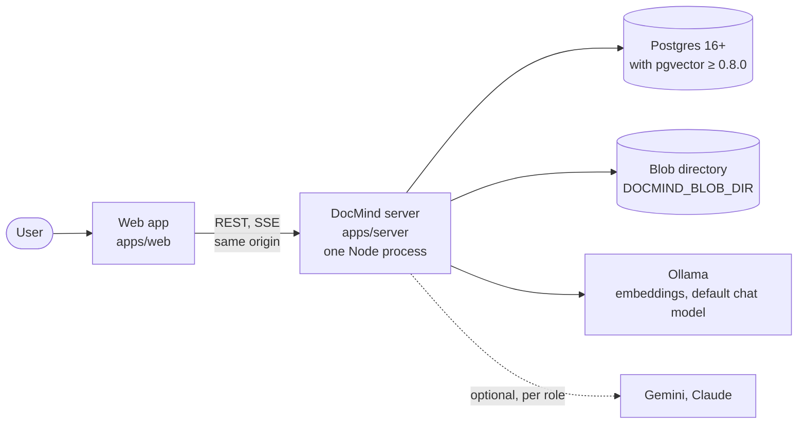
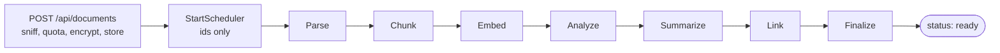
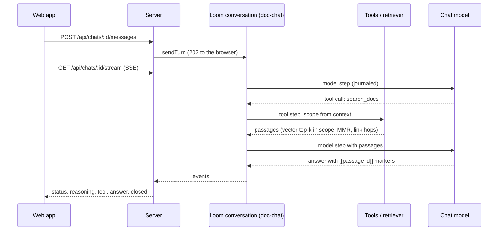
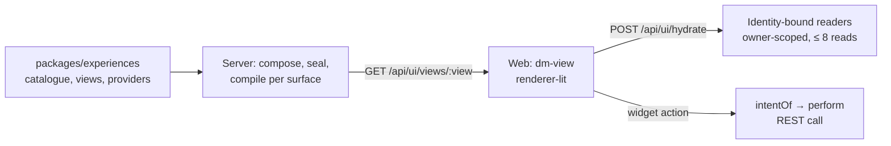

# DocMind architecture

Last updated 2026-10-23. This document describes how DocMind is built and why. For where to start reading the code, see [codebase-guide.md](codebase-guide.md). The binding design is the spec, [docs/specs/2026-10-18-docmind-design.md](specs/2026-10-18-docmind-design.md); where this summary and the spec disagree, the spec wins.

## 1. What DocMind is

DocMind is a multi-user, local-first document assistant built on the Loom framework:

- A user uploads documents. DocMind parses, chunks, embeds, analyzes, summarizes and links them.
- The user then asks questions in a chat. An agent answers only from the user's own documents, cites the passages it used, and streams the answer.

Four constraints shape every part of the design:

| Constraint | Consequence |
| --- | --- |
| Many users share one deployment | Every row is tenant-scoped and enforced by Postgres row-level security, not by application checks alone |
| Erasure must be final | Each user's data is encrypted under that user's own key; erasing an account destroys the key |
| Long, failure-prone work (parsing, model calls) | All of it runs as durable Loom flows that survive a crash and resume from their log |
| One UI definition for several surfaces | Screens are loom-ui experiences, compiled per surface (web today, terminal tested) |

## 2. System context

- The browser talks only to the server, on one origin. In development Vite proxies `/api`. In production the server also serves the built web app (`DOCMIND_WEB_DIR`) under a strict CSP.
- Postgres holds everything durable except the original files: Loom's event log, the relational tables, the vectors, the keys (wrapped) and the folded read models.
- Model calls go to Ollama by default. Gemini and Claude can be configured per role (chat, title, summary, vision, scanned PDF); see `docs/operations/llm-providers.md`.

## 3. Runtime and process model

DocMind runs as **one server process per database**. Three things live only in that process:
- the flow engine's in-memory state
- the live chat hub and stream partials
- the per-process view keys

Running two servers against one database is not supported.

Boot order (`apps/server/app/main.ts` → `setup.ts` → `bootIngest.ts`):

1. **Validate configuration.** Every environment variable is read and checked before any connection opens. A bad value fails with a `StartupConfigError` that names the variable, never its value.
2. **Open pools and verify the schema.** Applied migration checksums must match the files, and the vector column must fit the configured embedder.
3. **Compose.** `compose.ts` `buildServer()` wires every seam: auth, storage, flows, chat, UI routes.
4. **Boot the read models.** These are the `ingest-status` and `chat-activity` folded models. Loom's subject index is rebuilt from the execution ids.
5. **Bind the port.** A failed bind stops here, before any recovery work is spent.
6. **Start background work.**
    - Recovery: resume flow executions the last process left running.
    - Erasure: resume pending erasures.
    - Sweeps: the hourly session sweep, and the upload sweeper that restarts stuck ingestion and cleans orphaned status rows.

Shutdown drains the HTTP server, stops background work and aborts in-flight model calls, so their steps are left un-completed for the next recovery. A forced exit fires after a deadline.

## 4. Components

### 4.1 Server modules (`apps/server/app`)

| Module | Responsibility |
| --- | --- |
| `server.ts`, `http/` | Raw Node HTTP server; connection and body limits; 60 s request timer (streams exempt); origin guard; `requireAuth`; multipart parsing; static files with CSP |
| `auth/` | Sign-up, login, logout, sessions (HTTP-only cookie, only a hash stored), login throttling |
| `documents/` | Document API, content sniffing, quotas, starting ingestion, progress SSE, sweeps |
| `flows/ingest-document/` | The ingestion flow and its seven steps |
| `flows/chat-title/` | Names a chat from its first question |
| `chats/` | Chat sessions, the `doc-chat` conversation and agent, five tools, linked retrieval, citations, SSE stream, reasoning |
| `ui/` | Compiled experiences (`GET /api/ui/views/:view`) and their data (`POST /api/ui/hydrate`) |
| `erasure/` | `DELETE /api/me` and the background `Eraser` |
| `keys/`, `crypto/`, `sensitive.ts` | Master keys and rotation, field crypto, the registry of sensitive event paths |
| `llm/` | One provider per model role |
| `db/` | Migrations runner, `withTenant` |

### 4.2 Packages and the seams they own

Packages never import from apps. Each seam has one shared conformance suite that every implementation must pass. Only the composition root chooses the implementation.

| Seam | Package | v1 implementation |
| --- | --- | --- |
| `Authenticator` | `packages/auth` | Email and password (argon2id), session cookie |
| `DocumentParser` | `packages/parsers` | One parser per format, run in a resource-limited child process |
| `EmbeddingProvider` (Loom) | `packages/embeddings` | Ollama, `nomic-embed-text` by default |
| `ChunkVectorStore` | `packages/vector-pg` | pgvector columns on `chunks`, HNSW cosine index; an in-memory twin for tests |
| `ContentStore` (Loom) | `packages/blob-store` | Encrypted filesystem, per-user envelopes |
| `KeyStore` (Loom) | `packages/keystore-pg` | Per-user data keys in Postgres, wrapped by a master key |
| `LlmProvider` (Loom) | `packages/llm-anthropic`, Loom's providers | Ollama (OpenAI-compatible), Gemini, Claude |
| API shapes and intents | `packages/contracts` | zod schemas shared by server and web; `intentOf` |
| Screens | `packages/experiences` | Six loom-ui experiences, catalogue, providers, reshapers |

### 4.3 What comes from Loom and loom-ui

From Loom DocMind takes:
- durable flows and steps (`@loom/core`)
- the agent loop and conversations (`@loom/agent`, `@loom/conversation`)
- LLM effects and the untrusted-input guard (`@loom/llm`)
- grounding and citation checks (`@loom/knowledge`)
- the Postgres event store (`@loom/plugin-postgres`)
- encrypting stores and `shredSubject` (`@loom/plugin-crypto`)
- the content seam (`@loom/plugin-content`)
- SSE framing (`@loom/plugin-conversation-sse`)

From loom-ui it takes:
- the experience model, compiler and hydration
- the Lit renderer for the web
- the terminal renderer, used in tests

Both are sibling repositories linked with `link:`. CI checks them out at the pinned `LOOM_REF` and `LOOM_UI_REF`.

## 5. Data architecture

### 5.1 Where data lives

| Data | Store | Protection |
| --- | --- | --- |
| Original files | Blob directory, `<tenant>/<user>/<content address>` | Envelope-encrypted per user |
| Chat messages, flow history, ingest progress | Loom event log in Postgres | Sealed per user (`EncryptingEventStore`); sensitive paths registered in `sensitive.ts` |
| Documents, chunks, entities, links, chats, turn items, reasoning texts | Postgres tables | RLS by tenant; content columns (`*_enc`) sealed with the user's key |
| Embeddings | `chunks.embedding` (pgvector) | Plaintext: pgvector compares raw vectors |
| Link graph and entity keys | `chunk_links`, `chunk_entities`, `entities.name_key` | Plaintext metadata (existence, weight, HMAC); entity names sealed |
| Document status, chat activity | Loom folded read models | Scoped per user |
| Data keys | `data_keys` | Wrapped by the master key (`DOCMIND_KEK`) |

Tables, by migration: `tenants`, `users`, `auth_sessions`, `auth_throttle`, `data_keys`, `documents`, `parsed_documents`, `chunks`, `entities`, `chunk_entities`, `chunk_links`, `chat_sessions`, `chat_turn_items`, `chat_reasoning_texts`, `erasure_requests`. The SQL is in `infra/migrations` (0001–0025).

Document status is not a column. It is the `ingest-status` model's fold of the flow's events: `uploaded`, `parsing`, `embedding`, `ready` or `failed`.

### 5.2 Database roles

| Role | Used by | Rights |
| --- | --- | --- |
| Owner (`DOCMIND_MIGRATE_URL`) | Migrations, key rotation | Owns the schema |
| `docmind_app` (`DATABASE_URL`) | The server's requests | Owns nothing, no `BYPASSRLS`; RLS always applies |
| `docmind_loom` (`LOOM_DATABASE_URL`) | Loom's event store and read-model writer | Event log; folds rows of every tenant |

Lookups before a tenant is known (login by email, session by token hash, the sweeps, erasure bookkeeping) go through narrow `SECURITY DEFINER` functions owned by the migration role. Spec §4.3 lists them by name.

## 6. Security architecture

- **Identity.** The `Authenticator` yields `{tenantId, userId}` from the session cookie on every request. No route accepts a tenant or user id from the client.
- **Tenancy.** `withTenant(pool, tenantId, fn)` opens a transaction and sets `app.tenant_id`. RLS policies compare every row against it. The cross-tenant paths are few and named: recovery, the read-model writer, the sweeps and erasure.
- **Crypto-shredding.** Each user has a data key wrapped by the master key. The event log, snapshots, sealed columns and blobs are encrypted under it. Destroying the key (with a tombstone, so it can never be re-created) makes all of it unreadable.
- **Untrusted files.** Types are decided by magic bytes. Parsers run in a child process with CPU, memory, size and decompression limits. Quotas apply per file and per tenant.
- **Untrusted model input.** Document text is tagged as untrusted, and the chat tools are read-only. Their scope comes from the execution context, never from the model's arguments. Loom's capability ring grants the agent only those tools. Citations are validated against the passages actually retrieved. A prompt injection can skew an answer but cannot read another user's data or act.
- **Untrusted UI actions.** Browser actions become typed intents only by looking ids up in what the page itself published (`intentOf`). The REST routes re-check ownership anyway.
- **HTTP.** An origin guard sits on state-changing routes. Production uses a strict CSP: no inline script or style, no remote assets. Limits cover connections, body sizes, concurrent uploads, open streams and slow readers.
- **Logs.** Errors and logs carry class names, routes and variable names, never ids, emails, values or content. Loom's warnings are redacted before logging.

## 7. Ingestion

- **The flow.** `ingest-document`, version 3.0.0. Each step is a Loom `step$` with its own retry policy and time bound, and every step is bound to the document's `ingest_generation`.
- **Restartable steps.** Embed works from "which chunks lack a vector", in batches of 64. Link replaces its link set as a whole. A re-run therefore finishes the work rather than duplicating it.
- **Optional models.** Summarize and vision are skipped when their model role is off. A document with no text is still `ready`, with zero chunks.
- **Recovery.** `recovery.ts` re-drives executions whose process died, and Loom replays completed steps from the log. An execution that makes no progress across repeated re-drives is given up. The upload sweeper restarts uploads whose flow never started.
- **Retry and delete.** A retry increments the generation and starts a new execution. A delete cancels every generation first, then removes the row (chunks cascade) and the blob.

## 8. Chat and retrieval

- **A chat.** A chat is a Loom conversation with the id `u_<user>.c-<chat>`. Its `chat_sessions` row holds the sealed title and the `scope`: `"all"` or a list of document ids. Reopening a chat continues the same conversation, and long chats rotate their token window.
- **Tools.**
    - `search_docs` embeds the query, takes the pgvector top-k within the scope and re-ranks with MMR. It then follows links (`DOCMIND_RETRIEVAL_HOPS`, default 1; see `docs/design/linked-retrieval.md`).
    - `related`, `read_section`, `get_summary` and `list_documents` give deliberate hops and context.
    - Tools time out after 30 s.
- **Grounding.** The system prompt requires `[[passage id]]` citations and "not found in your documents" when retrieval is weak. Labelled general knowledge is an opt-in flow, `doc-chat-gk`. The stored reply is the raw text. On read, `citeReply` keeps only markers that point at passages the turn retrieved, and they become numbered source cards.
- **Streaming.** DocMind serves its own SSE (`chats/stream.ts`) with backpressure limits; a slow client reconnects with `Last-Event-ID`. A message sent mid-turn interrupts the turn (barge-in). `POST /stop` stops it.
- **Reasoning.** When the model exposes reasoning, Loom captures it (ADR 0133). It streams live, and its durable form is sealed per user.
- **Titles.** The `chat-title` flow names a chat once, from its first question. A user rename always wins.

## 9. UI architecture

- **The experiences.** There are six: library, empty library, document detail, sessions, chat and sources. They are defined once and know no surface.
- **Serving them.** The server compiles each experience per surface and serves it without user data. Data arrives through hydrate requests that the server binds to the caller's identity. A request may start at most 8 distinct reads, 4 at a time.
- **The web app.** It is a thin host: the shell, auth forms, dialogs, the upload zone, and the pages that host a view (`dm-*` elements). Chat state is a loom-ui `ChatFeed` folded from the SSE stream, with DocMind's tool steps and citations laid on top.
- **Other surfaces.** The same experiences render with the terminal renderer in tests. A terminal surface is planned as a second thin host over the same package and routes.

## 10. Account erasure

`DELETE /api/me` (password required) runs in two parts.

In one transaction it:
- records a durable request
- logs the user out everywhere
- frees the email

It then answers 202 with a receipt.

The background `Eraser` then runs these steps in order:

1. **`stop`.** Stop the user's flows, chats and streams.
2. **`shred`.** Loom appends tombstones and destroys the key. From here on, everything sealed is unreadable.
3. **`readModels`.** Tombstone the user's rows in the read models.
4. **`rows`.** Delete the user row; the foreign keys cascade.
5. **`blobs`.** Delete the user's blob directory.
6. **`key`.** Destroy the key again and check that it's gone.
7. **`done`.**

Each step is idempotent and recorded, and SQL enforces the order. A crash resumes at the first unrecorded step, and pending erasures resume at boot. An advisory lock keeps one runner per user across processes. `GET /api/erasure/:receipt` reports `pending` or `done`.

## 11. Configuration and deployment

Configuration is environment variables only, loaded from `.env` at the repo root by the root scripts. They fall into six groups:

| Group | Variables (examples) |
| --- | --- |
| Server | `HOST`, `PORT`, `DOCMIND_WEB_DIR`, `DOCMIND_PUBLIC_ORIGIN`, `DOCMIND_TRUST_PROXY`, `DOCMIND_COOKIE_SECURE` |
| Database | `DATABASE_URL`, `LOOM_DATABASE_URL`, `DOCMIND_MIGRATE_URL`, `DOCMIND_APP_DB_PASSWORD`, `DOCMIND_LOOM_DB_PASSWORD` |
| Keys | `DOCMIND_KEK`, `DOCMIND_KEK_ID`, `DOCMIND_CHAT_ENVELOPE_KEY` |
| Storage and limits | `DOCMIND_BLOB_DIR`, `DOCMIND_MAX_UPLOAD_BYTES`, `DOCMIND_TENANT_MAX_BYTES`, `DOCMIND_TENANT_MAX_DOCUMENTS`, `DOCMIND_MAX_CONCURRENT_UPLOADS` |
| Models | `DOCMIND_OLLAMA_URL`, `DOCMIND_EMBED_MODEL`, `DOCMIND_EMBED_DIMENSIONS`, `DOCMIND_LLM_PROVIDER` and per-role `DOCMIND_*_PROVIDER` / `_MODEL`, `GEMINI_API_KEY`, `ANTHROPIC_API_KEY` |
| Tests | `DOCMIND_TEST_PG_URL` |

Local development:
- **Postgres.** Either `docker compose up -d`, or a local cluster driven by `pnpm db:start` (`infra/local-db.sh`, data in `~/.docmind/pgdata`, port 55432). Keep the cluster out of `/tmp`.
- **Run.** `pnpm serve` starts the database, builds, migrates and starts the server.
- **Web.** `pnpm --filter @docmind/web dev` runs Vite with hot reload on port 5173.

Production:
- Run `pnpm build`, run migrations as the owner role, then start one server process with `DOCMIND_WEB_DIR=apps/web/dist`.
- Behind a reverse proxy, forward `Host` unchanged.
- Keep database backups for at most 30 days (see below).

## 12. Key decisions and trade-offs

| Decision | Why | Cost accepted |
| --- | --- | --- |
| Loom-native modular monolith | Durability and replay where failures are most common; one deployable | Splitting later means using the existing seams (for example a separate ingestion worker) |
| Postgres for everything | One store to back up, secure with RLS and query transactionally | Vector search scale bounded by pgvector |
| Encrypt content under per-user keys | Erasure is final by destroying one key | No full-text index (chunk text is sealed), so search is vector-only; dedup only within a user |
| Plaintext embeddings and link metadata | pgvector and link walks need raw values | Embeddings survive in backups until they expire, hence bounded backup retention |
| Flow inputs carry ids only | No content in the event log outside sealed paths | Steps re-read from tables |
| Experiences instead of hand-built views | One UI definition across surfaces; server-side data scoping | The web app follows loom-ui's widget set; gaps are fixed upstream in loom-ui |
| One process per database | The flow engine, live chat state and view keys are in memory | No horizontal scaling of the server today |

## 13. Known limits

These are from the spec's open risks (§10):
- A crash in the middle of a chat turn re-runs the turn, and the stream sends `reset`.
- Sign-up has no email verification, so it reveals whether an address has an account.
- Copies held by an external LLM provider are outside DocMind's control.
- A lost `DOCMIND_CHAT_ENVELOPE_KEY` makes queued messages unreadable.
- GitHub Actions currently can't run on the repository: account billing blocks it.

## 14. References

- Spec: `docs/specs/2026-10-18-docmind-design.md` (sections 4 data, 5 ingestion, 6 chat, 7 web UI, 8 testing)
- Design notes: `docs/design/linked-retrieval.md`, `docs/design/m6-loom-ui-native.md`
- Feature specs: `docs/specs/2026-10-22-multi-document-chat-scope-design.md`
- Runbooks: `docs/operations/llm-providers.md`, `rotate-kek.md`, `backfill.md`
- Reading order: [codebase-guide.md](codebase-guide.md)
