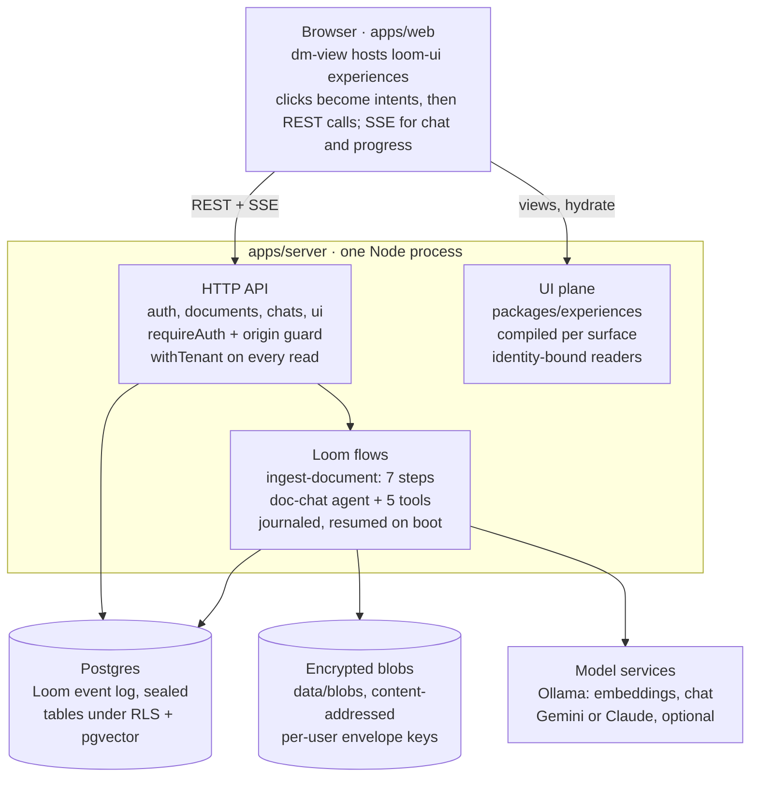

# DocMind codebase guide

Last updated 2026-10-23. This guide says where to start reading and in what order. For how the system is put together and why, see [architecture.md](architecture.md).

## The big picture

DocMind is one Node server plus one web app in a pnpm monorepo. You upload documents and it reads them. You can then chat with an agent that answers only from your documents and cites the passages it used. Read it as three layers:

- **Loom** (the sibling repo `../loom`) is the framework underneath. It provides durable flows (steps that survive a crash and replay from a log), the event store, the agent loop, LLM effects and crypto-shredding. DocMind never runs a long job outside a Loom flow.
- **DocMind's server** (`apps/server`) plugs DocMind's pieces into Loom: the HTTP API, the `ingest-document` flow, the chat agent and its tools, tenancy, and keys. Postgres holds everything: Loom's event log, the relational tables and the pgvector embeddings.
- **loom-ui** (the sibling repo `../loom-ui`) draws the screens. Each screen is a surface-neutral *experience* defined in `packages/experiences`. The server compiles it per surface (web, terminal). `apps/web` is a thin host that renders it and turns user actions into calls to the API.

The web app talks only to the HTTP API. Long work (ingestion, chat turns, titles) runs as Loom flows, which write to Postgres and the blob store and call the model services.

Two journeys carry almost all the behaviour, and the walkthroughs below follow each end to end:

1. **Upload → ingestion.** `POST /api/documents` stores the encrypted bytes. It then starts the `ingest-document` flow: parse, chunk, embed, analyze, summarize, link, finalize.
2. **Question → cited answer.** `POST /api/chats/:id/messages` starts a turn of the `doc-chat` conversation. The agent calls read-only retrieval tools, then streams an answer back over SSE. The answer cites `[[chunk id]]` markers, which become numbered source cards.

Three rules run through all of it:

- Every read is owner-scoped. Postgres row-level security keys rows to a tenant, and the server connects as a role that can't bypass it.
- Every user's data is encrypted under that user's own key, so destroying the key erases them.
- Model and tool calls are journaled, so a restarted server resumes work instead of redoing it.

## Repo map

Packages never import from apps. Each package owns one seam (an interface plus its implementation), and only the server's composition chooses which implementation backs each seam.

| Path | What it owns |
| --- | --- |
| `apps/server/app/main.ts` | Entry point: `setupServer()` then `bootIngest()` (verify, register, bind, recover, sweep) |
| `apps/server/app/setup.ts` | Reads and validates every env variable, opens the pools, builds the server |
| `apps/server/app/compose.ts` | The composition root: `buildServer()` wires auth, storage, flows, chat, UI routes |
| `apps/server/app/server.ts`, `http/` | The raw HTTP server, limits, origin guard, `requireAuth`, multipart, static files |
| `apps/server/app/auth/` | Sign-up, login, sessions, throttling (Postgres-backed) |
| `apps/server/app/documents/` | Upload, list, get, delete, retry routes; content sniffing; limits; starting and sweeping ingestion |
| `apps/server/app/flows/ingest-document/` | The durable ingestion flow and one file per step in `steps/` |
| `apps/server/app/flows/chat-title/` | The small flow that names a chat from its first question |
| `apps/server/app/chats/` | Chat sessions, the `doc-chat` agent, tools (`tools/`), retrieval (`retrieval/`), SSE stream, citations, reasoning |
| `apps/server/app/ui/` | `GET /api/ui/views/:view` and `POST /api/ui/hydrate`: compiled experiences and their owner-scoped readers |
| `apps/server/app/erasure/`, `keys/`, `crypto/` | Account erasure (`DELETE /api/me`), key-encryption keys, field crypto |
| `apps/server/app/llm/` | Builds one LLM provider per role (chat, title, summary, vision) |
| `apps/server/app/db/` | Migration runner (`migrate.ts`) and `withTenant` (`tenant.ts`); SQL lives in `infra/migrations` |
| `apps/web/src/` | The web surface: router, services, `dm-*` Lit elements, chat state, API client |
| `packages/contracts` | zod schemas and types shared by server and web; `intentOf` (what a UI action means) |
| `packages/experiences` | The six views as loom-ui experiences, the semantic catalogue, providers, reshapers |
| `packages/auth` | The `Authenticator` interface and the password/session implementation |
| `packages/parsers` | `DocumentParser` registry; parses untrusted bytes in a resource-limited child process |
| `packages/embeddings` | Ollama embedding provider for Loom's `EmbeddingProvider` |
| `packages/vector-pg` | `ChunkVectorStore`: vectors on `chunks` rows, search, neighbours (plus an in-memory twin) |
| `packages/blob-store` | Encrypted filesystem `ContentStore` (per-user envelopes) |
| `packages/keystore-pg` | `PostgresKeyStore`: per-user data keys wrapped by a master key |
| `packages/llm-anthropic` | Claude provider for Loom's `LlmProvider` |
| `infra/migrations` | Ordered SQL migrations 0001–0025: roles, tenancy, auth, keys, documents, chunks, chats, erasure |
| `infra/local-db.sh` | `pnpm db:start`, `db:stop`, `db:status` for a local Postgres outside `/tmp` |
| `docs/` | Design spec, design notes, operations runbooks, implementation plans |

## Where to start: the reading order

Read outside-in: first the shapes, then how the server boots, then each journey from its HTTP route down, and the web app last. Each step only needs the ones before it. Skip the `*.test.ts` files on a first pass, but come back to them: they are the most precise statement of what each module promises.

1. **The why (30 min).** `README.org` (Architecture and Security model), then `docs/specs/2026-10-18-docmind-design.md` sections 1–4: goals, approach, repo layout, and the data model with tenancy and crypto-shredding. Section 3.1's table lists every extension seam and its implementation. Keep it open.
2. **The shapes.** `packages/contracts/src/documents.ts` and `chats.ts`. Every route and every screen speaks these zod types (`DocumentDto`, `ChatScope`, `ChatSessionDto`). Reading them first makes the rest read like plumbing.
3. **Boot and composition.**
    1. `apps/server/app/main.ts` (50 lines): `setupServer()`, then `bootIngest()`.
    2. `setup.ts`: every env variable is validated before a connection opens.
    3. `compose.ts` `buildServer()`: the composition root. Notice that each package is plugged in here and nowhere else.
    4. `bootIngest.ts`: the order of verify, register flows, bind the port, then recover.
4. **Requests, auth and tenancy.**
    1. `server.ts`, then `http/requireAuth.ts` and `http/originGuard.ts`.
    2. `auth/routes.ts` with `packages/auth`.
    3. `db/tenant.ts` (`withTenant`): every owner-scoped query runs inside it.
    4. Migrations `infra/migrations/0001_app_role.sql` to `0003` and `0009_documents.sql`: the role setup, row-level security, and the first data table.
5. **Journey 1, upload and ingestion** (walkthrough below). Start at `documents/routes.ts` and go down to `flows/ingest-document/flow.ts` and its `steps/`.
6. **Journey 2, chat** (walkthrough below). Start at `chats/routes.ts` and `messageRoutes.ts`, then `wiring.ts`, `agent.ts`, `tools/`, `retrieval/retriever.ts`, `citations.ts`, `stream.ts`.
7. **The UI plane on the server.**
    1. `packages/experiences/src/catalog.ts`: what kinds of widget exist.
    2. `views.ts`: the six screens.
    3. `providers.ts` and `reshapers.ts`: where each widget's data comes from.
    4. Then `apps/server/app/ui/routes.ts` and `readers.ts`, which compile a view and answer its data loads for the signed-in user only.
8. **The web app.**
    1. `apps/web/src/main.ts` → `services.ts` (the UI's composition root) → `router.ts` → `components/dm-app.ts`.
    2. `components/dm-view.ts` with `ui/session.ts`: how one experience is mounted and hydrated.
    3. `packages/contracts/src/intents.ts` with `surface/perform.ts`: what a click means and what it does.
    4. The pages, `dm-documents-page.ts` and `dm-chat-page.ts`.
    5. The chat client: `state/chat.ts`, `chat/transport.ts`, `chat/feedAdapter.ts`.
9. **Erasure and keys, last.** `erasure/eraser.ts` and `account.ts`, `packages/keystore-pg`, `sensitive.ts`. They only make sense once you know every place user data lands.

For each step, two questions help: *where does the tenant come from?* (always the session, never a parameter), and *what happens if the process dies here?* (Loom replays from the log).

## Walkthrough 1: uploading a document

An upload answers as soon as the encrypted bytes and the row are stored. Everything slow happens afterwards, inside a durable Loom flow that a restart resumes. Follow these files in order:

1. **The route.** `apps/server/app/documents/routes.ts`, `upload()`. It caps concurrent uploads per user (`inFlight.ts`, 429 when full). It then streams the multipart body (`http/multipart.ts`) and decides the type from the first bytes (`sniff.ts`; the extension only breaks ties). Quotas come from `limits.ts`: 50 MB per file, plus per-tenant bytes and document counts.
2. **Storage.** The bytes go to `packages/blob-store` (`EncryptedFsContentStore`) under a keyed content address, so the same file uploaded twice is a duplicate (200, not 201). The row goes into `documents` through `documents/repo.ts`, under row-level security. Sensitive columns (`*_enc`) are sealed with field crypto.
3. **Starting the flow.** `documents/startScheduler.ts` starts the `ingest-document` execution without making the upload wait for Loom. `documents/ingest.ts` builds its input, which is ids only. A failed start is retried by the stale-upload sweep (`documents/sweep.ts`).
4. **The flow.** `flows/ingest-document/flow.ts` (version 3.0.0) runs seven steps in order, each a Loom `step$` with its own retry policy:
    1. **Parse** (`steps/parse.ts`). It runs `packages/parsers` in a resource-limited child process. Images and textless PDF pages go to the vision provider when one is configured.
    2. **Chunk** (`steps/chunk.ts` with `chunker.ts`). It splits by section and paragraph with a small overlap. Heading text is sealed with the chunk, never put in the locator.
    3. **Embed** (`steps/embed.ts`). It asks the vector store which chunks still lack a vector, then embeds them in batches of 64 through `packages/embeddings` (Ollama). It writes the vectors with `packages/vector-pg` onto the `chunks` rows. A re-run embeds only what is missing.
    4. **Analyze** (`steps/analyze.ts`). It computes sealed document stats.
    5. **Summarize** (`steps/summarize.ts`, `summarize/`). It runs a map-reduce over sections with the summary model, or is skipped when no model is configured.
    6. **Link** (`steps/link.ts`). It builds structure, similarity, entity and reference links between chunks. Chat retrieval follows these links.
    7. **Finalize** (`steps/finalize.ts`). Its completion is what makes the document *ready*.
5. **Status and progress.** No step writes a status. A folded read model turns the flow's step events into `uploaded`, `parsing`, `embedding`, `ready` or `failed`. Live progress reaches the browser over `GET /api/documents/events` (`documents/events.ts`, fed by the in-process bus in `progress.ts`).
6. **Crashes.** `flows/ingest-document/recovery.ts` re-drives executions whose process died. Loom replays completed steps from the log instead of re-running them. `POST /api/documents/:id/retry` starts a new generation for a failed document, and delete cancels every generation first.

## Walkthrough 2: a chat turn

Sending a message only appends a turn to a Loom conversation and answers 202. The answer arrives separately: the agent runs inside the `doc-chat` flow and its output streams back over SSE. Follow it from the browser and back:

1. **The composer.**
    1. In `apps/web/src/components/dm-chat-page.ts`, loom-ui's composer emits `SUBMIT_TEXT`.
    2. `intentOf` (`packages/contracts/src/intents.ts`) turns it into a `chat.send` intent.
    3. The page calls `ChatController.send` (`state/chat.ts`), which posts through `chat/transport.ts` with an idempotency key.
    4. A brand-new chat is created first with its chosen scope (`POST /api/chats`).
2. **The route.**
    1. `apps/server/app/chats/messageRoutes.ts` handles `POST /api/chats/:id/messages`. It loads the chat for the caller and calls Loom's `conversations.sendTurn`.
    2. A message sent while a turn is running interrupts that turn (barge-in).
    3. The first message of an untitled chat also fires the `chat-title` flow (`flows/chat-title/`).
3. **The agent.**
    1. `chats/wiring.ts` registers the chat flows, the model effect and the tools.
    2. `chats/agent.ts` holds the system prompt (answer only from tool results, cite `[[passageId]]`) and builds the `conversation$` with Loom's agent loop.
    3. The model comes from `apps/server/app/llm/` (Ollama by default; Claude through `packages/llm-anthropic`).
4. **The tools** (`chats/tools/`): `search_docs`, `related`, `read_section`, `get_summary`, `list_documents`. All are read-only.
    - `chats/scope.ts` derives tenant, user and chat scope from the call's own context, never from the model's arguments. A prompt injection in a document therefore can't reach another user's data.
    - `search_docs` calls `chats/retrieval/retriever.ts`. That embeds the query, takes the pgvector top-k inside the chat's scope (all documents or the chosen ones), re-ranks with MMR and follows links one hop.
5. **The stream.**
    1. `chats/stream.ts` serves `GET /api/chats/:id/stream`: status, reasoning, tool steps, the answer, reset and closed events.
    2. On the web, `chat/transport.ts` reads it and loom-ui's `ChatFeed` folds it into a transcript.
    3. `chat/feedAdapter.ts` lays DocMind's tool steps, reasoning and reference ids on top. The page then publishes it to the `Chat` widget.
6. **Citations.**
    1. The stored reply is the model's raw text. `chats/citations.ts` validates each `[[id]]` against the passages that turn actually retrieved, and drops ungrounded ones.
    2. Valid citations become numbered markers. Clicking one opens the Sources panel (the `sources` view), and from there the passage in its document.
7. **History.** `chats/messages.ts` serves `GET /api/chats/:id/messages`: pages of turns merged with the sealed turn items (citations, tool steps) and the reasoning. Reopening an old chat continues the same conversation.

## Ideas that run through everything

Five ideas explain most of the code that looks unusual. Learn them once and the defensive patterns stop being surprising.

| Idea | What it means in the code | Where to read it |
| --- | --- | --- |
| Tenancy by row-level security | The server connects as `docmind_app`, which owns no tables and can't bypass RLS. Every owner-scoped query runs inside `withTenant`, which sets the tenant for that transaction. Migrations run as the owner role. | `db/tenant.ts`, `infra/migrations/0001`–`0003`, spec §4.3 |
| One key per user (crypto-shredding) | Each user has a data key, stored wrapped by a master key (KEK). Loom's events and snapshots, sealed columns and blobs are all encrypted under it. Destroying the key makes all of that unreadable, which is how account erasure is final. | `packages/keystore-pg`, `packages/blob-store`, `erasure/`, `sensitive.ts`, spec §4.4 |
| Durable flows | Long work runs as Loom flows: `ingest-document`, `doc-chat`, `chat-title`. Steps, model calls and tool calls are journaled, so after a crash Loom replays recorded results instead of calling again. Flow inputs carry ids only, never content. | `flows/`, `chats/wiring.ts`, `bootIngest.ts`, Loom's `@loom/core` |
| Experiences, not hand-built screens | A screen is a loom-ui experience defined once in `packages/experiences`. The server compiles it per surface and serves its data through identity-bound readers. The web app only hosts it. The same experience also renders in a terminal. | `packages/experiences`, `ui/routes.ts`, `components/dm-view.ts`, `docs/design/m6-loom-ui-native.md` |
| Intents, never trusted actions | A widget action from the browser is untrusted. `intentOf` turns it into a typed intent, looking ids up in what the page itself published. The REST routes then re-check ownership anyway, so the intent filter is not the security boundary. | `packages/contracts/src/intents.ts`, `surface/perform.ts` |

One more habit: errors and logs carry class names and variable names, never values. That is why a startup failure prints only `Error` unless it is a `StartupConfigError` (`startupError.ts`).

## Running it, testing it, and where the docs are

Run the app and step through it while you read. Seeing a request in the logs beside its route file is the fastest way to learn the code.

| Command | What it does |
| --- | --- |
| `pnpm serve` | Starts the local Postgres (`pnpm db:start`), builds, migrates and starts the server on port 3000 |
| `pnpm --filter @docmind/web dev` | Vite on port 5173 with hot reload, proxying `/api` to the server |
| `pnpm db:start`, `db:stop`, `db:status` | The local Postgres cluster in `~/.docmind/pgdata`, port 55432 |
| `pnpm test` | Every package's Vitest suite; the Postgres suites run only when `DOCMIND_TEST_PG_URL` is set |
| `pnpm typecheck`, `typecheck:tests`, `lint` | The other gates |

Useful tests to read as documentation:

- `chats/golden.e2e.pg.test.ts`: a whole chat against a real database.
- `flows/ingest-document/` tests: each step's guarantees.
- `apps/web/src/acceptance.test.ts`: the web app end to end.

The design docs, in the order to read them:

- [architecture.md](architecture.md): how the system fits together, its decisions and constraints.
- `docs/specs/2026-10-18-docmind-design.md`: the spec, and the authority when code and docs disagree.
- `docs/design/`: design notes, including `linked-retrieval.md` and `m6-loom-ui-native.md`.
- `docs/specs/` for later features (for example the multi-document chat scope).
- `docs/superpowers/plans/`: the implementation plan behind each milestone, task by task.
- `docs/operations/`: runbooks for LLM providers, key rotation and backfill.
