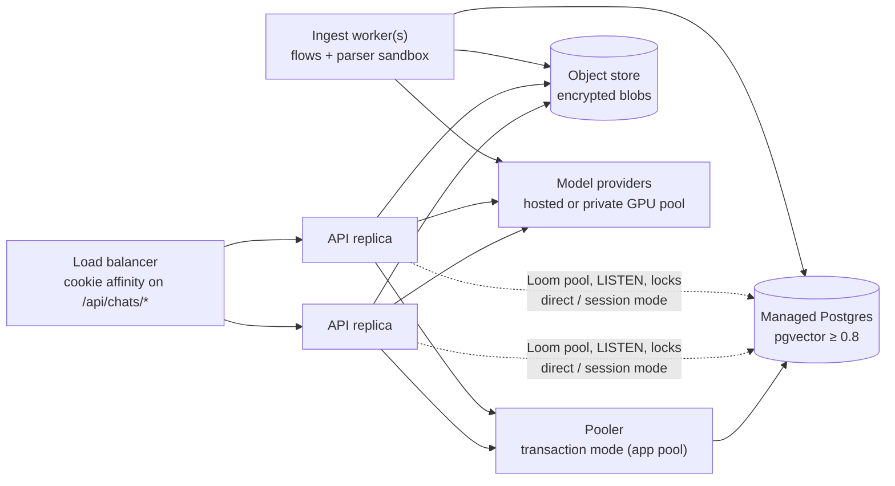

# Cloud deployment and scaling

**Status:** proposal (2026-10-25). Nothing here is implemented yet, except the load-test harness in
`apps/loadtest`, which produced the single-process baseline in §2.

## Problem

DocMind runs as **one Node process per database** (architecture §3). That process can be deployed to a
cloud host today only with care, and it cannot be replicated at all: a second replica behind a load
balancer gives wrong behaviour, not just a smaller speed-up. This note answers three questions:

1. What does one process handle?
2. What must change before DocMind runs on a cloud platform (containers behind a load balancer, managed
   Postgres), even as a single replica?
3. What must change to run N replicas, and in what order?

## 1. Where the time goes

A request in DocMind is one of three shapes. Each has a different bottleneck, and none of them is "Node is
single-threaded" first.

| Shape | Examples | Dominant cost | First bottleneck |
| --- | --- | --- | --- |
| Short reads | document list, `GET /api/ui/views/:view`, `POST /api/ui/hydrate` | `withTenant` transactions (RLS) + decrypting sealed columns | **one CPU core of the Node process** (measured, §2). The app pg pool (node-postgres default of 10, `apps/server/app/db/pool.ts:41`) was not waiting. |
| Chat turns | `POST /api/chats/:id/messages` + SSE stream | model calls (seconds), embedding the query, pgvector top-k | in production, the LLM provider's throughput and rate limits; with a fast provider, the Node core again (≈25 concurrent retrieval turns, §2); 4 open streams per user |
| Ingestion | `POST /api/documents` → 7-step flow | parse (child process), embed (batches of 64), analyze/summarize model calls | `DOCMIND_INGEST_CONCURRENCY` (4) and `DOCMIND_PARSE_CONCURRENCY` (2) per process; then the model host |

Node's single thread serves the event loop. The heavy CPU work is already off it: parsing runs in
sandboxed child processes, argon2 runs on the libuv pool, and model calls are network I/O. So **more
cores on one box help only up to a point**. The main loop stays on one core (crypto, JSON, SSE framing,
`pg` result parsing), and the extra cores serve parser children and argon2. The baseline (§2) confirms it:
reads plateau with exactly one core busy on an 8-core machine. Past roughly 2–4 vCPU, the way to scale is
more processes. More processes means the multi-replica work in §4, whether they run as
containers or as `node:cluster` workers on one machine: the in-process state is the same problem either way.

## 2. Single-process baseline

Measured 2026-10-25 with `apps/loadtest` (see its README to reproduce). Setup:
- Apple M2, 8 cores, 8 GiB. The server, the LLM stub, Postgres and the load generator all ran on one
  machine.
- Seed data was 20 users with 3 documents each.
- Stub: 300 ms to the first token, then 120 tokens at 15 ms, so a turn takes at least ≈2.4 s.

**Reads.** Throughput (req/s) stops growing at about **5 concurrent connections**. Past that, only latency
grows, roughly linearly.

| Route | Plateau req/s | p99 at 50 conn | p99 at 400 conn |
| --- | --- | --- | --- |
| `GET /api/ui/views/library` (compiled view) | ≈20,000 | 4 ms | 57 ms |
| `GET /api/me` | ≈9,600 | 10 ms | 82 ms |
| `GET /api/chats` | ≈5,200 | 30 ms | 281 ms |
| `POST /api/ui/hydrate` (sessions) | ≈3,800 | 16 ms | 320 ms |
| `GET /api/documents/:id` | ≈2,600 | 27 ms | 350 ms |
| `GET /api/documents` | ≈1,700 | 34 ms | 253 ms |
| `POST /api/ui/hydrate` (library, detail) | ≈1,100 | 138–145 ms | 533–625 ms |
| **Mixed, all routes interleaved** | **≈2,200** | 71 ms | 453 ms |

- The Node process holds steady at about 1.0 core busy from 10 connections up. That one core is the limit.
- Postgres was not the limit: `docmind_app` used 10–11 connections, mostly idle.
- The event loop was not blocked for long stretches: a `GET /healthz` probe stayed at 17–70 ms p99 even
  while requests waited 400 ms.
- Zero errors or non-2xx responses. RSS went from 212 MB to about 490–640 MB.

**Chat.** Concurrency was capped at 80, because each user may hold only 4 streams.

| Concurrent turns | Turns/s | TTFT p50 / p99 | Server cores |
| --- | --- | --- | --- |
| 5 | 2.2 | 351 / 390 ms | 0.15 |
| 25 | 10.0 | 420 / 873 ms | 0.38 |
| 80 | 15.4 | 1,118 / 1,340 ms | 0.86 |
| 25, with a `search_docs` tool call | 4.6 | 1,542 / 1,994 ms | 1.01 |
| 50, with a `search_docs` tool call | 9.8 | 2,339 / 2,952 ms | 1.97 |

A retrieval turn (embed the query, pgvector top-k, MMR, link hops, a second model call) costs several times a
plain turn. One core is saturated at about 25 concurrent retrieval turns.

Two caveats are still open:
- Full-turn p99 was 15–17 s at low concurrency in the tool-call runs. This hasn't been investigated; the
  suspect is the first turn on each new chat.
- Usage above one core in the last row suggests work spread across libuv and GC threads.

**Ingest.** 20 small markdown documents reached `ready` at about 200 docs/min (p50 1.8 s). That figure is
bounded by the stub and `DOCMIND_INGEST_CONCURRENCY` (4). It says nothing about real parse or embedding cost.

**Reading the numbers.**
- **One process sustains ≈2,000 req/s of mixed reads** on an M2-class core, with p99 under 100 ms up to
  about 50 concurrent connections.
- **It sustains ≈10–15 chat turns/s** of DocMind overhead with a fast stub, or about **5 turns/s** when
  every turn retrieves.
- A real page load is several requests (view + hydrate + lists), so this is roughly **a few hundred page
  loads per second**.
- The load generator shared the CPU, so these are lower bounds and a shape, not a cloud figure. Expect a
  cloud vCPU to land within a factor of about 2 of this, either way.
- Real chat throughput will be bounded by the model provider long before these numbers.

## 3. Required for any cloud deployment (even one replica)

Without these, a single cloud container either cannot be reached, loses data on restart, or breaks chat
after every deploy.

| # | Change | Why | Evidence |
| --- | --- | --- | --- |
| C1 | **Blobs on durable shared storage.** Short term: mount `DOCMIND_BLOB_DIR` on a network filesystem with `link()` and atomic `EEXIST` (EFS, Filestore). Target: an object-store `ContentStore` (§4, S1). | The default `data/blobs` sits on the container's ephemeral disk, so a restart loses every original file and in-flight ingest. | `packages/blob-store/src/EncryptedFsContentStore.ts:80-131` |
| C2 | **Require `DOCMIND_CHAT_ENVELOPE_KEY` in production.** Fail boot when chat is on and it is unset. | Unset, it is `randomBytes(32)` per process: queued chat envelopes fail verification after every restart or redeploy. | `apps/server/app/chats/settings.ts:55` |
| C3 | Set `HOST=0.0.0.0`. | The default `127.0.0.1` is unreachable from the load balancer. | `apps/server/app/setup.ts:41` |
| C4 | **Make `keepAliveTimeout` configurable** and set it above the LB idle timeout (e.g. 65 s for ALB's 60 s), with `headersTimeout` above that. | It is hard-coded at 5 s. The LB reuses sockets Node already closed, which gives intermittent 502s. | `apps/server/app/server.ts:78-80` |
| C5 | **Add `/readyz`**: a DB ping that fails once SIGTERM arrives. Keep `/healthz` as liveness. | `/healthz` is static and answers 200 during shutdown and with the database down. | `apps/server/app/server.ts:10` |
| C6 | Set the termination grace to ≥ 65 s (or shorten the close bounds). | The forced exit is 60 s and the close steps take about 40 s. A SIGKILL at the platform default (10–30 s) skips lease release, so recovery then waits out the 30 s lease TTL. | `apps/server/app/shutdown.ts:62`, `closeSequence.ts` |
| C7 | Set `DOCMIND_PUBLIC_ORIGIN` (no longer needs Host forwarded unchanged), `DOCMIND_COOKIE_SECURE=true`, `DOCMIND_TRUST_PROXY=true`, and add a **trusted-hop count**. | With a CDN in front of the LB, the "last X-Forwarded-For entry" rule keys every user's login throttle on one IP. | `packages/auth/src/clientIp.ts:15-24`, `originGuard.ts:76-77` |
| C8 | **A container image.** Multi-stage build that checks out `../loom` and `../loom-ui` at the pinned refs (as CI does), keeps `/bin/sh` and `/usr/bin/env` (the parser sandbox needs both, so no distroless), and includes `infra/migrations`. Migrations run as a one-off job with `DOCMIND_MIGRATE_URL`. | There is no Dockerfile. The packages are `link:` siblings. **Implemented:** `Dockerfile`, `.dockerignore`, CI job `image`, runbook `docs/operations/cloud-deploy.md`. | `pnpm-workspace.yaml`, `packages/parsers/src/runner/protocol.ts:36-38` |
| C9 | **Secrets from a secret manager.** Add `_FILE` variants (as the KEK has) for `DATABASE_URL`, `LOOM_DATABASE_URL`, `DOCMIND_CHAT_ENVELOPE_KEY` and the provider keys. | Only `DOCMIND_KEK_FILE` exists today. | `packages/keystore-pg/src/kek.ts:19-37` |
| C10 | **Models off the box.** Either a private Ollama service (it has no auth, so reach it only over the private network), or hosted providers per role (Claude and Gemini already exist). Embeddings need a hosted `EmbeddingProvider` for a fully managed setup. Changing the dimension means a migration and a re-embed (`vector(768)`). | Embeddings are Ollama-only, and both Ollama paths reject credentials. | `apps/server/app/flows/ingest-document/limits.ts:95-97`, `infra/migrations/0014_chunk_embeddings.sql:17` |
| C11 | **Managed Postgres fit.** pgvector ≥ 0.8.0 (the boot check enforces it; verify per service, region and PG major version), password auth for `docmind_app` (IAM auth adds role membership, which the boot check refuses), and TLS via `sslmode` in the URLs. | | `packages/vector-pg/src/pg.ts:263-270`, `apps/server/app/db/pool.ts:27-29` |
| C12 | Size memory at **≥ 3–4 GiB per replica** and enforce it with a cgroup limit. | Two parser children at 512 MiB heap each, but external (Buffer) memory is unbounded, plus up to 4 ingest steps each buffering a whole blob. | `packages/parsers/src/runner/ParseRunner.ts:89-93` |

Platform notes:
- **Cloud Run.** HTTP/1 bodies are capped at 32 MiB (the upload default is 50 MiB). Background flows need
  "CPU always allocated" and `min-instances ≥ 1`. Don't scale to zero: recovery, sweeps and parked
  chat turns run outside requests.
- **ECS/Fargate or Kubernetes** fit most naturally: long-lived containers, configurable grace periods, and
  ALB/ingress cookie affinity.

With C1–C12 in place, **one replica on a 2–4 vCPU / 8 GiB instance is the recommended first cloud
deployment** (stage 0 in §5). One core runs the event loop; the rest go to parser children, argon2 and
GC. A bigger instance will not raise the ≈2,000 req/s read ceiling measured in §2. Only stage 1 does.

## 4. Required for N replicas

Loom's flow engine is already multi-node-aware. Leases live in a Postgres table, appends are fenced,
starts are idempotent, and event appends notify other nodes over `LISTEN/NOTIFY`. Two nodes do not
double-run a step. **The blockers are DocMind's own in-process pieces:**

| # | Blocker | What breaks with 2 replicas | Fix |
| --- | --- | --- | --- |
| S1 | Blobs on a local disk | Upload on A, ingest step (recovery, sweeper) on B: the source is missing. Erasure deletes only the local copy. | Shared volume (C1), then an object-store implementation. The seam needs an extracted interface first: callers depend on the concrete class, with a `stage()`/`commit()` API. Commit becomes copy-if-absent (S3 `If-None-Match: *`, GCS `ifGenerationMatch=0`). Erasure becomes a prefix delete. Stale temp files get a lifecycle rule. |
| S2 | Document progress bus is in memory | The user's SSE is on B while the flow runs on A, so the library never updates. There is no polling fallback in the web app. | A `ProgressBus` over Postgres `NOTIFY` (ids only, well under 8 KB). The interface already anticipates it (`documents/progress.ts:13`). |
| S3 | Chat live layer (token deltas, tool steps, reasoning partials) is in memory | A stream on B sees the committed answer arrive whole (the durable path is cross-node), but no live tokens or tool steps. This degrades the experience; no data is lost. | Short term: cookie affinity for `/api/chats/*`. Real fix: bridge `hub.deltaSink()`, `reasoningSink()` and `ChatBus` through `NOTIFY`, coalesced under 8 KB. |
| S4 | `StopRegistry` is in memory | `POST /stop`, chat delete and erasure's stop answer `{stopped:false}` when the turn runs elsewhere. | A durable stop signal (`NOTIFY`, or an inbox flag the existing barge-in watcher already observes). |
| S5 | Subject index hydrated once at boot | An erasure on B misses executions created on A since B booted: `eraseSubject` returns `unknown`, so A's running executions are not tombstoned or stopped. The key is still destroyed, so the shred holds, but this is a compliance-audit gap. | Re-hydrate immediately before `eraseSubject` (it is idempotent: `erasure/compliance.ts:112`). |
| S6 | View keys are random per process | Different `versionHash` and revisions per replica cause spurious "stale" reloads in the web app. Cosmetic. | Derive `placeholderKey`/`revisionKey` by HKDF from a configured `DOCMIND_VIEW_KEY` (`compose.ts:207-210`). |
| S7 | Rolling deploys | During a deploy, an old-version node can give up a new-version execution (`FLOW_MISMATCH`). `MAX_RECOVERIES` = 3 counts graceful interruptions, so repeated deploys or scale-in mid-step can exhaust it. | Version-aware recovery: only the newest code gives up on a mismatch (spec §5.2). Until then, use a **recreate** deploy (stop old, start new), not rolling. |
| S8 | Session-scoped Postgres features | The erasure advisory lock, the migration lock and Loom's `LISTEN` break under PgBouncer transaction mode or RDS Proxy. | Route the Loom pool, the erasure pool and migrations directly or through a session-mode pooler. The app pool is compatible with transaction pooling (`withTenant` uses transaction-local `set_config`). |

Things that change meaning, but don't break, with N replicas:
- **Per-process caps become N×.** These include ingest concurrency (and per-tenant fairness), parse
  concurrency, concurrent uploads per user, SSE streams per user, and `DOCMIND_MAX_CONNECTIONS`. Either
  divide by N in config or move the user-facing ones (uploads, streams) into Postgres.
- **Connections.** Each replica holds about 24 connections (app 10, Loom 10, erasure 3, plus 1 `LISTEN`).
  Add env knobs for pool `max`, and keep N × per-replica connections under the server's `max_connections`
  (or put the app pool behind a transaction pooler).
- **Boot and hourly scans are O(total executions) per replica:** recovery, read-model catch-up and the
  subject index. Boot time grows with history, and N replicas repeat the work. This is acceptable at
  first; later, give the scans to one leader or a lease.
- **Sweeps run on every replica and are safe** (idempotent SQL; duplicate starts are refused). The only
  cost is N× query load.

Already scale-friendly: sessions and the login throttle live in Postgres, quotas are enforced under a tenant
advisory transaction lock, erasure uses a per-user advisory lock with a rescan for dead holders, migrations
are serialised by a lock with a checksum check, chat streams resume from the durable log with
`Last-Event-ID`, and SSE sends 15 s heartbeats with `x-accel-buffering: no`.

## 5. Strategy

| Stage | Topology | Work | Scales by |
| --- | --- | --- | --- |
| **0. Cloud, one replica** | 1 container (2–4 vCPU / 8 GiB), managed PG, shared volume for blobs, hosted or private models | C1–C12 | Barely. Extra cores raise ingestion (`DOCMIND_INGEST_CONCURRENCY`, `DOCMIND_PARSE_CONCURRENCY`), not request throughput (≈2,000 req/s mixed reads, ≈5 retrieval turns/s of overhead). |
| **1. N identical replicas** | 2+ replicas behind the LB with cookie affinity, recreate deploys | S2, S4, S5, S6, S8, the object store (S1), divided caps, pool knobs. Affinity covers S3 for the common case. | Horizontal on CPU and open connections. Most chat load is waiting on the provider. |
| **2. Robust multi-node** | Same, rolling deploys, affinity optional | S3 (`NOTIFY` bridge for the live chat layer), S7 (version-aware recovery), leader-elected scans | Horizontal without stickiness, zero-downtime deploys |
| **3. Split roles** | API replicas plus a separate ingest-worker pool (flows and the parser sandbox), each autoscaled on its own signal (API: CPU/connections; worker: queue depth = documents in `uploaded`/`parsing`) | Run the flow engine only where wanted (a config switch, since leases and fencing exist after stage 2), and worker sizing for memory | Ingestion bursts no longer slow chat. Workers scale on backlog. |

Beyond stage 3 the limits are Postgres, not Node:
- pgvector HNSW search and the event log share one primary. Scale up the instance first, then add read
  replicas for retrieval (accepting replica lag on just-ingested chunks).
- Partitioning the event log by tenant is the last resort.
- The model providers' throughput and rate limits cap chat and ingestion at every stage. Budget them
  explicitly: N replicas send N× the requests to the same quota.

## Recommendation

Do stage 0 now. It is a bounded list of small changes, and the largest is the blob volume.

Plan stage 1 when production traffic approaches one core: about 2,000 mixed req/s, or sustained
retrieval-turn concurrency in the tens. The Node process's CPU is the signal to alert on. Most of stage 1 is
mechanical (`NOTIFY`-backed buses, HKDF view keys, pool knobs). The one real design item is the
object-store `ContentStore`.

Stages 2 and 3 are justified only by deploy-frequency or ingestion-burst needs. The version-aware
recovery they require is a Loom-level change and needs its own spec.
