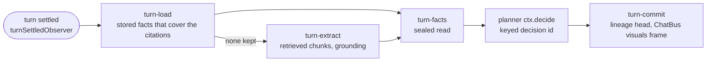

# Chat Visuals (sub-project 2): Implementation Plan

> **For agentic workers:** REQUIRED SUB-SKILL: Use superpowers:subagent-driven-development (recommended) or superpowers:executing-plans to implement this plan task-by-task. Steps use checkbox (`- [ ]`) syntax for tracking.

**Goal:** After a chat answer that cites at least one document has settled, a background Loom flow composes the visuals that make the answer clearer (charts, metric cards, tables) from the figures behind it, and the chat shows them in a collapsible "Visuals" strip under the assistant message. The answer streams exactly as it does today; its visuals arrive later, or never.

**Architecture:** `visualize-turn` is a new Loom flow. It is started by a `turnSettledObserver` listener (Loom's generic helper in `@loom/conversation`, composed into the runtime's single `onDurableEvent`) and by an on-demand route. Its steps are:
- `turn-load`: reads the turn's retrieved passages and reply, computes the cited passages with `citeReply`, and keeps the stored facts (`visual_facts`) whose `chunkIds` intersect the cited chunks (at most 12). Output: references only.
- `turn-extract`: only when nothing was kept. Extracts facts from the turn's own retrieved chunks with sub-project 1's prompt and grounding, sealed in `turn_visual_facts`.
- `turn-facts`: reads the kept facts back as planner input. Its output is sealed (the same `output.facts` path as `visualize-load`).
- A `ctx.decide` made by `ReferencePlanner.compose` inside the flow runner.
- `turn-commit`: replaces the head of lineage `turnvisuals-<userId>-<chatId>-<ord>` and publishes a `visuals` frame on `ChatBus`.

The server serves the turn's compiled visuals through a new view source `{ turn: { chatId, ord } }` on the sub-project 1 hydration path. The web shows the strip.

**Tech Stack:** TypeScript, Loom (`@loom/core`, `@loom/conversation`, `@loom/workflow-runtime`, `@loom/llm`), loom-ui (`@loom-ui/core`, `@loom-ui/planner`, `@loom-ui/lineage`, `@loom-ui/hydration`), Postgres with RLS, vitest, Lit.

**Spec:** `docs/specs/2026-11-08-chat-visuals-design.md` (binding). Sub-project 1: `docs/specs/2026-11-08-document-visuals-design.md` (rulings R1 to R31 referenced below are in its later sections and in `docs/superpowers/plans/2026-11-08-document-visuals.md`). Read both first: decisions C1 to C7, sections 3 to 10.

## Global Constraints

- **Ids only.** Flow start input is `{ tenantId, userId, chatId, ord }`, strict, UUIDs and a positive integer. No plaintext content (answer text, fact text, labels) in the event log: step outputs carry references only (`turn-load`) or are sealed (`turn-facts` through `output.facts`, `turn-commit` through `input.ops|summary|report`), turn facts are sealed per user, the lineage is sealed, decision ids are keyed (`DOCMIND_PLANNER_DECISION_KEY`, R19). The raw-event content proof (`assertNoPlaintext`, `chats/eventLogProof.ts`) must pass for the new flow.
- **Flow and ids.** Flow id `visualize-turn`, version `1.0.0`. Execution ids `visualize-turn-<chatId>-<ord>` (the one automatic pass) and `visualize-turn-<chatId>-<ord>-r<n>` (on demand, `n` the next re-run number), always through `executionIdFor(userId, name)` from `apps/server/app/subject.ts`. Lineage experience id `turnvisuals-<userId>-<chatId>-<ord>`. Ids contain the user and chat UUIDs in plaintext, as existing execution ids do (R14).
- **Retry.** Every step: 3 attempts, 2 s backoff, ×2 (`{ maxAttempts: 3, backoffMs: 2_000, backoffMultiplier: 2 }`, the same numbers as `CHAT_TITLE_RETRY`). Exhausted retries fail the execution with the visuals error type (R20). A failed, empty or disabled run leaves the strip hidden; the turn is never affected (C7).
- **Limits.** At most **12** stored facts kept per turn (ordered by first citation); at most **16** facts extracted per turn (`MAX_FACTS` of sub-project 1). The extraction reads at most `DOCMIND_SUMMARY_MAX_CHARS` characters of retrieved chunk text (`summaryMaxChars`, in retrieval order). Facts keep sub-project 1's schema limits (2 to 64 points per series, 12 rows × 8 columns, 200 characters per cell).
- **Capabilities and pins.** Planner capability handles are `fact-<i>` (`i` the index in the offered list). A stored fact's pin is `docmind:visual.facts@1#<documentId>/fact-<n>` (`n` its ordinal in its document); an extracted fact's pin is `docmind:turn.facts@1#fact-<n>`. Every capability has `sensitivity: "sensitive"`. Tools `visual.facts` and `turn.facts`, version `1.0.0`. Sub-project 1's pin `docmind:visual.facts@1#fact-<n>` (detail page) is unchanged.
- **Seal bind.** `turn_visual_facts.fact_enc` is sealed with `FieldCrypto.forUser(userId).seal("turnfact:<id>", value)`. Seal before opening the transaction; no key-store call under row locks.
- **Trigger.** Automatic start only when: status is `complete`; the `visuals` role is on; the chat exists and is not soft-deleted; the answer cites at least one still-owned document; and fewer than **20** visuals executions (document and turn together) are waiting on the shared gate. Otherwise the automatic start is dropped, not queued. `ExecutionAlreadyExistsError` is swallowed. The start never throws into the hook. The hook's listener only enqueues and returns (it runs on the runtime's write chain).
- **On demand.** `POST /api/chats/:id/turns/:ord/visualize` answers 202; **409 `not_visualizable`** (not a complete, cited answer); **409 `visualize_running`** (one run per turn at a time); **429** (more than **10** per user per minute). It checks the owner and that the chat is not deleted (404 otherwise).
- **Gate and role.** All visuals runs share sub-project 1's visuals gate (`newVisualizeGate()`: at most 2 executions in flight, 1 per tenant); chat and ingest never wait behind it. The whole feature is off unless the `visuals` role is on (`DOCMIND_VISUALS_PROVIDER`, plus `DOCMIND_PLANNER_DECISION_KEY`): then no `visualize-turn` execution is started and no route starts one.
- **No backfill, no boot sweep** (C6). A turn whose hook call was missed is recovered by the on-demand action.
- **UI copy (spec section 8), exact strings:** `Visuals`, `Visualize`, `Visualizing…`, `Re-visualize`, `Try again in a minute`, `Nothing to visualize`. The "Visualizing…" state ends at a `visuals` frame or after **60 s**. Uncited, interrupted and failed answers show neither strip nor action.
- **Gaps go to Loom and loom-ui.** The turn-end hook is Loom's `turnSettledObserver` (merged, pinned in Task 1); DocMind adds no polling and no kernel change.
- **Commit footer.** Every commit message ends with these two lines, exactly:
  `Co-Authored-By: Claude Opus 5.5 <noreply@anthropic.com>`
  `Claude-Session: https://claude.ai/code/session_011uGukQihQRMMZgAPLXQiX6`
- **Before a task is done,** run `pnpm --filter <package> typecheck`, `pnpm lint`, and the tests the task names. Postgres suites need `DOCMIND_TEST_PG_URL`; run `pnpm db:start && pnpm db:init-test` first.

Paths: `S` = `apps/server/app`, `VD` = `S/flows/visualize-document`, `VT` = `S/flows/visualize-turn` (new), `ID` = `S/flows/ingest-document`, `CH` = `S/chats`, `PE` = `packages/experiences/src`, `CT` = `packages/contracts/src`, `WEB` = `apps/web/src`.

Test commands: server `pnpm --filter @docmind/server exec vitest run <path relative to apps/server>`; experiences `pnpm --filter @docmind/experiences exec vitest run src/<file>`; contracts `pnpm --filter @docmind/contracts exec vitest run src/<file>`; web `pnpm --filter @docmind/web exec vitest run src/<file>`.

**Order notes (where this plan departs from the suggested order, and why).**
- The suggested "turn-load step + coverage rule" and "plan + commit" tasks need shared groundwork the code demands first: ids, the lineage subject mapping (`subject.ts` only knows `visuals-<user>-<doc>`; a `turnvisuals-...` line would resolve to no subject and the encrypting stores would refuse to write it), a generic `stepEffect` ref type (it is typed to the ingest ref today), and a guard. That is Task 4.
- A fifth step, `turn-facts`, is added to the spec's four (Plan decision, Task 6): the planner runs in the flow runner and needs fact content, but `turn-load` may output references only; a sealed read step is how sub-project 1 solved the same problem (`visualize-load`), and it keeps replay deterministic.

---

### Task 1: Pin Loom to the merged SHA that exports `turnSettledObserver`

**Files:**
- Modify: `.github/workflows/ci.yml` (`LOOM_REF` at line 29 and the comment above it)
- Create: `S/chats/loomPin.test.ts`

**Interfaces:**
- Consumes: `turnSettledObserver(flow: { definition: { id: string } }, listener: TurnSettledListener): (event: EventEnvelope) => void | Promise<void>` and `TurnSettledEvent` from `@loom/conversation` (loom `packages/conversation/src/settled.ts`, merged by loom PR #776 as commit `4af27eaa5d1f7b57eb0d234c926eddf62b02dc19`, which contains the current pin `db28b1b`).
- Produces: `LOOM_REF` = `4af27eaa5d1f7b57eb0d234c926eddf62b02dc19`.

How DocMind resolves Loom: `pnpm-workspace.yaml` `overrides` map every `@loom/*` package to `link:../loom/packages/...`, a sibling checkout. There is no version or lockfile entry to change. The pin is the `LOOM_REF` env var in `.github/workflows/ci.yml`, which checks `chhetrisushil/loom` out next to the repo at that ref and builds it. Locally the developer's `../loom` checkout must be at (or after) the same commit and built.

- [ ] **Step 1: Write the failing test** (`S/chats/loomPin.test.ts`)

```ts
import { turnSettledObserver } from "@loom/conversation";
import type { EventEnvelope } from "@loom/core";
import { describe, expect, it, vi } from "vitest";

// A guard that the Loom DocMind links to exports the turn-settled hook (loom PR #776). It fails on an older ../loom checkout.
describe("the pinned Loom exports turnSettledObserver", () => {
  it("ignores events of another flow", () => {
    const listener = vi.fn();
    const observe = turnSettledObserver({ definition: { id: "doc-chat" } }, listener);
    observe({ workflowId: "something-else", executionId: "x", eventType: "STEP_COMPLETED", payload: {} } as unknown as EventEnvelope);
    expect(listener).not.toHaveBeenCalled();
  });
});
```

- [ ] **Step 2: Check it fails against the old checkout**

Run: `git -C ../loom checkout db28b1b4e76ae749b382f4a34c66ee158ffcb1a7 && (cd ../loom && pnpm build) && pnpm --filter @docmind/server exec vitest run app/chats/loomPin.test.ts`
Expected: FAIL (`turnSettledObserver` is not exported). Skip this step if the sibling checkout is already newer.

- [ ] **Step 3: Pin and rebuild**
  - In `.github/workflows/ci.yml` replace the `LOOM_REF` value and its comment:

```yaml
  # 4af27ea: turnSettledObserver (@loom/conversation, loom PR #776): a callback per settled conversation turn once its record is durable. Contains db28b1b (EncryptingContentStore honours the per-call ContentAccess; reserved lineage streams are never tombstoned).
  LOOM_REF: 4af27eaa5d1f7b57eb0d234c926eddf62b02dc19
```

  - Locally: `git -C ../loom checkout 4af27eaa5d1f7b57eb0d234c926eddf62b02dc19 && (cd ../loom && pnpm install --frozen-lockfile && pnpm build)`.

- [ ] **Step 4: Run the guard test and the whole server typecheck**

Run: `pnpm --filter @docmind/server exec vitest run app/chats/loomPin.test.ts && pnpm --filter @docmind/server typecheck`
Expected: PASS. If the typecheck reports a Loom API difference elsewhere, the new Loom range (`db28b1b..4af27ea`) changed it: fix the call site and say so in the commit body.

- [ ] **Step 5: Commit**

```bash
git add .github/workflows/ci.yml apps/server/app/chats/loomPin.test.ts
git commit -m "build(loom): pin LOOM_REF to the commit that exports turnSettledObserver

Co-Authored-By: Claude Opus 5.5 <noreply@anthropic.com>
Claude-Session: https://claude.ai/code/session_011uGukQihQRMMZgAPLXQiX6"
```

---

### Task 2: Migration 0029, `PgTurnVisualFacts`, and the chat-tenant lookup

**Files:**
- Create: `infra/migrations/0029_turn_visual_facts.sql`
- Create: `VT/pgTurnFacts.ts`
- Test: `VT/pgTurnFacts.pg.test.ts`
- Modify: `S/db/embeddings.pg.test.ts` (the `APP_EXECUTABLE` list and its comment)

**Interfaces:**
- Produces:
  - `type TurnRef = { tenantId: string; userId: string; chatId: string; ord: number }` (from `VT/ids.ts`, created here in Step 3 so the store can import it; Task 4 extends that file).
  - `interface TurnFactStore { replace(ref: TurnRef, facts: readonly Fact[], signal?: AbortSignal): Promise<number>; list(ref: TurnRef): Promise<Fact[]> }`
  - `class PgTurnVisualFacts implements TurnFactStore { constructor(pool: Pool, fields: FieldCrypto) }`
  - SQL function `public.docmind_chat_tenant(p_user uuid, p_chat uuid) RETURNS uuid`: the tenant of a live (not soft-deleted) chat of a user not being erased, or no row. Needed because the turn-settled event carries only `u_<userId>.c-<chatId>`, and a Loom principal needs the tenant. Same narrow SECURITY DEFINER pattern as `docmind_ready_documents` (0028).

Plan decision: the FK is the composite `(tenant_id, user_id, chat_id) REFERENCES chat_sessions (tenant_id, user_id, id)` like `chat_turn_items` (0023), not a bare `chat_id` FK: a row of a chat that is not the writer's is then impossible.

- [ ] **Step 1: Write the failing tests** (`VT/pgTurnFacts.pg.test.ts`)

```ts
import { randomUUID } from "node:crypto";
import { afterAll, beforeAll, describe, expect, it } from "vitest";
import { insertChat } from "../../chats/sessions";
import { withTenant } from "../../db/tenant";
import { PG_URL } from "../../db/testSupport";
import { T1, T2, U1, U1B, U2 } from "../../documents/testHarness";
import { type PgFixture, startPgFixture } from "../ingest-document/pgFixture";
import type { Fact } from "../visualize-document/facts";
import { PgTurnVisualFacts } from "./pgTurnFacts";
import type { TurnRef } from "./ids";

describe.skipIf(!PG_URL)("PgTurnVisualFacts (needs DOCMIND_TEST_PG_URL)", () => {
  let fx: PgFixture;
  let store: PgTurnVisualFacts;
  beforeAll(async () => {
    fx = await startPgFixture();
    store = new PgTurnVisualFacts(fx.app, fx.fields);
  });
  afterAll(async () => {
    await fx?.close();
  });

  const chatOf = async (tenantId: string, userId: string): Promise<TurnRef> => {
    const row = await withTenant(fx.app, tenantId, (tx) =>
      insertChat(tx, tenantId, userId, randomUUID(), "all"),
    );
    return { tenantId, userId, chatId: row.id, ord: 2 };
  };
  const fig = (ordinal: number, label = "Revenue"): Fact => ({
    kind: "figure",
    label,
    value: 1200,
    chunkIds: [randomUUID()],
    ordinal,
  });
  const count = async (chatId: string) =>
    (await fx.db.owner.query("SELECT count(*)::int AS n FROM turn_visual_facts WHERE chat_id = $1", [chatId]))
      .rows[0].n as number;

  it("round-trips sealed facts in ordinal order and replaces the turn's rows in one transaction", async () => {
    const ref = await chatOf(T1, U1);
    expect(await store.replace(ref, [fig(1), fig(0)])).toBe(2);
    expect((await store.list(ref)).map((f) => f.ordinal)).toEqual([0, 1]);
    await store.replace(ref, [fig(0, "Margin")]);
    const after = await store.list(ref);
    expect(after).toHaveLength(1);
    expect(after[0]).toMatchObject({ label: "Margin" });
    // another turn of the same chat is untouched by a replace
    await store.replace({ ...ref, ord: 4 }, [fig(0)]);
    await store.replace(ref, []);
    expect(await store.list(ref)).toEqual([]);
    expect(await store.list({ ...ref, ord: 4 })).toHaveLength(1);
  });

  it("stores no plaintext label", async () => {
    const ref = await chatOf(T1, U1);
    await store.replace(ref, [fig(0, "Zebra-Quarterly-Takings")]);
    const raw = await fx.db.owner.query("SELECT fact_enc::text AS t FROM turn_visual_facts WHERE chat_id = $1", [ref.chatId]);
    expect(raw.rows.map((r) => r.t).join()).not.toContain("Zebra-Quarterly-Takings");
  });

  it("is invisible to another tenant and another user, and refuses a write for a chat that is not the caller's", async () => {
    const ref = await chatOf(T1, U1);
    await store.replace(ref, [fig(0)]);
    const other = await withTenant(fx.app, T2, (tx) =>
      tx.query("SELECT 1 FROM turn_visual_facts WHERE chat_id = $1", [ref.chatId]),
    );
    expect(other.rows).toEqual([]);
    expect(await store.list({ ...ref, userId: U1B })).toEqual([]);
    await expect(store.replace({ ...ref, userId: U1B }, [fig(0)])).rejects.toThrow();
    expect(await count(ref.chatId)).toBe(1);
  });

  it("goes with the chat row (cascade) and is unreadable once the user's key is destroyed (erasure)", async () => {
    const ref = await chatOf(T1, U1);
    await store.replace(ref, [fig(0)]);
    await fx.db.owner.query("DELETE FROM chat_sessions WHERE id = $1", [ref.chatId]);
    expect(await count(ref.chatId)).toBe(0);

    // U2 (tenant T2): destroying its key must not affect the other cases, which run as U1.
    const kept = await chatOf(T2, U2);
    await store.replace(kept, [fig(0)]);
    await fx.keys.destroy(U2);
    await expect(store.list(kept)).rejects.toThrow();
  });

  it("rolls back a replace whose attempt was aborted", async () => {
    const ref = await chatOf(T1, U1);
    await store.replace(ref, [fig(0)]);
    const ac = new AbortController();
    ac.abort();
    await expect(store.replace(ref, [fig(0), fig(1)], ac.signal)).rejects.toMatchObject({ name: "ParseAbortedError" });
    expect(await count(ref.chatId)).toBe(1);
  });

  it("docmind_chat_tenant answers for a live chat only", async () => {
    const live = await chatOf(T1, U1);
    const ask = async (userId: string, chatId: string) =>
      (await fx.app.query("SELECT public.docmind_chat_tenant($1::uuid, $2::uuid) AS t", [userId, chatId])).rows[0].t as string | null;
    expect(await ask(live.userId, live.chatId)).toBe(T1);
    expect(await ask(U1B, live.chatId)).toBeNull();
    await fx.db.owner.query("UPDATE chat_sessions SET deleted_at = now() WHERE id = $1", [live.chatId]);
    expect(await ask(live.userId, live.chatId)).toBeNull();
  });
});
```

- [ ] **Step 2: Run them and check they fail**

Run: `pnpm --filter @docmind/server exec vitest run app/flows/visualize-turn/pgTurnFacts.pg.test.ts`
Expected: FAIL, module not found.

- [ ] **Step 3: Implement**

`infra/migrations/0029_turn_visual_facts.sql`:

```sql
-- 0029: facts extracted from a chat turn's own retrieved chunks, the fallback of chat visuals (spec
-- docs/specs/2026-11-08-chat-visuals-design.md §6). `ord` is the assistant record's ordinal (the id the chat API shows).
-- Sealed under the owner's key (bind turnfact:<id>); a re-run replaces the turn's rows in one transaction.
CREATE TABLE turn_visual_facts (
  id uuid PRIMARY KEY,
  tenant_id uuid NOT NULL,
  user_id uuid NOT NULL,
  chat_id uuid NOT NULL,
  ord integer NOT NULL CHECK (ord >= 1),
  ordinal int NOT NULL CHECK (ordinal BETWEEN 0 AND 15),
  fact_enc jsonb NOT NULL,
  chunk_ids uuid[] NOT NULL,
  created_at timestamptz NOT NULL DEFAULT now(),
  CONSTRAINT turn_visual_facts_chat_fkey FOREIGN KEY (tenant_id, user_id, chat_id)
    REFERENCES chat_sessions (tenant_id, user_id, id) ON DELETE CASCADE,
  CONSTRAINT turn_visual_facts_key UNIQUE (chat_id, ord, ordinal)
);
ALTER TABLE turn_visual_facts ENABLE ROW LEVEL SECURITY;
CREATE POLICY tenant_isolation ON turn_visual_facts USING (tenant_id = app_tenant_id());

-- The tenant of a user's live chat, for the turn-settled hook: the conversation id carries the user and the chat
-- but no tenant. Ids only, a narrow SECURITY DEFINER function like 0028; a soft-deleted chat or a user being erased
-- gives no row (the hook then does nothing).
CREATE FUNCTION public.docmind_chat_tenant(p_user uuid, p_chat uuid)
RETURNS uuid
LANGUAGE sql STABLE STRICT SECURITY DEFINER SET search_path = pg_catalog, pg_temp AS $$
  SELECT c.tenant_id
    FROM public.chat_sessions c
    JOIN public.users u ON u.id = c.user_id AND u.erasing_at IS NULL
   WHERE c.id = p_chat AND c.user_id = p_user AND c.deleted_at IS NULL
$$;
REVOKE ALL ON FUNCTION public.docmind_chat_tenant(uuid, uuid) FROM PUBLIC;
GRANT EXECUTE ON FUNCTION public.docmind_chat_tenant(uuid, uuid) TO docmind_app;
```

`VT/ids.ts` (first slice; Task 4 adds the rest):

```ts
/** What a visualize-turn run is about: ids only. `ord` is the assistant record's ordinal (`ChatMessageDto.id`). */
export interface TurnRef {
  tenantId: string;
  userId: string;
  chatId: string;
  ord: number;
}
```

`VT/pgTurnFacts.ts`:

```ts
import { randomUUID } from "node:crypto";
import { ParseAbortedError } from "@docmind/parsers";
import type { Pool } from "pg";
import type { FieldCrypto } from "../../crypto/fields";
import { withTenant } from "../../db/tenant";
import { type Fact, StoredFact } from "../visualize-document/facts";
import type { TurnRef } from "./ids";

export interface TurnFactStore {
  /** Replaces the turn's facts in one transaction; returns the rows written. */
  replace(ref: TurnRef, facts: readonly Fact[], signal?: AbortSignal): Promise<number>;
  /** The turn's facts in ordinal order (owner-scoped; none for a turn that is not the caller's). */
  list(ref: TurnRef): Promise<Fact[]>;
}

export const turnFactBind = (id: string) => `turnfact:${id}`;

export class PgTurnVisualFacts implements TurnFactStore {
  constructor(
    private readonly pool: Pool,
    private readonly fields: FieldCrypto,
  ) {}

  async replace(ref: TurnRef, facts: readonly Fact[], signal?: AbortSignal): Promise<number> {
    // Sealing may call the key store: do it before the transaction, never under row locks.
    const cipher = this.fields.forUser(ref.userId);
    const rows = await Promise.all(
      facts.map(async (f) => {
        const id = randomUUID();
        return { id, ordinal: f.ordinal, chunkIds: f.chunkIds, sealed: JSON.stringify(await cipher.seal(turnFactBind(id), f)) };
      }),
    );
    await withTenant(this.pool, ref.tenantId, async (tx) => {
      await tx.query("DELETE FROM turn_visual_facts WHERE chat_id = $1 AND user_id = $2 AND ord = $3", [ref.chatId, ref.userId, ref.ord]);
      for (const r of rows) {
        // The composite foreign key refuses a chat that is not this user's (or is gone): the insert throws.
        await tx.query(
          `INSERT INTO turn_visual_facts (id, tenant_id, user_id, chat_id, ord, ordinal, fact_enc, chunk_ids)
           VALUES ($1, $2, $3, $4, $5, $6, $7::jsonb, $8::uuid[])`,
          [r.id, ref.tenantId, ref.userId, ref.chatId, ref.ord, r.ordinal, r.sealed, r.chunkIds],
        );
      }
      if (signal?.aborted) throw new ParseAbortedError();
    });
    return rows.length;
  }

  async list(ref: TurnRef): Promise<Fact[]> {
    const res = await withTenant(this.pool, ref.tenantId, (tx) =>
      tx.query<{ id: string; fact_enc: unknown }>(
        "SELECT id, fact_enc FROM turn_visual_facts WHERE chat_id = $1 AND user_id = $2 AND ord = $3 ORDER BY ordinal",
        [ref.chatId, ref.userId, ref.ord],
      ),
    );
    const cipher = this.fields.forUser(ref.userId);
    return Promise.all(
      res.rows.map(async (r) => {
        const parsed = StoredFact.safeParse(await cipher.open(turnFactBind(r.id), r.fact_enc));
        if (!parsed.success) throw new Error("turn visual fact has an unexpected shape");
        return parsed.data;
      }),
    );
  }
}
```

In `S/db/embeddings.pg.test.ts` add `"docmind_chat_tenant(uuid,uuid)",` to `APP_EXECUTABLE` in sorted position (before `docmind_delete_empty_tenant(uuid)`), and add `0029` to the comment's list of migrations that grant functions.

- [ ] **Step 4: Run the new test and the database suites**

Run: `pnpm db:start && pnpm db:init-test && pnpm --filter @docmind/server exec vitest run app/flows/visualize-turn/pgTurnFacts.pg.test.ts app/db/`
Expected: PASS (including `tenancy.test.ts`, which proves RLS on every table, and the function allowlist test).

- [ ] **Step 5: Commit**

```bash
git add infra/migrations/0029_turn_visual_facts.sql apps/server/app/flows/visualize-turn apps/server/app/db/embeddings.pg.test.ts
git commit -m "feat(visuals): turn_visual_facts store and the chat-tenant lookup

Co-Authored-By: Claude Opus 5.5 <noreply@anthropic.com>
Claude-Session: https://claude.ai/code/session_011uGukQihQRMMZgAPLXQiX6"
```

---

### Task 3: The catalogue side: both pin kinds, multi-document pins, the turn experience and the contract

`capabilitiesOf` is **generalised, not duplicated**: its per-fact body becomes one private `capability()` helper that both `capabilitiesOf` (sub-project 1, output unchanged) and the new `factCapabilities` call. `detailWithVisuals`' node-copying loop becomes one `adoptVisuals()` shared by it and the new `turnWithVisuals`.

**Files:**
- Modify: `PE/providers.ts` (`PINS`)
- Modify: `PE/visuals.ts` (`capability` helper, `factCapabilities`, `factRefOfPin`, `turnFactProvider`, `TURN_READ`)
- Modify: `PE/invoker.ts` (`turn.facts` target, `UiReaders.turnFacts`)
- Modify: `PE/views.ts` (`adoptVisuals`, `detailWithVisuals` on it, `turnWithVisuals`)
- Modify: `PE/payload.ts` (generic compile, `compileTurn`)
- Modify: `PE/views-api.ts` (`turnExperience`, `turnPayload`, scope `"turn"`)
- Modify: `PE/index.ts` (exports)
- Modify: `CT/ui.ts` (`UiViewResponse.view`, `UiHydrateRequest` turn member)
- Modify: `S/ui/readers.ts` (a `turnFacts` reader stub that returns `null` until Task 10 wires it; keeps the server typechecking)
- Test: `PE/visuals.test.ts`, `PE/views.test.ts`, `PE/hydrate.test.ts`, `CT/ui.test.ts`

**Interfaces:**
- Produces (all exported from `@docmind/experiences`):
  - `type FactOrigin = { kind: "doc"; documentId: string } | { kind: "turn" }`
  - `interface OfferedFact { fact: VisualFactRaw; origin: FactOrigin }`
  - `factCapabilities(offered: readonly OfferedFact[]): CapabilityRef[]` (handle `fact-<i>`, pins as in Global Constraints)
  - `type FactRef = { kind: "detail"; ordinal: number } | { kind: "doc"; documentId: string; ordinal: number } | { kind: "turn"; ordinal: number }`
  - `factRefOfPin(toolName: string, pin: string): FactRef | null`
  - `turnWithVisuals(visuals: Experience | null, turn: { chatId: string; ord: number }, liveDocuments: ReadonlySet<string>): Experience | null` (null: nothing to show; documents no longer owned drop out)
  - `Views.turnExperience(turn, visuals, liveDocuments): Experience | null`, `Views.turnPayload(turn, visuals, liveDocuments, surface): ViewPayload | null`
  - `Views.hydrateExperience(experience, requests, readers, principalId, scope?: "view" | "document" | "turn")`
  - `UiReaders.turnFacts(a: { chatId: string; ord: number }): Promise<VisualFactRaw[] | null>`
  - `TURN_READ` (viewer clearance `sensitive`, audience `viewer`, declared classes for both tools)
  - Contract: `UiViewResponse.view: ViewName | "turn"`; `UiHydrateRequest` gains `{ turn: { chatId: Uuid, ord: int >= 1 }, requests }`.
- Consumes: `provider`, `PINS`, `KIND` (`PE/providers.ts`), `build`, `panel` (`PE/compose.ts`).

Plan decision: planner handles are `fact-<i>` by index in the offered list, not by ordinal, because ordinals repeat across documents; the pin carries the true identity, and `turnWithVisuals` reads it back (the planner mints the provider from the pin, R26).

- [ ] **Step 1: Write the failing tests**

`PE/visuals.test.ts` (append):

```ts
import { capabilitiesOf, factCapabilities, factRefOfPin } from "./visuals";
import type { VisualFactRaw } from "./visuals";

describe("factCapabilities", () => {
  const A = "00000000-0000-4000-8000-00000000000a";
  const B = "00000000-0000-4000-8000-00000000000b";
  const figure = (ordinal: number): VisualFactRaw => ({ kind: "figure", label: "Revenue", value: 1200, chunkIds: [A], ordinal });

  it("gives facts of two documents with the same ordinal distinct handles and pins", () => {
    const caps = factCapabilities([
      { fact: figure(0), origin: { kind: "doc", documentId: A } },
      { fact: figure(0), origin: { kind: "doc", documentId: B } },
      { fact: figure(1), origin: { kind: "turn" } },
    ]);
    expect(caps.map((c) => c.handle)).toEqual(["fact-0", "fact-1", "fact-2"]);
    expect(caps.map((c) => [c.toolName, c.toolSchemaHash])).toEqual([
      ["visual.facts", `docmind:visual.facts@1#${A}/fact-0`],
      ["visual.facts", `docmind:visual.facts@1#${B}/fact-0`],
      ["turn.facts", "docmind:turn.facts@1#fact-1"],
    ]);
    expect(caps.every((c) => c.sensitivity === "sensitive" && c.kind === "docmind" && c.toolVersion === "1.0.0")).toBe(true);
  });

  it("leaves sub-project 1's capabilities exactly as they were", () => {
    const [c] = capabilitiesOf([figure(3)]);
    expect(c).toMatchObject({ handle: "fact-3", toolName: "visual.facts", toolSchemaHash: "docmind:visual.facts@1#fact-3" });
  });

  it("reads each pin kind back, and refuses anything else", () => {
    expect(factRefOfPin("visual.facts", "docmind:visual.facts@1#fact-4")).toEqual({ kind: "detail", ordinal: 4 });
    expect(factRefOfPin("visual.facts", `docmind:visual.facts@1#${A}/fact-2`)).toEqual({ kind: "doc", documentId: A, ordinal: 2 });
    expect(factRefOfPin("turn.facts", "docmind:turn.facts@1#fact-7")).toEqual({ kind: "turn", ordinal: 7 });
    for (const [tool, pin] of [
      ["visual.facts", `docmind:visual.facts@1#${A.toUpperCase()}/fact-2`],
      ["visual.facts", `docmind:visual.facts@1#${A}/fact-02`],
      ["visual.facts", "docmind:turn.facts@1#fact-1"],
      ["turn.facts", `docmind:turn.facts@1#${A}/fact-1`],
      ["turn.facts", "docmind:turn.facts@2#fact-1"],
      ["document.get", "docmind:document.get@1"],
    ] as const)
      expect(factRefOfPin(tool, pin), pin).toBeNull();
  });
});
```

`PE/views.test.ts` (append; reuse this file's `visualsOf`-style helper by writing a local one):

```ts
import { provider } from "./providers";
import { turnWithVisuals } from "./views";

describe("turnWithVisuals", () => {
  const CHAT = "00000000-0000-4000-8000-0000000000c1";
  const A = "00000000-0000-4000-8000-00000000000a";
  const B = "00000000-0000-4000-8000-00000000000b";
  const node = (id: string, type: string, handle: string, order = "a"): SemanticNode =>
    ({ id, order, kind: "semantic", type, typeVersion: "1.0.0", span: 6, props: {}, binding: { handle, priority: "P0" } }) as SemanticNode;
  /** What the planner commits: a provider per capability whose single step carries that capability's pin. */
  const planned = (handle: string, tool: "visual.facts" | "turn.facts", pin: string) => {
    const spec = provider(handle, { target: tool, args: {}, reshaper: "x" });
    return { ...spec, executionGraph: [{ ...spec.executionGraph[0], toolName: tool, toolSchemaHash: pin }] } as ProviderSpec;
  };
  const experience = (nodes: SemanticNode[], specs: ProviderSpec[]): Experience => {
    const g = genesis({
      experienceId: "docmind.turnvisuals",
      intent: { objective: "Visuals", source: "user" },
      meta: { author: "planner", createdAt: "2026-11-08T00:00:00Z", sourceKind: "code" },
    });
    const ops: Operation[] = [
      ...specs.map((s) => ({ type: "remapProvider", handle: s.handle, spec: s }) as Operation),
      ...nodes.map((n, i) => ({ type: "insertNode", parentId: g.root.id, node: { ...n, order: String.fromCharCode(0x61 + i) } }) as Operation),
    ];
    const r = replay(g, ops);
    if (!r.ok) throw new Error("fixture does not replay");
    return r.value;
  };
  const live = new Set([A, B]);

  it("points each node at the document and ordinal its pin names, and a turn fact at the turn's own read", () => {
    const e = experience(
      [node("n1", "KeyFigure", "p-a"), node("n2", "FactTable", "p-b"), node("n3", "FigureChart", "p-c")],
      [
        planned("p-a", "visual.facts", `docmind:visual.facts@1#${A}/fact-0`),
        planned("p-b", "visual.facts", `docmind:visual.facts@1#${B}/fact-2`),
        planned("p-c", "turn.facts", "docmind:turn.facts@1#fact-1"),
      ],
    );
    const out = turnWithVisuals(e, { chatId: CHAT, ord: 6 }, live) as Experience;
    const steps = Object.values(out.providers).map((p) => [p.executionGraph[0]?.toolName, p.executionGraph[0]?.arguments, (p.reshaping as { scriptRef: string }).scriptRef]);
    expect(steps).toEqual([
      ["visual.facts", { id: A }, "visual-kpi-0"],
      ["visual.facts", { id: B }, "visual-table-2"],
      ["turn.facts", { chatId: CHAT, ord: 6 }, "visual-bar-1"],
    ]);
  });

  it("drops a node whose document is no longer the user's, and everything when nothing is left", () => {
    const e = experience(
      [node("n1", "KeyFigure", "p-a"), node("n2", "KeyFigure", "p-b")],
      [planned("p-a", "visual.facts", `docmind:visual.facts@1#${A}/fact-0`), planned("p-b", "visual.facts", `docmind:visual.facts@1#${B}/fact-0`)],
    );
    const some = turnWithVisuals(e, { chatId: CHAT, ord: 6 }, new Set([A])) as Experience;
    expect(Object.keys(some.providers)).toHaveLength(1);
    expect(turnWithVisuals(e, { chatId: CHAT, ord: 6 }, new Set())).toBeNull();
    expect(turnWithVisuals(null, { chatId: CHAT, ord: 6 }, live)).toBeNull();
  });

  it("ignores a detail-page pin, a malformed pin and a provider the planner never declared", () => {
    const e = experience(
      [node("n1", "KeyFigure", "p-a"), node("n2", "KeyFigure", "p-b"), node("n3", "KeyFigure", "p-missing")],
      [planned("p-a", "visual.facts", "docmind:visual.facts@1#fact-0"), planned("p-b", "visual.facts", "docmind:visual.facts@1#garbage")],
    );
    expect(turnWithVisuals(e, { chatId: CHAT, ord: 6 }, live)).toBeNull();
  });

  it("gives two entries over one fact separate providers", () => {
    const e = experience(
      [node("n1", "KeyFigure", "p-a"), node("n2", "FigureChart", "p-a")],
      [planned("p-a", "turn.facts", "docmind:turn.facts@1#fact-0")],
    );
    const out = turnWithVisuals(e, { chatId: CHAT, ord: 6 }, live) as Experience;
    expect(Object.keys(out.providers).sort()).toEqual(["fact-0", "fact-0-b"]);
  });
});
```

(`SemanticNode`, `Experience`, `Operation`, `ProviderSpec`, `genesis`, `replay` come from `@loom-ui/core`; add whatever the file does not already import.)

`PE/hydrate.test.ts` (append inside a new `describe`):

```ts
describe("a turn's visuals", () => {
  const CHAT = id(40);
  const fact = (ordinal: number, value: number) => ({ kind: "figure" as const, label: "Revenue", value, chunkIds: [id(9)], ordinal });
  it("hydrates a stored fact from its document and an extracted fact from the turn, under the owner's clearance", async () => {
    const v = views();
    const r = readers({
      visualFacts: vi.fn(async (a) => (a.id === id(1) ? [fact(0, 11), fact(2, 22)] : null)),
      turnFacts: vi.fn(async () => [fact(0, 33)]),
    });
    // Build the experience as the planner would have committed it (see views.test.ts "turnWithVisuals").
    const exp = turnExperienceFor(v, CHAT, 6, [
      { entry: "KeyFigure", pin: ["visual.facts", `docmind:visual.facts@1#${id(1)}/fact-2`] },
      { entry: "KeyFigure", pin: ["turn.facts", "docmind:turn.facts@1#fact-0"] },
    ]);
    const p = v.turnPayload({ chatId: CHAT, ord: 6 }, exp.visuals, new Set([id(1)]), "web") as ViewPayload;
    const requests = Object.keys(exp.experience.providers).map((handle) => ({ experienceId: p.experienceId, versionHash: p.versionHash, handle, params: {} }));
    const out = await v.hydrateExperience(exp.experience, requests, r, "user-1", "turn");
    expect(out.map((o) => o.state)).toEqual(["ready", "ready"]);
    expect(out.map((o) => (o as { value: { value: number } }).value.value)).toEqual([22, 33]);
    expect(r.visualFacts).toHaveBeenCalledTimes(1);
    expect(r.turnFacts).toHaveBeenCalledWith({ chatId: CHAT, ord: 6 });
  });
});
```

`turnExperienceFor` is a helper you add at the top of this describe: it builds a visuals experience like `views.test.ts`' `experience()` (copy that helper body here; the two test files do not share helpers today) with one `KeyFigure` node per spec entry, then returns `{ visuals, experience: v.turnExperience({ chatId, ord }, visuals, new Set([id(1)])) as Experience }`.

`CT/ui.test.ts` (append):

```ts
it("accepts a turn as a hydrate source and as a view name", () => {
  const uuid = "0b4f7d52-6c53-4c6e-9d49-2b0e7a3f9a10";
  const req = { experienceId: "e", versionHash: "h", handle: "fact-0", params: {} };
  expect(UiHydrateRequest.safeParse({ turn: { chatId: uuid, ord: 6 }, requests: [req] }).success).toBe(true);
  expect(UiHydrateRequest.safeParse({ turn: { chatId: uuid, ord: 0 }, requests: [req] }).success).toBe(false);
  expect(UiHydrateRequest.safeParse({ turn: { chatId: "nope", ord: 6 }, requests: [req] }).success).toBe(false);
  expect(UiViewResponse.shape.view.safeParse("turn").success).toBe(true);
  expect(UiViewResponse.shape.view.safeParse("elsewhere").success).toBe(false);
});
```

- [ ] **Step 2: Run them and check they fail**

Run: `pnpm --filter @docmind/experiences exec vitest run src/visuals.test.ts src/views.test.ts src/hydrate.test.ts && pnpm --filter @docmind/contracts exec vitest run src/ui.test.ts`
Expected: FAIL (missing exports, unknown contract member).

- [ ] **Step 3: Implement**

`PE/providers.ts`: add to `PINS` (before `host.published`): `"turn.facts": "docmind:turn.facts@1",`.

`PE/visuals.ts`: replace the body of `capabilitiesOf` and add the rest.

```ts
export type FactOrigin = { kind: "doc"; documentId: string } | { kind: "turn" };
export interface OfferedFact {
  fact: VisualFactRaw;
  origin: FactOrigin;
}
type FactTool = "visual.facts" | "turn.facts";

const describeFact = (f: VisualFactRaw) =>
  f.kind === "series" ? "a series of numbers from the document" : f.kind === "figure" ? "one headline figure" : "a table of facts";

/** The one capability shape of every fact: only the handle, the tool and the pin differ. */
function capability(f: VisualFactRaw, handle: string, tool: FactTool, pin: string): CapabilityRef {
  return {
    handle,
    kind: KIND,
    toolName: tool,
    toolVersion: "1.0.0",
    toolSchemaHash: pin,
    description: describeFact(f),
    sampleOutput: f,
    sensitivity: "sensitive",
  };
}

export function capabilitiesOf(facts: readonly VisualFactRaw[]): CapabilityRef[] {
  // One pin per fact: the planner mints its provider handle from the pin, so two facts never share a handle and the
  // ordinal can be read back from the committed provider (R26). The invoker still checks against `PINS[tool]`.
  return facts.map((f) => capability(f, `fact-${f.ordinal}`, TOOL, `${PINS[TOOL]}#fact-${f.ordinal}`));
}

/**
 * Capabilities of a chat turn's facts, which may come from several documents (stored facts) or from the turn itself
 * (extracted). Handles are indexes, because ordinals repeat across documents; the pin names the true source.
 */
export function factCapabilities(offered: readonly OfferedFact[]): CapabilityRef[] {
  return offered.map(({ fact, origin }, i) =>
    origin.kind === "doc"
      ? capability(fact, `fact-${i}`, "visual.facts", `${PINS["visual.facts"]}#${origin.documentId}/fact-${fact.ordinal}`)
      : capability(fact, `fact-${i}`, "turn.facts", `${PINS["turn.facts"]}#fact-${fact.ordinal}`),
  );
}

export type FactRef =
  | { kind: "detail"; ordinal: number }
  | { kind: "doc"; documentId: string; ordinal: number }
  | { kind: "turn"; ordinal: number };

const ORD = "(0|[1-9][0-9]{0,1})";
const UUID_L = "[0-9a-f]{8}-[0-9a-f]{4}-[0-9a-f]{4}-[0-9a-f]{4}-[0-9a-f]{12}";
const DETAIL_PIN = new RegExp(`^docmind:visual\\.facts@1#fact-${ORD}$`);
const DOC_PIN = new RegExp(`^docmind:visual\\.facts@1#(${UUID_L})/fact-${ORD}$`);
const TURN_PIN = new RegExp(`^docmind:turn\\.facts@1#fact-${ORD}$`);

/** The fact a committed provider step reads, from its tool and pin; null for anything this module did not mint. */
export function factRefOfPin(toolName: string, pin: string): FactRef | null {
  if (toolName === "visual.facts") {
    const d = DETAIL_PIN.exec(pin);
    if (d) return { kind: "detail", ordinal: Number(d[1]) };
    const m = DOC_PIN.exec(pin);
    return m ? { kind: "doc", documentId: m[1] as string, ordinal: Number(m[2]) } : null;
  }
  if (toolName === "turn.facts") {
    const t = TURN_PIN.exec(pin);
    return t ? { kind: "turn", ordinal: Number(t[1]) } : null;
  }
  return null;
}

/** How a chat turn's visuals are compiled, inventoried and served: for its authenticated owner (R27), reading both tools. */
export const TURN_READ = {
  viewer: { clearance: "sensitive" },
  audience: "viewer",
  declaredToolClasses: { "docmind:visual.facts": "sensitive", "docmind:turn.facts": "sensitive" },
} as const;

/** The provider of a fact read for a turn: a stored fact reads its document, an extracted one the turn. */
export const turnFactProvider = (
  handle: string,
  ref: Exclude<FactRef, { kind: "detail" }>,
  turn: { chatId: string; ord: number },
  entry: VisualEntry,
): ProviderSpec =>
  ref.kind === "doc"
    ? provider(handle, { target: "visual.facts", args: { id: ref.documentId }, reshaper: `${FAMILY[entry]}-${ref.ordinal}` })
    : provider(handle, { target: "turn.facts", args: { chatId: turn.chatId, ord: turn.ord }, reshaper: `${FAMILY[entry]}-${ref.ordinal}` });
```

Delete the old inline `capabilitiesOf` and the `description` ternary it carried. `OWNER_READ` stays exactly as is (a test pins that it equals `declaredToolClassesFrom(capabilitiesOf(...))`).

`PE/invoker.ts`: add the reader, the argument schema and the case.

```ts
// UiReaders
turnFacts(a: { chatId: string; ord: number }): Promise<VisualFactRaw[] | null>;
// ARGS
"turn.facts": z.object({ chatId: Id, ord: z.number().int().min(1).max(999_999_999_999_999) }).strict(),
// plan(): next to the "visual.facts" case
case "turn.facts": {
  const a = ARGS["turn.facts"].safeParse(args);
  if (!a.success) return fail("invalidArgs");
  return {
    key: [target, a.data],
    exec: async () => (await readers.turnFacts(a.data)) ?? fail("notFound"),
  };
}
```

`PE/views.ts`: replace `FACT_HANDLE`, `FACT_PIN`, `factOrdinal` and `detailWithVisuals` (lines 188 to 253) with the shared form below. Behaviour of `detailWithVisuals` is unchanged, the existing tests must keep passing untouched.

```ts
import { type FactRef, factRefOfPin, turnFactProvider } from "./visuals";

const FACT_HANDLE = /^fact-(0|[1-9]\d*)$/;

/** The fact a bound node reads: a direct `fact-<n>` handle (detail only), or the pin on the provider of that handle. */
function factRefOf(visuals: Experience, handle: string, direct: boolean): FactRef | null {
  if (direct) {
    const d = FACT_HANDLE.exec(handle);
    if (d) return { kind: "detail", ordinal: Number(d[1]) };
  }
  const step = Object.hasOwn(visuals.providers, handle) ? visuals.providers[handle]?.executionGraph[0] : undefined;
  return step ? factRefOfPin(step.toolName, step.toolSchemaHash ?? "") : null;
}

interface Adopt {
  refOf(visuals: Experience, handle: string): FactRef | null;
  /** The provider handle of a distinct fact in the host experience. */
  baseHandle(ref: FactRef): string;
  provider(ref: FactRef, entry: VisualEntry): ProviderSpec;
}

/**
 * Copies the planner's nodes into a host experience. Providers are always generated here from each node's entry and
 * the real ids; any the planner declared are ignored. Two nodes binding one fact with different entries get separate
 * providers (`<base>-b`, `-c`, ...). Malformed nodes are dropped, never thrown on: this runs on every page load.
 */
function adoptVisuals(visuals: Experience, o: Adopt, providers: Record<string, ProviderSpec>): Child[] {
  const entryOf = new Map<string, VisualEntry>();
  const copy = (n: Child): Child | null => {
    if (n.kind === "container") {
      const children = (n.children as Child[]).slice(0, MAX_SIBLINGS).map(copy).filter((c): c is Child => c !== null);
      return children.length === 0 ? null : { ...n, id: `v-${n.id}`, children };
    }
    const ref = n.binding ? o.refOf(visuals, n.binding.handle) : null;
    if (!n.binding || ref === null || ref.ordinal >= MAX_VISUAL_FACTS || !VISUAL_ENTRIES.has(n.type)) return null;
    const entry = n.type as VisualEntry;
    const base = o.baseHandle(ref);
    let handle = base;
    for (let i = 0; (entryOf.get(handle) ?? entry) !== entry; i++) handle = `${base}-${String.fromCharCode(0x62 + i)}`;
    if (!entryOf.has(handle)) {
      entryOf.set(handle, entry);
      providers[handle] = { ...o.provider(ref, entry), handle };
    }
    return { ...n, id: `v-${n.id}`, binding: { ...n.binding, handle } };
  };
  return (visuals.root as ContainerNode).children
    .slice(0, MAX_SIBLINGS)
    .map((c) => copy(c as Child))
    .filter((c): c is Child => c !== null);
}

export function detailWithVisuals(visuals: Experience | null, documentId: string): Experience {
  if (visuals === null) return EXPERIENCES.detail;
  const providers: Record<string, ProviderSpec> = detailProviders();
  const kept = adoptVisuals(
    visuals,
    {
      refOf: (v, h) => {
        const r = factRefOf(v, h, true);
        return r?.kind === "detail" ? r : null; // a turn pin means nothing on a document's page
      },
      baseHandle: (r) => `fact-${r.ordinal}`,
      provider: (r, entry) => factProvider(r.ordinal, documentId, entry),
    },
    providers,
  );
  if (kept.length === 0) return EXPERIENCES.detail;
  return build({ id: "docmind.detail", objective: "Document", children: detailChildren([panel("visuals", "Visuals", kept)]), providers });
}

/**
 * A chat turn's visuals as an experience of their own (no detail chrome): the planner's nodes, with providers made
 * from each node's pin (a stored fact reads its document, an extracted fact reads the turn). A stored fact whose
 * document is no longer the user's (`liveDocuments`) drops out. Null when nothing is left.
 */
export function turnWithVisuals(
  visuals: Experience | null,
  turn: { chatId: string; ord: number },
  liveDocuments: ReadonlySet<string>,
): Experience | null {
  if (visuals === null) return null;
  const providers: Record<string, ProviderSpec> = {};
  const base = new Map<string, string>();
  const keyOf = (r: FactRef) => (r.kind === "doc" ? `${r.documentId}/${r.ordinal}` : `turn/${r.ordinal}`);
  const kept = adoptVisuals(
    visuals,
    {
      refOf: (v, h) => {
        const r = factRefOf(v, h, false);
        if (r === null || r.kind === "detail") return null;
        return r.kind === "doc" && !liveDocuments.has(r.documentId) ? null : r;
      },
      baseHandle: (r) => {
        const k = keyOf(r);
        if (!base.has(k)) base.set(k, `fact-${base.size}`);
        return base.get(k) as string;
      },
      provider: (r, entry) => turnFactProvider("", r as Exclude<FactRef, { kind: "detail" }>, turn, entry),
    },
    providers,
  );
  if (kept.length === 0) return null;
  return build({ id: "docmind.turn", objective: "Answer visuals", children: kept, providers });
}
```

`PE/payload.ts`: generalise `compileDetail` into a private `compileOwned(experience, surface, view, read)`; the cache key becomes `${surface}:${view}:${experience.versionHash}`; `ViewPayload.view` becomes `ViewName | "turn"`.

```ts
const compileOwned = (
  experience: Experience,
  surface: SurfaceName,
  view: "detail" | "turn",
  read: typeof OWNER_READ | typeof TURN_READ,
): ViewPayload => {
  const key = `${surface}:${view}:${experience.versionHash}`;
  /* ...the body of compileDetail, with `read.viewer`, `read.audience`, `read.declaredToolClasses` in both
        `compile(...)` and `handleInventory(...)`, `view` in the payload, and `key` as above */
};
const compileDetail = (e: Experience, s: SurfaceName) => compileOwned(e, s, "detail", OWNER_READ);
const compileTurn = (e: Experience, s: SurfaceName) => compileOwned(e, s, "turn", TURN_READ);
// return { compileDetail, compileTurn, ... } and import TURN_READ from "./visuals"
```

`PE/views-api.ts`: add to `Views` and `createViews`:

```ts
turnExperience(turn: { chatId: string; ord: number }, visuals: Experience | null, liveDocuments: ReadonlySet<string>): Experience | null;
turnPayload(turn: { chatId: string; ord: number }, visuals: Experience | null, liveDocuments: ReadonlySet<string>, surface: SurfaceName): ViewPayload | null;
// hydrateExperience: scope?: "view" | "document" | "turn"
```

In `hydrateExperience`, replace `const document = scope === "document"` with a `read` choice:

```ts
const owned = scope === "document" ? OWNER_READ : scope === "turn" ? TURN_READ : undefined;
// outputKinds: { catalog: owned ? mergedCatalog() : DOCMIND_CATALOG, surface: "web" },
// ...(owned && { viewer: owned.viewer, audience: owned.audience, declaredToolClasses: owned.declaredToolClasses }),
```

`turnExperience` mirrors `documentExperience`: build with `turnWithVisuals`, compile on every surface (`base.compileTurn`), and on any throw report `o.onFinding?.(UNBOUND, code)` (finding codes only) and return `null`. `turnPayload = (turn, visuals, live, surface) => { const e = turnExperience(...); return e === null ? null : base.compileTurn(e, surface); }`.

`PE/index.ts`: export `factCapabilities`, `factRefOfPin`, `turnWithVisuals` (already via `export * from "./views"`), `TURN_READ`, and the types `FactOrigin`, `FactRef`, `OfferedFact`.

`CT/ui.ts`:

```ts
// UiViewResponse: view: z.union([ViewName, z.literal("turn")]),
export const UiHydrateRequest = z.union([
  z.object({ view: ViewName, requests: HandleRequests }),
  z.object({ document: Uuid, requests: HandleRequests }),
  z.object({ turn: z.object({ chatId: Uuid, ord: z.number().int().min(1) }), requests: HandleRequests }),
]);
```

`S/ui/readers.ts`: add `async turnFacts() { return null; },` to the returned readers object (Task 10 replaces it).

- [ ] **Step 4: Run the package suites and typechecks**

Run: `pnpm --filter @docmind/experiences exec vitest run && pnpm --filter @docmind/contracts exec vitest run && pnpm --filter @docmind/experiences typecheck && pnpm --filter @docmind/server typecheck && pnpm --filter @docmind/web typecheck`
Expected: PASS. If the web typecheck names `ViewPayload.view` or `UiViewResponse.view` consumers (`ViewSession.name`), widen them to accept `"turn"` (Task 11 finishes the web side).

- [ ] **Step 4b: Keep every `UiReaders` literal compiling.** The new reader member is required: add `turnFacts: async () => null,` to `WEB/testing/fakeUi.ts` (`emptyReaders`), to the `readers()` helper in `PE/hydrate.test.ts` (`turnFacts: vi.fn(async () => null)`), and to any other literal `grep -rn "visualFacts:" apps packages --include='*.ts'` finds. Run `pnpm typecheck && pnpm typecheck:tests`.

- [ ] **Step 5: Commit**

```bash
git add packages apps
git commit -m "feat(visuals): turn pins, multi-document stored-fact pins and the turn experience

Co-Authored-By: Claude Opus 5.5 <noreply@anthropic.com>
Claude-Session: https://claude.ai/code/session_011uGukQihQRMMZgAPLXQiX6"
```

---

### Task 4: Ids, the turn lineage's erasure subject, a generic `stepEffect`, and the turn guard

**Files:**
- Modify: `VT/ids.ts` (created in Task 2)
- Modify: `S/subject.ts` (`VISUALS_LINEAGE`, `subjectOfExecution`)
- Modify: `ID/stepEffect.ts` (`StepGuard`, `stepEffect`, `stepEffectOf` generic over the ref type)
- Create: `VT/guard.ts`
- Test: `VT/ids.test.ts`, `S/subject.test.ts`, `ID/stepEffect.test.ts`, `VT/guard.pg.test.ts`

**Interfaces:**
- Produces:
  - `TURN_FLOW_ID = "visualize-turn"`
  - `turnExecutionId(userId: string, chatId: string, ord: number, rerun?: number): UserExecutionId`
  - `turnExperienceId(r: { userId: string; chatId: string; ord: number }): string`
  - `isTurnVisualizeExecution(id: string): boolean`; `parseTurnExecution(id: string): { userId: string; chatId: string; ord: number; rerun?: number } | null`
  - `subjectOfExecution` resolves `__loom_ui_lineage__:turnvisuals-<userId>-<chatId>-<ord>` to `<userId>`.
  - `StepGuard<R = IngestStartInput>`, `stepEffect<R extends { tenantId: string } = IngestStartInput>(...)`, `stepEffectOf<O, R extends { tenantId: string } = IngestStartInput>(...)` (ingest behaviour unchanged).
  - `class PgTurnGuard implements StepGuard<TurnRef> { constructor(pool: Pool) }`: the chat must exist for its owner, not soft-deleted, and its owner not being erased; else `DocumentGoneError` (the shared "subject is gone" signal `stepEffect` maps to `outcome: "document_gone"`, so nothing is written).
- Consumes: `executionIdFor` (`S/subject.ts`), `UUID_PATTERN` (`CH/ids.ts`), `DocumentGoneError` (`ID/errors.ts`).

- [ ] **Step 1: Write the failing tests**

`VT/ids.test.ts`:

```ts
import { randomUUID } from "node:crypto";
import { describe, expect, it } from "vitest";
import { isVisualizeExecution } from "../../status/model";
import { executionIdFor } from "../../subject";
import { isTurnVisualizeExecution, parseTurnExecution, turnExecutionId, turnExperienceId } from "./ids";

const user = randomUUID();
const chat = randomUUID();

describe("turn ids", () => {
  it("builds the automatic and the on-demand execution id under the user's prefix", () => {
    expect(turnExecutionId(user, chat, 6)).toBe(executionIdFor(user, `visualize-turn-${chat}-6`));
    expect(turnExecutionId(user, chat, 6, 2)).toBe(`u_${user}:visualize-turn-${chat}-6-r2`);
  });
  it("builds the lineage id", () => {
    expect(turnExperienceId({ userId: user, chatId: chat, ord: 6 })).toBe(`turnvisuals-${user}-${chat}-6`);
  });
  it("refuses a bad ord or re-run number", () => {
    for (const bad of [0, -1, 1.5, 1_000_000_000]) expect(() => turnExecutionId(user, chat, bad)).toThrow(RangeError);
    for (const bad of [0, 1.5, 1_000]) expect(() => turnExecutionId(user, chat, 6, bad)).toThrow(RangeError);
  });
  it("parses what it builds and nothing else, and is never a document-visualize or ingest id", () => {
    const id = turnExecutionId(user, chat, 6, 3);
    expect(parseTurnExecution(id)).toEqual({ userId: user, chatId: chat, ord: 6, rerun: 3 });
    expect(parseTurnExecution(turnExecutionId(user, chat, 6))).toEqual({ userId: user, chatId: chat, ord: 6 });
    expect(parseTurnExecution(`u_${user}:visualize-${chat}`)).toBeNull();
    expect(parseTurnExecution(`u_${user}:visualize-turn-${chat}-06`)).toBeNull();
    expect(isTurnVisualizeExecution(id)).toBe(true);
    expect(isVisualizeExecution(id)).toBe(false);
  });
});
```

`S/subject.test.ts` (append):

```ts
it("owns a chat turn's visuals lineage line by its user, and refuses a malformed one", () => {
  const prefix = LINEAGE_STREAM_PREFIX;
  const chat = "c3c3c3c3-c3c3-4c3c-8c3c-c3c3c3c3c3c3";
  expect(subjectOfExecution({ executionId: `${prefix}turnvisuals-${USER}-${chat}-6` })).toBe(USER);
  expect(subjectOfExecution({ executionId: `${prefix}turnvisuals-${USER}-${chat}-0` })).toBe("");
  expect(subjectOfExecution({ executionId: `${prefix}turnvisuals-${USER}-${chat}` })).toBe("");
  expect(subjectOfExecution({ executionId: `${prefix}turnvisuals-${USER.toUpperCase()}-${chat}-6` })).toBe("");
});
```

(import `LINEAGE_STREAM_PREFIX` from `@loom-ui/lineage` at the top of that file if absent; `USER` is that file's existing constant.)

`ID/stepEffect.test.ts` (append; reuse this file's `runEffect`/`REF` helpers where they exist, else the inline call below):

```ts
it("runs a step over a ref that is not an ingest ref, and gates it by the ref's tenant", async () => {
  type R = { tenantId: string; chatId: string };
  const seen: string[] = [];
  const guard: StepGuard<R> = { begin: async (ref, step) => void seen.push(`${step}:${ref.chatId}`) };
  const gateTenants: string[] = [];
  const gate = { run: async <T>(tenant: string, _s: AbortSignal | undefined, task: () => Promise<T>) => (gateTenants.push(tenant), task()) };
  const effect = stepEffect<R>("turn-load", guard, async () => ({ count: 1 }), { gate });
  const out = await effect.execute({ tenantId: "t1", chatId: "c1" }, { executionId: "e1" } as never);
  expect(out).toEqual({ outcome: "done", count: 1 });
  expect(seen).toEqual(["turn-load:c1"]);
  expect(gateTenants).toEqual(["t1"]);
});
```

`VT/guard.pg.test.ts`:

```ts
import { randomUUID } from "node:crypto";
import { afterAll, beforeAll, describe, expect, it } from "vitest";
import { insertChat, softDeleteChat } from "../../chats/sessions";
import { withTenant } from "../../db/tenant";
import { PG_URL } from "../../db/testSupport";
import { T1, U1, U1B } from "../../documents/testHarness";
import { DocumentGoneError } from "../ingest-document/errors";
import { type PgFixture, startPgFixture } from "../ingest-document/pgFixture";
import { PgTurnGuard } from "./guard";

describe.skipIf(!PG_URL)("PgTurnGuard (needs DOCMIND_TEST_PG_URL)", () => {
  let fx: PgFixture;
  beforeAll(async () => void (fx = await startPgFixture()));
  afterAll(async () => void (await fx?.close()));
  const chat = async () =>
    (await withTenant(fx.app, T1, (tx) => insertChat(tx, T1, U1, randomUUID(), "all"))).id;

  it("lets a live chat of its owner through", async () => {
    const chatId = await chat();
    await expect(new PgTurnGuard(fx.app).begin({ tenantId: T1, userId: U1, chatId, ord: 2 }, "turn-load")).resolves.toBeUndefined();
  });
  it("refuses a foreign, soft-deleted, unknown or erasing owner's chat as 'gone'", async () => {
    const guard = new PgTurnGuard(fx.app);
    const chatId = await chat();
    await expect(guard.begin({ tenantId: T1, userId: U1B, chatId, ord: 2 }, "s")).rejects.toBeInstanceOf(DocumentGoneError);
    await expect(guard.begin({ tenantId: T1, userId: U1, chatId: randomUUID(), ord: 2 }, "s")).rejects.toBeInstanceOf(DocumentGoneError);
    await fx.db.owner.query("UPDATE users SET erasing_at = now() WHERE id = $1", [U1]);
    await expect(guard.begin({ tenantId: T1, userId: U1, chatId, ord: 2 }, "s")).rejects.toBeInstanceOf(DocumentGoneError);
    await fx.db.owner.query("UPDATE users SET erasing_at = NULL WHERE id = $1", [U1]);
    await withTenant(fx.app, T1, (tx) => softDeleteChat(tx, U1, chatId));
    await expect(guard.begin({ tenantId: T1, userId: U1, chatId, ord: 2 }, "s")).rejects.toBeInstanceOf(DocumentGoneError);
  });
});
```

- [ ] **Step 2: Run them and check they fail**

Run: `pnpm --filter @docmind/server exec vitest run app/flows/visualize-turn/ids.test.ts app/subject.test.ts app/flows/ingest-document/stepEffect.test.ts app/flows/visualize-turn/guard.pg.test.ts`
Expected: FAIL (missing exports; the lineage subject is `""`; `StepGuard` is not generic).

- [ ] **Step 3: Implement**

`VT/ids.ts` (append to the `TurnRef` from Task 2):

```ts
import { UUID_PATTERN } from "../../chats/ids";
import { type UserExecutionId, executionIdFor } from "../../subject";

export const TURN_FLOW_ID = "visualize-turn";
const MAX_ORD = 999_999_999; // nine digits, as the execution-id pattern below allows
const MAX_RERUN = 999;

const checkOrd = (ord: number) => {
  if (!Number.isSafeInteger(ord) || ord < 1 || ord > MAX_ORD) throw new RangeError("ord must be an integer from 1 to 999999999");
};

/**
 * `visualize-turn-<chatId>-<ord>`: the one automatic pass of a turn (Loom starts a caller-chosen id once, so it is also
 * the idempotency key). `rerun` makes `-r<n>`, an on-demand run. Ids only.
 */
export function turnExecutionId(userId: string, chatId: string, ord: number, rerun?: number): UserExecutionId {
  checkOrd(ord);
  if (rerun !== undefined && (!Number.isSafeInteger(rerun) || rerun < 1 || rerun > MAX_RERUN))
    throw new RangeError("rerun must be an integer from 1 to 999");
  return executionIdFor(userId, `visualize-turn-${chatId.toLowerCase()}-${ord}${rerun === undefined ? "" : `-r${rerun}`}`);
}

/**
 * The lineage line of a turn's visuals. Ids only: stored in plaintext, and it survives erasure (S/subject.ts parses it
 * back to the owner, so the shape is part of the erasure contract).
 */
export const turnExperienceId = (r: { userId: string; chatId: string; ord: number }): string => {
  checkOrd(r.ord);
  return `turnvisuals-${r.userId}-${r.chatId}-${r.ord}`;
};

const TURN_EXECUTION = new RegExp(
  `^u_(${UUID_PATTERN}):visualize-turn-(${UUID_PATTERN})-([1-9][0-9]{0,8})(?:-r([1-9][0-9]{0,2}))?$`,
);
export function parseTurnExecution(id: string): { userId: string; chatId: string; ord: number; rerun?: number } | null {
  const m = TURN_EXECUTION.exec(id);
  if (!m) return null;
  return { userId: m[1] as string, chatId: m[2] as string, ord: Number(m[3]), ...(m[4] !== undefined && { rerun: Number(m[4]) }) };
}
export const isTurnVisualizeExecution = (id: string): boolean => TURN_EXECUTION.test(id);
```

`S/subject.ts`:

```ts
/** The visuals lineage lines: a document's `visuals-<userId>-<documentId>` and a chat turn's `turnvisuals-<userId>-<chatId>-<ord>` (ids only). */
const VISUALS_LINEAGE = new RegExp(
  `^${escapeRegExp(LINEAGE_STREAM_PREFIX)}(?:visuals-(${UUID})-${UUID}|turnvisuals-(${UUID})-${UUID}-[1-9][0-9]{0,8})$`,
);
// in subjectOfExecution:
if (e.executionId.startsWith(LINEAGE_STREAM_PREFIX)) {
  const m = VISUALS_LINEAGE.exec(e.executionId);
  return m?.[1] ?? m?.[2] ?? "";
}
```

Update the two doc comments that name only `visuals-<userId>-<documentId>` (`S/subject.ts` and `S/storage.ts` line 89). `registerLineageSensitivePaths(events)` registers by stream prefix, not per line, so the turn lines are sealed from the first write with no further change.

`ID/stepEffect.ts`: make the ref type a parameter, nothing else.

```ts
export interface StepGuard<R = IngestStartInput> {
  begin(ref: R, step: string, generation?: number): Promise<void>;
}
export function stepEffect<R extends { tenantId: string } = IngestStartInput>(
  step: string,
  guard: StepGuard<R>,
  work: (ref: R, signal?: AbortSignal, progress?: () => void) => Promise<{ count?: number; model?: string } | undefined>,
  options: StepOptions = {},
): Effect<R, StepResult> {
  return stepEffectOf<StepResult, R>(step, guard, work, STEP_RESULT_SPEC, options);
}
export function stepEffectOf<O, R extends { tenantId: string } = IngestStartInput>(
  step: string,
  guard: StepGuard<R>,
  work: (ref: R, signal?: AbortSignal, progress?: () => void) => Promise<object | undefined>,
  spec: StepOutputSpec<O>,
  options: StepOptions = {},
): Effect<R, O> {
```

and inside, replace the three `ref: IngestStartInput` annotations (`attemptOnce` parameter) with `ref: R`. Nothing reads another field of `ref` than `tenantId`.

`VT/guard.ts`:

```ts
import type { Pool } from "pg";
import { withTenant } from "../../db/tenant";
import { DocumentGoneError } from "../ingest-document/errors";
import type { StepGuard } from "../ingest-document/stepEffect";
import type { TurnRef } from "./ids";

/**
 * Called first by every turn step: the chat must still be its owner's and live (not soft-deleted), and its owner must
 * not be being erased (`users.erasing_at`). Otherwise the step ends as "gone" and writes nothing. A failure is
 * rethrown with a fixed message.
 */
export class PgTurnGuard implements StepGuard<TurnRef> {
  constructor(private readonly pool: Pool) {}

  async begin({ tenantId, userId, chatId }: TurnRef): Promise<void> {
    let live: boolean;
    try {
      live = await withTenant(this.pool, tenantId, async (tx) => {
        const { rows } = await tx.query(
          `SELECT 1 FROM chat_sessions c JOIN users u ON u.id = c.user_id AND u.erasing_at IS NULL
            WHERE c.id = $1 AND c.user_id = $2 AND c.deleted_at IS NULL`,
          [chatId, userId],
        );
        return rows.length > 0;
      });
    } catch {
      throw new Error("chat existence check failed");
    }
    if (!live) throw new DocumentGoneError();
  }
}
```

- [ ] **Step 4: Run the tests, the ingest and visualize suites, and the typecheck**

Run: `pnpm --filter @docmind/server exec vitest run app/flows app/subject.test.ts app/status && pnpm --filter @docmind/server typecheck`
Expected: PASS (ingest and visualize-document unchanged: the generics default to the ingest ref).

- [ ] **Step 5: Commit**

```bash
git add apps/server
git commit -m "feat(visuals): turn ids, the turn lineage's erasure subject, a generic stepEffect and the turn guard

Co-Authored-By: Claude Opus 5.5 <noreply@anthropic.com>
Claude-Session: https://claude.ai/code/session_011uGukQihQRMMZgAPLXQiX6"
```

---

### Task 5: Reading a settled turn, the coverage rule and the `turn-load` step

**Files:**
- Create: `VT/readTurn.ts`
- Create: `VT/coverage.ts`
- Create: `VT/model.ts` (the flow's zod schemas and `TURN_RETRY`)
- Create: `VT/steps.ts` (the `turn-load` effect; Task 6 adds the other two)
- Test: `VT/readTurn.test.ts`, `VT/coverage.test.ts`, `VT/steps.load.test.ts`

**Interfaces:**
- Consumes: `citeReply`, `documentTitles` (`CH/citations.ts`), `turnKeyOfRecord` (`CH/scope.ts`), `chatConversationId` (`CH/ids.ts`), `PgTurnItems.forTurns` and `StoredPassage` (`CH/turnItems.ts`), `ConversationReader.read` (`@loom/conversation`), `VisualFactStore.list` (`VD/pgFacts.ts`), `isDocumentGone` (`ID/errors.ts`).
- Produces:
  - `readTurn(deps: TurnReadDeps, ref: TurnRef, signal?: AbortSignal): Promise<TurnRead | null>`
    - `interface TurnReadDeps { reader: Pick<ConversationReader, "read">; items: Pick<PgTurnItems, "forTurns">; pool: Pool; fields: FieldCrypto }`
    - `interface TurnRead { status: "complete" | "interrupted" | "failed"; retrieved: string[]; citations: { passageId: string; documentId: string }[] }` (`retrieved`: chunk ids of the turn's `passages` items in retrieval order, deduplicated; `citations`: what `citeReply` leaves, in citation order, for documents still owned)
  - `coverFacts(input: { citedChunkIds: readonly string[]; documents: ReadonlyMap<string, readonly { ordinal: number; chunkIds: readonly string[] }[]> }): { documentId: string; ordinal: number }[]`; `MAX_KEPT_FACTS = 12`, `MAX_KEPT_DOCUMENTS = 8`
  - `TurnInput` (strict zod: `{ tenantId, userId, chatId, ord }`), `TurnLoadOutput`, `TURN_RETRY`
  - `turnLoadEffect(deps: TurnLoadDeps): Effect<TurnRef, TurnLoadOutput>`

Plan decision: `MAX_KEPT_DOCUMENTS = 8` (a fact from a ninth distinct document is dropped, after the cap of 12 facts is applied in citation order): one hydrate POST allows 8 distinct reads (`MAX_READS_PER_BATCH`), and a stored fact costs one read per document.

Plan decision: the record is found by scanning the reader backward from the tail until the entry with that `ord` (page of 30, at most 40 pages). The flow input is ids only (no `turn`), and the turn key of the stored items needs the record's `turn`, so the record must be read anyway (for the reply text `citeReply` needs).

- [ ] **Step 1: Write the failing tests**

`VT/coverage.test.ts`:

```ts
import { describe, expect, it } from "vitest";
import { MAX_KEPT_DOCUMENTS, MAX_KEPT_FACTS, coverFacts } from "./coverage";

const c = (n: number) => `00000000-0000-4000-8000-${String(n).padStart(12, "0")}`;
const d = (n: number) => `00000000-0000-4000-8000-0000000d${String(n).padStart(4, "0")}`;
const fact = (ordinal: number, ...chunks: number[]) => ({ ordinal, chunkIds: chunks.map(c) });

describe("coverFacts", () => {
  it("keeps a fact only when its chunks intersect the cited chunks", () => {
    const out = coverFacts({
      citedChunkIds: [c(1)],
      documents: new Map([[d(1), [fact(0, 1), fact(1, 2), fact(2, 9, 1)]]]),
    });
    expect(out).toEqual([{ documentId: d(1), ordinal: 0 }, { documentId: d(1), ordinal: 2 }]);
  });

  it("orders by first citation, then document, then ordinal", () => {
    const out = coverFacts({
      citedChunkIds: [c(5), c(1), c(3)],
      documents: new Map([
        [d(1), [fact(0, 1), fact(1, 3)]],
        [d(2), [fact(0, 5)]],
      ]),
    });
    expect(out).toEqual([
      { documentId: d(2), ordinal: 0 }, // chunk 5 is cited first
      { documentId: d(1), ordinal: 0 }, // chunk 1
      { documentId: d(1), ordinal: 1 }, // chunk 3
    ]);
  });

  it("keeps at most 12 facts and at most 8 documents", () => {
    const many = new Map([[d(1), Array.from({ length: 16 }, (_, i) => fact(i, 1))]]);
    expect(coverFacts({ citedChunkIds: [c(1)], documents: many })).toHaveLength(MAX_KEPT_FACTS);
    const docs = new Map(Array.from({ length: 10 }, (_, i) => [d(i + 1), [fact(0, i + 1)]] as const));
    const out = coverFacts({ citedChunkIds: Array.from({ length: 10 }, (_, i) => c(i + 1)), documents: docs });
    expect(new Set(out.map((r) => r.documentId)).size).toBe(MAX_KEPT_DOCUMENTS);
  });

  it("keeps nothing when no cited chunk is covered (the caller then extracts)", () => {
    expect(coverFacts({ citedChunkIds: [c(1)], documents: new Map([[d(1), [fact(0, 2)]]]) })).toEqual([]);
    expect(coverFacts({ citedChunkIds: [], documents: new Map() })).toEqual([]);
  });
});
```

`VT/readTurn.test.ts`:

```ts
import { randomUUID } from "node:crypto";
import type { HistoryEntry } from "@loom/conversation";
import { describe, expect, it, vi } from "vitest";
import type { StoredPassage, TurnItem } from "../../chats/turnItems";
import { readTurn } from "./readTurn";

const user = randomUUID();
const chat = randomUUID();
const ref = { tenantId: randomUUID(), userId: user, chatId: chat, ord: 4 };
const DOC = randomUUID();
const P1 = randomUUID();
const P2 = randomUUID();
const passage = (passageId: string, documentId = DOC): StoredPassage => ({
  passageId, documentId, locator: { kind: "section", index: 1 }, headingPath: [], snippet: "x",
});
const reply = (text: string, over: Partial<HistoryEntry> = {}): HistoryEntry =>
  ({ ord: 4, turn: 2, role: "assistant", status: "complete", text, cursor: "1.9" }) as HistoryEntry;
const user1 = { ord: 3, turn: 2, role: "user", status: "complete", text: "q", cursor: "1.8" } as HistoryEntry;

/** A reader whose backward pages hold `all` (oldest first) newest first, `size` per page. */
const readerOf = (all: HistoryEntry[], size = 2) => {
  const newest = [...all].reverse();
  return {
    read: vi.fn(async (_id: string, o: { cursor?: string }) => {
      const from = o.cursor === undefined ? 0 : Number(o.cursor);
      const entries = newest.slice(from, from + size);
      const next = from + size;
      return { entries, nextCursor: String(next), done: next >= newest.length };
    }),
  };
};
const deps = (entries: HistoryEntry[], items: TurnItem[], titles: Record<string, string> = { [DOC]: "Q3 report" }) => ({
  reader: readerOf(entries) as never,
  // the turn key of ord 4 / turn 2 is ord - turn = 2
  items: { forTurns: vi.fn(async (_r: unknown, keys: number[]) => new Map(keys.includes(2) ? [[2, items]] : [])) } as never,
  pool: {} as never,
  fields: {} as never,
  titlesOf: async () => new Map(Object.entries(titles)),
});

describe("readTurn", () => {
  it("returns the retrieved chunks and the citations the reply keeps, for documents still owned", async () => {
    const out = await readTurn(
      deps([user1, reply(`Revenue was 1,200 [[${P2}]] and rose [[${P1}]] [[${P2}]].`)], [
        { kind: "passages", body: { passages: [passage(P1), passage(P2)] } },
        { kind: "passages", body: { passages: [passage(P2)] } },
      ]),
      ref,
    );
    expect(out).toEqual({
      status: "complete",
      retrieved: [P1, P2],
      citations: [{ passageId: P2, documentId: DOC }, { passageId: P1, documentId: DOC }],
    });
  });

  it("drops a citation of a document that is gone, and a marker the turn never retrieved", async () => {
    const out = await readTurn(
      deps([user1, reply(`a [[${P1}]] b [[${randomUUID()}]]`)], [{ kind: "passages", body: { passages: [passage(P1)] } }], {}),
      ref,
    );
    expect(out?.citations).toEqual([]);
  });

  it("finds the record several pages back, and answers null for an ord that is not an assistant record", async () => {
    const filler = Array.from({ length: 5 }, (_, i) => ({ ...user1, ord: 10 + i, turn: 3 + i }) as HistoryEntry);
    expect((await readTurn(deps([user1, reply("x"), ...filler], []), ref))?.status).toBe("complete");
    expect(await readTurn(deps([user1, reply("x")], []), { ...ref, ord: 3 })).toBeNull();
    expect(await readTurn(deps([user1, reply("x")], []), { ...ref, ord: 99 })).toBeNull();
  });
});
```

`VT/steps.load.test.ts`:

```ts
import { randomUUID } from "node:crypto";
import { describe, expect, it, vi } from "vitest";
import type { Fact } from "../visualize-document/facts";
import { DocumentGoneError } from "../ingest-document/errors";
import { turnLoadEffect } from "./steps";

const ref = { tenantId: randomUUID(), userId: randomUUID(), chatId: randomUUID(), ord: 4 };
const A = randomUUID();
const B = randomUUID();
const K1 = randomUUID();
const K2 = randomUUID();
const fig = (ordinal: number, chunk: string): Fact => ({ kind: "figure", label: "Revenue", value: 1, chunkIds: [chunk], ordinal });
const guard = { begin: vi.fn(async () => {}) };
const run = (turn: unknown, lists: Record<string, Fact[] | "gone">) =>
  turnLoadEffect({
    guard,
    turn: { read: vi.fn(async () => turn) } as never,
    facts: {
      list: vi.fn(async (r: { documentId: string }) => {
        const v = lists[r.documentId];
        if (v === "gone") throw new DocumentGoneError();
        return v ?? [];
      }),
      replace: vi.fn(),
    },
  }).execute(ref, { executionId: "e" } as never);

describe("turn-load", () => {
  it("outputs references only, for stored facts that cover the citations", async () => {
    const out = await run(
      { status: "complete", retrieved: [K1, K2], citations: [{ passageId: K1, documentId: A }, { passageId: K2, documentId: B }] },
      { [A]: [fig(0, K1), fig(1, randomUUID())], [B]: "gone" },
    );
    expect(out).toEqual({ outcome: "done", cited: true, refs: [{ documentId: A, ordinal: 0 }] });
    expect(JSON.stringify(out)).not.toContain("Revenue");
  });
  it("reports cited with no references when nothing covers (the flow then extracts)", async () => {
    const out = await run({ status: "complete", retrieved: [K1], citations: [{ passageId: K1, documentId: A }] }, { [A]: [fig(0, randomUUID())] });
    expect(out).toEqual({ outcome: "done", cited: true, refs: [] });
  });
  it("is not cited for an uncited, interrupted or missing turn", async () => {
    for (const turn of [
      { status: "complete", retrieved: [K1], citations: [] },
      { status: "interrupted", retrieved: [K1], citations: [{ passageId: K1, documentId: A }] },
      null,
    ])
      expect(await run(turn, {})).toEqual({ outcome: "done", cited: false, refs: [] });
  });
  it("ends as document_gone when the guard says the chat is gone", async () => {
    guard.begin.mockRejectedValueOnce(new DocumentGoneError());
    expect(await run({ status: "complete", retrieved: [], citations: [] }, {})).toEqual({ outcome: "document_gone", cited: false, refs: [] });
  });
});
```

Note: `readTurn.test.ts` passes a `titlesOf` seam in `deps`: `TurnReadDeps` has an optional `titlesOf?: (ids: string[]) => Promise<Map<string, string>>` that defaults to `documentTitles(pool, fields, { tenantId, userId }, ids)`, so the unit test needs no database.

- [ ] **Step 2: Run them and check they fail**

Run: `pnpm --filter @docmind/server exec vitest run app/flows/visualize-turn/coverage.test.ts app/flows/visualize-turn/readTurn.test.ts app/flows/visualize-turn/steps.load.test.ts`
Expected: FAIL, modules not found.

- [ ] **Step 3: Implement**

`VT/coverage.ts`:

```ts
export const MAX_KEPT_FACTS = 12;
export const MAX_KEPT_DOCUMENTS = 8;

/**
 * C1, the coverage rule. A stored fact is kept only when it cites a chunk the answer cited, ordered by the first
 * citation of such a chunk (then document id, then ordinal), at most 12 facts from at most 8 documents.
 * Nothing kept means the caller extracts from the turn's own chunks.
 */
export function coverFacts(input: {
  citedChunkIds: readonly string[]; // in citation order
  documents: ReadonlyMap<string, readonly { ordinal: number; chunkIds: readonly string[] }[]>;
}): { documentId: string; ordinal: number }[] {
  const rank = new Map<string, number>();
  input.citedChunkIds.forEach((id, i) => {
    if (!rank.has(id)) rank.set(id, i);
  });
  const covered: { documentId: string; ordinal: number; rank: number }[] = [];
  for (const [documentId, facts] of input.documents)
    for (const f of facts) {
      const ranks = f.chunkIds.flatMap((id) => (rank.has(id) ? [rank.get(id) as number] : []));
      if (ranks.length > 0) covered.push({ documentId, ordinal: f.ordinal, rank: Math.min(...ranks) });
    }
  covered.sort((a, b) => a.rank - b.rank || (a.documentId < b.documentId ? -1 : a.documentId > b.documentId ? 1 : 0) || a.ordinal - b.ordinal);
  const documents = new Set<string>();
  const kept: { documentId: string; ordinal: number }[] = [];
  for (const f of covered) {
    if (kept.length >= MAX_KEPT_FACTS) break;
    if (!documents.has(f.documentId) && documents.size >= MAX_KEPT_DOCUMENTS) continue;
    documents.add(f.documentId);
    kept.push({ documentId: f.documentId, ordinal: f.ordinal });
  }
  return kept;
}
```

`VT/readTurn.ts`:

```ts
import type { ConversationReader, HistoryEntry } from "@loom/conversation";
import type { Pool } from "pg";
import { citeReply, documentTitles } from "../../chats/citations";
import { chatConversationId } from "../../chats/ids";
import { turnKeyOfRecord } from "../../chats/scope";
import type { PgTurnItems, StoredPassage } from "../../chats/turnItems";
import type { FieldCrypto } from "../../crypto/fields";
import type { TurnRef } from "./ids";

export interface TurnReadDeps {
  /** The decrypting reader of the conversation log (`createConversationReader(eventStore)`); it does not authorize: the ref comes from the execution. */
  reader: Pick<ConversationReader, "read">;
  items: Pick<PgTurnItems, "forTurns">;
  pool: Pool;
  fields: FieldCrypto;
  /** Test seam: current titles of the user's documents among the ids (default: the real lookup). */
  titlesOf?: (ids: string[]) => Promise<Map<string, string>>;
}

export interface TurnRead {
  status: "complete" | "interrupted" | "failed";
  /** Chunk ids of the turn's retrieved passages, in retrieval order, deduplicated. */
  retrieved: string[];
  /** What `citeReply` leaves, in citation order, for documents the user still owns. */
  citations: { passageId: string; documentId: string }[];
}

const PAGE = 30;
const MAX_PAGES = 40;

/** The assistant record with this `ord`, found by scanning backward from the tail; null when there is none. */
async function findReply(deps: TurnReadDeps, ref: TurnRef, signal?: AbortSignal): Promise<HistoryEntry | null> {
  const conversationId = chatConversationId(ref.userId, ref.chatId);
  let cursor: string | undefined;
  for (let page = 0; page < MAX_PAGES; page++) {
    const res = await deps.reader.read(conversationId, {
      direction: "backward",
      limit: PAGE,
      ...(cursor !== undefined && { cursor }),
      ...(signal && { signal }),
    });
    for (const e of res.entries) {
      if (e.ord === ref.ord) return e.role === "assistant" && e.turn >= 1 ? e : null;
    }
    // Backward: once a page reaches records older than the wanted ord, it is not here.
    const oldest = res.entries.at(-1)?.ord;
    if (res.done || res.nextCursor === undefined || (oldest !== undefined && oldest < ref.ord)) return null;
    cursor = res.nextCursor;
  }
  return null;
}

/** The settled turn's status, retrieved chunks and kept citations. Reads content; returns ids only. */
export async function readTurn(deps: TurnReadDeps, ref: TurnRef, signal?: AbortSignal): Promise<TurnRead | null> {
  const reply = await findReply(deps, ref, signal);
  if (!reply || (reply.status !== "complete" && reply.status !== "interrupted" && reply.status !== "failed")) return null;
  const turnKey = turnKeyOfRecord({ role: "assistant", ord: reply.ord as number, turn: reply.turn });
  const items = (await deps.items.forTurns(ref, [turnKey])).get(turnKey) ?? [];
  const passages: StoredPassage[] = items.flatMap((i) => (i.kind === "passages" ? i.body.passages : []));
  const retrieved = [...new Set(passages.map((p) => p.passageId))];
  const documentIds = [...new Set(passages.map((p) => p.documentId))];
  const titles = await (deps.titlesOf
    ? deps.titlesOf(documentIds)
    : documentTitles(deps.pool, deps.fields, { tenantId: ref.tenantId, userId: ref.userId }, documentIds));
  const cited = citeReply(reply.text, passages, titles);
  return {
    status: reply.status,
    retrieved,
    // A document missing from `titles` was deleted (or is not the user's): its citation does not count.
    citations: cited.citations.filter((c) => titles.has(c.documentId)).map((c) => ({ passageId: c.passageId, documentId: c.documentId })),
  };
}
```

`VT/model.ts`:

```ts
import type { RetryPolicy } from "@loom/core";
import { z } from "zod";
import { FAILURE_CODES } from "../ingest-document/errors";
import { StoredFact } from "../visualize-document/facts";

/** 3 attempts, 2 s backoff, ×2: the numbers of `CHAT_TITLE_RETRY`. Declared metadata (part of the flow's identity); `stepEffect` applies it. */
export const TURN_RETRY: RetryPolicy = { maxAttempts: 3, backoffMs: 2_000, backoffMultiplier: 2 };

/** Ids only, strict. The execution id is `turnExecutionId(...)` (ids.ts). */
export const TurnInput = z
  .object({
    tenantId: z.string().uuid(),
    userId: z.string().uuid(),
    chatId: z.string().uuid(),
    ord: z.number().int().min(1).max(999_999_999),
  })
  .strict();
export type TurnInput = z.infer<typeof TurnInput>;

const Outcome = z.enum(["done", "document_gone", "failed"]);
const FactRefOut = z.object({ documentId: z.string().uuid(), ordinal: z.number().int().min(0).max(15) }).strict();

/** What `turn-load` leaves in the log: references only (document id, ordinal), never a fact's text. */
export const TurnLoadOutput = z
  .object({ outcome: Outcome, code: z.enum(FAILURE_CODES).optional(), cited: z.boolean(), refs: z.array(FactRefOut).max(12) })
  .strict();
export type TurnLoadOutput = z.infer<typeof TurnLoadOutput>;
```

`VT/steps.ts` (first slice):

```ts
import type { Effect } from "@loom/effect-runtime";
import { isDocumentGone } from "../ingest-document/errors";
import { type StepGuard, type StepSeams, ingestStepOptions, stepEffectOf } from "../ingest-document/stepEffect";
import type { Fact } from "../visualize-document/facts";
import type { VisualFactStore } from "../visualize-document/pgFacts";
import { coverFacts } from "./coverage";
import type { TurnRef } from "./ids";
import { TURN_RETRY, TurnLoadOutput } from "./model";
import type { TurnRead } from "./readTurn";

export interface TurnLoadDeps extends StepSeams {
  guard: StepGuard<TurnRef>;
  /** `readTurn` bound to its collaborators (deps.ts does the binding). */
  turn: { read(ref: TurnRef, signal?: AbortSignal): Promise<TurnRead | null> };
  facts: VisualFactStore;
}

/**
 * Step 1 (C1): the cited, still-owned documents' stored facts that cite a cited chunk. Output: references only.
 * `cited: false` (uncited, not complete, or no such turn) ends the run as "nothing".
 */
export function turnLoadEffect(deps: TurnLoadDeps): Effect<TurnRef, TurnLoadOutput> {
  return stepEffectOf<TurnLoadOutput, TurnRef>(
    "turn-load",
    deps.guard,
    async (ref, signal) => {
      const turn = await deps.turn.read(ref, signal);
      if (!turn || turn.status !== "complete" || turn.citations.length === 0) return { cited: false, refs: [] };
      const documents = new Map<string, Fact[]>();
      for (const documentId of new Set(turn.citations.map((c) => c.documentId))) {
        try {
          documents.set(documentId, await deps.facts.list({ tenantId: ref.tenantId, userId: ref.userId, documentId }));
        } catch (err) {
          if (!isDocumentGone(err)) throw err; // a document deleted since the answer: its facts do not count
        }
      }
      return { cited: true, refs: coverFacts({ citedChunkIds: turn.citations.map((c) => c.passageId), documents }) };
    },
    { schema: TurnLoadOutput, ended: (end) => ({ ...end, cited: false, refs: [] }) },
    ingestStepOptions(deps, TURN_RETRY),
  );
}
```

- [ ] **Step 4: Run the tests and the typecheck**

Run: `pnpm --filter @docmind/server exec vitest run app/flows/visualize-turn && pnpm --filter @docmind/server typecheck`
Expected: PASS.

- [ ] **Step 5: Commit**

```bash
git add apps/server
git commit -m "feat(visuals): read a settled turn, the coverage rule and the turn-load step

Co-Authored-By: Claude Opus 5.5 <noreply@anthropic.com>
Claude-Session: https://claude.ai/code/session_011uGukQihQRMMZgAPLXQiX6"
```

---

### Task 6: The `turn-extract` and `turn-facts` steps

`turn-extract` reuses sub-project 1's extraction prompt, windowing and grounding. The model call moves out of `extractEffect` into one exported function both steps call.

**Files:**
- Modify: `VD/extract.ts` (export `Chunk`, `windows`, new `askForFacts`; `extractEffect` calls it)
- Modify: `VT/model.ts` (`TurnFactsOutput`, `TurnFactsInput`)
- Modify: `VT/steps.ts` (`turnExtractEffect`, `turnFactsEffect`)
- Test: `VD/extract.test.ts` (unchanged, must still pass), `VT/steps.extract.test.ts`, `VT/steps.facts.test.ts`

**Interfaces:**
- Produces:
  - `askForFacts(llm: LlmProvider, chunks: Chunk[], signal?: AbortSignal): Promise<DraftFact[]>` (may throw `LlmRefusalError`/`LlmOutputError`; no persistence)
  - `turnExtractEffect(deps: TurnExtractDeps): Effect<TurnRef, StepResult>`; `TurnExtractDeps extends StepSeams { guard: StepGuard<TurnRef>; turn: { read(ref, signal?): Promise<TurnRead | null> }; passages: { read(scope: { tenantId: string; ownerId: string }, chunkIds: readonly string[]): Promise<Map<string, { text: string }>> }; facts: TurnFactStore; summaryMaxChars: number; llm?: LlmProvider }`
  - `turnFactsEffect(deps: TurnFactsDeps): Effect<TurnFactsInput, TurnFactsOutput>`; `TurnFactsDeps extends StepSeams { guard: StepGuard<TurnRef>; stored: VisualFactStore; turnFacts: TurnFactStore }`
  - `TurnFactsInput = TurnRef & { refs: { documentId: string; ordinal: number }[] }`
  - `TurnFactsOutput = { outcome, code?, facts: { origin: { kind: "doc"; documentId: string } | { kind: "turn" }; fact: StoredFact }[] (max 16) }`. Sealed in the log by the existing `STEP_COMPLETED` path `output.facts` (`S/sensitive.ts`), the same path `visualize-load` uses.
- Consumes: `admit`, `MAX_FACTS` (`VD/facts.ts`), `EXTRACT_SYSTEM`, `EXTRACT_INSTRUCTION` (`VD/prompts.ts`), `PassageReader.read` (`CH/retrieval/passages.ts`, owner-scoped, a deleted document's chunks are absent).

Plan decision: `turn-extract` reads **all** chunks retrieved in the turn (not only cited ones), concatenated in retrieval order, stopping once `summaryMaxChars` characters are read (the chunk that crosses the cap is kept whole, as `readAll` does for documents). The spec says "the chunks retrieved in this turn".

Plan decision: `turn-facts` is a step of its own (the spec lists four). The planner decision runs in the flow runner and needs fact content; `turn-load` may output references only, and a runner must not read the database itself (replay). A sealed read step is how `visualize-load` solved it.

- [ ] **Step 1: Write the failing tests**

`VT/steps.extract.test.ts` (mirror `VD/extract.test.ts`'s `setup`):

```ts
import { randomUUID } from "node:crypto";
import { LlmRefusalError } from "@docmind/llm-anthropic";
import { type LlmProvider } from "@loom/llm";
import { describe, expect, it, vi } from "vitest";
import type { Fact } from "../visualize-document/facts";
import type { TurnRef } from "./ids";
import { turnExtractEffect } from "./steps";

const K0 = randomUUID();
const K1 = randomUUID();
const GONE = randomUUID();
const TEXTS: Record<string, string> = {
  [K0]: "Revenue was 120 in 2023 and 150 in 2024.",
  [K1]: "Headcount reached 300.",
};
const GOOD = { kind: "series", label: "Revenue", points: [{ x: "2023", y: 120 }, { x: "2024", y: 150 }], chunkIds: [K0] };
const BAD = { kind: "figure", label: "Headcount", value: 999, chunkIds: [K1] };
const ref: TurnRef = { tenantId: randomUUID(), userId: randomUUID(), chatId: randomUUID(), ord: 4 };

const llmReplying = (facts: unknown[]): LlmProvider & { calls: unknown[] } => {
  const calls: unknown[] = [];
  return { calls, model: "visuals-test", complete: async (req: unknown) => (calls.push(req), { content: JSON.stringify({ facts }), stopReason: "end_turn" }) } as never;
};
function setup(o: { llm?: LlmProvider; retrieved?: string[]; summaryMaxChars?: number } = {}) {
  const writes: Fact[][] = [];
  const read = vi.fn(async (_s: unknown, ids: readonly string[]) => new Map(ids.filter((i) => TEXTS[i]).map((i) => [i, { text: TEXTS[i] as string }])));
  const effect = turnExtractEffect({
    guard: { begin: async () => {} },
    turn: { read: async () => ({ status: "complete", retrieved: o.retrieved ?? [K0, GONE, K1], citations: [] }) },
    passages: { read: read as never },
    facts: { replace: async (_r, facts) => (writes.push([...facts]), facts.length), list: async () => [] },
    summaryMaxChars: o.summaryMaxChars ?? 400_000,
    ...(o.llm && { llm: o.llm }),
  });
  return { effect, writes, read, run: () => effect.execute(ref, { executionId: "e" } as never) };
}

describe("turn-extract", () => {
  it("grounds the model's facts against the retrieved chunks, drops the ungrounded, and stores the rest", async () => {
    const llm = llmReplying([GOOD, BAD]);
    const s = setup({ llm });
    expect(await s.run()).toEqual({ outcome: "done", count: 1, model: "visuals-test" });
    expect(s.writes).toHaveLength(1);
    expect(s.writes[0]?.map((f) => [f.kind, f.ordinal])).toEqual([["series", 0]]);
    expect(s.read).toHaveBeenCalledWith({ tenantId: ref.tenantId, ownerId: ref.userId }, [K0, GONE, K1]);
  });
  it("drops the chunks of a document deleted since (they are absent from the read)", async () => {
    const llm = llmReplying([GOOD]);
    await setup({ llm, retrieved: [K0, GONE] }).run();
    expect(JSON.stringify(llm.calls)).not.toContain(GONE);
  });
  it("cites chunks outside the retrieved set as ungrounded", async () => {
    const s = setup({ llm: llmReplying([{ ...GOOD, chunkIds: [GONE] }]) });
    expect((await s.run()).count).toBe(0);
    expect(s.writes[0]).toEqual([]);
  });
  it("stops reading chunks once the cap is reached", async () => {
    const llm = llmReplying([]);
    await setup({ llm, summaryMaxChars: 10 }).run();
    expect(JSON.stringify(llm.calls)).toContain(K0);
    expect(JSON.stringify(llm.calls)).not.toContain(K1);
  });
  it("clears the turn's facts on a refusal and is done with none", async () => {
    const llm = { model: "m", complete: async () => { throw new LlmRefusalError(); } } as never;
    const s = setup({ llm });
    expect(await s.run()).toEqual({ outcome: "done", count: 0, model: "m" });
    expect(s.writes).toEqual([[]]);
  });
  it("is done with model 'none' and calls nothing when the visuals role is off", async () => {
    const s = setup();
    expect(await s.run()).toEqual({ outcome: "done", model: "none" });
    expect(s.read).not.toHaveBeenCalled();
  });
});
```

`VT/steps.facts.test.ts`:

```ts
import { randomUUID } from "node:crypto";
import { describe, expect, it, vi } from "vitest";
import { DocumentGoneError } from "../ingest-document/errors";
import type { Fact } from "../visualize-document/facts";
import { turnFactsEffect } from "./steps";

const ref = { tenantId: randomUUID(), userId: randomUUID(), chatId: randomUUID(), ord: 4 };
const A = randomUUID();
const B = randomUUID();
const fig = (ordinal: number, label: string): Fact => ({ kind: "figure", label, value: 1, chunkIds: [randomUUID()], ordinal });

describe("turn-facts", () => {
  it("reads each referenced document once and picks the referenced ordinals, in reference order", async () => {
    const list = vi.fn(async (r: { documentId: string }) => (r.documentId === A ? [fig(0, "a0"), fig(1, "a1"), fig(2, "a2")] : [fig(0, "b0")]));
    const out = await turnFactsEffect({ guard: { begin: async () => {} }, stored: { list, replace: vi.fn() }, turnFacts: { list: vi.fn(), replace: vi.fn() } }).execute(
      { ...ref, refs: [{ documentId: A, ordinal: 2 }, { documentId: B, ordinal: 0 }, { documentId: A, ordinal: 0 }] },
      { executionId: "e" } as never,
    );
    expect(list).toHaveBeenCalledTimes(2);
    expect(out.facts.map((f) => [f.origin, (f.fact as { label: string }).label])).toEqual([
      [{ kind: "doc", documentId: A }, "a2"],
      [{ kind: "doc", documentId: B }, "b0"],
      [{ kind: "doc", documentId: A }, "a0"],
    ]);
  });
  it("drops a reference whose document is gone or whose fact was replaced since", async () => {
    const list = vi.fn(async (r: { documentId: string }) => { if (r.documentId === B) throw new DocumentGoneError(); return [fig(0, "a0")]; });
    const out = await turnFactsEffect({ guard: { begin: async () => {} }, stored: { list, replace: vi.fn() }, turnFacts: { list: vi.fn(), replace: vi.fn() } }).execute(
      { ...ref, refs: [{ documentId: A, ordinal: 0 }, { documentId: A, ordinal: 9 }, { documentId: B, ordinal: 0 }] },
      { executionId: "e" } as never,
    );
    expect(out.facts).toHaveLength(1);
  });
  it("reads the turn's own facts when there are no references", async () => {
    const turnList = vi.fn(async () => [fig(0, "t0"), fig(1, "t1")]);
    const out = await turnFactsEffect({ guard: { begin: async () => {} }, stored: { list: vi.fn(), replace: vi.fn() }, turnFacts: { list: turnList, replace: vi.fn() } }).execute(
      { ...ref, refs: [] },
      { executionId: "e" } as never,
    );
    expect(out.facts.map((f) => f.origin)).toEqual([{ kind: "turn" }, { kind: "turn" }]);
  });
});
```

- [ ] **Step 2: Run them and check they fail**

Run: `pnpm --filter @docmind/server exec vitest run app/flows/visualize-turn/steps.extract.test.ts app/flows/visualize-turn/steps.facts.test.ts`
Expected: FAIL (`turnExtractEffect` / `turnFactsEffect` missing).

- [ ] **Step 3: Implement**

`VD/extract.ts`: export `Chunk` and `windows`, and move the loop into `askForFacts`; `extractEffect` keeps its `try/catch` for a refusal around the call.

```ts
export type Chunk = { id: string; text: string };
export function windows(/* unchanged */) {}

/** The facts the `visuals` model finds in `chunks`: windowed, fenced as untrusted data. Not grounded, not stored. */
export async function askForFacts(llm: LlmProvider, chunks: Chunk[], signal?: AbortSignal): Promise<DraftFact[]> {
  const drafts: DraftFact[] = [];
  for (const window of windows(chunks, EXTRACT_WINDOW_CHARS)) {
    const text = window.map((c) => `[[${c.id}]]\n${c.text}`).join("\n\n");
    const request = guardRequest({
      system: `${EXTRACT_SYSTEM}\n\n${UNTRUSTED_CONTENT_SYSTEM_NOTE}`,
      messages: [{ role: "user", content: [{ type: "text", text: tainted(text, "document") }, { type: "text", text: EXTRACT_INSTRUCTION }] }],
      temperature: 0,
    });
    const res = await llm.complete({ ...request, ...(signal && { signal }) });
    if (res.stopReason === "max_tokens") throw new LlmOutputError(); // truncated JSON
    drafts.push(...jsonAnswer(res.content, ExtractAnswer).facts);
  }
  return drafts;
}
```

In `extractEffect`, replace the inline `for` loop with `drafts.push(...(await askForFacts(llm, chunks, signal)))` inside the existing `try`.

`VT/model.ts` (append):

```ts
export const TurnFactsInput = TurnInput.extend({ refs: z.array(FactRefOut).max(12) });
export type TurnFactsInput = z.infer<typeof TurnFactsInput>;

/**
 * What `turn-facts` leaves in the log: the facts themselves (labels, values, table cells), so `output.facts` is sealed in
 * S/sensitive.ts (the path `visualize-load` already registers). Empty unless done.
 */
export const TurnFactsOutput = z
  .object({
    outcome: Outcome,
    code: z.enum(FAILURE_CODES).optional(),
    facts: z
      .array(
        z
          .object({
            origin: z.union([
              z.object({ kind: z.literal("doc"), documentId: z.string().uuid() }).strict(),
              z.object({ kind: z.literal("turn") }).strict(),
            ]),
            fact: StoredFact,
          })
          .strict(),
      )
      .max(MAX_FACTS),
  })
  .strict();
export type TurnFactsOutput = z.infer<typeof TurnFactsOutput>;
```

(import `MAX_FACTS` from `../visualize-document/facts`.)

`VT/steps.ts` (append):

```ts
import { LlmRefusalError } from "@docmind/llm-anthropic";
import type { LlmProvider } from "@loom/llm";
import { StepResult } from "../ingest-document/stepEffect";
import { stepEffect } from "../ingest-document/stepEffect";
import { type Chunk, askForFacts } from "../visualize-document/extract";
import { admit } from "../visualize-document/facts";
import type { TurnFactStore } from "./pgTurnFacts";
import { TurnFactsOutput, type TurnFactsInput } from "./model";

const READ_BATCH = 100; // PassageReader's MAX_READ_IDS
const EXTRACT_STEP_TIMEOUT_MS = 600_000;

export interface TurnExtractDeps extends StepSeams {
  guard: StepGuard<TurnRef>;
  turn: TurnLoadDeps["turn"];
  passages: { read(scope: { tenantId: string; ownerId: string }, chunkIds: readonly string[]): Promise<Map<string, { text: string }>> };
  facts: TurnFactStore;
  /** The most chunk text read, in retrieval order (DOCMIND_SUMMARY_MAX_CHARS): it bounds the model calls. */
  summaryMaxChars: number;
  /** Absent when the visuals role is off: the step is then done with no facts. */
  llm?: LlmProvider;
}

/** The retrieved chunks' text in retrieval order; a chunk that vanished (its document was deleted) is skipped. */
async function readRetrieved(deps: TurnExtractDeps, ref: TurnRef, ids: string[]): Promise<Chunk[]> {
  const out: Chunk[] = [];
  let used = 0;
  for (let i = 0; i < ids.length && used < deps.summaryMaxChars; i += READ_BATCH) {
    const batch = ids.slice(i, i + READ_BATCH);
    const byId = await deps.passages.read({ tenantId: ref.tenantId, ownerId: ref.userId }, batch);
    for (const id of batch) {
      const p = byId.get(id);
      if (!p) continue;
      if (used >= deps.summaryMaxChars) break;
      out.push({ id, text: p.text });
      used += p.text.length;
    }
  }
  return out;
}

/**
 * Step 2 (C1 fallback), run only when `turn-load` kept nothing: the model reads the turn's retrieved chunks with
 * sub-project 1's prompt, the grounding check keeps the facts whose numbers appear in the chunks they cite (R6 to R12),
 * at most 16, sealed in `turn_visual_facts`. A refusal or no grounded fact is done with none.
 */
export function turnExtractEffect(deps: TurnExtractDeps): Effect<TurnRef, StepResult> {
  return stepEffect<TurnRef>(
    "turn-extract",
    deps.guard,
    async (ref, signal) => {
      const llm = deps.llm;
      if (!llm) return { model: "none" };
      const model = String((llm as { model?: unknown }).model ?? "unknown").slice(0, 200);
      const turn = await deps.turn.read(ref, signal);
      const chunks = turn ? await readRetrieved(deps, ref, turn.retrieved) : [];
      if (chunks.length === 0) {
        await deps.facts.replace(ref, [], signal);
        return { count: 0, model };
      }
      let drafts: Awaited<ReturnType<typeof askForFacts>>;
      try {
        drafts = await askForFacts(llm, chunks, signal);
      } catch (err) {
        if (!(err instanceof LlmRefusalError)) throw err;
        await deps.facts.replace(ref, [], signal); // the stored facts must reflect this run
        return { count: 0, model };
      }
      const { facts, dropped } = admit(drafts, new Map(chunks.map((c) => [c.id, c.text])), new Set(chunks.map((c) => c.id)));
      console.info("turn-extract dropped ungrounded facts", dropped); // the count only, never content
      return { count: await deps.facts.replace(ref, facts, signal), model };
    },
    ingestStepOptions({ ...deps, stepTimeoutMs: EXTRACT_STEP_TIMEOUT_MS }, TURN_RETRY, LLM_BACKOFF_CAP_MS),
  );
}

export interface TurnFactsDeps extends StepSeams {
  guard: StepGuard<TurnRef>;
  stored: VisualFactStore;
  turnFacts: TurnFactStore;
}

/**
 * Step 3: the kept facts' content, for the planner. Stored facts are read per referenced document (one read each) and
 * picked by ordinal in reference order; with no references the turn's own extracted facts are read. A document gone
 * since, or a fact replaced since, drops out. The output is sealed (`output.facts`).
 */
export function turnFactsEffect(deps: TurnFactsDeps): Effect<TurnFactsInput, TurnFactsOutput> {
  return stepEffectOf<TurnFactsOutput, TurnFactsInput>(
    "turn-facts",
    deps.guard,
    async (input) => {
      const ref: TurnRef = { tenantId: input.tenantId, userId: input.userId, chatId: input.chatId, ord: input.ord };
      if (input.refs.length === 0) {
        const own = await deps.turnFacts.list(ref);
        return { facts: own.map((fact) => ({ origin: { kind: "turn" as const }, fact })) };
      }
      const byDocument = new Map<string, Map<number, Fact>>();
      for (const documentId of new Set(input.refs.map((r) => r.documentId))) {
        try {
          const list = await deps.stored.list({ tenantId: ref.tenantId, userId: ref.userId, documentId });
          byDocument.set(documentId, new Map(list.map((f) => [f.ordinal, f])));
        } catch (err) {
          if (!isDocumentGone(err)) throw err;
        }
      }
      const facts = input.refs.flatMap((r) => {
        const fact = byDocument.get(r.documentId)?.get(r.ordinal);
        return fact ? [{ origin: { kind: "doc" as const, documentId: r.documentId }, fact }] : [];
      });
      return { facts };
    },
    { schema: TurnFactsOutput, ended: (end) => ({ ...end, facts: [] }) },
    ingestStepOptions(deps, TURN_RETRY),
  );
}
```

Imports to add at the top of `steps.ts`: `LLM_BACKOFF_CAP_MS` from `../ingest-document/stepEffect`. The `guard` of `turn-facts` receives the full `TurnFactsInput` (a superset of `TurnRef`), which `PgTurnGuard` accepts.

- [ ] **Step 4: Run the tests (new and the existing extract suite) and the typecheck**

Run: `pnpm --filter @docmind/server exec vitest run app/flows/visualize-turn app/flows/visualize-document/extract.test.ts && pnpm --filter @docmind/server typecheck`
Expected: PASS.

- [ ] **Step 5: Commit**

```bash
git add apps/server
git commit -m "feat(visuals): turn-extract against retrieved chunks and the sealed turn-facts read

Co-Authored-By: Claude Opus 5.5 <noreply@anthropic.com>
Claude-Session: https://claude.ai/code/session_011uGukQihQRMMZgAPLXQiX6"
```

---

### Task 7: Plan and commit steps, the lineage target, the `visuals` frame and the stream contract

**Files:**
- Modify: `VD/lineage.ts` (`commitPlanTo`; `commitPlan` delegates)
- Create: `VT/plan.ts`
- Create: `VT/commit.ts`
- Create: `VT/testing.ts`
- Modify: `CH/bus.ts` (`LiveChatEvent`)
- Modify: `CH/stream.ts` (`onBus`)
- Modify: `CT/chats.ts` (`ChatStreamEvent`)
- Test: `VD/lineage.test.ts`, `VT/plan.test.ts`, `VT/commit.test.ts`, `CH/bus.test.ts`, `CH/stream.pg.test.ts` (or `streamLive.pg.test.ts`), `CT/chats.test.ts`

**Interfaces:**
- Produces:
  - `commitPlanTo(lineage: Lineage, target: { experienceId: string; intent: Intent; sourceKind: string }, plan: CommitPlan, now: () => string): Promise<{ head: string }>` (the body of `commitPlan`, generalised; `commitPlan(lineage, ref, plan, now)` calls it with the document target: output unchanged)
  - `TURN_INTENT: Intent` = `{ objective: "Illustrate this answer for its reader. Choose nothing if no visual adds understanding.", source: "application", sensitivity: "sensitive" }`
  - `planTurn(planner: Planner, offered: readonly OfferedFact[], ctx: DecideContext): Promise<PlanResult>`
  - `TurnCommitInput = TurnRef & { outcome: "visualized" | "nothing"; announce: boolean; ops: Operation[]; summary?: string; summaryClass?: PlanResult["summaryClass"]; report?: PlanReport }`
  - `turnCommitEffect(deps: { guard: StepGuard<TurnRef>; lineage: Lineage; now: () => string; bus: Pick<ChatBus, "publish"> } & StepSeams): Effect<TurnCommitInput, StepResult>`
  - `LiveChatEvent` gains `{ kind: "visuals"; ord: number; outcome: "visualized" | "nothing" }`
  - `ChatStreamEvent` gains `{ kind: "visuals", ord: Count, outcome: "visualized" | "nothing" (default "visualized") }`; the frame carries no content.
  - Test helper `aTurnPlan(nodeId: string, label: string, summary?: string): Promise<PlanResult>` in `VT/testing.ts`: a real `PlanResult` from the reference planner on a scripted model, one `KeyFigure` bound to an extracted turn fact.
- Consumes: `factCapabilities` (Task 3), `VISUALS_CATALOG`, `scriptedPlannerModel`, `recording` (`VD/testing.ts`), `plannerProvenance`, `HeadMovedError`, `LineageRefusedError` (`VD/lineage.ts`), `VisualsLineageError`, `DocumentGoneError` (`ID/errors.ts`).

Plan decision: the `turn-commit` step also covers the "nothing" outcome. For an on-demand run (`announce: true`) it writes nothing to the lineage and publishes `visuals {ord, outcome: "nothing"}`, so the web can say "Nothing to visualize" without learning anything from the execution; an automatic run that ends "nothing" is silent (the message just shows the action). Reason: the runner cannot publish (replay), and the client needs the outcome of the run it asked for.

Plan decision: the frame carries `outcome` (a fixed word, not content) beside `ord`; the spec's `visuals {ord}` has no way to say "nothing".

- [ ] **Step 1: Write the failing tests**

`VD/lineage.test.ts` (append): a turn target gets its own line, replaced on re-commit, and idempotent.

```ts
import { commitPlanTo } from "./lineage";
import { TURN_INTENT } from "../visualize-turn/plan";
import { turnExperienceId } from "../visualize-turn/ids";
import { aTurnPlan } from "../visualize-turn/testing";

describe("commitPlanTo a turn's line", () => {
  const target = (r: { userId: string; chatId: string; ord: number }) => ({
    experienceId: turnExperienceId(r),
    intent: TURN_INTENT,
    sourceKind: "turn-visuals",
  });
  it("creates the line, replaces its content on a re-run, and writes nothing for an identical plan", async () => {
    const lineage = newLineage();
    const r = { userId: randomUUID(), chatId: randomUUID(), ord: 6 };
    const first = await commitPlanTo(lineage, target(r), await aTurnPlan("a", "A"), now);
    const again = await commitPlanTo(lineage, target(r), await aTurnPlan("a", "A"), now);
    expect(again.head).toBe(first.head);
    const second = await commitPlanTo(lineage, target(r), await aTurnPlan("b", "B"), now);
    expect(second.head).not.toBe(first.head);
    const latest = await lineage.resolveLatest(turnExperienceId(r));
    if (!latest.ok) throw new Error("no head");
    expect(childrenOf(latest.value.root).map((c) => c.id)).toEqual(["b"]);
  });
  it("keeps a document's line and a turn's line apart", async () => {
    const lineage = newLineage();
    const doc = ref();
    const turn = { userId: doc.userId, chatId: randomUUID(), ord: 2 };
    await commitPlan(lineage, doc, await aPlan("doc", "D"), now);
    await commitPlanTo(lineage, target(turn), await aTurnPlan("turn", "T"), now);
    expect((await lineage.head(experienceIdOf(doc))).ok).toBe(true);
    expect((await lineage.head(turnExperienceId(turn))).ok).toBe(true);
  });
});
```

`VT/plan.test.ts`:

```ts
import { ReferencePlanner } from "@loom-ui/planner";
import { describe, expect, it } from "vitest";
import { recording, scriptedPlannerModel } from "../visualize-document/testing";
import { TURN_INTENT, planTurn } from "./plan";

const A = "00000000-0000-4000-8000-00000000000a";
const fig = (ordinal: number, label: string) => ({ kind: "figure" as const, label, value: 7, chunkIds: [A], ordinal });
const node = (id: string, capability: string) => ({
  id, type: "KeyFigure", label: id, span: 4, props: {},
  binding: { capability, arguments: {}, path: "value", priority: "P0" },
});

describe("planTurn", () => {
  it("offers a capability per fact, binds stored facts of two documents to their own pins, and records one decision", async () => {
    const B = "00000000-0000-4000-8000-00000000000b";
    const model = scriptedPlannerModel([JSON.stringify({ summary: "s", nodes: [node("n1", "fact-0"), node("n2", "fact-1")] })]);
    const ctx = recording();
    const plan = await planTurn(
      new ReferencePlanner({ model, modelId: "test" }),
      [
        { fact: fig(0, "Revenue"), origin: { kind: "doc", documentId: A } },
        { fact: fig(0, "Margin"), origin: { kind: "doc", documentId: B } },
      ],
      ctx,
    );
    expect(plan.findings.filter((f) => f.severity === "error")).toEqual([]);
    const pins = Object.values(plan.ops.flatMap((o) => (o.type === "remapProvider" || o.type === "addProvider" ? [o] : [])).map((o) => (o as { spec: { executionGraph: { toolSchemaHash: string }[] } }).spec.executionGraph[0]?.toolSchemaHash));
    expect(pins.sort()).toEqual([`docmind:visual.facts@1#${A}/fact-0`, `docmind:visual.facts@1#${B}/fact-0`].sort());
    // replay: the second compose makes no model call
    await planTurn(new ReferencePlanner({ model, modelId: "test" }), [{ fact: fig(0, "Revenue"), origin: { kind: "doc", documentId: A } }, { fact: fig(0, "Margin"), origin: { kind: "doc", documentId: B } }], ctx);
    expect(model.calls).toBe(1);
  });
  it("states the fixed intent and carries no answer text", () => {
    expect(TURN_INTENT.objective).toBe("Illustrate this answer for its reader. Choose nothing if no visual adds understanding.");
    expect(TURN_INTENT.sensitivity).toBe("sensitive");
  });
});
```

If the planner's op names for providers differ from `remapProvider`/`addProvider`, take the op type names from `@loom-ui/core`'s `Operation` union; the point of the assertion is that every provider step carries the pin of its capability.

`VT/commit.test.ts` (mirror `VD/commit.test.ts`):

```ts
import { randomUUID } from "node:crypto";
import { InMemoryLineageStore, Lineage } from "@loom-ui/lineage";
import { InMemoryContentStore } from "@loom/plugin-content";
import { describe, expect, it, vi } from "vitest";
import { ChatBus, type LiveChatEvent } from "../../chats/bus";
import { SENSITIVE_EVENT_PATHS } from "../../sensitive";
import { type TurnCommitInput, turnCommitEffect } from "./commit";
import { turnExperienceId } from "./ids";
import { aTurnPlan } from "./testing";

const ref = () => ({ tenantId: randomUUID(), userId: randomUUID(), chatId: randomUUID(), ord: 6 });
const lineage = () => new Lineage({ events: new InMemoryLineageStore(), content: new InMemoryContentStore() });
const make = (l: Lineage, bus: Pick<ChatBus, "publish">) =>
  turnCommitEffect({ guard: { begin: async () => {} }, lineage: l, bus, now: () => "2026-11-08T10:00:00.000Z" });
const visualized = async (r: ReturnType<typeof ref>, announce = false): Promise<TurnCommitInput> => {
  const plan = await aTurnPlan("headline", "Zebra-Secret-Label", "Zebra-Secret-Summary");
  return { ...r, outcome: "visualized", announce, ops: [...plan.ops], report: plan.report, ...(plan.summary && { summary: plan.summary }) };
};

describe("turn-commit", () => {
  it("commits to the turn's line and publishes visuals to the chat", async () => {
    const l = lineage();
    const seen: [string, LiveChatEvent][] = [];
    const r = ref();
    const input = await visualized(r);
    const out = await make(l, { publish: (c, e) => void seen.push([c, e]) }).execute(input, undefined as never);
    expect(out).toEqual({ outcome: "done", count: input.ops.length });
    expect((await l.head(turnExperienceId(r))).ok).toBe(true);
    expect(seen).toEqual([[r.chatId, { kind: "visuals", ord: 6, outcome: "visualized" }]]);
  });
  it("is idempotent: a second commit of the same plan writes nothing new and still announces", async () => {
    const l = lineage();
    const r = ref();
    const input = await visualized(r);
    const publish = vi.fn();
    const effect = make(l, { publish });
    await effect.execute(input, undefined as never);
    const head1 = await l.head(turnExperienceId(r));
    await effect.execute(input, undefined as never);
    expect(await l.head(turnExperienceId(r))).toEqual(head1);
    expect(publish).toHaveBeenCalledTimes(2);
  });
  it("writes nothing for 'nothing', and announces it only for an on-demand run", async () => {
    const l = lineage();
    const r = ref();
    const publish = vi.fn();
    const effect = make(l, { publish });
    await effect.execute({ ...r, outcome: "nothing", announce: false, ops: [] }, undefined as never);
    expect(publish).not.toHaveBeenCalled();
    await effect.execute({ ...r, outcome: "nothing", announce: true, ops: [] }, undefined as never);
    expect(publish).toHaveBeenCalledWith(r.chatId, { kind: "visuals", ord: 6, outcome: "nothing" });
    const head = await l.head(turnExperienceId(r));
    expect(head.ok && head.value).toBeFalsy();
  });
  it("never fails the step when the bus does", async () => {
    const r = ref();
    const out = await make(lineage(), { publish: () => { throw new Error("bus down"); } }).execute(await visualized(r), undefined as never);
    expect(out.outcome).toBe("done");
  });
  it("relies on sealed event paths that are registered: ops, summary, report in, facts out", () => {
    expect(SENSITIVE_EVENT_PATHS.STEP_STARTED).toEqual(expect.arrayContaining(["input.ops", "input.summary", "input.report"]));
    expect(SENSITIVE_EVENT_PATHS.STEP_COMPLETED).toContain("output.facts");
    expect(SENSITIVE_EVENT_PATHS.DECISION_RECORDED).toEqual(expect.arrayContaining(["choice.ops", "choice.summary", "choice.findings", "choice.report"]));
  });
});
```

`CH/bus.test.ts` (append):

```ts
it("delivers a visuals event to the chat's subscribers only", () => {
  const bus = new ChatBus();
  const mine: unknown[] = [];
  const other: unknown[] = [];
  bus.subscribe("c1", (e) => mine.push(e));
  bus.subscribe("c2", (e) => other.push(e));
  bus.publish("c1", { kind: "visuals", ord: 6, outcome: "visualized" });
  expect(mine).toEqual([{ kind: "visuals", ord: 6, outcome: "visualized" }]);
  expect(other).toEqual([]);
});
```

`CT/chats.test.ts`: add `{ kind: "visuals", ord: 6, outcome: "visualized" }` and `{ kind: "visuals", ord: 6, outcome: "nothing" }` to the `events` array in "parses every stream event kind", and:

```ts
it("a visuals frame without an outcome means visualized, and refuses ord 0 or an unknown outcome", () => {
  expect(ChatStreamEvent.parse({ kind: "visuals", ord: 6 })).toEqual({ kind: "visuals", ord: 6, outcome: "visualized" });
  expect(ChatStreamEvent.safeParse({ kind: "visuals", ord: -1 }).success).toBe(false);
  expect(ChatStreamEvent.safeParse({ kind: "visuals", ord: 6, outcome: "other" }).success).toBe(false);
});
```

In `CH/streamLive.pg.test.ts` add one case in the style of its existing `tool` frame test: publish `{ kind: "visuals", ord: 4, outcome: "visualized" }` on `h.wiring.bus` for the chat while a stream is open and expect an SSE frame `event: visuals` with `data` `{"ord":4,"outcome":"visualized"}` (read the file for its `collectUntil`/frame helpers and copy the nearest `tool` frame test).

`VT/testing.ts`:

```ts
import { randomUUID } from "node:crypto";
import { ReferencePlanner } from "@loom-ui/planner";
import type { PlanResult } from "@loom-ui/planner";
import type { Fact } from "../visualize-document/facts";
import { recording, scriptedPlannerModel } from "../visualize-document/testing";
import { planTurn } from "./plan";

/** A real `PlanResult` (one KeyFigure `nodeId`, labelled `label`, binding an extracted turn fact), made by the reference planner on a scripted model. */
export async function aTurnPlan(nodeId: string, label: string, summary = "A headline figure"): Promise<PlanResult> {
  const fact: Fact = { kind: "figure", label, value: 4242, unit: "USD", chunkIds: [randomUUID()], ordinal: 0 };
  const node = { id: nodeId, type: "KeyFigure", label, span: 4, props: {}, binding: { capability: "fact-0", arguments: {}, path: "value", priority: "P0" } };
  const model = scriptedPlannerModel([JSON.stringify({ summary, nodes: [node] })]);
  return planTurn(new ReferencePlanner({ model, modelId: "test" }), [{ fact, origin: { kind: "turn" } }], recording());
}
```

- [ ] **Step 2: Run them and check they fail**

Run: `pnpm --filter @docmind/server exec vitest run app/flows/visualize-turn/plan.test.ts app/flows/visualize-turn/commit.test.ts app/flows/visualize-document/lineage.test.ts app/chats/bus.test.ts && pnpm --filter @docmind/contracts exec vitest run src/chats.test.ts`
Expected: FAIL.

- [ ] **Step 3: Implement**

`VD/lineage.ts`: turn `commitPlan`'s body into `commitPlanTo` with a target, and keep `commitPlan` as the document wrapper.

```ts
export interface CommitTarget {
  experienceId: string;
  intent: Intent;
  /** A fixed label stored in the genesis metadata (never content). */
  sourceKind: string;
}

export async function commitPlanTo(lineage: Lineage, target: CommitTarget, plan: CommitPlan, now: () => string): Promise<{ head: string }> {
  const { experienceId } = target;
  const by = plannerProvenance(plan, { agentId: VISUALIZER_AGENT_ID });
  const emptyGenesis = () =>
    genesis({
      experienceId,
      intent: target.intent,
      meta: { author: VISUALIZER_AGENT_ID, createdAt: now(), sourceKind: target.sourceKind },
    });
  /* ...the rest of the current commitPlan body, unchanged ... */
}

export const commitPlan = (lineage: Lineage, ref: VisualizeRef, plan: CommitPlan, now: () => string) =>
  commitPlanTo(lineage, { experienceId: experienceIdOf(ref), intent: VISUALS_INTENT, sourceKind: "document-visuals" }, plan, now);
```

(import `type Intent` from `@loom-ui/core`.)

`VT/plan.ts`:

```ts
import { VISUALS_CATALOG, type OfferedFact, factCapabilities } from "@docmind/experiences";
import type { Intent } from "@loom-ui/core";
import type { DecideContext, PlanResult, Planner } from "@loom-ui/planner";

export const TURN_INTENT: Intent = {
  objective: "Illustrate this answer for its reader. Choose nothing if no visual adds understanding.",
  source: "application",
  sensitivity: "sensitive",
};

/**
 * One `ctx.decide` (the planner's own, keyed by DOCMIND_PLANNER_DECISION_KEY, R19): the model's plan over the turn's
 * facts, recorded and replayable. The intent holds no answer text; fact values reach the model only as fenced data.
 */
export async function planTurn(planner: Planner, offered: readonly OfferedFact[], ctx: DecideContext): Promise<PlanResult> {
  return planner.compose(
    { intent: TURN_INTENT, catalog: VISUALS_CATALOG, capabilities: factCapabilities(offered), containers: [], surface: "web", contextClass: "sensitive" },
    ctx,
  );
}
```

`VT/commit.ts`:

```ts
import type { Operation } from "@loom-ui/core";
import { LineErasedError, LineUnreadableError, type Lineage } from "@loom-ui/lineage";
import type { PlanReport, PlanResult } from "@loom-ui/planner";
import type { Effect } from "@loom/effect-runtime";
import type { ChatBus } from "../../chats/bus";
import { DocumentGoneError, VisualsLineageError } from "../ingest-document/errors";
import { type StepGuard, StepResult, type StepSeams, ingestStepOptions, stepEffectOf } from "../ingest-document/stepEffect";
import { LineageRefusedError, commitPlanTo } from "../visualize-document/lineage";
import { type TurnRef, turnExperienceId } from "./ids";
import { TURN_RETRY } from "./model";
import { TURN_INTENT } from "./plan";

/**
 * The commit step's input: the plan the planner decided. User content (labels, bindings, the model's summary), so
 * `STEP_STARTED.input.ops`, `input.summary` and `input.report` are sealed in S/sensitive.ts (already registered).
 */
export type TurnCommitInput = TurnRef & {
  outcome: "visualized" | "nothing";
  /** An on-demand run: the owner asked, so a "nothing" outcome is announced too. */
  announce: boolean;
  ops: Operation[];
  summary?: string;
  summaryClass?: PlanResult["summaryClass"];
  report?: PlanReport;
};

/**
 * "visualized": replaces the head of the turn's line (sealed under the user's key, R18; an identical head is returned with
 * nothing written), then publishes `visuals` on the chat's bus (idempotent commit or not). "nothing": writes nothing, and
 * publishes only for an on-demand run. A bus that fails is logged by class and never fails the step. A line whose owner
 * was erased is "gone"; a refusal or an unreadable line is the visuals lineage error (not transient).
 */
export function turnCommitEffect(
  deps: { guard: StepGuard<TurnRef>; lineage: Lineage; now: () => string; bus: Pick<ChatBus, "publish"> } & StepSeams,
): Effect<TurnCommitInput, StepResult> {
  return stepEffectOf<StepResult, TurnCommitInput>(
    "turn-commit",
    deps.guard,
    async (input) => {
      if (input.outcome === "visualized") {
        try {
          await commitPlanTo(
            deps.lineage,
            { experienceId: turnExperienceId(input), intent: TURN_INTENT, sourceKind: "turn-visuals" },
            { ops: input.ops, report: input.report as PlanReport, summary: input.summary, summaryClass: input.summaryClass } as never,
            deps.now,
          );
        } catch (err) {
          if (err instanceof LineErasedError) throw new DocumentGoneError();
          if (err instanceof LineageRefusedError || err instanceof LineUnreadableError) throw new VisualsLineageError();
          throw err;
        }
      }
      if (input.outcome === "visualized" || input.announce) {
        try {
          deps.bus.publish(input.chatId, { kind: "visuals", ord: input.ord, outcome: input.outcome });
        } catch (err) {
          console.error("turn visuals event not published", err instanceof Error ? err.constructor.name : typeof err);
        }
      }
      return { count: input.ops.length };
    },
    { schema: StepResult, ended: (end) => end },
    ingestStepOptions(deps, TURN_RETRY),
  );
}
```

`CH/bus.ts`:

```ts
export type LiveChatEvent =
  | { kind: "tool"; turnKey: number; step: ChatToolStep }
  | { kind: "reset"; turnKey: number }
  /** A turn's visuals were committed (or an on-demand run found nothing). Ids and a fixed word only. */
  | { kind: "visuals"; ord: number; outcome: "visualized" | "nothing" };
```

`CH/stream.ts` `onBus`:

```ts
const onBus = (e: LiveChatEvent) => {
  if (e.kind === "visuals") return void sink.send(frame("visuals", { ord: e.ord, outcome: e.outcome }));
  if (e.kind === "reset") return void sink.send(frame("tool-reset", { turnKey: e.turnKey }));
  sink.send(frame("tool", { turnKey: e.turnKey, step: e.step }));
};
```

Check `S/chats/wiring.ts`/other code that switches on `LiveChatEvent["kind"]` (`grep -rn "LiveChatEvent" apps/server/app`) and keep each exhaustive.

`CT/chats.ts` (inside the `ChatStreamEvent` union, before `closed`):

```ts
z.object({
  kind: z.literal("visuals"),
  ord: z.number().int().min(1),
  outcome: z.enum(["visualized", "nothing"]).default("visualized"),
}),
```

and extend its doc comment: `visuals` is live like `tool`, carries `ord` (the assistant record's ordinal, `ChatMessageDto.id`) and no content.

- [ ] **Step 4: Run the tests and the typechecks**

Run: `pnpm --filter @docmind/server exec vitest run app/flows app/chats/bus.test.ts && pnpm --filter @docmind/contracts exec vitest run && pnpm --filter @docmind/server typecheck && pnpm --filter @docmind/web typecheck`
Expected: PASS. (`CH/streamLive.pg.test.ts` with `DOCMIND_TEST_PG_URL`.) If the web typecheck now fails on an exhaustive `switch (ev.kind)` in `WEB/chat/feedAdapter.ts`, add `case "visuals": break;` for now (Task 11 fills it).

- [ ] **Step 5: Commit**

```bash
git add apps packages
git commit -m "feat(visuals): turn plan and commit steps, the lineage target and the visuals stream frame

Co-Authored-By: Claude Opus 5.5 <noreply@anthropic.com>
Claude-Session: https://claude.ai/code/session_011uGukQihQRMMZgAPLXQiX6"
```

---

### Task 8: The `visualize-turn` flow, its trigger and starter, and the wiring in `compose.ts`

**Files:**
- Create: `VT/flow.ts`, `VT/deps.ts`, `VT/trigger.ts`, `VT/start.ts`
- Create: `S/observers.ts` (compose several `onDurableEvent` observers into one)
- Modify: `S/security.ts` (grants), `S/config.ts` (`FlowDeps.visualizeTurn`, `FlowDeps.onDurableEvent`), `S/compose.ts`, `S/bootIngest.ts` (`recoveryOwns`)
- Test: `VT/flow.test.ts`, `VT/trigger.test.ts`, `VT/start.test.ts`, `S/observers.test.ts`, `S/security.test.ts`, `S/bootIngest.test.ts` (or the file that tests `recoveryOwns`), `S/compose.pg.test.ts` (if one exists; otherwise the e2e in Task 12 covers the wiring)

**Interfaces:**
- Produces:
  - `TurnOutput` (`{ outcome: "visualized" | "nothing" }`, strict), the four step definitions, `TURN_STEPS`, `visualizeTurnFlow(planner: () => Planner | undefined = () => undefined): RegisteredFlow`, `runVisualizeTurn(planner): FlowRunner<TurnRef, TurnOutput>`
  - `TurnVisualizeDeps extends StepSeams { guard: StepGuard<TurnRef>; turn: { read(ref: TurnRef, signal?: AbortSignal): Promise<TurnRead | null> }; stored: VisualFactStore; turnFacts: TurnFactStore; passages: TurnExtractDeps["passages"]; summaryMaxChars: number; lineage: Lineage; bus: Pick<ChatBus, "publish">; now: () => string; llm?: LlmProvider; planner?: Planner }` and `turnEffects(deps): Record<string, Effect>`
  - `turnToVisualize(e: TurnSettledEvent, d: TriggerDeps): Promise<TurnRef | null>` (the pure trigger filter)
  - `loomTurnStarter(runtime: Pick<WorkflowRuntime, "start">, flow: RegisteredFlow, o: TurnStarterOptions): TurnVisualsStarter` where `TurnVisualsStarter { onSettled(e: TurnSettledEvent): void; visualize(ref: TurnRef): Promise<VisualizeStart>; running(ref: TurnRef): boolean; idle(): Promise<void> }` and `VisualizeStart = { kind: "started"; rerun: number } | { kind: "running" } | { kind: "disabled" }`
  - `composeDurableObservers(...observers: ((e: EventEnvelope) => void | Promise<void>)[]): (e: EventEnvelope) => void`
  - `FlowDeps.visualizeTurn?: { flow: RegisteredFlow; deps: TurnVisualizeDeps }`, `FlowDeps.onDurableEvent?: (e: EventEnvelope) => void | Promise<void>` (passed to `observability.onDurableEvent`)
- Consumes: `turnSettledObserver`, `TurnSettledEvent` (`@loom/conversation`, Task 1), `chatIdOfConversation`, `CHAT_FLOW_ID`, `CHAT_GK_FLOW_ID` (`CH/ids.ts`), `newVisualizeGate()` (`VD/deps.ts`), `planTurn`, `turnCommitEffect`, the steps of Tasks 5 to 7.

Plan decision: the visuals gate is `newVisualizeGate()`'s one instance, shared by `visualize-document` and `visualize-turn` (sub-project 1's "at most 2 in flight"), and the backpressure count is that gate's `waiting` (queued attempts waiting for their tenant slot). It undercounts attempts queued behind the process slots of the fair scheduler; at two process slots that is a bounded error, and the cap is a safety valve, not a quota.

Plan decision: the flow is registered whenever chat is on, but the starter's `enabled` is "the `visuals` role is on". A role switched off after an execution started leaves a registered flow to resume; its steps then end with no work (`turn-extract` returns model `none`, no planner), never an error.

Plan decision: an invalid or empty plan, a role gone off mid-run, an uncited turn and a gone chat all end as `nothing` (C7: the strip stays hidden). Only exhausted step retries fail the execution (R20).

Plan decision: on demand, the next re-run number is found by probing `-r1`, `-r2`, … with `runtime.start` (Loom refuses an existing id with `ExecutionAlreadyExistsError`), starting after the highest number this process has used for the turn. No new table: the id space is the counter. "Running" is process-local (the executions this process started and has not seen finish); a run resumed by recovery after a restart is not tracked, so a click in the first seconds could start a second run, which is harmless: both commit idempotently and the later head wins.

- [ ] **Step 1: Write the failing tests**

`VT/trigger.test.ts`:

```ts
import { randomUUID } from "node:crypto";
import type { TurnSettledEvent } from "@loom/conversation";
import { describe, expect, it, vi } from "vitest";
import { chatConversationId } from "../../chats/ids";
import type { TurnRead } from "./readTurn";
import { type TriggerDeps, turnToVisualize } from "./trigger";

const user = randomUUID();
const chat = randomUUID();
const tenant = randomUUID();
const cited: TurnRead = { status: "complete", retrieved: ["k"], citations: [{ passageId: "k", documentId: randomUUID() }] };
const event = (over: Partial<TurnSettledEvent> = {}): TurnSettledEvent => ({
  conversationId: chatConversationId(user, chat),
  executionId: chatConversationId(user, chat),
  turn: 2,
  ord: 4,
  status: "complete",
  ...over,
});
const deps = (over: Partial<TriggerDeps> = {}): TriggerDeps => ({
  enabled: () => true,
  tenantOf: vi.fn(async () => tenant),
  turn: { read: vi.fn(async () => cited) },
  backlog: () => 0,
  maxWaiting: 20,
  ...over,
});

describe("turnToVisualize", () => {
  it("starts a complete, cited answer of a live chat, with the chat resolved from the conversation id", async () => {
    expect(await turnToVisualize(event(), deps())).toEqual({ tenantId: tenant, userId: user, chatId: chat, ord: 4 });
  });
  it("resolves the chat of a rotated generation too", async () => {
    const e = event({ conversationId: chatConversationId(user, chat), executionId: `${chatConversationId(user, chat)}~2` });
    expect((await turnToVisualize(e, deps()))?.chatId).toBe(chat);
  });
  it.each(["interrupted", "failed", "rejected"] as const)("ignores a %s turn without touching the database", async (status) => {
    const d = deps();
    expect(await turnToVisualize(event({ status }), d)).toBeNull();
    expect(d.tenantOf).not.toHaveBeenCalled();
  });
  it("ignores everything while the visuals role is off", async () => {
    const d = deps({ enabled: () => false });
    expect(await turnToVisualize(event(), d)).toBeNull();
    expect(d.tenantOf).not.toHaveBeenCalled();
  });
  it("ignores a conversation that is not a chat's", async () => {
    expect(await turnToVisualize(event({ conversationId: "not-a-chat" }), deps())).toBeNull();
  });
  it("ignores a chat that is deleted, unknown or being erased (no tenant)", async () => {
    expect(await turnToVisualize(event(), deps({ tenantOf: async () => null }))).toBeNull();
  });
  it("ignores an uncited, non-complete or missing answer", async () => {
    for (const turn of [{ ...cited, citations: [] }, { ...cited, status: "interrupted" as const }, null])
      expect(await turnToVisualize(event(), deps({ turn: { read: async () => turn } }))).toBeNull();
  });
  it("drops the start, not queues it, at 20 waiting visuals executions", async () => {
    expect(await turnToVisualize(event(), deps({ backlog: () => 19 }))).not.toBeNull();
    const d = deps({ backlog: () => 20 });
    expect(await turnToVisualize(event(), d)).toBeNull();
    expect(d.tenantOf).not.toHaveBeenCalled();
  });
});
```

`VT/start.test.ts`:

```ts
import { randomUUID } from "node:crypto";
import { ExecutionAlreadyExistsError, type WorkflowRuntime } from "@loom/workflow-runtime";
import { describe, expect, it, vi } from "vitest";
import { chatConversationId } from "../../chats/ids";
import { turnExecutionId } from "./ids";
import { visualizeTurnFlow } from "./flow";
import { loomTurnStarter } from "./start";

const user = randomUUID();
const chat = randomUUID();
const tenant = randomUUID();
const ref = { tenantId: tenant, userId: user, chatId: chat, ord: 4 };
const cited = { status: "complete" as const, retrieved: ["k"], citations: [{ passageId: "k", documentId: randomUUID() }] };
const flow = visualizeTurnFlow();

function fake() {
  const started = new Set<string>();
  const done = new Map<string, () => void>();
  const start = vi.fn(async (_f: unknown, _i: unknown, o: { executionId: string }) => {
    if (started.has(o.executionId)) throw new ExecutionAlreadyExistsError(o.executionId);
    started.add(o.executionId);
    return { executionId: o.executionId, waitForCompletion: () => new Promise<void>((r) => done.set(o.executionId, r)) } as never;
  });
  return { runtime: { start } as unknown as Pick<WorkflowRuntime, "start">, start, started, finish: (id: string) => done.get(id)?.() };
}
const options = (over = {}) => ({
  enabled: () => true,
  tenantOf: async () => tenant,
  turn: { read: async () => cited },
  backlog: () => 0,
  maxWaiting: 20,
  onError: vi.fn(),
  ...over,
});
const settled = () => ({ conversationId: chatConversationId(user, chat), executionId: chatConversationId(user, chat), turn: 2, ord: 4, status: "complete" as const });

describe("the turn starter: the hook", () => {
  it("starts visualize-turn-<chat>-<ord> once; a duplicate event is swallowed and a fork's repeat is the same id", async () => {
    const f = fake();
    const s = loomTurnStarter(f.runtime, flow, options());
    s.onSettled(settled());
    s.onSettled(settled());
    await s.idle();
    expect(f.start).toHaveBeenCalledTimes(2);
    expect([...f.started]).toEqual([turnExecutionId(user, chat, 4)]);
    expect(f.start.mock.calls[0]?.[1]).toEqual(ref); // ids only
    expect(f.start.mock.calls[0]?.[2]).toMatchObject({ principal: { tenant, actor: user } });
  });
  it("never throws into the hook, whatever the start does", async () => {
    const onError = vi.fn();
    const f = fake();
    f.start.mockRejectedValueOnce(new Error("store down"));
    const s = loomTurnStarter(f.runtime, flow, options({ onError }));
    expect(() => s.onSettled(settled())).not.toThrow();
    await s.idle();
    expect(onError).toHaveBeenCalledTimes(1);
    const s2 = loomTurnStarter(f.runtime, flow, options({ onError, tenantOf: async () => { throw new Error("db"); } }));
    expect(() => s2.onSettled(settled())).not.toThrow();
    await s2.idle();
    expect(onError).toHaveBeenCalledTimes(2);
  });
  it("starts nothing for an interrupted turn, a disabled role or a full backlog", async () => {
    const f = fake();
    for (const o of [options({ enabled: () => false }), options({ backlog: () => 20 })]) {
      const s = loomTurnStarter(f.runtime, flow, o);
      s.onSettled(settled());
      await s.idle();
    }
    const s = loomTurnStarter(f.runtime, flow, options());
    s.onSettled({ ...settled(), status: "interrupted" });
    await s.idle();
    expect(f.start).not.toHaveBeenCalled();
  });
});

describe("the turn starter: on demand", () => {
  it("numbers re-runs from -r1 and probes past ids that exist", async () => {
    const f = fake();
    f.started.add(turnExecutionId(user, chat, 4, 1)); // an earlier process started -r1
    const s = loomTurnStarter(f.runtime, flow, options());
    expect(await s.visualize(ref)).toEqual({ kind: "started", rerun: 2 });
    f.finish(turnExecutionId(user, chat, 4, 2));
    await s.idle();
    expect(await s.visualize(ref)).toEqual({ kind: "started", rerun: 3 });
  });
  it("answers running while a run of the turn is in flight (automatic or on demand), and frees the turn when it ends", async () => {
    const f = fake();
    const s = loomTurnStarter(f.runtime, flow, options());
    s.onSettled(settled());
    await s.idle();
    expect(s.running(ref)).toBe(true);
    expect(await s.visualize(ref)).toEqual({ kind: "running" });
    f.finish(turnExecutionId(user, chat, 4));
    await vi.waitFor(() => expect(s.running(ref)).toBe(false));
    expect(await s.visualize(ref)).toEqual({ kind: "started", rerun: 1 });
  });
  it("is disabled while the visuals role is off", async () => {
    const s = loomTurnStarter(fake().runtime, flow, options({ enabled: () => false }));
    expect(await s.visualize(ref)).toEqual({ kind: "disabled" });
  });
});
```

`VT/flow.test.ts` (in-memory runtime, mirror `VD/flow.test.ts`'s `stack`):

```ts
import { randomUUID } from "node:crypto";
import { InMemoryLineageStore, Lineage } from "@loom-ui/lineage";
import { InMemoryAsyncEventStore } from "@loom/event-runtime";
import type { LlmProvider, LlmRequest } from "@loom/llm";
import { InMemoryContentStore } from "@loom/plugin-content";
import { EncryptingEventStore, InMemoryKeyStore } from "@loom/plugin-crypto";
import { afterEach, describe, expect, it } from "vitest";
import { buildApp } from "../../config";
import { ChatBus, type LiveChatEvent } from "../../chats/bus";
import { SENSITIVE_EVENT_PATHS } from "../../sensitive";
import { subjectOfExecution } from "../../subject";
import type { Fact } from "../visualize-document/facts";
import { visualsPlanner } from "../visualize-document/planner";
import { childrenOf } from "../visualize-document/testing";
import { type TurnVisualizeDeps } from "./deps";
import { TURN_STEPS, TurnOutput, visualizeTurnFlow } from "./flow";
import { turnExecutionId, turnExperienceId } from "./ids";
import { TURN_RETRY } from "./model";
import type { TurnRead } from "./readTurn";

const LABEL = "Zebra-Secret-Revenue";
const SUMMARY = "Zebra-Secret-Summary-Text";
const DOC = randomUUID();
const CHUNK = randomUUID();
const KEY = Uint8Array.from({ length: 32 }, (_, i) => i + 1);
const stored: Fact = { kind: "figure", label: LABEL, value: 4242, unit: "USD", chunkIds: [CHUNK], ordinal: 0 };
const EXTRACTED = JSON.stringify({ facts: [{ kind: "figure", label: LABEL, value: 4242, unit: "USD", chunkIds: [CHUNK] }] });
const node = (capability: string) => ({ id: "revenue", type: "KeyFigure", label: LABEL, span: 4, props: {}, binding: { capability, arguments: {}, path: "value", priority: "P0" } });
const plan = (capability = "fact-0") => JSON.stringify({ summary: SUMMARY, nodes: [node(capability)] });
const CITED: TurnRead = { status: "complete", retrieved: [CHUNK], citations: [{ passageId: CHUNK, documentId: DOC }] };

const scripted = (replies: string[]) => {
  const requests: LlmRequest[] = [];
  const llm: LlmProvider & { model: string } = {
    model: "claude-test",
    complete: async (r: LlmRequest) => (requests.push(r), { content: replies[Math.min(requests.length - 1, replies.length - 1)] as string, stopReason: "end_turn" }),
  };
  return { llm, requests };
};

const apps: ReturnType<typeof buildApp>[] = [];
afterEach(async () => void (await Promise.all(apps.splice(0).map((a) => a.close()))));

function stack(o: { replies: string[]; turn?: TurnRead | null; storedFacts?: Fact[]; rerun?: number }) {
  const inner = new InMemoryAsyncEventStore();
  const sealed = new EncryptingEventStore(inner, new InMemoryKeyStore(), { sensitive: { ...SENSITIVE_EVENT_PATHS }, subjectOf: subjectOfExecution });
  const lineage = new Lineage({ events: new InMemoryLineageStore(), content: new InMemoryContentStore() });
  const frames: [string, LiveChatEvent][] = [];
  const model = scripted(o.replies);
  const planner = visualsPlanner(model.llm, KEY);
  let held: Fact[] = [];
  const deps: TurnVisualizeDeps = {
    guard: { begin: async () => {} },
    turn: { read: async () => (o.turn === undefined ? CITED : o.turn) },
    stored: { list: async () => o.storedFacts ?? [], replace: async () => 0 },
    turnFacts: { list: async () => held, replace: async (_r, facts) => ((held = [...facts]), facts.length) },
    passages: { read: async (_s, ids) => new Map(ids.map((i) => [i, { text: `${LABEL} was 4242 USD last year.` }])) },
    summaryMaxChars: 400_000,
    lineage,
    bus: { publish: (c, e) => void frames.push([c, e]) },
    now: () => "2026-11-08T10:00:00.000Z",
    sleep: async () => {},
    llm: model.llm,
    planner,
  };
  const app = buildApp({ kind: "custom", eventStore: sealed }, { events: sealed }, { visualizeTurn: { flow: visualizeTurnFlow(() => planner), deps } });
  apps.push(app);
  const ref = { tenantId: randomUUID(), userId: randomUUID(), chatId: randomUUID(), ord: 4 };
  const executionId = turnExecutionId(ref.userId, ref.chatId, ref.ord, o.rerun);
  const run = async () => {
    const handle = await app.runtime.start(visualizeTurnFlow(() => planner), ref, { executionId, principal: { tenant: ref.tenantId, actor: ref.userId } });
    return TurnOutput.parse((await handle.waitForCompletion()).variables._output);
  };
  return { inner, sealed, lineage, frames, model, ref, executionId, run };
}

describe("visualize-turn flow", () => {
  it("pins its identity: id, version, step ids and the retry policy of every step", () => {
    const flow = visualizeTurnFlow();
    expect(flow.definition.id).toBe("visualize-turn");
    expect(flow.definition.version).toBe("1.0.0");
    expect(TURN_STEPS.map((s) => s.id)).toEqual(["turn-load", "turn-extract", "turn-facts", "turn-commit"]);
    for (const s of TURN_STEPS) expect(s.retry).toEqual(TURN_RETRY);
    expect(TURN_RETRY).toEqual({ maxAttempts: 3, backoffMs: 2_000, backoffMultiplier: 2 });
  });

  it("uses the stored facts that cover the citations: no extraction, one planner call, a head and a frame", async () => {
    const s = stack({ replies: [plan()], storedFacts: [stored] });
    expect(await s.run()).toEqual({ outcome: "visualized" });
    expect(s.model.requests).toHaveLength(1); // the planner only
    const latest = await s.lineage.resolveLatest(turnExperienceId(s.ref));
    expect(latest.ok && childrenOf(latest.value.root).map((c) => c.id)).toEqual(["revenue"]);
    expect(s.frames).toEqual([[s.ref.chatId, { kind: "visuals", ord: 4, outcome: "visualized" }]]);
  });

  it("extracts from the turn's chunks only when no stored fact covers them", async () => {
    const s = stack({ replies: [EXTRACTED, plan()], storedFacts: [] });
    expect(await s.run()).toEqual({ outcome: "visualized" });
    expect(s.model.requests).toHaveLength(2); // one extract window, one planner call
  });

  it("is nothing for an uncited answer, with no model call and no frame", async () => {
    const s = stack({ replies: [plan()], turn: { ...CITED, citations: [] } });
    expect(await s.run()).toEqual({ outcome: "nothing" });
    expect(s.model.requests).toHaveLength(0);
    expect(s.frames).toEqual([]);
  });

  it("is nothing when the model finds no grounded fact or plans no widget", async () => {
    const none = stack({ replies: [JSON.stringify({ facts: [] })], storedFacts: [] });
    expect(await none.run()).toEqual({ outcome: "nothing" });
    const empty = stack({ replies: [JSON.stringify({ nodes: [] })], storedFacts: [stored] });
    expect(await empty.run()).toEqual({ outcome: "nothing" });
    expect((await empty.lineage.head(turnExperienceId(empty.ref))).ok && false).toBe(false);
  });

  it("announces 'nothing' for an on-demand run only", async () => {
    const auto = stack({ replies: [JSON.stringify({ nodes: [] })], storedFacts: [stored] });
    await auto.run();
    expect(auto.frames).toEqual([]);
    const manual = stack({ replies: [JSON.stringify({ nodes: [] })], storedFacts: [stored], rerun: 1 });
    await manual.run();
    expect(manual.frames).toEqual([[manual.ref.chatId, { kind: "visuals", ord: 4, outcome: "nothing" }]]);
  });

  it("holds no fact label, value or planner text unsealed in the raw log", async () => {
    const s = stack({ replies: [plan()], storedFacts: [stored] });
    await s.run();
    const raw = await s.inner.read(s.executionId);
    const text = JSON.stringify(raw);
    for (const secret of [LABEL, SUMMARY, "4242", "KeyFigure", "Zebra"]) expect(text, secret).not.toContain(secret);
    expect(JSON.stringify(await s.sealed.read(s.executionId))).toContain(LABEL); // not vacuous
    expect(text).toContain(DOC); // the references (document id) stay readable: ids only
  });
});
```

`S/observers.test.ts`:

```ts
import type { EventEnvelope } from "@loom/core";
import { describe, expect, it, vi } from "vitest";
import { composeDurableObservers } from "./observers";

const e = { eventType: "STEP_COMPLETED" } as unknown as EventEnvelope;
describe("composeDurableObservers", () => {
  it("calls every observer in order, whatever an earlier one does", async () => {
    const calls: string[] = [];
    const warn = vi.spyOn(console, "error").mockImplementation(() => {});
    const one = composeDurableObservers(
      () => { calls.push("a"); throw new Error("sync"); },
      async () => { calls.push("b"); throw new Error("async"); },
      () => void calls.push("c"),
    );
    expect(one(e)).toBeUndefined(); // never returns a promise the runtime could await or fail on
    await new Promise((r) => setTimeout(r, 0));
    expect(calls).toEqual(["a", "b", "c"]);
    expect(warn).toHaveBeenCalledTimes(2);
    warn.mockRestore();
  });
});
```

`S/security.test.ts` (append): `expect(authorizer` allows the four turn steps under `visualize-turn` and refuses a visualize-document step under it. Mirror the file's `request(workflowId, toolId)` + whichever method that file uses to check a grant (read the nearest existing `visualize-document` assertion in the file; if there is none, use `authorizer.check(request(...))` as the neighbouring tests do):

```ts
it("grants visualize-turn exactly its four steps", () => {
  for (const tool of ["turn-load", "turn-extract", "turn-facts", "turn-commit"])
    expect(authorizer.check(request("visualize-turn", tool)).allowed).toBe(true);
  expect(authorizer.check(request("visualize-turn", "visualize-extract")).allowed).toBe(false);
  expect(authorizer.check(request("visualize-document", "turn-load")).allowed).toBe(false);
});
```

`recoveryOwns` test (in the file that tests `bootIngest`, `S/bootIngest.test.ts` if it exists, else create it):

```ts
it("re-drives a turn visualize execution and still refuses an unrelated one", () => {
  const u = "11111111-1111-4111-8111-111111111111";
  const c = "22222222-2222-4222-8222-222222222222";
  expect(recoveryOwns(`u_${u}:visualize-turn-${c}-6`)).toBe(true);
  expect(recoveryOwns(`u_${u}:visualize-turn-${c}-6-r2`)).toBe(true);
  expect(recoveryOwns(`u_${u}:something-else`)).toBe(false);
});
```

- [ ] **Step 2: Run them and check they fail**

Run: `pnpm --filter @docmind/server exec vitest run app/flows/visualize-turn app/observers.test.ts app/security.test.ts app/bootIngest.test.ts`
Expected: FAIL.

- [ ] **Step 3: Implement**

`VT/flow.ts`:

```ts
import type { Planner } from "@loom-ui/planner";
import { flow$, step$ } from "@loom/core";
import type { FlowRunner, RegisteredFlow } from "@loom/workflow-runtime";
import { z } from "zod";
import { StepResult } from "../ingest-document/stepEffect";
import { parseTurnExecution, type TurnRef } from "./ids";
import { TURN_RETRY, TurnFactsInput, TurnFactsOutput, TurnInput, TurnLoadOutput } from "./model";
import { planTurn } from "./plan";

/** The flow's result: one word. Never content. */
export const TurnOutput = z.object({ outcome: z.enum(["visualized", "nothing"]) }).strict();
export type TurnOutput = z.infer<typeof TurnOutput>;

// A step id doubles as its tool id; `security.ts` grants exactly these and `deps.ts` registers their effects.
// Retries are declared metadata (part of the flow's identity); `stepEffect` applies them.
export const turnLoadStep = step$({ id: "turn-load", name: "TurnLoad", inputSchema: TurnInput, outputSchema: TurnLoadOutput, retry: TURN_RETRY });
export const turnExtractStep = step$({ id: "turn-extract", name: "TurnExtract", inputSchema: TurnInput, outputSchema: StepResult, retry: TURN_RETRY });
export const turnFactsStep = step$({ id: "turn-facts", name: "TurnFacts", inputSchema: TurnFactsInput, outputSchema: TurnFactsOutput, retry: TURN_RETRY });

// The commit step's input is the plan (ops, summary, report): loose here, the effect (commit.ts `TurnCommitInput`) holds
// the shape. STEP_STARTED seals `input.ops|summary|report`.
const CommitStepInput = TurnInput.extend({
  outcome: z.enum(["visualized", "nothing"]),
  announce: z.boolean(),
  ops: z.array(z.unknown()),
  summary: z.string().optional(),
  summaryClass: z.string().optional(),
  report: z.unknown().optional(),
});
export const turnCommitStep = step$({ id: "turn-commit", name: "TurnCommit", inputSchema: CommitStepInput, outputSchema: StepResult, retry: TURN_RETRY });

export const TURN_STEPS = [turnLoadStep, turnExtractStep, turnFactsStep, turnCommitStep];

/**
 * load (stored facts that cover the citations; references only) -> extract (only when none: the turn's own chunks) ->
 * facts (the kept facts' content, sealed) -> one planner decision -> commit (the plan to the turn's lineage, then a
 * `visuals` frame). Everything that is not "visualized" ends as "nothing" (C7); only exhausted step retries fail the run.
 * An on-demand run (`-r<n>` in its execution id) also announces "nothing", so the asking browser can say so.
 */
export const runVisualizeTurn =
  (planner: () => Planner | undefined): FlowRunner<TurnRef, TurnOutput> =>
  async (ctx, input) => {
    const announce = parseTurnExecution(ctx.executionId)?.rerun !== undefined;
    const nothing = async (): Promise<TurnOutput> => {
      if (announce) await ctx.run(turnCommitStep, { ...input, outcome: "nothing", announce, ops: [] });
      return { outcome: "nothing" };
    };
    const loaded = await ctx.run(turnLoadStep, input);
    if (loaded.outcome !== "done" || !loaded.cited) return { outcome: "nothing" }; // not a visualizable turn: nothing to announce
    if (loaded.refs.length === 0) {
      const extracted = await ctx.run(turnExtractStep, input);
      if (extracted.outcome !== "done" || extracted.model === "none" || (extracted.count ?? 0) === 0) return nothing();
    }
    const read = await ctx.run(turnFactsStep, { ...input, refs: loaded.refs });
    if (read.outcome !== "done" || read.facts.length === 0) return nothing();
    const p = planner();
    if (!p) return nothing();
    const plan = await planTurn(p, read.facts.map(({ fact, origin }) => ({ fact, origin })), ctx);
    if (plan.findings.some((f) => f.severity === "error") || plan.ops.length === 0) return nothing();
    const committed = await ctx.run(turnCommitStep, {
      ...input,
      outcome: "visualized",
      announce,
      ops: [...plan.ops],
      report: plan.report,
      ...(plan.summary && { summary: plan.summary, summaryClass: plan.summaryClass }),
    });
    return committed.outcome === "done" ? { outcome: "visualized" } : { outcome: "nothing" };
  };

/** The flow, with the planner of this app (a secret and a model: per app, as `visualizeDocumentFlow`). */
export const visualizeTurnFlow = (planner: () => Planner | undefined = () => undefined): RegisteredFlow => ({
  definition: flow$({
    id: "visualize-turn",
    name: "VisualizeTurn",
    version: "1.0.0",
    inputSchema: TurnInput,
    outputSchema: TurnOutput,
    steps: TURN_STEPS,
  }),
  runner: runVisualizeTurn(planner) as FlowRunner<unknown, unknown>,
});
```

If `ctx.executionId` is not on the runner context in this Loom version, take it from `FlowContext` in `loom/packages/workflow-runtime/src/types.ts` (the `readonly executionId` at line 217 is its field): the first test run says so.

`VT/deps.ts`:

```ts
import type { Lineage } from "@loom-ui/lineage";
import type { Planner } from "@loom-ui/planner";
import type { Effect } from "@loom/effect-runtime";
import type { LlmProvider } from "@loom/llm";
import type { ChatBus } from "../../chats/bus";
import type { StepGuard, StepSeams } from "../ingest-document/stepEffect";
import type { VisualFactStore } from "../visualize-document/pgFacts";
import { type TurnCommitInput, turnCommitEffect } from "./commit";
import type { TurnRef } from "./ids";
import type { TurnFactStore } from "./pgTurnFacts";
import { type TurnExtractDeps, turnExtractEffect, turnFactsEffect, turnLoadEffect } from "./steps";

/** What the turn flow's steps and runner need from the outside world. Built per app by the composition root. */
export interface TurnVisualizeDeps extends StepSeams {
  guard: StepGuard<TurnRef>;
  turn: TurnExtractDeps["turn"];
  /** Sub-project 1's store: the stored facts of the cited documents. */
  stored: VisualFactStore;
  turnFacts: TurnFactStore;
  passages: TurnExtractDeps["passages"];
  /** The extract step's read bound: the summary cap (DOCMIND_SUMMARY_MAX_CHARS). */
  summaryMaxChars: number;
  lineage: Lineage;
  bus: Pick<ChatBus, "publish">;
  now: () => string;
  /** The `visuals` role's provider; absent when the role is off. */
  llm?: LlmProvider;
  /** The planner over the same provider (R19); absent when the role is off. */
  planner?: Planner;
}

/** The effect of each step, keyed by step id (which is also its tool id). */
export const turnEffects = (d: TurnVisualizeDeps): Record<string, Effect> => ({
  "turn-load": turnLoadEffect({ ...d, facts: d.stored }) as unknown as Effect,
  "turn-extract": turnExtractEffect({ ...d, facts: d.turnFacts }) as unknown as Effect,
  "turn-facts": turnFactsEffect({ ...d, stored: d.stored, turnFacts: d.turnFacts }) as unknown as Effect,
  "turn-commit": turnCommitEffect(d) as unknown as Effect<TurnCommitInput>,
});
```

`VT/trigger.ts`:

```ts
import type { TurnSettledEvent } from "@loom/conversation";
import { chatIdOfConversation } from "../../chats/ids";
import type { TurnRef } from "./ids";
import type { TurnRead } from "./readTurn";

export const MAX_WAITING = 20;

export interface TriggerDeps {
  /** True while the `visuals` role is on. */
  enabled(): boolean;
  /** The tenant of the user's live chat, or null (unknown, soft-deleted, owner being erased): `docmind_chat_tenant`. */
  tenantOf(userId: string, chatId: string): Promise<string | null>;
  turn: { read(ref: TurnRef, signal?: AbortSignal): Promise<TurnRead | null> };
  /** Visuals executions (document and turn) waiting on the shared gate. */
  backlog(): number;
  maxWaiting: number;
}

/**
 * The trigger filter (spec section 4): the turn to visualize, or null. Cheap checks first, so a failed or role-off turn
 * costs no query: complete, role on, a chat's conversation, backlog under the cap; then the chat is live and the answer
 * cites at least one document that is still the user's.
 */
export async function turnToVisualize(e: TurnSettledEvent, d: TriggerDeps): Promise<TurnRef | null> {
  if (e.status !== "complete" || !d.enabled()) return null;
  const ids = chatIdOfConversation(e.conversationId);
  if (!ids || d.backlog() >= d.maxWaiting) return null;
  const tenantId = await d.tenantOf(ids.userId, ids.chatId);
  if (!tenantId) return null;
  const ref: TurnRef = { tenantId, userId: ids.userId, chatId: ids.chatId, ord: e.ord };
  const turn = await d.turn.read(ref);
  return turn && turn.status === "complete" && turn.citations.length > 0 ? ref : null;
}
```

`VT/start.ts`:

```ts
import type { TurnSettledEvent } from "@loom/conversation";
import { ExecutionAlreadyExistsError, type ExecutionHandle, type RegisteredFlow, type WorkflowRuntime } from "@loom/workflow-runtime";
import { type TurnRef, turnExecutionId } from "./ids";
import { TurnInput } from "./model";
import { type TriggerDeps, turnToVisualize } from "./trigger";

export type VisualizeStart = { kind: "started"; rerun: number } | { kind: "running" } | { kind: "disabled" };

export interface TurnVisualsStarter {
  /** For `turnSettledObserver`: enqueues the check and returns. Never throws. */
  onSettled(e: TurnSettledEvent): void;
  /** On demand: starts `-r<n>` with the next free number, unless a run of the turn is in flight. */
  visualize(ref: TurnRef): Promise<VisualizeStart>;
  /** True while a run of this turn that this process started has not finished. */
  running(ref: TurnRef): boolean;
  /** Resolves when every enqueued check and start has settled (shutdown). */
  idle(): Promise<void>;
}

export interface TurnStarterOptions extends TriggerDeps {
  onError?: (err: unknown) => void;
}

const MAX_RERUNS = 999;
const logClass = (err: unknown) =>
  console.error("visualize-turn start failed", err instanceof Error ? err.constructor.name : typeof err);

export function loomTurnStarter(
  runtime: Pick<WorkflowRuntime, "start">,
  flow: RegisteredFlow,
  o: TurnStarterOptions,
): TurnVisualsStarter {
  const onError = o.onError ?? logClass;
  const pending = new Set<Promise<unknown>>();
  const inFlight = new Map<string, Set<string>>(); // `<chatId>:<ord>` -> execution ids running
  const lastRerun = new Map<string, number>();
  const keyOf = (r: TurnRef) => `${r.chatId}:${r.ord}`;
  const isRunning = (r: TurnRef) => (inFlight.get(keyOf(r))?.size ?? 0) > 0;

  const track = (ref: TurnRef, executionId: string, handle: ExecutionHandle) => {
    const key = keyOf(ref);
    const set = inFlight.get(key) ?? new Set<string>();
    inFlight.set(key, set);
    set.add(executionId);
    const done = handle.waitForCompletion().then(() => undefined, () => undefined); // a failed run frees the turn too
    pending.add(done);
    void done.finally(() => {
      pending.delete(done);
      set.delete(executionId);
      if (set.size === 0 && inFlight.get(key) === set) inFlight.delete(key);
    });
  };

  /** Starts one execution id; null when Loom already has it. */
  const startOne = async (ref: TurnRef, rerun?: number): Promise<ExecutionHandle | null> => {
    const input = TurnInput.parse({ tenantId: ref.tenantId, userId: ref.userId, chatId: ref.chatId, ord: ref.ord });
    const executionId = turnExecutionId(input.userId, input.chatId, input.ord, rerun);
    try {
      const handle = await runtime.start(flow, input, { executionId, principal: { tenant: input.tenantId, actor: input.userId } });
      track(ref, executionId, handle);
      return handle;
    } catch (err) {
      if (err instanceof ExecutionAlreadyExistsError) return null;
      throw err;
    }
  };

  const enqueue = <T>(p: Promise<T>) => {
    const run = p.then(() => undefined, (err: unknown) => onError(err));
    pending.add(run);
    void run.finally(() => pending.delete(run));
  };

  return {
    onSettled(e) {
      // Only an async function's synchronous prefix runs here (status, role, conversation id, backlog): the runtime calls
      // this on its write chain, so everything that touches the database or Loom is behind the first await.
      enqueue(
        turnToVisualize(e, o).then(async (ref) => {
          if (ref) await startOne(ref);
        }),
      );
    },
    async visualize(ref) {
      if (!o.enabled()) return { kind: "disabled" };
      if (isRunning(ref)) return { kind: "running" };
      for (let n = (lastRerun.get(keyOf(ref)) ?? 0) + 1; n <= MAX_RERUNS; n++) {
        if (await startOne(ref, n)) {
          lastRerun.set(keyOf(ref), n);
          return { kind: "started", rerun: n };
        }
      }
      throw new RangeError("too many re-runs of one turn");
    },
    running: isRunning,
    async idle() {
      while (pending.size > 0) await Promise.all([...pending]);
    },
  };
}
```

`S/observers.ts`:

```ts
import type { EventEnvelope } from "@loom/core";

type Observer = (event: EventEnvelope) => void | Promise<void>;

/**
 * One `onDurableEvent` out of several observers (Loom allows one per runtime). Each observer runs even if an earlier one
 * throws; a rejection is logged by class and never returned, so the runtime has no promise to wait on or fail on. The
 * observers' synchronous parts run on the runtime's write chain: they must only enqueue.
 */
export function composeDurableObservers(...observers: Observer[]): (event: EventEnvelope) => void {
  const report = (err: unknown) =>
    console.error("durable observer failed", err instanceof Error ? err.constructor.name : typeof err);
  return (event) => {
    for (const observe of observers) {
      try {
        const out = observe(event);
        if (out) void out.catch(report);
      } catch (err) {
        report(err);
      }
    }
  };
}
```

`S/security.ts`: after the `visualize-document` line:

```ts
  // The chat visuals flow (the turn's stored facts, the extraction fallback, the sealed fact read, the commit); a step id is its tool id.
  "visualize-turn": ["turn-load", "turn-extract", "turn-facts", "turn-commit"],
```

`S/config.ts`: add to `FlowDeps`

```ts
  /** The visualize-turn flow's dependencies (chat visuals); registered with chat. */
  visualizeTurn?: { flow: RegisteredFlow; deps: TurnVisualizeDeps };
  /** Loom's `observability.onDurableEvent`: one function (see S/observers.ts). Late-bound by the composition root. */
  onDurableEvent?: (event: EventEnvelope) => void | Promise<void>;
```

then `const flows = [...(deps.chat?.flows ?? []), ...(deps.visualize ? [deps.visualize.flow] : []), ...(deps.visualizeTurn ? [deps.visualizeTurn.flow] : [])];`, in `observability` add `...(deps.onDurableEvent && { onDurableEvent: deps.onDurableEvent }),`, and in `registerEffects` add the loop over `turnEffects(deps.visualizeTurn.deps)`.

`S/bootIngest.ts`: `recoveryOwns = (id) => isIngestExecution(id) || isVisualizeExecution(id) || isTurnVisualizeExecution(id) || isRecoverableChatExecution(id)` (import from `./flows/visualize-turn/ids`).

`S/compose.ts` (after `visualize` is built and before `buildApp`, and after `app`/`status` exist for the starter):

```ts
import { turnSettledObserver } from "@loom/conversation";
import { readTurn } from "./flows/visualize-turn/readTurn";
import { PgTurnVisualFacts } from "./flows/visualize-turn/pgTurnFacts";
import { PgTurnGuard } from "./flows/visualize-turn/guard";
import { visualizeTurnFlow } from "./flows/visualize-turn/flow";
import { loomTurnStarter } from "./flows/visualize-turn/start";
import { MAX_WAITING } from "./flows/visualize-turn/trigger";
import { composeDurableObservers } from "./observers";
import { CHAT_FLOW_ID, CHAT_GK_FLOW_ID } from "./chats/ids";
import type { TurnRef } from "./flows/visualize-turn/ids";
import type { EventEnvelope } from "@loom/core";
import type { TurnSettledEvent } from "@loom/conversation";

// --- before buildApp ---
// The turn-settled hook needs the runtime that buildApp creates, so the observer is late-bound (as `statusReads` is).
let settled: ((e: EventEnvelope) => void) | undefined;
```

`chatParts.collaborators` is on `PreparedChat`, so inside `compose.ts`:

```ts
const turnRead = chatParts && {
  read: (ref: TurnRef, signal?: AbortSignal) =>
    readTurn(
      { reader: createConversationReader(options.status.source), items: chatParts.collaborators.items, pool, fields },
      ref,
      signal,
    ),
};
const turnFacts = new PgTurnVisualFacts(pool, fields);
const visualizeTurn = chatParts && turnRead && {
  flow: visualizeTurnFlow(() => planner),
  deps: {
    guard: new PgTurnGuard(pool),
    turn: turnRead,
    stored: new PgVisualFacts(pool, fields),
    turnFacts,
    passages: chatParts.collaborators.passages,
    summaryMaxChars: options.ingest.summaryMaxChars,
    lineage: visualsLineageOf,
    bus: chatParts.bus,
    now: () => new Date().toISOString(),
    shutdown: options.ingest.shutdown.signal,
    gate: visualizeGate, // the SAME gate as visualize-document: at most 2 visuals executions in flight
    ...(options.ingest.sleep && { sleep: options.ingest.sleep }),
    ...(visualsLlm && { llm: visualsLlm }),
    ...(planner && { planner }),
  },
};
// buildApp(..., { ..., visualize, ...(visualizeTurn && { visualizeTurn }), onDurableEvent: (e) => settled?.(e), ... })

// --- after buildApp / `titles` / `visuals` ---
const turns =
  visualizeTurn &&
  chatParts &&
  turnRead &&
  loomTurnStarter(app.runtime, visualizeTurn.flow, {
    enabled: () => visualsLlm !== undefined,
    tenantOf: async (userId, chatId) =>
      ((await pool.query("SELECT public.docmind_chat_tenant($1::uuid, $2::uuid) AS t", [userId, chatId])).rows[0]?.t as string | null) ?? null,
    turn: turnRead,
    backlog: () => visualizeGate.waiting,
    maxWaiting: MAX_WAITING,
  });
if (turns) {
  const onSettled = (e: TurnSettledEvent) => turns.onSettled(e);
  // One onDurableEvent per runtime: one observer per chat flow, composed here so later observers compose here too.
  settled = composeDurableObservers(
    turnSettledObserver({ definition: { id: CHAT_FLOW_ID } }, onSettled),
    turnSettledObserver({ definition: { id: CHAT_GK_FLOW_ID } }, onSettled),
  );
}
```

Return `turns` from `buildServer` (next to `titles`/`visuals`), and make shutdown await `turns.idle()` where `titles.idle()` is awaited (`grep -n "titles?.idle\|\.idle()" apps/server/app/*.ts`: add it to the same `startsIdle` list). The `onDurableEvent` is typed to take `(e: EventEnvelope)`; import `EventEnvelope` and `TurnSettledEvent` types. `chatParts.bus` exists on `PreparedChat`.

- [ ] **Step 4: Run the tests, the whole server unit suite and the typecheck**

Run: `pnpm --filter @docmind/server exec vitest run app/flows app/observers.test.ts app/security.test.ts app/bootIngest.test.ts app/chats && pnpm --filter @docmind/server typecheck && pnpm lint`
Expected: PASS. A test that boots `buildServer` without chat (`options.chat` absent) must still pass: every new piece is behind `chatParts`.

- [ ] **Step 5: Commit**

```bash
git add apps/server
git commit -m "feat(visuals): the visualize-turn flow, the turn-settled trigger and the single onDurableEvent

Co-Authored-By: Claude Opus 5.5 <noreply@anthropic.com>
Claude-Session: https://claude.ai/code/session_011uGukQihQRMMZgAPLXQiX6"
```

---

### Task 9: The on-demand route: `POST /api/chats/:id/turns/:ord/visualize`

**Files:**
- Create: `VT/limiter.ts`
- Create: `CH/visualizeRoutes.ts`
- Modify: `CT/chats.ts` (`VisualizeTurnResponse`)
- Modify: `CH/routes.ts` (`ChatRouteDeps.visualize`, mount the routes)
- Modify: `CH/testHarness.ts` (a `visualize` option passed into the deps)
- Modify: `S/compose.ts` (pass the starter, the turn reader and a limiter to `chatRoutes`)
- Test: `VT/limiter.test.ts`, `CH/visualize.pg.test.ts`, `CT/chats.test.ts`

**Interfaces:**
- Produces:
  - `class UserRateLimit { constructor(max?: number /* 10 */, windowMs?: number /* 60_000 */, now?: () => number); tryAcquire(userId: string): boolean }` (sliding window, process-local: DocMind is single-process, spec section 10 of the document-visuals spec)
  - `ChatRouteDeps.visualize?: { starter: Pick<TurnVisualsStarter, "visualize">; turn: { read(ref: TurnRef): Promise<TurnRead | null> }; limiter: Pick<UserRateLimit, "tryAcquire"> }`
  - `chatVisualizeRoutes(deps: ChatRouteDeps): Record<string, Handler>` with `POST /api/chats/:id/turns/:ord/visualize`
  - `VisualizeTurnResponse = z.object({ started: z.literal(true) })`
- Consumes: `loadChat`, `notFound`, `principalOf` (`CH/access.ts`), `requireAuth`, `sendError`, `json`, `TurnVisualsStarter` (Task 8).

Answers: 202 `{ started: true }`; 404 (malformed or foreign chat, deleted chat, malformed `ord`); 429 with `retry-after: 60` (the 11th request in a minute); 409 `not_visualizable` (no such turn, not a complete answer, or no citation of a document the user still owns, or the visuals role is off); 409 `visualize_running` (a run of this turn is in flight). Order: owner and deleted check, then the rate limit (every attempt counts, so probing is limited), then the turn check, then the start.

Plan decision: the visuals role being off answers 409 `not_visualizable` (the feature cannot visualize this answer), not 404 or 503: the web already maps `not_visualizable` to "Nothing to visualize" and needs no new state.

- [ ] **Step 1: Write the failing tests**

`VT/limiter.test.ts`:

```ts
import { describe, expect, it } from "vitest";
import { UserRateLimit } from "./limiter";

describe("UserRateLimit", () => {
  it("allows 10 per user per minute and refuses the 11th, per user", () => {
    let t = 0;
    const l = new UserRateLimit(10, 60_000, () => t);
    for (let i = 0; i < 10; i++) expect(l.tryAcquire("a")).toBe(true);
    expect(l.tryAcquire("a")).toBe(false);
    expect(l.tryAcquire("b")).toBe(true);
  });
  it("lets a request through again once the oldest has left the window", () => {
    let t = 0;
    const l = new UserRateLimit(2, 60_000, () => t);
    expect(l.tryAcquire("a")).toBe(true);
    t = 30_000;
    expect(l.tryAcquire("a")).toBe(true);
    expect(l.tryAcquire("a")).toBe(false);
    t = 60_000; // the first is exactly one window old: gone
    expect(l.tryAcquire("a")).toBe(true);
    expect(l.tryAcquire("a")).toBe(false);
  });
  it("forgets idle users, so the map does not grow without bound", () => {
    let t = 0;
    const l = new UserRateLimit(1, 1_000, () => t);
    for (let i = 0; i < 1_000; i++) l.tryAcquire(`u${i}`);
    t = 10_000;
    l.tryAcquire("fresh");
    expect(l.size()).toBeLessThanOrEqual(2);
  });
});
```

`CH/visualize.pg.test.ts`:

```ts
import { randomUUID } from "node:crypto";
import { VisualizeTurnResponse } from "@docmind/contracts";
import { afterAll, beforeAll, describe, expect, it, vi } from "vitest";
import { PG_URL } from "../db/testSupport";
import { ALICE, BOB } from "../documents/testHarness";
import { UserRateLimit } from "../flows/visualize-turn/limiter";
import type { TurnRead } from "../flows/visualize-turn/readTurn";
import type { VisualizeStart } from "../flows/visualize-turn/start";
import { type ChatHarness, seedChat, startChatServer } from "./testHarness";

const CITED: TurnRead = { status: "complete", retrieved: ["k"], citations: [{ passageId: "k", documentId: randomUUID() }] };

describe.skipIf(!PG_URL)("POST /api/chats/:id/turns/:ord/visualize (needs DOCMIND_TEST_PG_URL)", () => {
  let h: ChatHarness;
  const state = { turn: CITED as TurnRead | null, start: { kind: "started", rerun: 1 } as VisualizeStart, limit: new UserRateLimit(10) };
  const visualize = vi.fn(async () => state.start);
  beforeAll(async () => {
    h = await startChatServer({
      visualize: {
        starter: { visualize },
        turn: { read: async () => state.turn },
        limiter: { tryAcquire: (u) => state.limit.tryAcquire(u) },
      },
    });
  });
  afterAll(async () => void (await h.close()));
  const post = (user: string, chat: string, ord: string | number) => h.req(user, "POST", `/api/chats/${chat}/turns/${ord}/visualize`);

  it("answers 202 for a complete, cited answer of the caller's chat, and starts one run", async () => {
    state.limit = new UserRateLimit(10);
    visualize.mockClear();
    const id = await seedChat(h, ALICE);
    const res = await post("alice", id, 4);
    expect([res.status, VisualizeTurnResponse.parse(await res.json())]).toEqual([202, { started: true }]);
    expect(visualize).toHaveBeenCalledWith({ tenantId: ALICE.tenantId, userId: ALICE.userId, chatId: id, ord: 4 });
  });

  it("answers 404 for another user's chat, an unknown or deleted chat and a malformed ord, and starts nothing", async () => {
    visualize.mockClear();
    const id = await seedChat(h, ALICE);
    expect((await post("bob", id, 4)).status).toBe(404);
    expect((await post("alice", randomUUID(), 4)).status).toBe(404);
    for (const bad of ["0", "-1", "01", "x", "1.5"]) expect((await post("alice", id, bad)).status, bad).toBe(404);
    await h.req("alice", "DELETE", `/api/chats/${id}`);
    expect((await post("alice", id, 4)).status).toBe(404);
    expect(visualize).not.toHaveBeenCalled();
  });

  it("answers 409 not_visualizable for a turn that is not a complete, cited answer, or while the role is off", async () => {
    const id = await seedChat(h, ALICE);
    for (const turn of [null, { ...CITED, citations: [] }, { ...CITED, status: "interrupted" as const }, { ...CITED, status: "failed" as const }]) {
      state.turn = turn;
      const res = await post("alice", id, 4);
      expect([res.status, ((await res.json()) as { error?: { code?: string } }).error?.code]).toEqual([409, "not_visualizable"]);
    }
    state.turn = CITED;
    state.start = { kind: "disabled" };
    expect((await post("alice", id, 4)).status).toBe(409);
    state.start = { kind: "started", rerun: 1 };
  });

  it("answers 409 visualize_running while a run of the turn is in flight", async () => {
    state.start = { kind: "running" };
    const id = await seedChat(h, ALICE);
    const res = await post("alice", id, 4);
    expect([res.status, ((await res.json()) as { error?: { code?: string } }).error?.code]).toEqual([409, "visualize_running"]);
    state.start = { kind: "started", rerun: 1 };
  });

  it("answers 429 with retry-after on the 11th request in a minute, per user", async () => {
    state.limit = new UserRateLimit(10);
    const id = await seedChat(h, ALICE);
    for (let i = 0; i < 10; i++) expect((await post("alice", id, 4)).status).toBe(202);
    const limited = await post("alice", id, 4);
    expect(limited.status).toBe(429);
    expect(limited.headers.get("retry-after")).toBe("60");
    const mine = await seedChat(h, BOB);
    expect((await post("bob", mine, 4)).status).toBe(202); // another user is not limited by alice
  });
});
```

(If `BOB` is not exported by `documents/testHarness`, use the harness's third user as `manage.pg.test.ts` does; the harness users are `alice`, `alice2`, `bob`. The error body shape is `sendError`'s: read `S/http/respond.ts` and assert the same field the neighbouring `*.pg.test.ts` assert for `409 chat_closed`.)

`CT/chats.test.ts`: `expect(VisualizeTurnResponse.parse({ started: true })).toEqual({ started: true }); expect(VisualizeTurnResponse.safeParse({ started: false }).success).toBe(false);`

- [ ] **Step 2: Run them and check they fail**

Run: `pnpm --filter @docmind/server exec vitest run app/flows/visualize-turn/limiter.test.ts app/chats/visualize.pg.test.ts && pnpm --filter @docmind/contracts exec vitest run src/chats.test.ts`
Expected: FAIL.

- [ ] **Step 3: Implement**

`VT/limiter.ts`:

```ts
/**
 * A sliding window per user (default 10 per minute), in memory: DocMind runs one server per database. A request that is
 * refused is not recorded, so a client that keeps trying is let in as soon as its oldest request leaves the window.
 */
export class UserRateLimit {
  private readonly hits = new Map<string, number[]>();
  constructor(
    private readonly max = 10,
    private readonly windowMs = 60_000,
    private readonly now: () => number = Date.now,
  ) {}

  tryAcquire(userId: string): boolean {
    const t = this.now();
    this.sweep(t);
    const recent = (this.hits.get(userId) ?? []).filter((at) => t - at < this.windowMs);
    if (recent.length >= this.max) {
      this.hits.set(userId, recent);
      return false;
    }
    recent.push(t);
    this.hits.set(userId, recent);
    return true;
  }

  size(): number {
    return this.hits.size;
  }

  /** Drops users whose newest request is out of the window (at most once per window, so a request stays cheap). */
  private lastSweep = 0;
  private sweep(t: number): void {
    if (t - this.lastSweep < this.windowMs) return;
    this.lastSweep = t;
    for (const [user, list] of this.hits) if (list.every((at) => t - at >= this.windowMs)) this.hits.delete(user);
  }
}
```

`CH/visualizeRoutes.ts`:

```ts
import { VisualizeTurnResponse } from "@docmind/contracts";
import { requireAuth } from "../http/requireAuth";
import { type Handler, json, sendError } from "../http/respond";
import { loadChat, notFound } from "./access";
import type { ChatRouteDeps } from "./routes";

const ORD = /^[1-9][0-9]{0,8}$/;

/** On-demand visuals for one turn (C2). Every check names nothing about another user's chat: those are all 404. */
export function chatVisualizeRoutes(deps: ChatRouteDeps): Record<string, Handler> {
  const v = deps.visualize;
  if (!v) return {};
  return {
    "POST /api/chats/:id/turns/:ord/visualize": requireAuth(deps.authenticator, async (_req, res, identity, ctx) => {
      const chat = await loadChat(deps, identity, ctx); // owner, tenant, not soft-deleted
      const ordText = ctx.params.ord ?? "";
      if (!chat || !ORD.test(ordText)) return notFound(res);
      if (!v.limiter.tryAcquire(identity.userId)) {
        res.setHeader("retry-after", "60");
        return sendError(res, 429, "too_many_requests", "too many visualize requests; try again in a minute");
      }
      const ref = { tenantId: identity.tenantId, userId: identity.userId, chatId: chat.id, ord: Number(ordText) };
      const turn = await v.turn.read(ref);
      if (!turn || turn.status !== "complete" || turn.citations.length === 0)
        return sendError(res, 409, "not_visualizable", "this answer has no visuals to make");
      const started = await v.starter.visualize(ref);
      if (started.kind === "disabled") return sendError(res, 409, "not_visualizable", "this answer has no visuals to make");
      if (started.kind === "running") return sendError(res, 409, "visualize_running", "visuals for this answer are being made");
      json(res, 202, { started: true } satisfies VisualizeTurnResponse);
    }),
  };
}
```

`CT/chats.ts`: `export const VisualizeTurnResponse = z.object({ started: z.literal(true) }); export type VisualizeTurnResponse = z.infer<typeof VisualizeTurnResponse>;`

`CH/routes.ts`: add to `ChatRouteDeps`

```ts
/** On-demand visuals (absent without the visuals flow): the starter, the turn reader and the per-user limiter. */
visualize?: {
  starter: Pick<TurnVisualsStarter, "visualize">;
  turn: { read(ref: TurnRef): Promise<TurnRead | null> };
  limiter: Pick<UserRateLimit, "tryAcquire">;
};
```

and spread `...chatVisualizeRoutes(deps)` after `...chatReasoningRoutes(deps)`. (`TurnRef` is `VT/ids.ts`'s; `ChatRef` in `CH/turnItems.ts` is the same shape without `ord`, do not reuse it.)

`CH/testHarness.ts`: add `visualize?: ChatRouteDeps["visualize"]` to `startChatServer`'s options and `...(o.visualize && { visualize: o.visualize })` to `deps`.

`S/compose.ts`: in the `chatRoutes({...})` call add `...(turns && turnRead && { visualize: { starter: turns, turn: turnRead, limiter: new UserRateLimit() } })` (import `UserRateLimit`).

- [ ] **Step 4: Run the tests and the typecheck**

Run: `pnpm --filter @docmind/server exec vitest run app/flows/visualize-turn app/chats && pnpm --filter @docmind/server typecheck`
Expected: PASS.

- [ ] **Step 5: Commit**

```bash
git add apps packages
git commit -m "feat(visuals): the on-demand visualize route with its 409, 429 and re-run numbering

Co-Authored-By: Claude Opus 5.5 <noreply@anthropic.com>
Claude-Session: https://claude.ai/code/session_011uGukQihQRMMZgAPLXQiX6"
```

---

### Task 10: Serving: the turn's visuals route, hydrate `{ turn }`, and `hasVisuals`

**Files:**
- Modify: `PE/views.ts` (export `documentsOfVisuals`)
- Modify: `S/ui/routes.ts` (the GET route, the hydrate branch, seams)
- Modify: `S/ui/readers.ts` (`turnFacts`, `UiReaderDeps.turnFacts`)
- Create: `CH/turnHeads.ts`
- Modify: `CH/messages.ts` (`MessageDeps.heads`, `hasVisuals`), `CH/routes.ts` (`ChatRouteDeps.heads`), `CT/chats.ts` (`ChatMessageDto.hasVisuals`)
- Modify: `S/compose.ts` (build `uiRoutes` with `turnFacts`, `chatRoutes`/`chatStreamRoutes` with `heads`)
- Test: `PE/views.test.ts`, `S/ui/routes.test.ts`, `S/ui/ui.pg.test.ts`, `CH/turnHeads.test.ts`, `CH/messages.test.ts`, `CH/history.pg.test.ts`, `CT/chats.test.ts`

**Interfaces:**
- Produces:
  - `documentsOfVisuals(visuals: Experience): string[]` (`@docmind/experiences`): the distinct document ids named by the doc pins of the planner's providers, in provider order
  - `GET /api/ui/chats/:id/turns/:ord/visuals?surface=web` → `UiViewResponse` with `view: "turn"`, or 404 (chat not the user's, deleted, malformed ids, no head, no widget survives, or the view does not compile)
  - `POST /api/ui/hydrate` accepts `{ turn: { chatId, ord }, requests }` (404 as above)
  - `UiRouteDeps` seams: `ownsChat?(identity, chatId): Promise<boolean>`, `ownedDocuments?(identity, ids: string[]): Promise<Set<string>>`
  - `UiReaderDeps.turnFacts: TurnFactStore`; `UiReaders.turnFacts` reads `turn_visual_facts` for the caller, `null` when the turn has none
  - `interface TurnHeads { has(ref: { userId: string; chatId: string }, ords: readonly number[]): Promise<Set<number>> }`; `lineageTurnHeads(lineage: Pick<Lineage, "head">, concurrency?: number): TurnHeads`
  - `ChatMessageDto.hasVisuals?: boolean`: set for assistant messages only (`true` when the turn has a head, `false` otherwise), from one batched `heads.has` call per `toMessageDtos` call
- Consumes: `turnWithVisuals`/`Views.turnExperience`/`Views.turnPayload`/`hydrateExperience(..., "turn")` (Task 3), `turnExperienceId` (Task 4), `getChat` (`CH/sessions.ts`).

Plan decision: `hasVisuals` is looked up only for assistant replies that are `complete` and have at least one citation (an uncited answer never has visuals), by `Lineage.head` on each such ord with bounded concurrency (8). Loom's lineage has no multi-stream head read, so "one batched lookup" is one `heads.has` call per history page issuing at most 30 independent single-stream reads. A head that cannot be read (erased, unreadable) counts as no visuals.

Plan decision: a deleted cited document drops its widgets from the compiled view (`liveDocuments`) instead of showing a placeholder, per spec section 7; the route learns which documents are live with one `SELECT ... WHERE owner_id AND id = ANY(...)`.

- [ ] **Step 1: Write the failing tests**

`PE/views.test.ts` (append to the `turnWithVisuals` describe; add `documentsOfVisuals` to the file's `./views` import):

```ts
it("lists the distinct documents the planner's providers name, and none for turn or detail pins", () => {
  const e = experience(
    [node("n1", "KeyFigure", "p-a"), node("n2", "KeyFigure", "p-b"), node("n3", "KeyFigure", "p-c"), node("n4", "KeyFigure", "p-d")],
    [
      planned("p-a", "visual.facts", `docmind:visual.facts@1#${A}/fact-0`),
      planned("p-b", "visual.facts", `docmind:visual.facts@1#${A}/fact-1`),
      planned("p-c", "visual.facts", `docmind:visual.facts@1#${B}/fact-0`),
      planned("p-d", "turn.facts", "docmind:turn.facts@1#fact-0"),
    ],
  );
  expect(documentsOfVisuals(e)).toEqual([A, B]);
});
```

`S/ui/routes.test.ts` (append; reuse the file's `lineage`, `get`, `post`, `ID`; extend the `uiRoutes({...})` call in `beforeAll` with the two seams and a `turnFacts` reader):

```ts
// in beforeAll's uiRoutes({...}): 
//   ownsChat: async (_i, id) => id === CHAT,
//   ownedDocuments: async (_i, ids) => new Set(ids.filter((d) => d !== GONE_DOC)),
// and in readersFor(): turnFacts: async (a) => (turnFactCalls.push(a), [{ kind: "figure", label: "Revenue", value: 4242, unit: "USD", chunkIds: [], ordinal: 0 }]),
const CHAT = "00000000-0000-4000-8000-0000000000c1";
const CHAT_NO_HEAD = "00000000-0000-4000-8000-0000000000c2";
const GONE_DOC = "00000000-0000-4000-8000-0000000000d9";

describe("GET /api/ui/chats/:id/turns/:ord/visuals", () => {
  beforeAll(async () => {
    await commitPlanTo(lineage, { experienceId: turnExperienceId({ userId: ID.userId, chatId: CHAT, ord: 4 }), intent: TURN_INTENT, sourceKind: "turn-visuals" }, await aTurnPlan("headline", "Revenue"), () => "2026-11-08T10:00:00.000Z");
  });
  it("serves the compiled turn visuals to the owner, uncacheable", async () => {
    const res = await get(`/api/ui/chats/${CHAT}/turns/4/visuals?surface=web`);
    expect(res.status).toBe(200);
    expect(res.headers.get("cache-control")).toBe("private, no-store");
    const body = UiViewResponse.parse(await res.json());
    expect(body.view).toBe("turn");
    expect(body.inventory.handles.length).toBeGreaterThan(0);
  });
  it("is 404 for another user, no session, a chat without a head, a malformed id or ord, and an unknown surface is 400", async () => {
    expect((await get(`/api/ui/chats/${CHAT}/turns/4/visuals`, "bob")).status).toBe(404);
    expect((await get(`/api/ui/chats/${CHAT}/turns/4/visuals`, "")).status).toBe(401);
    expect((await get(`/api/ui/chats/${CHAT_NO_HEAD}/turns/4/visuals`)).status).toBe(404);
    expect((await get(`/api/ui/chats/${CHAT}/turns/5/visuals`)).status).toBe(404); // no head for that ord
    for (const bad of ["x", "0", "01", "-1"]) expect((await get(`/api/ui/chats/${CHAT}/turns/${bad}/visuals`)).status, bad).toBe(404);
    expect((await get(`/api/ui/chats/not-a-uuid/turns/4/visuals`)).status).toBe(404);
    expect((await get(`/api/ui/chats/${CHAT}/turns/4/visuals?surface=paper`)).status).toBe(400);
  });
});

describe("POST /api/ui/hydrate with a turn", () => {
  it("hydrates the turn's extracted fact for its owner", async () => {
    const view = UiViewResponse.parse(await (await get(`/api/ui/chats/${CHAT}/turns/4/visuals?surface=web`)).json());
    const handle = view.inventory.handles[0]?.handle as string;
    const res = await post({ turn: { chatId: CHAT, ord: 4 }, requests: [{ experienceId: view.experienceId, versionHash: view.versionHash, handle, params: {} }] });
    expect(res.status).toBe(200);
    const { results } = (await res.json()) as { results: { state: string }[] };
    expect(results[0]?.state).toBe("ready");
    expect(turnFactCalls).toContainEqual({ chatId: CHAT, ord: 4 });
  });
  it("is 404 for another user's chat or a turn without a head", async () => {
    const req = { experienceId: "e", versionHash: "h", handle: "fact-0", params: {} };
    expect((await post({ turn: { chatId: CHAT, ord: 4 }, requests: [req] }, "bob")).status).toBe(404);
    expect((await post({ turn: { chatId: CHAT_NO_HEAD, ord: 4 }, requests: [req] })).status).toBe(404);
  });
});
```

(Add the imports `commitPlanTo`, `TURN_INTENT`, `turnExperienceId`, `aTurnPlan`; declare `const turnFactCalls: unknown[] = []` beside the file's other call arrays. `aTurnPlan` binds an extracted turn fact, so the head's providers read `turn.facts`; a second block with a stored-fact plan whose document is `GONE_DOC` proves widgets drop out: build it with `planTurn` over `{ origin: { kind: "doc", documentId: GONE_DOC } }`, commit it to `CHAT` ord 6, and expect 404 from `.../turns/6/visuals` because no widget survives.)

`CH/turnHeads.test.ts`:

```ts
import { describe, expect, it, vi } from "vitest";
import { lineageTurnHeads } from "./turnHeads";

const ref = { userId: "11111111-1111-4111-8111-111111111111", chatId: "22222222-2222-4222-8222-222222222222" };
const head = (heads: Set<number>) =>
  vi.fn(async (experienceId: string) => {
    const ord = Number(experienceId.split("-").at(-1));
    if (ord === 99) throw new Error("line unreadable");
    return { ok: true as const, value: heads.has(ord) ? "hash" : null };
  });

describe("lineageTurnHeads", () => {
  it("answers which of the ords have a head, reading the turn's own line for each", async () => {
    const h = head(new Set([2, 6]));
    const out = await lineageTurnHeads({ head: h } as never).has(ref, [2, 4, 6]);
    expect([...out].sort()).toEqual([2, 6]);
    expect(h.mock.calls.map((c) => c[0]).sort()).toEqual([2, 4, 6].map((o) => `turnvisuals-${ref.userId}-${ref.chatId}-${o}`));
  });
  it("counts an unreadable or refused head as none, and reads nothing for no ords", async () => {
    expect([...(await lineageTurnHeads({ head: head(new Set([1])) } as never).has(ref, [1, 99]))]).toEqual([1]);
    const h = head(new Set());
    expect((await lineageTurnHeads({ head: h } as never).has(ref, [])).size).toBe(0);
    expect(h).not.toHaveBeenCalled();
    const refused = { head: async () => ({ ok: false, refusal: { kind: "line-erased" } }) };
    expect((await lineageTurnHeads(refused as never).has(ref, [1])).size).toBe(0);
  });
  it("never has more than the bound reads in flight", async () => {
    let live = 0;
    let peak = 0;
    const slow = { head: async () => { live++; peak = Math.max(peak, live); await new Promise((r) => setTimeout(r, 1)); live--; return { ok: true, value: null }; } };
    await lineageTurnHeads(slow as never, 3).has(ref, Array.from({ length: 30 }, (_, i) => i + 1));
    expect(peak).toBeLessThanOrEqual(3);
  });
});
```

`CH/messages.test.ts` (append; reuse this file's helpers that build `deps`/`identity`/history entries; read its top 40 lines for their names and copy the nearest "citations are recomputed" test):

```ts
it("marks complete, cited replies with hasVisuals from one batched lookup, and leaves everything else without it", async () => {
  const has = vi.fn(async (_ref: unknown, ords: readonly number[]) => new Set(ords.filter((o) => o === 4)));
  // history: user 3 / reply 4 (cited, has a head), user 5 / reply 6 (cited, no head), user 7 / reply 8 (uncited), reply 10 interrupted + cited
  const out = await toMessageDtos({ ...deps, heads: { has } }, identity, chatId, entries);
  expect(out.filter((m) => m.role === "assistant").map((m) => [m.id, m.hasVisuals])).toEqual([["4", true], ["6", false], ["8", false], ["10", false]]);
  expect(out.filter((m) => m.role === "user").every((m) => m.hasVisuals === undefined)).toBe(true);
  expect(has).toHaveBeenCalledTimes(1);
  expect(has).toHaveBeenCalledWith({ userId: identity.userId, chatId }, [4, 6]); // only complete, cited replies
});
it("sets no hasVisuals at all when the server has no visuals", async () => {
  const out = await toMessageDtos(deps, identity, chatId, entries);
  expect(out.every((m) => m.hasVisuals === undefined)).toBe(true);
});
```

`CT/chats.test.ts`: the `ChatMessageDto` accepts `hasVisuals: true|false` and an absent one; refuses a non-boolean.

`S/ui/ui.pg.test.ts` (append in the style of its `visualFacts` reader tests): the real `readersFor` with `PgTurnVisualFacts` returns the caller's own turn facts and `null` for another user's chat or a turn with none.

- [ ] **Step 1b: Literals.** Every test that builds `UiReaderDeps` or a `readersFor` result literal (`S/ui/readers.test.ts`, `S/ui/ui.pg.test.ts`, `S/ui/routes.test.ts`) gains `turnFacts` (a `PgTurnVisualFacts` or a stub).

- [ ] **Step 2: Run them and check they fail**

Run: `pnpm --filter @docmind/experiences exec vitest run src/views.test.ts && pnpm --filter @docmind/server exec vitest run app/ui/routes.test.ts app/chats/turnHeads.test.ts app/chats/messages.test.ts && pnpm --filter @docmind/contracts exec vitest run src/chats.test.ts`
Expected: FAIL.

- [ ] **Step 3: Implement**

`PE/views.ts` (next to `turnWithVisuals`; export from `PE/index.ts` through the existing `export * from "./views"`):

```ts
/** The distinct documents the planner's providers name by their stored-fact pins, in provider order. */
export function documentsOfVisuals(visuals: Experience): string[] {
  const out = new Set<string>();
  for (const p of Object.values(visuals.providers)) {
    const step = p.executionGraph[0];
    const ref = step ? factRefOfPin(step.toolName, step.toolSchemaHash ?? "") : null;
    if (ref?.kind === "doc") out.add(ref.documentId);
  }
  return [...out];
}
```

`S/ui/routes.ts`:

```ts
import { turnExperienceId } from "../flows/visualize-turn/ids";
import { documentsOfVisuals } from "@docmind/experiences";
import { getChat } from "../chats/sessions";

// in UiRouteDeps:
/** Test seam: replaces the chat owner check (default: the chat is the caller's and not soft-deleted). */
ownsChat?: (identity: Identity, chatId: string) => Promise<boolean>;
/** Test seam: the ids among `ids` that are the caller's documents (default: one owner-scoped query). */
ownedDocuments?: (identity: Identity, ids: string[]) => Promise<Set<string>>;

// in uiRoutes():
const ownsChat =
  deps.ownsChat ??
  (async (identity: Identity, id: string) =>
    Boolean(await withTenant(deps.readers.pool, identity.tenantId, (tx) => getChat(tx, identity.userId, id))));
const ownedDocuments =
  deps.ownedDocuments ??
  (async (identity: Identity, ids: string[]) => {
    if (ids.length === 0) return new Set<string>();
    const { rows } = await withTenant(deps.readers.pool, identity.tenantId, (tx) =>
      tx.query<{ id: string }>("SELECT id FROM documents WHERE owner_id = $1 AND id = ANY($2::uuid[])", [identity.userId, ids]),
    );
    return new Set(rows.map((r) => r.id));
  });
const ORD = /^[1-9][0-9]{0,8}$/;
/** The turn's visuals head and the documents of it that are still the caller's; null when there is no head. */
const turnHead = async (identity: Identity, chatId: string, ord: number) => {
  try {
    const latest = await deps.lineage.resolveLatest(turnExperienceId({ userId: identity.userId, chatId, ord }));
    if (!latest.ok) return null;
    return { visuals: latest.value, live: await ownedDocuments(identity, documentsOfVisuals(latest.value)) };
  } catch (err) {
    console.error("turn visuals head unavailable", err instanceof Error ? err.constructor.name : typeof err);
    return null;
  }
};
```

New route in the returned object:

```ts
"GET /api/ui/chats/:id/turns/:ord/visuals": noStore(
  "private, no-store",
  requireAuth(deps.authenticator, async (req, res, identity, ctx) => {
    const parsed = Uuid.safeParse(ctx.params.id);
    const ordText = ctx.params.ord ?? "";
    const chatId = parsed.success ? parsed.data.toLowerCase() : null;
    // A malformed id or ord answers exactly like a missing or foreign one; the owner is checked before anything else.
    if (!chatId || !ORD.test(ordText) || !(await ownsChat(identity, chatId)))
      return sendError(res, 404, "not_found", "visuals not found");
    const surface = surfaceOf(req);
    if (!surface.success) return sendError(res, 400, "invalid_request", "unknown surface");
    const turn = { chatId, ord: Number(ordText) };
    const head = await turnHead(identity, chatId, turn.ord);
    const payload = head && deps.views.turnPayload(turn, head.visuals, head.live, surface.data);
    if (!payload) return sendError(res, 404, "not_found", "visuals not found");
    json(res, 200, payload as unknown as UiViewResponse);
  }),
),
```

The hydrate handler gets a third branch (`"turn" in body`):

```ts
} else if ("turn" in body) {
  const chatId = body.turn.chatId.toLowerCase();
  if (!(await ownsChat(identity, chatId))) return sendError(res, 404, "not_found", "visuals not found");
  const head = await turnHead(identity, chatId, body.turn.ord);
  const experience = head && deps.views.turnExperience({ chatId, ord: body.turn.ord }, head.visuals, head.live);
  if (!experience) return sendError(res, 404, "not_found", "visuals not found");
  results = await deps.views.hydrateExperience(experience, body.requests, readers(identity), identity.userId, "turn");
} else {
```

(the existing `{ document }` branch stays the final `else`; its `body.document` narrowing needs the `"turn" in body` check before it: reorder so the document branch tests `"document" in body`.)

`S/ui/readers.ts`: add `turnFacts: TurnFactStore;` to `UiReaderDeps` and replace the Task 3 stub:

```ts
async turnFacts({ chatId, ord }) {
  const facts = await deps.turnFacts.list({ tenantId: identity.tenantId, userId: identity.userId, chatId, ord });
  return facts.length === 0 ? null : facts;
},
```

`CH/turnHeads.ts`:

```ts
import type { Lineage } from "@loom-ui/lineage";
import { turnExperienceId } from "../flows/visualize-turn/ids";

export interface TurnHeads {
  /** Which of the chat's turns (assistant record ordinals) have a visuals head. */
  has(ref: { userId: string; chatId: string }, ords: readonly number[]): Promise<Set<number>>;
}

/** Heads of the turn lines, read at most `concurrency` at a time. A line that cannot be read (erased, unreadable) has no head. */
export function lineageTurnHeads(lineage: Pick<Lineage, "head">, concurrency = 8): TurnHeads {
  return {
    async has(ref, ords) {
      const found = new Set<number>();
      const queue = [...new Set(ords)];
      const worker = async () => {
        for (let ord = queue.shift(); ord !== undefined; ord = queue.shift()) {
          try {
            const r = await lineage.head(turnExperienceId({ ...ref, ord }));
            if (r.ok && r.value !== null) found.add(ord);
          } catch {
            // an unreadable line is no visuals
          }
        }
      };
      await Promise.all(Array.from({ length: Math.min(concurrency, queue.length) }, worker));
      return found;
    },
  };
}
```

`CH/messages.ts`: `MessageDeps = Pick<ChatRouteDeps, "pool" | "fields" | "chat" | "reasoning" | "heads">`; after `entries.map` inputs are computed and before the final map, compute the batch:

```ts
const visualised = new Set<number>();
if (deps.heads) {
  const ords = entries.flatMap((e) => {
    if (e.role !== "assistant" || e.status !== "complete" || e.turn < 1) return [];
    const key = turnKeyOf(e);
    const retrieved = (key === undefined ? [] : (items.get(key) ?? [])).flatMap((i) => (i.kind === "passages" ? i.body.passages : []));
    return citeReply(e.text, retrieved, titles).citations.length > 0 ? [e.ord as number] : [];
  });
  if (ords.length > 0) for (const o of await deps.heads.has({ userId: identity.userId, chatId }, ords)) visualised.add(o);
}
```

and in the assistant branch of the final map add `...(deps.heads && { hasVisuals: visualised.has(e.ord as number) })` (for every assistant message, `false` when not looked up). `CH/routes.ts`: `heads?: TurnHeads` in `ChatRouteDeps`; `chatStreamRoutes` deps extend `ChatRouteDeps`-like so `toMessageDtos(deps, ...)` in `stream.ts` gets it through the same field (check `ChatStreamDeps` and add `heads?` if it is a separate type).

`CT/chats.ts` in `ChatMessageDto`: `/** Assistant messages only, when the server makes visuals: whether the turn has a visuals head. */ hasVisuals: z.boolean().optional(),`.

`S/compose.ts`: `uiRoutes({... readers: { ..., turnFacts }})` using the `turnFacts` built in Task 8; `const heads = lineageTurnHeads(visualsLineageOf)` passed as `heads` to `chatRoutes` and `chatStreamRoutes` (only when `visualsLlm` is on? No: heads are read-only and cheap; pass them whenever chat is on, so a deployment that turned the role off still shows the visuals it made earlier).

- [ ] **Step 4: Run the tests, the Postgres suites and the typechecks**

Run: `pnpm --filter @docmind/experiences exec vitest run && pnpm --filter @docmind/server exec vitest run app/ui app/chats && pnpm --filter @docmind/contracts exec vitest run && pnpm --filter @docmind/server typecheck && pnpm --filter @docmind/web typecheck`
Expected: PASS.

- [ ] **Step 5: Commit**

```bash
git add apps packages
git commit -m "feat(visuals): serve a turn's visuals, hydrate it, and mark replies with hasVisuals

Co-Authored-By: Claude Opus 5.5 <noreply@anthropic.com>
Claude-Session: https://claude.ai/code/session_011uGukQihQRMMZgAPLXQiX6"
```

---

### Task 11: The web: the Visuals strip, the action states and the live frame

**Files:**
- Modify: `WEB/api/client.ts` (`ViewSource`, `uiTurnVisuals`, `visualizeTurn`), `WEB/ui/session.ts` (`fetchPayload`), `WEB/components/dm-view.ts` (`turn` property)
- Create: `WEB/chat/visuals.ts` (copy and the pure action rules), `WEB/chat/placeStrips.ts`
- Modify: `WEB/chat/feedAdapter.ts` (`Extras.hasVisuals`, the `visuals` frame), `WEB/state/chat.ts` (`EntryView`, `ChatController.visualize`)
- Create: `WEB/components/dm-turn-visuals.ts`
- Modify: `WEB/components/dm-chat-page.ts` (place strips, perform `visualize`), `WEB/components/index.ts` (register)
- Modify: `WEB/testing/fakeUi.ts` (`emptyReaders.turnFacts`, `uiTurnVisuals`)
- Test: `WEB/api/client.test.ts`, `WEB/ui/session.test.ts`, `WEB/chat/visuals.test.ts`, `WEB/chat/placeStrips.test.ts`, `WEB/chat/feedAdapter.test.ts`, `WEB/state/chat.test.ts`, `WEB/components/dm-turn-visuals.test.ts`, `WEB/components/dm-chat-page.test.ts`

**Interfaces:**
- Produces:
  - `ViewSource = { view: ViewName } | { document: string } | { turn: { chatId: string; ord: number } }`; `Api.uiTurnVisuals(chatId, ord, signal?)`, `Api.visualizeTurn(chatId, ord): Promise<void>` (resolves on 202; rejects with `ApiError`)
  - `VISUALS_COPY`, `VISUALS_TIMEOUT_MS = 60_000`, `visualsViewOf(e: { role: "user" | "assistant"; status: string; citations: readonly unknown[]; hasVisuals: boolean; phase: VisualsPhase }): VisualsView | null` where `VisualsPhase = "idle" | "running" | "limited" | "nothing"` and `VisualsView = { strip: boolean; action: string | null; busy: boolean; note: string | null }`
  - `EntryView.hasVisuals: boolean`, `EntryView.visuals: VisualsView | null`; `ChatController.visualize(ord: number): Promise<void>`
  - `ChatFold.drainVisuals(): [ord: number, outcome: "visualized" | "nothing"][]`; `Extras.hasVisuals: boolean`
  - `placeStrips(log: ParentNode, entries: readonly { turn: number; ord: number; visuals: VisualsView | null }[], make: () => StripHost): void`, `interface StripHost extends HTMLElement { ord: number; chatId: string; view: VisualsView | null }`
  - `<dm-turn-visuals>`: properties `chatId: string`, `ord: number`, `view: VisualsView | null`; dispatches `visualize` (a `CustomEvent<{ ord: number }>`, `bubbles`, `composed`)
  - `dm-view` property `turn: { chatId: string; ord: number } | undefined` (a third source beside `name` and `document`)
- Consumes: `UiViewResponse`, `ChatStreamEvent` (with the `visuals` member), `ChatMessageDto.hasVisuals` (Tasks 7 and 10), `ViewSession`, `ApiError` (`WEB/api/http.ts`).

Plan decision: the `Chat` widget (loom-ui `lu-chat`) has no per-entry slot, so the strip cannot be given to it as data. `dm-chat-page` places one `<dm-turn-visuals>` as the last child of the widget's own `article[data-role="assistant"][data-turn="<n>"]` (a reconciler, `placeStrips`, run on every state change and on a `MutationObserver` over the log, idempotent, ignoring mutations of its own nodes), the same kind of reach into the widget's shadow root `dm-doc-detail` already makes. The clean fix is a generic named slot per entry in loom-ui (`ChatEntry`-keyed), recorded as a follow-up; it is not built here (a loom-ui change needs its own pin bump).

Plan decision: the strip's widgets are fetched (payload, then one hydrate) when the strip first scrolls into view (an `IntersectionObserver`; mounted at once where the API is missing), not on first expand. Spec section 8 asks for a collapsed preview (first key figure or first chart row, plus a count), which needs the widgets; expanding then only removes the clip. Cost: one payload and one hydrate per strip that is seen, bounded by the messages on screen.

Plan decision: after a 429 the note "Try again in a minute" replaces the action for 60 s and then clears; an outcome of `nothing` shows "Nothing to visualize" beside the action (a re-click is allowed: the answer's sources may have been re-indexed).

- [ ] **Step 1: Write the failing tests**

`WEB/chat/visuals.test.ts`:

```ts
import { describe, expect, it } from "vitest";
import { VISUALS_COPY, visualsViewOf } from "./visuals";

const base = { role: "assistant" as const, status: "complete", citations: [{}], hasVisuals: false, phase: "idle" as const };

describe("visualsViewOf", () => {
  it("has the exact copy of the spec", () => {
    expect(VISUALS_COPY).toEqual({ strip: "Visuals", visualize: "Visualize", visualizing: "Visualizing…", revisualize: "Re-visualize", limited: "Try again in a minute", nothing: "Nothing to visualize" });
  });
  it("offers Visualize on a cited answer with no visuals, and Re-visualize plus the strip once it has some", () => {
    expect(visualsViewOf(base)).toEqual({ strip: false, action: "Visualize", busy: false, note: null });
    expect(visualsViewOf({ ...base, hasVisuals: true })).toEqual({ strip: true, action: "Re-visualize", busy: false, note: null });
  });
  it("shows Visualizing… (busy) while a run is waited on, keeping the strip of earlier visuals", () => {
    expect(visualsViewOf({ ...base, phase: "running" })).toEqual({ strip: false, action: "Visualizing…", busy: true, note: null });
    expect(visualsViewOf({ ...base, hasVisuals: true, phase: "running" })?.strip).toBe(true);
  });
  it("says Try again in a minute after a 429, without the action, and Nothing to visualize beside it", () => {
    expect(visualsViewOf({ ...base, phase: "limited" })).toEqual({ strip: false, action: null, busy: false, note: "Try again in a minute" });
    expect(visualsViewOf({ ...base, phase: "nothing" })).toEqual({ strip: false, action: "Visualize", busy: false, note: "Nothing to visualize" });
  });
  it.each([
    [{ role: "user" as const }],
    [{ status: "interrupted" }],
    [{ status: "failed" }],
    [{ status: "rejected" }],
    [{ status: "streaming" }],
    [{ citations: [] }],
  ])("shows neither strip nor action for %j", (over) => {
    expect(visualsViewOf({ ...base, ...over, hasVisuals: true })).toBeNull();
  });
});
```

`WEB/chat/placeStrips.test.ts`:

```ts
import { describe, expect, it } from "vitest";
import { type StripHost, placeStrips } from "./placeStrips";

const log = (...turns: number[]) => {
  const root = document.createElement("div");
  for (const t of turns) {
    const a = document.createElement("article");
    a.dataset.role = "assistant";
    a.dataset.turn = String(t);
    root.append(a);
  }
  const user = document.createElement("article");
  user.dataset.role = "user";
  user.dataset.turn = "1";
  root.prepend(user);
  return root;
};
const make = (): StripHost => Object.assign(document.createElement("div"), { ord: 0, chatId: "", view: null }) as StripHost;
const view = { strip: true, action: "Re-visualize", busy: false, note: null };

describe("placeStrips", () => {
  it("puts one strip at the end of the assistant article of each turn that has a view, and none on a user article", () => {
    const root = log(1, 2);
    placeStrips(root, [{ turn: 1, ord: 2, visuals: view }, { turn: 2, ord: 4, visuals: null }], make);
    const strips = root.querySelectorAll("[data-turn-visuals]");
    expect(strips).toHaveLength(1);
    const article = strips[0]?.parentElement as HTMLElement;
    expect([article.dataset.role, article.dataset.turn, article.lastElementChild === strips[0]]).toEqual(["assistant", "1", true]);
    expect((strips[0] as StripHost).ord).toBe(2);
  });
  it("is idempotent: a second run keeps the same element and updates its view", () => {
    const root = log(1);
    placeStrips(root, [{ turn: 1, ord: 2, visuals: view }], make);
    const first = root.querySelector("[data-turn-visuals]");
    placeStrips(root, [{ turn: 1, ord: 2, visuals: { ...view, busy: true } }], make);
    expect(root.querySelector("[data-turn-visuals]")).toBe(first);
    expect((first as StripHost).view?.busy).toBe(true);
  });
  it("removes a strip whose view went away or whose article is gone", () => {
    const root = log(1, 2);
    placeStrips(root, [{ turn: 1, ord: 2, visuals: view }, { turn: 2, ord: 4, visuals: view }], make);
    placeStrips(root, [{ turn: 1, ord: 2, visuals: null }], make);
    expect(root.querySelectorAll("[data-turn-visuals]")).toHaveLength(0);
  });
});
```

`WEB/chat/feedAdapter.test.ts` (append; use this file's own message fixtures, as its existing tests do):

```ts
it("keeps hasVisuals from history, and marks the reply of a visuals frame by its ord", () => {
  const fold = new ChatFold();
  fold.applyHistory({ items: [msg(1, "user", 1), msg(2, "assistant", 1, { citations: [cited], hasVisuals: false })], nextCursor: null });
  expect(fold.extrasOf("t1.assistant")?.hasVisuals).toBe(false);
  fold.applyStream({ kind: "visuals", ord: 2, outcome: "visualized" });
  expect(fold.extrasOf("t1.assistant")?.hasVisuals).toBe(true);
  expect(fold.drainVisuals()).toEqual([[2, "visualized"]]);
  expect(fold.drainVisuals()).toEqual([]);
});
it("keeps a nothing frame out of hasVisuals, and ignores a frame for an unknown ord", () => {
  const fold = new ChatFold();
  fold.applyHistory({ items: [msg(1, "user", 1), msg(2, "assistant", 1, { citations: [cited] })], nextCursor: null });
  fold.applyStream({ kind: "visuals", ord: 2, outcome: "nothing" });
  fold.applyStream({ kind: "visuals", ord: 77, outcome: "visualized" });
  expect(fold.extrasOf("t1.assistant")?.hasVisuals).toBe(false);
  expect(fold.drainVisuals()).toEqual([[2, "nothing"], [77, "visualized"]]);
});
```

(`msg` and `cited` are that file's fixture helpers; if it names them differently, use its own.)

`WEB/state/chat.test.ts` (append; mirror this file's controller setup with a fake `api` and `open`; use `vi.useFakeTimers()`):

```ts
describe("visuals actions", () => {
  const setup = async (visualizeTurn: (chatId: string, ord: number) => Promise<void>) => {
    vi.useFakeTimers();
    const sse = fakeSse(); // this file's helper for an injectable stream
    const api = { ...fakeChatApi([msg(1, "user", 1), msg(2, "assistant", 1, { citations: [cited] })]), visualizeTurn: vi.fn(visualizeTurn) };
    const c = new ChatController({ api, auth: fakeAuth(), chatId: CHAT, open: sse.open });
    await c.start();
    const assistant = () => c.state.get().entries.find((e) => e.role === "assistant");
    return { c, api, sse, assistant };
  };
  afterEach(() => vi.useRealTimers());

  it("202: Visualizing…, then the frame ends the wait and shows the strip", async () => {
    const { c, sse, assistant } = await setup(async () => {});
    expect(assistant()?.visuals).toMatchObject({ action: "Visualize", busy: false });
    await c.visualize(2);
    expect(assistant()?.visuals).toMatchObject({ action: "Visualizing…", busy: true });
    sse.frame("visuals", { ord: 2, outcome: "visualized" });
    expect(assistant()?.visuals).toEqual({ strip: true, action: "Re-visualize", busy: false, note: null });
  });
  it("ends the wait after 60 s with no frame", async () => {
    const { c, assistant } = await setup(async () => {});
    await c.visualize(2);
    vi.advanceTimersByTime(59_999);
    expect(assistant()?.visuals?.busy).toBe(true);
    vi.advanceTimersByTime(1);
    expect(assistant()?.visuals).toMatchObject({ action: "Visualize", busy: false });
  });
  it("ignores a second activation while a run is waited on", async () => {
    const { c, api } = await setup(async () => {});
    await Promise.all([c.visualize(2), c.visualize(2)]);
    expect(api.visualizeTurn).toHaveBeenCalledTimes(1);
  });
  it("409 visualize_running keeps Visualizing…", async () => {
    const { c, assistant } = await setup(async () => { throw new ApiError(409, "visualize_running"); });
    await c.visualize(2);
    expect(assistant()?.visuals).toMatchObject({ action: "Visualizing…", busy: true });
  });
  it("409 not_visualizable and a nothing frame show Nothing to visualize", async () => {
    const a = await setup(async () => { throw new ApiError(409, "not_visualizable"); });
    await a.c.visualize(2);
    expect(a.assistant()?.visuals?.note).toBe("Nothing to visualize");
    const b = await setup(async () => {});
    await b.c.visualize(2);
    b.sse.frame("visuals", { ord: 2, outcome: "nothing" });
    expect(b.assistant()?.visuals).toMatchObject({ note: "Nothing to visualize", busy: false });
  });
  it("429 shows Try again in a minute for 60 s, then the action again", async () => {
    const { c, assistant } = await setup(async () => { throw new ApiError(429, "too_many_requests", 60); });
    await c.visualize(2);
    expect(assistant()?.visuals).toEqual({ strip: false, action: null, busy: false, note: "Try again in a minute" });
    vi.advanceTimersByTime(60_000);
    expect(assistant()?.visuals).toMatchObject({ action: "Visualize", note: null });
  });
  it("any other failure puts the action back, silently", async () => {
    const { c, assistant } = await setup(async () => { throw new ApiError(500, "internal"); });
    await c.visualize(2);
    expect(assistant()?.visuals).toMatchObject({ action: "Visualize", busy: false, note: null });
  });
  it("shows no action on uncited, interrupted and failed answers", async () => {
    vi.useFakeTimers();
    const api = fakeChatApi([msg(1, "user", 1), msg(2, "assistant", 1), msg(3, "user", 2), msg(4, "assistant", 2, { status: "interrupted", citations: [cited] })]);
    const c = new ChatController({ api: { ...api, visualizeTurn: vi.fn() }, auth: fakeAuth(), chatId: CHAT, open: fakeSse().open });
    await c.start();
    expect(c.state.get().entries.filter((e) => e.role === "assistant").map((e) => e.visuals)).toEqual([null, null]);
  });
});
```

(`fakeSse`, `fakeChatApi`, `fakeAuth`, `msg`, `cited`, `CHAT` are helpers; use this file's existing ones. If one does not exist under that name, take the closest existing fixture in `state/chat.test.ts` and `chat/transport.test.ts`; do not add a parallel helper.)

`WEB/components/dm-turn-visuals.test.ts`:

```ts
import { afterEach, beforeEach, describe, expect, it, vi } from "vitest";
import "./dm-turn-visuals";
import type { DmTurnVisuals } from "./dm-turn-visuals";

const view = (over = {}) => ({ strip: true, action: "Re-visualize", busy: false, note: null, ...over });
async function mount(props: Partial<DmTurnVisuals> = {}) {
  const el = document.createElement("dm-turn-visuals") as DmTurnVisuals;
  Object.assign(el, { chatId: "c1", ord: 2, view: view(), ...props });
  document.body.append(el);
  await el.updateComplete;
  return el;
}
const q = (el: HTMLElement, sel: string) => el.shadowRoot?.querySelector(sel) as HTMLElement | null;
beforeEach(() => vi.stubGlobal("IntersectionObserver", undefined)); // mount the widgets at once
afterEach(() => { vi.unstubAllGlobals(); document.body.replaceChildren(); });

describe("dm-turn-visuals", () => {
  it("is a collapsed strip titled Visuals that expands in place", async () => {
    const el = await mount();
    const toggle = q(el, "[data-toggle]");
    expect(toggle?.textContent).toContain("Visuals");
    expect(toggle?.getAttribute("aria-expanded")).toBe("false");
    expect(q(el, "[data-body]")?.hasAttribute("data-collapsed")).toBe(true);
    toggle?.click();
    await el.updateComplete;
    expect(toggle?.getAttribute("aria-expanded")).toBe("true");
    expect(q(el, "[data-body]")?.hasAttribute("data-collapsed")).toBe(false);
  });
  it("mounts the turn's view only when there is a strip, with the turn as its source", async () => {
    const el = await mount();
    const v = q(el, "dm-view") as unknown as { turn?: unknown };
    expect(v.turn).toEqual({ chatId: "c1", ord: 2 });
    const none = await mount({ view: view({ strip: false }) });
    expect(q(none, "dm-view")).toBeNull();
    expect(q(none, "[data-toggle]")).toBeNull();
  });
  it("shows the action, disabled and labelled Visualizing… while busy, and raises visualize on a click", async () => {
    const el = await mount({ view: view({ strip: false, action: "Visualize" }) });
    const seen: number[] = [];
    el.addEventListener("visualize", (e) => seen.push((e as CustomEvent<{ ord: number }>).detail.ord));
    q(el, "[data-action]")?.click();
    expect(seen).toEqual([2]);
    el.view = view({ strip: false, action: "Visualizing…", busy: true });
    await el.updateComplete;
    expect((q(el, "[data-action]") as HTMLButtonElement).disabled).toBe(true);
    expect(q(el, "[data-action]")?.textContent).toContain("Visualizing…");
  });
  it("announces a note politely and shows nothing at all without a view", async () => {
    const el = await mount({ view: view({ strip: false, action: null, note: "Try again in a minute" }) });
    expect(q(el, "[data-note]")?.getAttribute("role")).toBe("status");
    expect(q(el, "[data-note]")?.textContent).toBe("Try again in a minute");
    const empty = await mount({ view: null });
    expect(empty.shadowRoot?.querySelector("button")).toBeNull();
  });
  it("waits to mount the view until the strip is seen when IntersectionObserver exists", async () => {
    let seen: (entries: { isIntersecting: boolean }[]) => void = () => {};
    vi.stubGlobal("IntersectionObserver", class { constructor(cb: typeof seen) { seen = cb; } observe() {} disconnect() {} });
    const el = await mount();
    expect(q(el, "dm-view")).toBeNull();
    seen([{ isIntersecting: true }]);
    await el.updateComplete;
    expect(q(el, "dm-view")).not.toBeNull();
  });
});
```

`WEB/components/dm-chat-page.test.ts` (append in its style; it mounts the page against `fakeUi`, a fake api with `listMessages`, and a stub SSE):

```ts
it("shows the Visuals strip under a reply that has visuals, and the Visualize action under one that does not, and neither under an uncited reply", async () => {
  const page = await openChat([
    msg(1, "user", 1), msg(2, "assistant", 1, { citations: [cited], hasVisuals: true }),
    msg(3, "user", 2), msg(4, "assistant", 2, { citations: [cited] }),
    msg(5, "user", 3), msg(6, "assistant", 3),
  ]);
  const strips = [...logOf(page).querySelectorAll("[data-turn-visuals]")] as HTMLElement[];
  expect(strips.map((s) => [(s.parentElement as HTMLElement).dataset.turn, (s as unknown as { view: { strip: boolean; action: string } }).view.strip, (s as unknown as { view: { action: string } }).view.action])).toEqual([["1", true, "Re-visualize"], ["2", false, "Visualize"]]);
});
it("shows the strip after a visuals frame and asks the server when Visualize is clicked", async () => {
  const { page, sse, api } = await openChatLive([msg(1, "user", 1), msg(2, "assistant", 1, { citations: [cited] })]);
  (logOf(page).querySelector("[data-turn-visuals]") as HTMLElement).dispatchEvent(new CustomEvent("visualize", { detail: { ord: 2 }, bubbles: true, composed: true }));
  expect(api.visualizeTurn).toHaveBeenCalledWith(CHAT, 2);
  sse.frame("visuals", { ord: 2, outcome: "visualized" });
  await page.updateComplete;
  expect(((logOf(page).querySelector("[data-turn-visuals]") as unknown) as { view: { strip: boolean } }).view.strip).toBe(true);
});
```

(`openChat`, `openChatLive`, `logOf` are small helpers you add at the top of this describe from the file's existing mount code: `logOf(page)` is `page.shadowRoot.querySelector("dm-view[name=chat]").shadowRoot.querySelector("lu-chat").shadowRoot.querySelector(".log")`; wait for `lu-chat` to render its articles with `await vi.waitFor(...)`.)

`WEB/api/client.test.ts` (append) and `WEB/ui/session.test.ts` (append):

```ts
it("visualizeTurn POSTs the turn's visualize route and uiTurnVisuals GETs its visuals, with the chat id escaped", async () => {
  const calls: [string, string][] = [];
  const api = createApi(httpStub((m, p) => { calls.push([m, p]); return p.endsWith("/visualize") ? { started: true } : turnViewPayload; }));
  await api.visualizeTurn("c/1", 4);
  await api.uiTurnVisuals("c/1", 4);
  expect(calls).toEqual([["POST", "/api/chats/c%2F1/turns/4/visualize"], ["GET", "/api/ui/chats/c%2F1/turns/4/visuals?surface=web"]]);
});
it("opens a turn source and hydrates with it", async () => {
  const api = { uiView: vi.fn(), uiDocumentDetail: vi.fn(), uiTurnVisuals: vi.fn(async () => turnViewPayload), uiHydrate: vi.fn(async () => []) };
  const s = await ViewSession.open(api as never, { turn: { chatId: "c1", ord: 4 } });
  expect(api.uiTurnVisuals).toHaveBeenCalledWith("c1", 4, undefined);
  s.start();
  await vi.waitFor(() => expect(api.uiHydrate).toHaveBeenCalled());
  expect((api.uiHydrate.mock.calls[0] as unknown[])[0]).toEqual({ turn: { chatId: "c1", ord: 4 } });
});
```

(`httpStub` and `turnViewPayload` are each file's own stub-http helper and a `UiViewResponse` fixture with `view: "turn"`; reuse the neighbouring test's.)

- [ ] **Step 2: Run them and check they fail**

Run: `pnpm --filter @docmind/web exec vitest run src/chat src/state/chat.test.ts src/components/dm-turn-visuals.test.ts src/components/dm-chat-page.test.ts src/api/client.test.ts src/ui/session.test.ts`
Expected: FAIL (missing modules and members).

- [ ] **Step 3: Implement**

`WEB/api/client.ts`:

```ts
import { VisualizeTurnResponse } from "@docmind/contracts";

/** What a view session hydrates against: a named view, one document's detail experience, or one chat turn's visuals. */
export type ViewSource = { view: ViewName } | { document: string } | { turn: { chatId: string; ord: number } };

// in Api:
/** A chat turn's compiled visuals (404 when it has none). */
uiTurnVisuals(chatId: string, ord: number, signal?: AbortSignal): Promise<UiViewResponse>;
/** Asks for the turn's visuals to be made (202). Rejects with `ApiError`: 409 `visualize_running` / `not_visualizable`, 429. */
visualizeTurn(chatId: string, ord: number): Promise<void>;

// in createApi:
uiTurnVisuals: (chatId, ord, signal) =>
  http.request("GET", `/api/ui/chats/${seg(chatId)}/turns/${ord}/visuals?surface=web`, {
    schema: UiViewResponse,
    ...(signal && { signal }),
  }),
visualizeTurn: async (chatId, ord) => {
  await http.request("POST", `/api/chats/${seg(chatId)}/turns/${ord}/visualize`, { schema: VisualizeTurnResponse });
},
```

`WEB/ui/session.ts`: widen the three `Pick<Api, "uiView" | "uiDocumentDetail" ...>` types with `"uiTurnVisuals"` and

```ts
const fetchPayload = (api: Pick<Api, "uiView" | "uiDocumentDetail" | "uiTurnVisuals">, source: ViewSource, signal: AbortSignal | undefined): Promise<UiViewResponse> =>
  "view" in source
    ? api.uiView(source.view, signal)
    : "document" in source
      ? api.uiDocumentDetail(source.document, signal)
      : api.uiTurnVisuals(source.turn.chatId, source.turn.ord, signal);
```

`name` getter: `return "view" in this.source ? this.source.view : "detail";` stays (a document or a turn is not a named view; no caller of `name` is given a turn session). `uiHydrate` already spreads `source` into the body, which is exactly `{ turn: {...}, requests }`.

`WEB/components/dm-view.ts`: add `turn: { attribute: false }` to `properties`, `declare turn: { chatId: string; ord: number } | undefined;`, and

```ts
private get source(): ViewSource | undefined {
  if (this.turn !== undefined) return { turn: this.turn };
  if (this.document !== undefined) return { document: this.document };
  return this.name === undefined ? undefined : { view: this.name };
}
// sourceKey(): "view" in source ? `view:${...}` : "document" in source ? `document:${...}` : `turn:${source.turn.chatId}:${source.turn.ord}`
```

`WEB/testing/fakeUi.ts`: `emptyReaders` gains `turnFacts: async () => null`; the fake `api` gains `uiTurnVisuals` (returns `views.turnPayload(...)` is not possible without a head: take an optional `turnVisuals` argument `(chatId, ord) => UiViewResponse` and call it).

`WEB/chat/visuals.ts`:

```ts
/** The exact words of the Visuals strip and its action (spec section 8). */
export const VISUALS_COPY = {
  strip: "Visuals",
  visualize: "Visualize",
  visualizing: "Visualizing…",
  revisualize: "Re-visualize",
  limited: "Try again in a minute",
  nothing: "Nothing to visualize",
} as const;

/** How long "Visualizing…" waits for a `visuals` frame, and how long "Try again in a minute" stays. */
export const VISUALS_TIMEOUT_MS = 60_000;

export type VisualsPhase = "idle" | "running" | "limited" | "nothing";
export interface VisualsView {
  strip: boolean;
  action: string | null;
  busy: boolean;
  note: string | null;
}

/** What a message shows: null for anything but a complete, cited assistant answer (uncited, interrupted, failed, user). */
export function visualsViewOf(e: {
  role: "user" | "assistant";
  status: string;
  citations: readonly unknown[];
  hasVisuals: boolean;
  phase: VisualsPhase;
}): VisualsView | null {
  if (e.role !== "assistant" || e.status !== "complete" || e.citations.length === 0) return null;
  const idleAction = e.hasVisuals ? VISUALS_COPY.revisualize : VISUALS_COPY.visualize;
  switch (e.phase) {
    case "running":
      return { strip: e.hasVisuals, action: VISUALS_COPY.visualizing, busy: true, note: null };
    case "limited":
      return { strip: e.hasVisuals, action: null, busy: false, note: VISUALS_COPY.limited };
    case "nothing":
      return { strip: e.hasVisuals, action: idleAction, busy: false, note: VISUALS_COPY.nothing };
    default:
      return { strip: e.hasVisuals, action: idleAction, busy: false, note: null };
  }
}
```

`WEB/chat/placeStrips.ts`:

```ts
import type { VisualsView } from "./visuals";

export interface StripHost extends HTMLElement {
  ord: number;
  chatId: string;
  view: VisualsView | null;
}

/**
 * Keeps one strip at the end of each assistant article that has a view. `lu-chat` has no slot per entry, so the page
 * puts its strip inside the widget's own article (found by `data-turn`). Idempotent: an existing strip is updated, never
 * recreated; a strip with no view or no article is removed.
 */
export function placeStrips(
  log: ParentNode,
  entries: readonly { turn: number; ord: number; visuals: VisualsView | null }[],
  make: () => StripHost,
  chatId = "",
): void {
  const wanted = new Map(entries.filter((e) => e.visuals !== null).map((e) => [String(e.turn), e]));
  for (const article of log.querySelectorAll<HTMLElement>('article[data-role="assistant"]')) {
    const entry = wanted.get(article.dataset.turn ?? "");
    const own = article.querySelector<StripHost>(":scope > [data-turn-visuals]");
    if (!entry) {
      own?.remove();
      continue;
    }
    const strip = own ?? make();
    if (!own) {
      strip.setAttribute("data-turn-visuals", "");
      article.append(strip);
    }
    strip.chatId = chatId;
    strip.ord = entry.ord;
    strip.view = entry.visuals;
  }
  // a strip whose article is gone
  for (const strip of log.querySelectorAll<StripHost>("[data-turn-visuals]"))
    if (!strip.parentElement?.matches('article[data-role="assistant"]')) strip.remove();
}
```

The test passes no `chatId`, so the default `""` is fine; the page passes the real one.

`WEB/chat/feedAdapter.ts`:

```ts
// Extras: add  hasVisuals: boolean;
const extrasOf = (m: ChatMessageDto): Extras => ({ ord: Number(m.id), citations: m.citations, steps: m.steps, reasoning: m.reasoning, outcome: m.outcome, hasVisuals: m.hasVisuals === true });

// ChatFold: a queue of visuals frames the controller settles from, and the marking
private readonly visualsFrames: [number, "visualized" | "nothing"][] = [];
/** The visuals frames since the last call, oldest first: the controller turns them into action states. */
drainVisuals(): [number, "visualized" | "nothing"][] {
  return this.visualsFrames.splice(0);
}
// applyStream():
case "visuals": {
  this.visualsFrames.push([ev.ord, ev.outcome]);
  if (ev.outcome === "visualized")
    for (const x of this.extras.values()) if (x.ord === ev.ord) x.hasVisuals = true;
  break;
}
```

`WEB/state/chat.ts`:

```ts
import { type VisualsPhase, type VisualsView, VISUALS_TIMEOUT_MS, visualsViewOf } from "../chat/visuals";

// EntryView: add
hasVisuals: boolean;
/** What the message shows for visuals; null: neither strip nor action. */
visuals: VisualsView | null;

// viewOf(): after `extras` is read
const hasVisuals = extras?.hasVisuals ?? false;
const phase = (e.role === "assistant" && extras ? this.phases.get(extras.ord) : undefined) ?? "idle";
// ...and in the returned object:
hasVisuals,
visuals: e.role === "assistant" && extras
  ? visualsViewOf({ role: "assistant", status: e.status, citations: extras.citations, hasVisuals, phase })
  : null,

// ChatController fields and methods
private readonly phases = new Map<number, VisualsPhase>();
private readonly phaseTimers = new Map<number, ReturnType<typeof setTimeout>>();

private setPhase(ord: number, phase: VisualsPhase, resetAfterMs?: number): void {
  clearTimeout(this.phaseTimers.get(ord));
  this.phaseTimers.delete(ord);
  if (phase === "idle") this.phases.delete(ord);
  else this.phases.set(ord, phase);
  if (resetAfterMs !== undefined)
    this.phaseTimers.set(ord, setTimeout(() => { // the wait ended with no frame, or the minute is over
      this.phaseTimers.delete(ord);
      this.phases.delete(ord);
      this.publish();
    }, resetAfterMs));
}

/** Asks the server to make the turn's visuals; "Visualizing…" lasts until a `visuals` frame or 60 s. */
async visualize(ord: number): Promise<void> {
  if (this.stopped || this.phases.get(ord) === "running") return;
  this.setPhase(ord, "running", VISUALS_TIMEOUT_MS);
  this.publish();
  try {
    await this.d.api.visualizeTurn(this.d.chatId, ord);
  } catch (err) {
    if (err instanceof ApiError && err.status === 409 && err.code === "visualize_running") return; // still being made: keep waiting
    if (err instanceof ApiError && err.status === 409 && err.code === "not_visualizable") this.setPhase(ord, "nothing");
    else if (err instanceof ApiError && err.status === 429) this.setPhase(ord, "limited", VISUALS_TIMEOUT_MS);
    else this.setPhase(ord, "idle");
    this.publish();
  }
}

// in publish(), before building `entries`:
for (const [ord, outcome] of this.fold.drainVisuals()) this.setPhase(ord, outcome === "visualized" ? "idle" : "nothing");

// in close(): clear every phase timer
for (const t of this.phaseTimers.values()) clearTimeout(t);
this.phaseTimers.clear();
```

Add `"visualizeTurn"` to the controller's `api` `Pick`: `Pick<Api, "listMessages" | "sendMessage" | "stopChat" | "visualizeTurn">` (and to `TransportDeps.api`'s Pick only if the transport's tests construct the same object; the transport does not call it, so leave `TransportDeps` as is and pass `d.api` through, which still satisfies it).

`WEB/components/dm-turn-visuals.ts`:

```ts
import { LitElement, css, html, nothing } from "lit";
import { VISUALS_COPY, type VisualsView } from "../chat/visuals";
import { baseStyles } from "../styles/base";
import "./dm-view";

/** The strip under a cited answer: collapsed by default, expanding in place; its widgets are one `dm-view` over the turn. */
export class DmTurnVisuals extends LitElement {
  static properties = {
    chatId: { type: String },
    ord: { type: Number },
    view: { attribute: false },
    open: { state: true },
    seen: { state: true },
    count: { state: true },
  };
  static styles = [
    baseStyles,
    css`
      :host { display: block; margin-top: 8px; }
      [data-toggle] { display: flex; align-items: center; gap: 8px; }
      [data-body][data-collapsed] { max-height: 112px; overflow: hidden; }
      [data-body] { margin-top: 8px; }
      [data-note] { color: var(--dm-muted); margin-left: 8px; }
    `,
  ];
  declare chatId: string;
  declare ord: number;
  declare view: VisualsView | null;
  declare open: boolean;
  declare seen: boolean;
  declare count: number;
  private io: IntersectionObserver | undefined;
  constructor() {
    super();
    this.chatId = "";
    this.ord = 0;
    this.view = null;
    this.open = false;
    this.seen = false;
    this.count = 0;
  }
  connectedCallback(): void {
    super.connectedCallback();
    if (typeof IntersectionObserver === "undefined") {
      this.seen = true; // no way to tell: mount the widgets at once
      return;
    }
    this.io = new IntersectionObserver((entries) => {
      if (entries.some((e) => e.isIntersecting)) {
        this.seen = true;
        this.io?.disconnect();
      }
    });
    this.io.observe(this);
  }
  disconnectedCallback(): void {
    this.io?.disconnect();
    super.disconnectedCallback();
  }
  private ready = (e: Event) => {
    const root = (e.target as HTMLElement).shadowRoot;
    this.count = root?.querySelectorAll("[data-widget-kind]").length ?? 0;
  };
  render() {
    const v = this.view;
    if (!v) return nothing;
    return html`
      ${v.strip
        ? html`<button class="btn ghost" data-toggle aria-expanded=${String(this.open)} aria-controls="body" @click=${() => (this.open = !this.open)}>
              ${VISUALS_COPY.strip}${this.count > 0 ? html` <span data-count>(${this.count})</span>` : nothing}
            </button>
            <div id="body" data-body ?data-collapsed=${!this.open}>
              ${this.seen ? html`<dm-view .turn=${{ chatId: this.chatId, ord: this.ord }} @view-ready=${this.ready}></dm-view>` : nothing}
            </div>`
        : nothing}
      ${v.action
        ? html`<button class="btn secondary" data-action ?disabled=${v.busy} @click=${() => this.dispatchEvent(new CustomEvent("visualize", { detail: { ord: this.ord }, bubbles: true, composed: true }))}>${v.action}</button>`
        : nothing}
      ${v.note ? html`<span data-note role="status">${v.note}</span>` : nothing}
    `;
  }
}
customElements.define("dm-turn-visuals", DmTurnVisuals);
```

`WEB/components/index.ts`: add `import "./dm-turn-visuals";`.

`WEB/components/dm-chat-page.ts`: in `sync()` (it already calls `requestUpdate`), after `this.guardComposer();` add `this.placeVisuals();`, and add:

```ts
import { placeStrips, type StripHost } from "../chat/placeStrips";
import "./dm-turn-visuals";

private stripWatch: MutationObserver | undefined;

/** The widget's own transcript log, once the chat view has drawn it (null before). */
private logRoot(): ParentNode | null {
  const chat = this.renderRoot.querySelector("dm-view[name=chat]")?.shadowRoot?.querySelector("lu-chat");
  return chat?.shadowRoot ?? null;
}

/** Puts the Visuals strip (and the Visualize action) under each assistant reply that has one, and keeps them there across the widget's redraws. */
private placeVisuals(): void {
  const root = this.logRoot();
  const st = this.controller?.state.get();
  const id = this.chatId;
  if (!root || !st || !id) return;
  if (!this.stripWatch) {
    this.stripWatch = new MutationObserver((records) => {
      if (records.every((r) => [...r.addedNodes, ...r.removedNodes].every((n) => n instanceof Element && n.hasAttribute("data-turn-visuals")))) return; // our own change
      this.placeVisuals();
    });
    this.stripWatch.observe(root, { childList: true, subtree: true });
  }
  placeStrips(
    root,
    st.entries.flatMap((e) => (e.role === "assistant" && e.ord !== undefined ? [{ turn: e.turn, ord: e.ord, visuals: e.visuals }] : [])),
    () => document.createElement("dm-turn-visuals") as unknown as StripHost,
    id,
  );
}
private onVisualize = (e: Event) => {
  const ord = (e as CustomEvent<{ ord: number }>).detail.ord;
  void this.controller?.visualize(ord);
};
```

`placeVisuals` must also run once the chat view first renders: call it from `onReady` (the chat view's `view-ready` handler) and `release()` disconnects `stripWatch` (`this.stripWatch?.disconnect(); this.stripWatch = undefined;`). Listen for the strip's event on the page: `this.renderRoot.addEventListener("visualize", this.onVisualize)` in `connectedCallback` (removed in `disconnectedCallback`); the event is `composed`, so it crosses lu-chat's and dm-view's shadow roots.

- [ ] **Step 4: Run the web suites and the typechecks**

Run: `pnpm --filter @docmind/web exec vitest run && pnpm --filter @docmind/web typecheck && pnpm --filter @docmind/web typecheck:tests && pnpm lint`
Expected: PASS.

- [ ] **Step 5: Commit**

```bash
git add apps/web packages
git commit -m "feat(visuals): the web Visuals strip, its action states and the live visuals frame

Co-Authored-By: Claude Opus 5.5 <noreply@anthropic.com>
Claude-Session: https://claude.ai/code/session_011uGukQihQRMMZgAPLXQiX6"
```

---

### Task 12: End to end, the docs, and the eval fixture

**Files:**
- Create: `CH/visuals.e2e.pg.test.ts`
- Create: `CH/visualsEval.fixture.ts`, `CH/visualsEval.fixture.test.ts`
- Modify: `README.org` (item 5 of the request path, around line 58), `docs/architecture.md` (new section 7.2 after 7.1, before `## 8. Chat and retrieval`), `docs/codebase-guide.md` (the table row for `visualize-document` at line 59, and the chat walkthrough after line 156), `docs/operations/llm-providers.md` (the `visuals` row at line 24 and the section "Upgrading to document visuals")

**Interfaces:**
- Consumes: `startIngestStack({ chat: true, visuals: true })` (`documents/ingestStack.ts`: `claude`, `visualsClaude`, `chatReq`, `openChat`, `durable.raw.eventStore`, `db.owner`), `scriptChat`, `collectUntil`, `isReply`, `DOC`, `SENTENCE` (`CH/e2eSupport.ts`), `assertNoPlaintext` (`CH/eventLogProof.ts`), `turnExecutionId`, `turnExperienceId`, `isTurnVisualizeExecution` (`VT/ids.ts`).
- Produces: `VISUALS_EVAL_CASES: VisualsEvalCase[]`, `summarizeVisualsEval(results): { stored: number; fallback: number; none: number; wrongFacts: number }`.

Plan decision: the spec says "the M7 retrieval fixture gains questions"; M7's retrieval eval is not built yet (README: "M7 planned"), so there is no fixture to extend. The questions land as a typed fixture file with its own structural test and a scoring function, ready for the M7 harness to import; they are not run against a model here.

- [ ] **Step 1: Write the failing tests**

`CH/visuals.e2e.pg.test.ts`:

```ts
import { randomUUID } from "node:crypto";
import { ChatSessionDto, UiViewResponse, type UploadDocumentResponse } from "@docmind/contracts";
import type { FakeAnthropic } from "@docmind/llm-anthropic/testing";
import { afterAll, describe, expect, it, vi } from "vitest";
import { PG_URL } from "../db/testSupport";
import { type IngestStack, startIngestStack } from "../documents/ingestStack";
import { isTurnVisualizeExecution, turnExecutionId } from "../flows/visualize-turn/ids";
import { DOC, collectUntil, isReply, scriptChat } from "./e2eSupport";
import { assertNoPlaintext } from "./eventLogProof";

const LABEL = "Zebra-Quarterly-Takings";
const FIGURE_DOC = `${DOC} ${LABEL} reached 7391.25 in the last quarter.`;
const CHUNK_ID = /\[\[([0-9a-f]{8}-[0-9a-f]{4}-[0-9a-f]{4}-[0-9a-f]{4}-[0-9a-f]{12})\]\]/;
const WAIT = 60_000;

/**
 * A `visuals` model that finds the figure in whatever it is shown while `state.extract` is on, and plans a KeyFigure bound
 * to the first offered fact. `state.calls` counts every request, so a test can say how many a step made.
 */
function stubVisuals(claude: FakeAnthropic, state: { extract: boolean; calls: number }) {
  claude.reply((body) => {
    state.calls++;
    const system = typeof body.system === "string" ? body.system : JSON.stringify(body.system);
    const text = JSON.stringify(body.messages);
    if (system.includes("You extract facts")) {
      const chunk = CHUNK_ID.exec(text)?.[1];
      if (!state.extract || !chunk || !text.includes(LABEL)) return { text: '{"facts":[]}' };
      return { text: JSON.stringify({ facts: [{ kind: "figure", label: LABEL, value: 7391.25, unit: "USD", chunkIds: [chunk] }] }) };
    }
    return {
      text: JSON.stringify({
        summary: "A headline figure",
        nodes: [{ id: "headline", type: "KeyFigure", label: LABEL, span: 4, props: {}, binding: { capability: "fact-0", arguments: {}, path: "value", priority: "P0" } }],
      }),
    };
  });
}

describe.skipIf(!PG_URL)("chat visuals end to end (needs DOCMIND_TEST_PG_URL)", () => {
  const stacks: IngestStack[] = [];
  afterAll(async () => {
    for (const s of stacks.splice(0)) await s.close();
  });

  async function ready(st: IngestStack, cookie: string) {
    const events = await st.events(cookie);
    try {
      const up = await st.upload(cookie, "report.txt", Buffer.from(FIGURE_DOC));
      expect(up.status).toBe(201);
      const documentId = ((await up.json()) as UploadDocumentResponse).document.id;
      await st.until(events, documentId, (s) => s === "ready" || s === "failed");
      const chunks = await st.db.owner.query("SELECT id FROM chunks WHERE document_id = $1", [documentId]);
      return { documentId, passageId: chunks.rows[0].id as string };
    } finally {
      events.close();
    }
  }

  /** Asks one question; the chat model answers with `answer(passageId)`. Resolves with the reply frame's data. */
  async function ask(st: IngestStack, cookie: string, chatId: string, text: string) {
    const stream = await st.openChat(cookie, chatId);
    try {
      const sent = await st.chatReq(cookie, "POST", `/api/chats/${chatId}/messages`, { text, messageId: randomUUID() });
      expect(sent.status).toBe(202);
      const frames = await collectUntil(stream, isReply);
      return frames.find(isReply)?.data as { id: string; hasVisuals?: boolean; citations: unknown[] };
    } finally {
      stream.close();
    }
  }

  const outcomeOf = async (st: IngestStack, userId: string, chatId: string, ord: number, rerun?: number) => {
    let outcome = "";
    await vi.waitFor(
      async () => {
        const end = (await st.durable.raw.eventStore.read(turnExecutionId(userId, chatId, ord, rerun))).find((e) => e.eventType === "EXECUTION_COMPLETED");
        expect(end).toBeDefined();
        outcome = (end?.payload as { output: { outcome: string } }).output.outcome;
      },
      { timeout: WAIT, interval: 50 },
    );
    return outcome;
  };

  const view = async (st: IngestStack, cookie: string, chatId: string, ord: number) =>
    fetch(`${st.base}/api/ui/chats/${chatId}/turns/${ord}/visuals?surface=web`, { headers: { cookie } });
  const hydrate = async (st: IngestStack, cookie: string, chatId: string, ord: number) => {
    const v = UiViewResponse.parse(await (await view(st, cookie, chatId, ord)).json());
    const res = await fetch(`${st.base}/api/ui/hydrate`, {
      method: "POST",
      headers: { cookie, "content-type": "application/json" },
      body: JSON.stringify({
        turn: { chatId, ord },
        requests: v.inventory.handles.map((h) => ({ experienceId: v.experienceId, versionHash: v.versionHash, handle: h.handle, params: {} })),
      }),
    });
    expect(res.status).toBe(200);
    return ((await res.json()) as { results: { state: string; value: unknown }[] }).results;
  };

  it(
    "a cited answer gets its visuals from the stored facts: hook, flow, visuals frame, hydrated widgets, replay with no model call; then on demand",
    async () => {
      const st = await startIngestStack({ chat: true, visuals: true });
      stacks.push(st);
      const state = { extract: true, calls: 0 };
      stubVisuals(st.visualsClaude as FakeAnthropic, state);
      const ada = await st.signUpAndLogIn("ada@example.com");
      const { passageId } = await ready(st, ada.cookie); // visualize-document stores the fact during ingest
      await vi.waitFor(async () => expect((await st.db.owner.query("SELECT count(*)::int AS n FROM visual_facts")).rows[0].n).toBe(1), { timeout: WAIT });
      scriptChat(st.claude as FakeAnthropic, () => ({ text: `${LABEL} reached 7391.25 [[${passageId}]].` }));
      const chat = ChatSessionDto.parse(await (await st.chatReq(ada.cookie, "POST", "/api/chats", {})).json());

      const before = state.calls;
      const stream = await st.openChat(ada.cookie, chat.id);
      await st.chatReq(ada.cookie, "POST", `/api/chats/${chat.id}/messages`, { text: "What were the takings?", messageId: randomUUID() });
      const frames = await collectUntil(stream, (f) => f.event === "visuals");
      stream.close();
      const reply = frames.find(isReply)?.data as { id: string };
      const ord = Number(reply.id);
      expect(frames.find((f) => f.event === "visuals")?.data).toEqual({ ord, outcome: "visualized" });
      expect(await outcomeOf(st, ada.userId, chat.id, ord)).toBe("visualized");
      expect(state.calls - before).toBe(1); // the planner only: the stored fact covered the citation, no extraction

      // history now says so, and the widgets hydrate from the document's fact
      const page = (await (await st.chatReq(ada.cookie, "GET", `/api/chats/${chat.id}/messages`)).json()) as { items: { id: string; role: string; hasVisuals?: boolean }[] };
      expect(page.items.filter((m) => m.role === "assistant").map((m) => m.hasVisuals)).toEqual([true]);
      const results = await hydrate(st, ada.cookie, chat.id, ord);
      expect(results[0]).toMatchObject({ state: "ready" });
      expect(JSON.stringify(results[0])).toContain("7391.25");

      // replay: serving and hydrating again makes no model call
      const served = state.calls;
      await view(st, ada.cookie, chat.id, ord);
      await hydrate(st, ada.cookie, chat.id, ord);
      expect(state.calls).toBe(served);

      // another user cannot read it
      const bob = await st.signUpAndLogIn("bob@example.com");
      expect((await view(st, bob.cookie, chat.id, ord)).status).toBe(404);

      // on demand: 202, a second run is numbered -r1, and the head is replaced idempotently
      const again = await st.chatReq(ada.cookie, "POST", `/api/chats/${chat.id}/turns/${ord}/visualize`);
      expect(again.status).toBe(202);
      expect(await outcomeOf(st, ada.userId, chat.id, ord, 1)).toBe("visualized");

      // nothing readable is left in any raw log (the stack's whole event store), and the references stay readable
      const ids = (await st.durable.raw.eventStore.listExecutions?.()) ?? [];
      expect(ids.some(isTurnVisualizeExecution)).toBe(true);
      const raw = (await Promise.all(ids.map((id) => st.durable.raw.eventStore.read(id)))).flat();
      assertNoPlaintext(raw, [LABEL, "7391.25", "A headline figure"]);
    },
    WAIT * 2,
  );

  it(
    "extracts from the turn's own chunks when no stored fact covers the citation, and seals them",
    async () => {
      const st = await startIngestStack({ chat: true, visuals: true });
      stacks.push(st);
      const state = { extract: false, calls: 0 }; // the document flow finds nothing
      stubVisuals(st.visualsClaude as FakeAnthropic, state);
      const ada = await st.signUpAndLogIn("ada@example.com");
      const { passageId } = await ready(st, ada.cookie);
      await vi.waitFor(() => expect(state.calls).toBeGreaterThan(0), { timeout: WAIT });
      expect((await st.db.owner.query("SELECT count(*)::int AS n FROM visual_facts")).rows[0].n).toBe(0);
      state.extract = true; // ...but the turn's extraction does
      scriptChat(st.claude as FakeAnthropic, () => ({ text: `${LABEL} reached 7391.25 [[${passageId}]].` }));
      const chat = ChatSessionDto.parse(await (await st.chatReq(ada.cookie, "POST", "/api/chats", {})).json());
      const before = state.calls;
      const reply = await ask(st, ada.cookie, chat.id, "What were the takings?");
      const ord = Number(reply.id);
      expect(await outcomeOf(st, ada.userId, chat.id, ord)).toBe("visualized");
      expect(state.calls - before).toBe(2); // one extraction, one planner call
      const rows = await st.db.owner.query("SELECT fact_enc::text AS t FROM turn_visual_facts WHERE chat_id = $1", [chat.id]);
      expect(rows.rows).toHaveLength(1);
      expect(rows.rows[0].t).not.toContain(LABEL);
      expect(JSON.stringify((await hydrate(st, ada.cookie, chat.id, ord))[0])).toContain("7391.25");
      // deleting the chat takes the facts with it once the row goes; the route refuses at once
      await st.chatReq(ada.cookie, "DELETE", `/api/chats/${chat.id}`);
      expect((await view(st, ada.cookie, chat.id, ord)).status).toBe(404);
    },
    WAIT * 2,
  );

  it(
    "starts nothing for an uncited answer and refuses it on demand; and starts nothing at all while the visuals role is off",
    async () => {
      const st = await startIngestStack({ chat: true, visuals: true });
      stacks.push(st);
      stubVisuals(st.visualsClaude as FakeAnthropic, { extract: true, calls: 0 });
      const ada = await st.signUpAndLogIn("ada@example.com");
      await ready(st, ada.cookie);
      scriptChat(st.claude as FakeAnthropic, () => ({ text: "I could not find that." })); // no [[marker]]
      const chat = ChatSessionDto.parse(await (await st.chatReq(ada.cookie, "POST", "/api/chats", {})).json());
      const reply = await ask(st, ada.cookie, chat.id, "What is the weather?");
      const ord = Number(reply.id);
      const res = await st.chatReq(ada.cookie, "POST", `/api/chats/${chat.id}/turns/${ord}/visualize`);
      expect(res.status).toBe(409);
      expect(((await res.json()) as { error?: { code?: string } }).error?.code).toBe("not_visualizable");
      const ids = (await st.durable.raw.eventStore.listExecutions?.()) ?? [];
      expect(ids.filter(isTurnVisualizeExecution)).toEqual([]);

      const off = await startIngestStack({ chat: true }); // no visuals role
      stacks.push(off);
      const bea = await off.signUpAndLogIn("bea@example.com");
      const { passageId } = await ready(off, bea.cookie);
      scriptChat(off.claude as FakeAnthropic, () => ({ text: `Takings were 7391.25 [[${passageId}]].` }));
      const offChat = ChatSessionDto.parse(await (await off.chatReq(bea.cookie, "POST", "/api/chats", {})).json());
      const offReply = await ask(off, bea.cookie, offChat.id, "What were the takings?");
      expect(offReply.citations).toHaveLength(1);
      const offIds = (await off.durable.raw.eventStore.listExecutions?.()) ?? [];
      expect(offIds.filter(isTurnVisualizeExecution)).toEqual([]);
      const refused = await off.chatReq(bea.cookie, "POST", `/api/chats/${offChat.id}/turns/${Number(offReply.id)}/visualize`);
      expect(refused.status).toBe(409);
    },
    WAIT * 2,
  );
});
```

`CH/visualsEval.fixture.test.ts`:

```ts
import { describe, expect, it } from "vitest";
import { grounded } from "../flows/visualize-document/facts";
import { VISUALS_EVAL_CASES, summarizeVisualsEval } from "./visualsEval.fixture";

describe("the chat visuals eval fixture", () => {
  it("has unique ids, both source kinds, and questions over documents with known figures", () => {
    const ids = VISUALS_EVAL_CASES.map((c) => c.id);
    expect(new Set(ids).size).toBe(ids.length);
    expect(new Set(VISUALS_EVAL_CASES.map((c) => c.expectedSource))).toEqual(new Set(["stored", "fallback"]));
    expect(VISUALS_EVAL_CASES.length).toBeGreaterThanOrEqual(8);
  });
  it("every known figure is stated in its document (the grounding check agrees), so a wrong fact is measurable", () => {
    const chunk = "00000000-0000-4000-8000-000000000001";
    for (const c of VISUALS_EVAL_CASES)
      for (const f of c.figures)
        expect(grounded({ kind: "figure", label: f.label, value: f.value, chunkIds: [chunk] }, new Map([[chunk, c.document]])), `${c.id}: ${f.label}`).toBe(true);
  });
  it("scores the stored and fallback rates and the wrong facts", () => {
    const [a, b, c] = VISUALS_EVAL_CASES;
    expect(
      summarizeVisualsEval([
        { id: a?.id as string, source: "stored", facts: (a?.figures ?? []).map((f) => ({ ...f })) },
        { id: b?.id as string, source: "fallback", facts: [{ label: "Invented", value: 1 }] },
        { id: c?.id as string, source: "none", facts: [] },
      ]),
    ).toEqual({ stored: 1, fallback: 1, none: 1, wrongFacts: 1 });
  });
});
```

- [ ] **Step 2: Run them and check they fail**

Run: `pnpm --filter @docmind/server exec vitest run app/chats/visualsEval.fixture.test.ts app/chats/visuals.e2e.pg.test.ts`
Expected: FAIL (the fixture module does not exist; the e2e needs Tasks 1 to 10 in place).

- [ ] **Step 3: Implement the fixture and the docs**

`CH/visualsEval.fixture.ts`:

```ts
/**
 * Questions over documents with known figures, for the retrieval eval (M7) to run against a real model. Each case says
 * which fact source the design expects (spec C1): `stored` (the document is short enough for the summary cap, so
 * sub-project 1 stored its facts) or `fallback` (the figure sits past the cap, or the document yields no stored fact).
 * The eval measures how often each source is used and how many facts are wrong (a fact whose figure is not in `figures`).
 */
export interface VisualsEvalCase {
  id: string;
  /** The document text the model is shown. */
  document: string;
  question: string;
  /** The figures the document states and a correct fact may carry. */
  figures: { label: string; value: number }[];
  expectedSource: "stored" | "fallback";
}

const filler = (n: number) => "The committee reviewed the agenda and noted the minutes. ".repeat(n);

export const VISUALS_EVAL_CASES: VisualsEvalCase[] = [
  { id: "revenue-year", document: "Revenue was 1,200 in 2023 and 1,500 in 2024.", question: "How did revenue change?", figures: [{ label: "Revenue 2023", value: 1200 }, { label: "Revenue 2024", value: 1500 }], expectedSource: "stored" },
  { id: "headcount", document: "Headcount reached 300 at year end, up from 240.", question: "How many people work there now?", figures: [{ label: "Headcount", value: 300 }, { label: "Previous headcount", value: 240 }], expectedSource: "stored" },
  { id: "margin-percent", document: "The gross margin was 42% and the net margin 12%.", question: "What are the margins?", figures: [{ label: "Gross margin", value: 42 }, { label: "Net margin", value: 12 }], expectedSource: "stored" },
  { id: "invoice-terms", document: "Invoices are due within 30 days. Late payment accrues 2% interest per month.", question: "When are invoices due and what does late payment cost?", figures: [{ label: "Days to pay", value: 30 }, { label: "Monthly interest", value: 2 }], expectedSource: "stored" },
  { id: "quarterly-table", document: "Q1 sales 410. Q2 sales 455. Q3 sales 498. Q4 sales 530.", question: "Show sales by quarter.", figures: [{ label: "Q1", value: 410 }, { label: "Q2", value: 455 }, { label: "Q3", value: 498 }, { label: "Q4", value: 530 }], expectedSource: "stored" },
  { id: "late-figure", document: `${filler(3000)} In the final appendix, total reserves stood at 7,391.25.`, question: "What were the total reserves?", figures: [{ label: "Total reserves", value: 7391.25 }], expectedSource: "fallback" },
  { id: "late-series", document: `${filler(3000)} Reserves by year: 2022 5,100; 2023 6,250; 2024 7,391.`, question: "How did reserves develop?", figures: [{ label: "2022", value: 5100 }, { label: "2023", value: 6250 }, { label: "2024", value: 7391 }], expectedSource: "fallback" },
  { id: "late-currency", document: `${filler(3000)} The settlement was $2.4M, paid in two instalments.`, question: "How large was the settlement?", figures: [{ label: "Settlement", value: 2_400_000 }], expectedSource: "fallback" },
];

export interface VisualsEvalResult {
  id: string;
  source: "stored" | "fallback" | "none";
  facts: { label: string; value: number }[];
}

/** How many questions used each source, and how many facts carry a figure the case does not know. */
export function summarizeVisualsEval(results: readonly VisualsEvalResult[]): { stored: number; fallback: number; none: number; wrongFacts: number } {
  const known = new Map(VISUALS_EVAL_CASES.map((c) => [c.id, new Set(c.figures.map((f) => f.value))]));
  const out = { stored: 0, fallback: 0, none: 0, wrongFacts: 0 };
  for (const r of results) {
    out[r.source]++;
    out.wrongFacts += r.facts.filter((f) => !known.get(r.id)?.has(f.value)).length;
  }
  return out;
}
```

If `late-figure` and its siblings are not actually past the summary cap on the dev machine's `DOCMIND_SUMMARY_MAX_CHARS`, the `filler(n)` count (about 55 characters × 3000 = 165,000) is the thing to raise; the fixture test does not depend on it, the eval run does.

Docs:
- `README.org`: after item 5 (the `/api/chats` paragraph) add item 5a text:

```org
   Chat answers that cite a document get visuals too: when a cited answer settles, Loom's =turnSettledObserver=
   starts the =visualize-turn= flow (only while the =visuals= role is on). It reuses the stored facts of the cited
   documents, or extracts facts from the turn's own chunks, plans charts and cards from them and commits them to a
   per-user sealed lineage; the chat shows a collapsible Visuals strip under the answer, and
   =POST /api/chats/:id/turns/:ord/visualize= makes or remakes one on demand.
```

- `docs/architecture.md`: insert before `## 8. Chat and retrieval`:

````markdown
### 7.2 Chat visuals



- **The trigger.** Loom's `turnSettledObserver` (one per chat flow, composed into the runtime's single `onDurableEvent`) calls a listener that only enqueues. The queued check starts `visualize-turn-<chatId>-<ord>` for a `complete` answer of a live chat that cites a document the user still owns, while the `visuals` role is on and fewer than 20 visuals executions wait on the shared gate. `ExecutionAlreadyExistsError` is swallowed. No backfill: a turn whose hook call was missed is recovered by the on-demand action.
- **Facts are layered.** Stored `visual_facts` of the cited documents are kept when they cite a chunk the answer cited (at most 12, in citation order). Only when none survive does the turn extract from its own retrieved chunks (at most 16, same prompt and grounding), sealed in `turn_visual_facts` (RLS, cascade with the chat).
- **Plan and commit.** Capabilities are `docmind:visual.facts@1#<documentId>/fact-<n>` for a stored fact and `docmind:turn.facts@1#fact-<n>` for an extracted one. The plan replaces the head of `turnvisuals-<userId>-<chatId>-<ord>` (sealed, idempotent) and the step publishes `{kind: "visuals", ord}` on the `ChatBus`.
- **On demand.** `POST /api/chats/:id/turns/:ord/visualize` answers 202, 409 `not_visualizable`, 409 `visualize_running` or 429 (10 per user per minute); re-runs are `-r<n>`.
- **Serving.** `GET /api/ui/chats/:id/turns/:ord/visuals` and `POST /api/ui/hydrate {turn}` are owner-checked under the owner's `sensitive` clearance; a deleted cited document's widgets drop out. `ChatMessageDto.hasVisuals` comes from one batched head lookup per history page.
- **Privacy.** Step outputs carry references only; facts, ops and the summary are sealed; ids are plaintext like every execution id. Erasure destroys the key that seals the turn lines.
````

- `docs/codebase-guide.md`: add a table row after line 59: `| \`apps/server/app/flows/visualize-turn/\` | Chat visuals: \`readTurn.ts\` and \`coverage.ts\` (cited chunks, which stored facts cover them), \`steps.ts\` (turn-load, turn-extract, turn-facts), \`plan.ts\` and \`commit.ts\`, \`trigger.ts\` and \`start.ts\` (the turn-settled filter, the starter, on-demand re-runs), \`pgTurnFacts.ts\` (sealed \`turn_visual_facts\`) |`, and after the line that describes `chats/citations.ts` (line 156) add: `    1. Once the reply has settled, \`flows/visualize-turn/trigger.ts\` decides whether to compose visuals for it; \`chats/visualizeRoutes.ts\` does so on demand, and \`web/src/components/dm-turn-visuals.ts\` draws the strip.`
- `docs/operations/llm-providers.md`: change the `visuals` row's purpose to `Extracts facts and plans document and chat-answer visuals; \`off\` hides every Visuals tab and strip and starts no visuals run`, and in "Upgrading to document visuals" add one paragraph: `The same role (and the same \`DOCMIND_PLANNER_DECISION_KEY\`) turns on chat visuals; it adds one table (\`turn_visual_facts\`, migration 0029) and needs a Loom build that exports \`turnSettledObserver\` (the \`LOOM_REF\` in CI). Chat turns that settled while the role was off, or before the upgrade, are not backfilled: the "Visualize" action on the answer makes them.`

- [ ] **Step 4: Run everything**

Run: `pnpm db:start && pnpm db:init-test && pnpm --filter @docmind/server exec vitest run app/chats/visuals.e2e.pg.test.ts app/chats/visualsEval.fixture.test.ts && pnpm typecheck && pnpm typecheck:tests && pnpm lint && pnpm test`
Expected: PASS across the monorepo. The e2e is the proof of the whole chain: the hook, the flow, the `visuals` frame on the stream, the hydrated widgets, the no-model-call replay, the on-demand re-run, and the content-free raw log.

- [ ] **Step 5: Commit**

```bash
git add apps README.org docs
git commit -m "test(visuals): chat visuals end to end, the eval fixture, and the docs

Co-Authored-By: Claude Opus 5.5 <noreply@anthropic.com>
Claude-Session: https://claude.ai/code/session_011uGukQihQRMMZgAPLXQiX6"
```

---

## Self-review

Spec section to task mapping:

| Spec section | Task(s) |
|---|---|
| 1 Goal (ambient, reuses catalogue, grounding, planner wiring, lineage, hydration) | 3, 6, 7, 8, 10 |
| 2 C1 layered facts (stored kept only on chunk intersection, fallback only when none survive) | 5 (coverage rule, `turn-load`), 6 (`turn-extract`), 12 (both e2e paths) |
| 2 C2 automatic for cited answers, plus on demand | 8 (trigger), 9 (route) |
| 2 C3 collapsed strip under the message, text never reflows | 11 |
| 2 C4 generic Loom hook | 1 (pin), 8 (listener, composition) |
| 2 C5 one lineage per turn, a re-run replaces its head | 4 (`turnExperienceId`, subject), 7 (`commitPlanTo`) |
| 2 C6 no backfill, no boot sweep | 8 (no sweep; `recoveryOwns` only resumes interrupted runs), 12 (docs) |
| 2 C7 optional visuals, failure leaves the strip hidden | 8 (`nothing` outcomes), 11 (strip only with `hasVisuals`) |
| 3 `turnSettledObserver` (signature, guarantees, write chain, one `onDurableEvent`, forks) | 1, 8 (`composeDurableObservers`, `onSettled` only enqueues, id keyed by chat and ord) |
| 4 Trigger (status, role, chat live, cited, backpressure 20, ids, swallow, never throws) | 8 (`turnToVisualize`, `loomTurnStarter`), 2 (`docmind_chat_tenant`) |
| 4 On demand (202, owner, 409 codes, 429 10/min, `-r<n>`, shared gate) | 9, 8 (re-run numbering, shared gate) |
| 5 Flow `visualize-turn` 1.0.0, input, steps 1 to 4, output, retry | 5, 6, 7, 8 |
| 6 Storage (`0029`, `turn_visual_facts`, RLS, replace in a transaction, lineage content) | 2 |
| 7 Serving (GET route, hydrate `{turn}`, owner clearance, deleted document drops, no 500, `hasVisuals`, `visuals` event) | 3 (catalogue, scope `turn`, contract), 7 (frame), 10 |
| 8 Web (strip, expand in place, action states, copy, 60 s, uncited/interrupted/failed show neither) | 11 |
| 9 Lifecycle and privacy (edits are new turns, soft delete, erasure, no plaintext, ids) | 4 (erasure subject), 7 and 8 (sealed paths, content-free outputs), 10 (soft delete refusal), 12 (raw-log proof) |
| 10 Testing (unit, Postgres, end to end, web, eval) | every task has its tests; 2 and 9 and 10 Postgres; 12 e2e and eval fixture; 11 web |
| 11 Out of scope | not built (uncited answers, cross-document combination, diagrams, editing, backfill, shared chats) |

Placeholders: none. The Loom SHA is `4af27eaa5d1f7b57eb0d234c926eddf62b02dc19` (loom PR #776), in Task 1 only.

Points the executor should watch (each is a place where this plan relies on a Loom or loom-ui detail it could not run):
- Task 8: the runner's `ctx.executionId` field (Loom `FlowContext`), and `Lineage.head` returning `{ ok: true, value: hash | null }` (Tasks 7 and 10): both are read from the code, the first test run confirms them.
- Task 3: the planner accepting `docmind:visual.facts@1#<documentId>/fact-<n>` as a free-text pin (`CapabilityRef.toolSchemaHash` is opaque in `loom-ui/packages/planner/src/spi.ts`); Task 7's `plan.test.ts` proves it against the real `ReferencePlanner`.
- Task 11: the reach into `lu-chat`'s shadow root (`article[data-role="assistant"][data-turn]`, from `loom-ui/packages/renderer-lit/src/widgets/lu-chat.ts`) is the one piece that depends on a widget's internals; a loom-ui entry slot is the clean follow-up.
